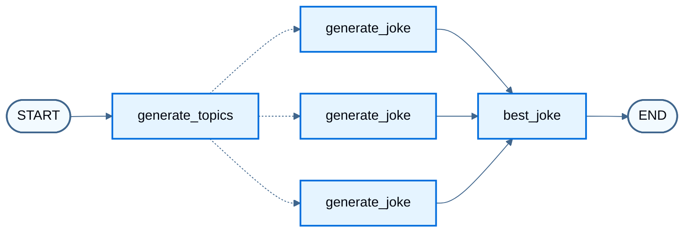
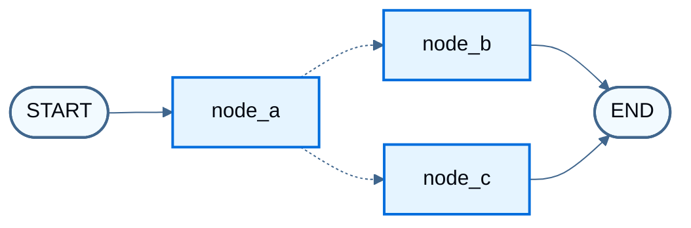

# Use Send and Command

> Build map-reduce workflows with Send and combine state updates with routing using Command in LangGraph.

[`Send`](https://reference.langchain.com/python/langgraph/types/Send) runs the same node once per item with a custom input when the item count is known only at runtime (map-reduce). [`Command`](https://reference.langchain.com/python/langgraph/types/Command) updates state and chooses the next node in one return. For ordinary sequences, branches, and loops, see [Control flow](Build%20sequences%2C%20branches%2C%20and%20loops.md). For concepts, see [Send](Graph%20API%20overview.md#send) and [Command](Graph%20API%20overview.md#command) on the Graph API overview.

## Use Send for map-reduce

Return one or more `Send` objects from a [conditional edge](Graph%20API%20overview.md#conditional-edges). Each `Send` names a target node and passes that invocation's input. LangGraph runs those invocations in parallel. When workers write the same state key, use a [reducer](Graph%20API%20overview.md#reducers) so updates merge (for example, concatenating lists).

The worker below does not receive the full graph state. `Send` passes `{ "subject": ... }` as that run's input, so the worker schema includes `subject` even though the overall state does not.

```python
import operator
from typing_extensions import Annotated, TypedDict

from langgraph.graph import END, START, StateGraph
from langgraph.types import Send


class OverallState(TypedDict):
    topic: str
    subjects: list[str]
    jokes: Annotated[list[str], operator.add]
    best_selected_joke: str


class JokeState(TypedDict):
    subject: str


def generate_topics(state: OverallState):
    return {"subjects": ["lions", "elephants", "penguins"]}


def generate_joke(state: JokeState):
    joke_map = {
        "lions": "Why don't lions like fast food? Because they can't catch it!",
        "elephants": "Why don't elephants use computers? They're afraid of the mouse!",
        "penguins": "Why don't penguins like talking to strangers at parties? Because they find it hard to break the ice.",
    }
    return {"jokes": [joke_map[state["subject"]]]}


def continue_to_jokes(state: OverallState):
    return [Send("generate_joke", {"subject": s}) for s in state["subjects"]]


def best_joke(state: OverallState):
    return {"best_selected_joke": "penguins"}


builder = StateGraph(OverallState)
builder.add_node("generate_topics", generate_topics)
builder.add_node("generate_joke", generate_joke)
builder.add_node("best_joke", best_joke)
builder.add_edge(START, "generate_topics")
builder.add_conditional_edges("generate_topics", continue_to_jokes, ["generate_joke"])
builder.add_edge("generate_joke", "best_joke")
builder.add_edge("best_joke", END)
graph = builder.compile()
```

```python
from IPython.display import Image, display

display(Image(graph.get_graph().draw_mermaid_png()))
```



Dashed edges are `Send` fan-out: one `generate_joke` invocation per subject.

Stream node updates (this example has no chat model, so there are no message tokens to iterate):

```python
for chunk in graph.stream({"topic": "animals"}, stream_mode="updates"):
    print(chunk)
```

```
{'generate_topics': {'subjects': ['lions', 'elephants', 'penguins']}}
{'generate_joke': {'jokes': ["Why don't lions like fast food? Because they can't catch it!"]}}
{'generate_joke': {'jokes': ["Why don't elephants use computers? They're afraid of the mouse!"]}}
{'generate_joke': {'jokes': ["Why don't penguins like talking to strangers at parties? Because they find it hard to break the ice."]}}
{'best_joke': {'best_selected_joke': 'penguins'}}
```

## Combine control flow and state updates with Command

Return a [Command](https://reference.langchain.com/python/langgraph/types/Command) from a node when that step must both update state and choose what runs next. For routing alone, prefer [conditional edges](Graph%20API%20overview.md#conditional-edges).

Shape of a `Command` return (full graph below):

```python
def my_node(state: State) -> Command[Literal["my_other_node"]]:
    return Command(
        # state update
        update={"foo": "bar"},
        # control flow
        goto="my_other_node",
    )
```

The end-to-end example uses three nodes: A, then B or C. Node A updates state and picks the next node with `Command`, so the graph has no conditional edges between A, B, and C.

```python
import random
from typing_extensions import Literal, TypedDict

from langgraph.graph import START, StateGraph
from langgraph.types import Command


class State(TypedDict):
    foo: str


def node_a(state: State) -> Command[Literal["node_b", "node_c"]]:
    print("Called A")
    value = random.choice(["b", "c"])
    goto = "node_b" if value == "b" else "node_c"

    return Command(
        update={"foo": value},
        goto=goto,
    )


def node_b(state: State):
    print("Called B")
    return {"foo": state["foo"] + "b"}


def node_c(state: State):
    print("Called C")
    return {"foo": state["foo"] + "c"}
```

Build the [`StateGraph`](https://reference.langchain.com/python/langgraph/graph/state/StateGraph). Control flow lives in `node_a`, so there are no [conditional edges](Graph%20API%20overview.md#conditional-edges) between A, B, and C.

```python
builder = StateGraph(State)
builder.add_edge(START, "node_a")
builder.add_node(node_a)
builder.add_node(node_b)
builder.add_node(node_c)
# No edges between nodes A, B, and C

graph = builder.compile()
```

> [!WARNING]
>
> Annotate the return type as [`Command`](https://reference.langchain.com/python/langgraph/types/Command) with the possible destinations, for example `Command[Literal["node_b", "node_c"]]`. That declaration is required for graph rendering and tells LangGraph that `node_a` can navigate to `node_b` and `node_c`.

```python
from IPython.display import Image, display

display(Image(graph.get_graph().draw_mermaid_png()))
```



Dashed edges are `Command` routes from `node_a`. Repeated invokes take different paths (A → B or A → C) based on the random choice in node A.

```python
graph.invoke({"foo": ""})
```

```
Called A
Called C
```

### Navigate to a node in a parent graph

From a node inside a [subgraph](../Capabilities/Subgraphs.md), route to a node in the parent graph with `graph=Command.PARENT`:

```python
def my_node(state: State) -> Command[Literal["other_subgraph"]]:
    return Command(
        update={"foo": "bar"},
        goto="other_subgraph",  # node in the parent graph
        graph=Command.PARENT,
    )
```

The example below turns node A into a single-node subgraph and adds it to a parent graph that still contains B and C.

> [!WARNING]
>
> **State updates with `Command.PARENT`**
> When a subgraph node updates a key that exists in both the parent and subgraph [state schemas](Graph%20API%20overview.md#schema), define a [reducer](Graph%20API%20overview.md#reducers) for that key on the parent. See the example below.

```python
import operator
import random
from typing_extensions import Annotated, TypedDict

from langgraph.graph import START, StateGraph
from langgraph.types import Command


class State(TypedDict):
    foo: Annotated[str, operator.add]  # [!code highlight]


def node_a(state: State) -> Command:
    print("Called A")
    value = random.choice(["a", "b"])
    goto = "node_b" if value == "a" else "node_c"

    return Command(
        update={"foo": value},
        goto=goto,
        # Closest parent graph relative to this subgraph
        graph=Command.PARENT,  # [!code highlight]
    )


subgraph = StateGraph(State).add_node(node_a).add_edge(START, "node_a").compile()


def node_b(state: State):
    print("Called B")
    # Reducer appends; do not manually concatenate onto state["foo"]
    return {"foo": "b"}  # [!code highlight]


def node_c(state: State):
    print("Called C")
    return {"foo": "c"}  # [!code highlight]


builder = StateGraph(State)
builder.add_edge(START, "subgraph")
builder.add_node("subgraph", subgraph)
builder.add_node(node_b)
builder.add_node(node_c)

graph = builder.compile()
```

```python
graph.invoke({"foo": ""})
```

```
Called A
Called C
```

### Use inside tools

Return `Command(update=...)` from a tool to write graph state (for example, customer lookup results) during a turn. The fragment below assumes `get_user_info` / `getUserInfo` and a message history key named `messages`. Complete the imports and helpers in your app.

```python
from langchain.messages import ToolMessage
from langchain.tools import tool, ToolRuntime
from langgraph.types import Command


@tool
def lookup_user_info(runtime: ToolRuntime):
    """Look up user information to better assist with questions."""
    user = runtime.server_info.user if runtime.server_info else None
    user_info = get_user_info(user.identity if user is not None else None)  # [!code highlight]
    return Command(
        update={
            "user_info": user_info,
            "messages": [
                ToolMessage(
                    "Successfully looked up user information",
                    tool_call_id=runtime.tool_call_id,
                )
            ],
        }
    )
```

> [!WARNING]
>
> When returning [`Command`](https://reference.langchain.com/python/langgraph/types/Command) from a tool, include `messages` (or whichever state key holds the message history) in `Command.update`, and that list must contain a `ToolMessage`. LLM providers require an AI message with tool calls to be followed by tool result messages.

For tools that return [`Command`](https://reference.langchain.com/python/langgraph/types/Command), prefer the prebuilt [`ToolNode`](https://reference.langchain.com/python/langgraph/agents/#langgraph.prebuilt.tool_node.ToolNode), which propagates those objects into graph state. In a custom tool-calling node, propagate [`Command`](https://reference.langchain.com/python/langgraph/types/Command) returns from tools yourself.

## Resume after an interrupt

Use `Command` as input to `invoke` / `stream` only to resume after an [interrupt](../Capabilities/Interrupts.md) (`resume=...`, optionally with `update` while resuming). Do not pass `Command(update=...)` alone to continue a conversation: any `Command` as input resumes from the latest checkpoint, not from `START`. Pass a plain state update to start a new turn.

For the full anti-pattern example, see [Input to invoke or stream](Graph%20API%20overview.md#input-to-invoke-or-stream). For interrupt patterns, see [Interrupts](../Capabilities/Interrupts.md).

## See also

* [Send](Graph%20API%20overview.md#send) and [Command](Graph%20API%20overview.md#command) on the Graph API overview
* [Interrupts](../Capabilities/Interrupts.md)
* [Control flow](Build%20sequences%2C%20branches%2C%20and%20loops.md)
* [Use subgraphs](../Capabilities/Subgraphs.md)
* [Configure nodes](Configure%20nodes.md)
