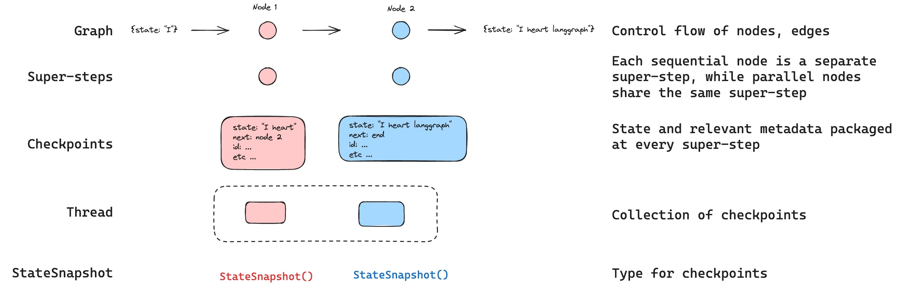
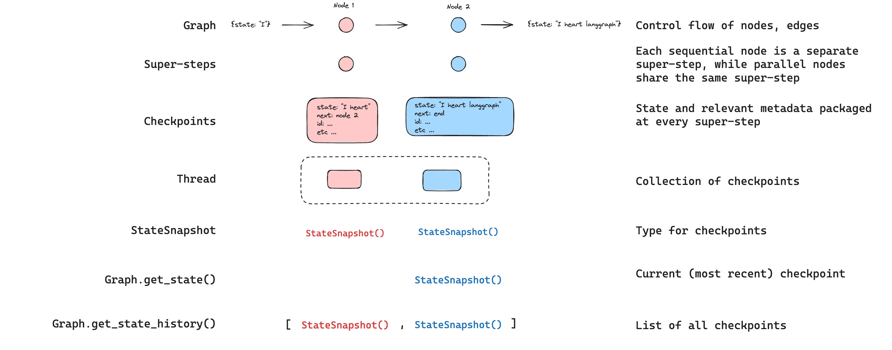
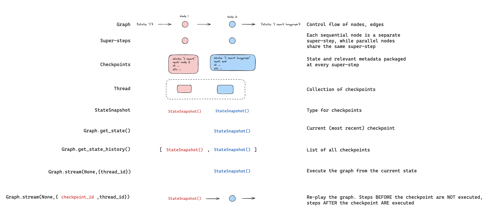
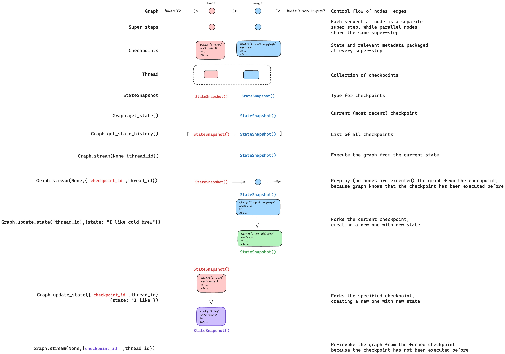

# Checkpointers

> LangGraph checkpointers save graph state as checkpoints at each step, enabling persistence, human-in-the-loop, and fault-tolerant execution.

A checkpointer saves a snapshot of graph state at each super-step, organized into **threads**. Compile a graph with a checkpointer to enable human-in-the-loop workflows, time travel debugging, fault-tolerant execution, and conversational memory.



> [!NOTE]
>
> **Agent Server handles checkpointing automatically**
> When using the [Agent Server](https://docs.langchain.com/langsmith/agent-server.md), you do not need to implement or configure checkpointers manually. The server handles all persistence infrastructure for you behind the scenes.

> [!TIP]
>
> Trace checkpointed state and debug how your agent resumes across sessions with [LangSmith](https://smith.langchain.com?utm_source=docs&utm_medium=cta&utm_campaign=langsmith-signup&utm_content=oss-langgraph-checkpointers). Follow the [tracing quickstart](https://docs.langchain.com/langsmith/trace-with-langgraph.md) to get set up.

## Why use checkpointers

Checkpointers are required for the following features:

* **Human-in-the-loop**: Checkpointers facilitate [human-in-the-loop workflows](Interrupts.md) by allowing humans to inspect, interrupt, and approve graph steps. Checkpointers are needed for these workflows as the person has to be able to view the state of a graph at any point in time, and the graph has to be able to resume execution after the person has made any updates to the state. See [Interrupts](Interrupts.md) for examples.
* **Memory**: Checkpointers allow for ["memory"](https://docs.langchain.com/oss/python/concepts/memory.md) between interactions. In the case of repeated human interactions (like conversations) any follow up messages can be sent to that thread, which will retain its memory of previous ones. See [Add memory](Memory.md) for information on how to add and manage conversation memory using checkpointers.
* **Time travel**: Checkpointers allow for ["time travel"](Use%20time-travel.md), allowing users to replay prior graph executions to review and / or debug specific graph steps. In addition, checkpointers make it possible to fork the graph state at arbitrary checkpoints to explore alternative trajectories.
* **Fault-tolerance**: Checkpointing provides fault-tolerance and error recovery: if one or more nodes fail at a given superstep, you can restart your graph from the last successful step.

- **Pending writes**: When a graph node fails mid-execution at a given [super-step](#super-steps), LangGraph stores pending checkpoint writes from any other nodes that completed successfully at that super-step. When you resume graph execution from that super-step you don't re-run the successful nodes.

## Core concepts

### Threads

A thread is a unique ID or thread identifier assigned to each checkpoint saved by a checkpointer. It contains the accumulated state of a sequence of [runs](https://docs.langchain.com/langsmith/runs.md). When a run is executed, the [state](../Build%20with%20the%20Graph%20API/Graph%20API%20overview.md#state) of the underlying graph of the assistant will be persisted to the thread.

When invoking a graph with a checkpointer, you **must** specify a `thread_id` as part of the `configurable` portion of the config:

```python
{"configurable": {"thread_id": "1"}}
```

A thread's current and historical state can be retrieved. To persist state, a thread must be created prior to executing a run. The LangSmith API provides several endpoints for creating and managing threads and thread state. See the [API reference](https://reference.langchain.com/python/langsmith/) for more details.

The checkpointer uses `thread_id` as the primary key for storing and retrieving checkpoints. Without it, the checkpointer cannot save state or resume execution after an [interrupt](Interrupts.md), since the checkpointer uses `thread_id` to load the saved state.

#### Choose how to continue a thread

The `thread_id` identifies saved state. The input and `checkpoint_id` determine whether an invocation starts new work, resumes unfinished work, or replays history. Reusing a thread ID alone does not mean that execution resumes.

With a checkpointer and an existing thread, choose the invocation for your goal:

| Goal | Invocation | Execution |
| - | - | - |
| Submit new input | `graph.invoke(input, config)` | Applies the input to saved state and starts from the entry point. |
| Continue after an error | `graph.invoke(None, config)` | Loads the latest checkpoint and retries unfinished work. Omit `checkpoint_id`. |
| Answer an `interrupt()` | `graph.invoke(Command(resume=answer), config)` | Supplies the interrupt's return value. The interrupted node starts again from its beginning. |
| Replay history | `graph.invoke(None, snapshot.config)` | Uses a snapshot from `get_state_history()` and re-executes nodes after that checkpoint. |

New input does not clear the thread. LangGraph applies it using the state's [reducers](../Build%20with%20the%20Graph%20API/Graph%20API%20overview.md#reducers). Use a new `thread_id` to start with empty state.

Resume returns the saved result without running nodes when the latest checkpoint has no unfinished work. For runnable examples, see [Functional API error recovery](../Advanced/Build%20with%20the%20Functional%20API/Configure%20Functional%20API%20tasks.md#resume-after-an-error), [resuming interrupts](Interrupts.md#resuming-interrupts), and [replaying history](Use%20time-travel.md#replay).

### Checkpoints

The state of a thread at a particular point in time is called a checkpoint. A checkpoint is a snapshot of the graph state saved at each [super-step](#super-steps) and is represented by a `StateSnapshot` object (see [StateSnapshot fields](#statesnapshot-fields) for the full field reference).

#### Super-steps

LangGraph creates a checkpoint at each **super-step** boundary. A super-step is a single "tick" of the graph where all nodes scheduled for that step execute (potentially in parallel). For a sequential graph like `START -> A -> B -> END`, there are separate super-steps for the input, node A, and node B — producing a checkpoint after each one. Understanding super-step boundaries is important for [time travel](Use%20time-travel.md), because you can only resume execution from a checkpoint (i.e., a super-step boundary).

In addition to super-step checkpoints, LangGraph also persists writes at the **node (task) level**. As each node within a super-step finishes, its outputs are written to the checkpointer's `checkpoint_writes` table as task entries linked to the in-progress checkpoint. These per-task writes are what enable [pending writes](#pending-writes) recovery: if another node in the same super-step fails, the successful nodes' writes are already durable and don't need to be re-run on resume. The full state snapshot is then committed once the super-step completes.

LangGraph also persists writes from individual node executions within a super-step. These writes are stored as tasks and used for fault tolerance: if another node in the same super-step fails, successful node writes do not need to be recomputed when you resume. These task writes are not full `StateSnapshot` checkpoints, so time travel resumes from full checkpoints at super-step boundaries.

Checkpoints are persisted and can be used to restore the state of a thread at a later time.

Let's see what checkpoints are saved when a simple graph is invoked as follows:

```python
from langgraph.graph import StateGraph, START, END
from langgraph.checkpoint.memory import InMemorySaver
from langchain_core.runnables import RunnableConfig
from typing import Annotated
from typing_extensions import TypedDict
from operator import add

class State(TypedDict):
    foo: str
    bar: Annotated[list[str], add]

def node_a(state: State):
    return {"foo": "a", "bar": ["a"]}

def node_b(state: State):
    return {"foo": "b", "bar": ["b"]}


workflow = StateGraph(State)
workflow.add_node(node_a)
workflow.add_node(node_b)
workflow.add_edge(START, "node_a")
workflow.add_edge("node_a", "node_b")
workflow.add_edge("node_b", END)

checkpointer = InMemorySaver()
graph = workflow.compile(checkpointer=checkpointer)

config: RunnableConfig = {"configurable": {"thread_id": "1"}}
graph.invoke({"foo": "", "bar":[]}, config)
```

After you run the graph, there will be exactly 4 checkpoints:

* Empty checkpoint with [`START`](https://reference.langchain.com/python/langgraph/constants/START) as the next node to be executed
* Checkpoint with the user input `{'foo': '', 'bar': []}` and `node_a` as the next node to be executed
* Checkpoint with the outputs of `node_a` `{'foo': 'a', 'bar': ['a']}` and `node_b` as the next node to be executed
* Checkpoint with the outputs of `node_b` `{'foo': 'b', 'bar': ['a', 'b']}` and no next nodes to be executed

Note that the `bar` channel values contain outputs from both nodes because this example has a reducer for the `bar` channel.

#### Checkpoint namespace

Each checkpoint has a `checkpoint_ns` (checkpoint namespace) field that identifies which graph or subgraph it belongs to:

* **`""`** (empty string): The checkpoint belongs to the parent (root) graph.
* **`"node_name:uuid"`**: The checkpoint belongs to a subgraph invoked as the given node. For nested subgraphs, namespaces are joined with `|` separators (e.g., `"outer_node:uuid|inner_node:uuid"`).

You can access the checkpoint namespace from within a node via the config:

```python
from langchain_core.runnables import RunnableConfig

def my_node(state: State, config: RunnableConfig):
    checkpoint_ns = config["configurable"]["checkpoint_ns"]
    # "" for the parent graph, "node_name:uuid" for a subgraph
```

See [Subgraphs](Subgraphs.md) for more details on working with subgraph state and checkpoints.

## Get and update state

### Get state

When interacting with the saved graph state, you **must** specify a [thread identifier](#threads). You can view the *latest* state of the graph by calling `graph.get_state(config)`. This will return a `StateSnapshot` object that corresponds to the latest checkpoint associated with the thread ID provided in the config or a checkpoint associated with a checkpoint ID for the thread, if provided.

```python
# get the latest state snapshot
config = {"configurable": {"thread_id": "1"}}
graph.get_state(config)

# get a state snapshot for a specific checkpoint_id
config = {"configurable": {"thread_id": "1", "checkpoint_id": "1ef663ba-28fe-6528-8002-5a559208592c"}}
graph.get_state(config)
```

In this example, the output of `get_state` will look like this:

```
StateSnapshot(
    values={'foo': 'b', 'bar': ['a', 'b']},
    next=(),
    config={'configurable': {'thread_id': '1', 'checkpoint_ns': '', 'checkpoint_id': '1ef663ba-28fe-6528-8002-5a559208592c'}},
    metadata={'source': 'loop', 'writes': {'node_b': {'foo': 'b', 'bar': ['b']}}, 'step': 2},
    created_at='2024-08-29T19:19:38.821749+00:00',
    parent_config={'configurable': {'thread_id': '1', 'checkpoint_ns': '', 'checkpoint_id': '1ef663ba-28f9-6ec4-8001-31981c2c39f8'}},
    tasks=()
)
```

#### StateSnapshot fields

| Field | Type | Description |
| - | - | - |
| `values` | `dict` | State channel values at this checkpoint. |
| `next` | `tuple[str, ...]` | Node names to execute next. Empty `()` means the graph is complete. |
| `config` | `dict` | Contains `thread_id`, `checkpoint_ns`, and `checkpoint_id`. |
| `metadata` | `dict` | Execution metadata. Contains `source` (`"input"`, `"loop"`, or `"update"`), `writes` (node outputs), and `step` (super-step counter). |
| `created_at` | `str` | ISO 8601 timestamp of when this checkpoint was created. |
| `parent_config` | `dict \| None` | Config of the previous checkpoint. `None` for the first checkpoint. |
| `tasks` | `tuple[PregelTask, ...]` | Tasks to execute at this step. Each task has `id`, `name`, `error`, `interrupts`, and optionally `state` (subgraph snapshot, when using `subgraphs=True`). |

### Get state history

You can get the full history of the graph execution for a given thread by calling [`graph.get_state_history(config)`](https://reference.langchain.com/python/langgraph/graphs/#langgraph.graph.state.CompiledStateGraph.get_state_history). This will return a list of `StateSnapshot` objects associated with the thread ID provided in the config. Importantly, the checkpoints will be ordered chronologically with the most recent checkpoint / `StateSnapshot` being the first in the list.

```python
config = {"configurable": {"thread_id": "1"}}
list(graph.get_state_history(config))
```

In this example, the output of [`get_state_history`](https://reference.langchain.com/python/langgraph/graphs/#langgraph.graph.state.CompiledStateGraph.get_state_history) will look like this:

```
[
    StateSnapshot(
        values={'foo': 'b', 'bar': ['a', 'b']},
        next=(),
        config={'configurable': {'thread_id': '1', 'checkpoint_ns': '', 'checkpoint_id': '1ef663ba-28fe-6528-8002-5a559208592c'}},
        metadata={'source': 'loop', 'writes': {'node_b': {'foo': 'b', 'bar': ['b']}}, 'step': 2},
        created_at='2024-08-29T19:19:38.821749+00:00',
        parent_config={'configurable': {'thread_id': '1', 'checkpoint_ns': '', 'checkpoint_id': '1ef663ba-28f9-6ec4-8001-31981c2c39f8'}},
        tasks=(),
    ),
    StateSnapshot(
        values={'foo': 'a', 'bar': ['a']},
        next=('node_b',),
        config={'configurable': {'thread_id': '1', 'checkpoint_ns': '', 'checkpoint_id': '1ef663ba-28f9-6ec4-8001-31981c2c39f8'}},
        metadata={'source': 'loop', 'writes': {'node_a': {'foo': 'a', 'bar': ['a']}}, 'step': 1},
        created_at='2024-08-29T19:19:38.819946+00:00',
        parent_config={'configurable': {'thread_id': '1', 'checkpoint_ns': '', 'checkpoint_id': '1ef663ba-28f4-6b4a-8000-ca575a13d36a'}},
        tasks=(PregelTask(id='6fb7314f-f114-5413-a1f3-d37dfe98ff44', name='node_b', error=None, interrupts=()),),
    ),
    StateSnapshot(
        values={'foo': '', 'bar': []},
        next=('node_a',),
        config={'configurable': {'thread_id': '1', 'checkpoint_ns': '', 'checkpoint_id': '1ef663ba-28f4-6b4a-8000-ca575a13d36a'}},
        metadata={'source': 'loop', 'writes': None, 'step': 0},
        created_at='2024-08-29T19:19:38.817813+00:00',
        parent_config={'configurable': {'thread_id': '1', 'checkpoint_ns': '', 'checkpoint_id': '1ef663ba-28f0-6c66-bfff-6723431e8481'}},
        tasks=(PregelTask(id='f1b14528-5ee5-579c-949b-23ef9bfbed58', name='node_a', error=None, interrupts=()),),
    ),
    StateSnapshot(
        values={'bar': []},
        next=('__start__',),
        config={'configurable': {'thread_id': '1', 'checkpoint_ns': '', 'checkpoint_id': '1ef663ba-28f0-6c66-bfff-6723431e8481'}},
        metadata={'source': 'input', 'writes': {'foo': ''}, 'step': -1},
        created_at='2024-08-29T19:19:38.816205+00:00',
        parent_config=None,
        tasks=(PregelTask(id='6d27aa2e-d72b-5504-a36f-8620e54a76dd', name='__start__', error=None, interrupts=()),),
    )
]
```



#### Find a specific checkpoint

You can filter the state history to find checkpoints matching specific criteria:

```python
history = list(graph.get_state_history(config))

# Find the checkpoint before a specific node executed
before_node_b = next(s for s in history if s.next == ("node_b",))

# Find a checkpoint by step number
step_2 = next(s for s in history if s.metadata["step"] == 2)

# Find checkpoints created by update_state
forks = [s for s in history if s.metadata["source"] == "update"]

# Find the checkpoint where an interrupt occurred
interrupted = next(
    s for s in history
    if s.tasks and any(t.interrupts for t in s.tasks)
)
```

#### List every thread

To see every thread a checkpointer holds state for, for example, to build an admin or debugging view, omit `thread_id` when listing checkpoints:

`graph.get_state_history(config)` requires a `thread_id` in `config` and only returns history for one thread. Call `.list` on the same checkpointer you passed to `compile`, with `config=None`:

```python
# config=None returns checkpoints across every thread
for checkpoint_tuple in checkpointer.list(None):
    print(checkpoint_tuple.config["configurable"]["thread_id"])
```

Pass `None`, not `{}`. [`SqliteSaver`](https://reference.langchain.com/python/langgraph/checkpoints/#langgraph.checkpoint.sqlite.SqliteSaver) treats any non-`None` config as a thread filter and raises if `thread_id` is missing. For async graphs, use `.alist(None)` instead. This works with [`InMemorySaver`](https://reference.langchain.com/python/langgraph/checkpoints/#langgraph.checkpoint.memory.InMemorySaver), [`SqliteSaver`](https://reference.langchain.com/python/langgraph/checkpoints/#langgraph.checkpoint.sqlite.SqliteSaver), and [`PostgresSaver`](https://reference.langchain.com/python/langgraph/checkpoints/#langgraph.checkpoint.postgres.PostgresSaver). `.list` still returns one row per checkpoint, not per thread, so group by `thread_id` yourself to build a thread list.

### Replay

Replay re-executes steps from a prior checkpoint. Invoke the graph with a prior `checkpoint_id` to re-run nodes after that checkpoint. Nodes before the checkpoint are skipped (their results are already saved). Nodes after the checkpoint re-execute, including any LLM calls, API requests, or [interrupts](Interrupts.md) — which are always re-triggered during replay.

See [Time travel](Use%20time-travel.md) for full details and code examples on replaying past executions.



### Update state

You can edit the graph state using [`update_state`](https://reference.langchain.com/python/langgraph/graphs/#langgraph.graph.state.CompiledStateGraph.update_state). This creates a new checkpoint with the updated values — it does not modify the original checkpoint. The update is treated the same as a node update: values are passed through [reducer](../Build%20with%20the%20Graph%20API/Graph%20API%20overview.md#reducers) functions when defined, so channels with reducers *accumulate* values rather than overwrite them.

You can optionally specify `as_node` to control which node the update is treated as coming from, which affects which node executes next. See [Time travel: `as_node`](Use%20time-travel.md#from-a-specific-node) for details.



## Durability modes

LangGraph supports three durability modes that let you balance performance and data consistency. You can specify the durability mode when calling any graph execution method:

```python
graph.stream(
    {"input": "test"},
    durability="sync"
)
```

The durability modes, from least to most durable, are as follows:

* `"exit"`: LangGraph persists changes only when graph execution exits — successfully, with an error, or due to a human-in-the-loop interrupt. This provides the best performance for long-running graphs but means intermediate state is not saved, so you cannot recover from system failures (like process crashes) mid-execution.

* `"async"`: LangGraph persists changes asynchronously while the next step executes. This provides good performance and durability, but there is a small risk that LangGraph does not write checkpoints if the process crashes during execution.

* `"sync"`: LangGraph persists changes synchronously before the next step starts. This ensures that LangGraph writes every checkpoint before continuing execution, providing high durability at the cost of some performance overhead.

### First durable checkpoint on a new thread

For a new thread, the durability mode also determines which checkpoints are committed before the first user node executes. The internal `__start__` superstep runs first; step `0` is the loop checkpoint written after that superstep.

* `"exit"`: No checkpoint exists until the run ends. A crash during the run leaves no record of the thread.

* `"async"`: LangGraph starts writing the input checkpoint before the first user node executes, but does not wait for the write to finish. The first user node can run before any checkpoint is committed.

* `"sync"`: LangGraph commits the input checkpoint (step `-1`) and the step `0` checkpoint before the first user node executes.

> [!WARNING]
>
> In every mode, a crash before the first checkpoint becomes durable leaves the thread indistinguishable from a thread that was never invoked: `get_tuple()` returns `None` in both cases, and `invoke(None, config)` raises `EmptyInputError`. If you need to distinguish "never accepted" from "accepted but lost", record admission outside the checkpointer, for example by committing an outbox row to your own store before you call `invoke`.

## Optimize checkpoint storage

By default, LangGraph checkpoints write the full value of every state channel at each super-step. For long-running threads with large accumulations—such as multi-turn conversations—this can produce significant storage growth over time.

[`DeltaChannel`](https://reference.langchain.com/python/langgraph/channels/delta/DeltaChannel) stores only incremental deltas instead of the full accumulated value, substantially reducing checkpoint size for append-heavy channels. See [DeltaChannel](../Advanced/LangGraph%20runtime.md#deltachannel) for usage and the storage-vs-latency tradeoff.

> [!WARNING]
>
> `DeltaChannel` requires `langgraph>=1.2` and is currently in beta. The API may change in future releases.

## Checkpointer libraries

Under the hood, checkpointing is powered by checkpointer objects that conform to [`BaseCheckpointSaver`](https://reference.langchain.com/python/langgraph/checkpoints/#langgraph.checkpoint.base.BaseCheckpointSaver) interface. LangGraph provides several checkpointer implementations, all implemented via standalone, installable libraries.

> [!NOTE]
>
> See [checkpointer integrations](https://docs.langchain.com/oss/python/integrations/checkpointers/index.md) for available providers.

* `langgraph-checkpoint`: The base interface for checkpointer savers ([`BaseCheckpointSaver`](https://reference.langchain.com/python/langgraph/checkpoints/#langgraph.checkpoint.base.BaseCheckpointSaver)) and serialization/deserialization interface ([`SerializerProtocol`](https://reference.langchain.com/python/langgraph/checkpoints/#langgraph.checkpoint.serde.base.SerializerProtocol)). Includes in-memory checkpointer implementation ([`InMemorySaver`](https://reference.langchain.com/python/langgraph/checkpoints/#langgraph.checkpoint.memory.InMemorySaver)) for experimentation. LangGraph comes with `langgraph-checkpoint` included.
* `langgraph-checkpoint-sqlite`: An implementation of LangGraph checkpointer that uses SQLite database ([`SqliteSaver`](https://reference.langchain.com/python/langgraph/checkpoints/#langgraph.checkpoint.sqlite.SqliteSaver) / [`AsyncSqliteSaver`](https://reference.langchain.com/python/langgraph/checkpoints/#langgraph.checkpoint.sqlite.aio.AsyncSqliteSaver)). Ideal for experimentation and local workflows. Needs to be installed separately.
* `langgraph-checkpoint-postgres`: An advanced checkpointer that uses Postgres database ([`PostgresSaver`](https://reference.langchain.com/python/langgraph/checkpoints/#langgraph.checkpoint.postgres.PostgresSaver) / [`AsyncPostgresSaver`](https://reference.langchain.com/python/langgraph/checkpoints/#langgraph.checkpoint.postgres.aio.AsyncPostgresSaver)), used in LangSmith. Ideal for using in production. Needs to be installed separately.
* `langgraph-checkpoint-mongodb`: An advanced checkpointer that uses MongoDB (`MongoDBSaver` / `AsyncMongoDBSaver`). Ideal for using in production. Needs to be installed separately.
* `langchain-azure-cosmosdb`: An implementation of LangGraph checkpointer that uses Azure Cosmos DB for NoSQL ([`CosmosDBSaverSync`](https://reference.langchain.com/python/langchain-azure-cosmosdb/) / [`CosmosDBSaver`](https://reference.langchain.com/python/langchain-azure-cosmosdb/)). Ideal for using in production with Azure. Supports both sync and async operations, with Microsoft Entra ID authentication. Needs to be installed separately.

### Checkpointer interface

Each checkpointer conforms to [`BaseCheckpointSaver`](https://reference.langchain.com/python/langgraph/checkpoints/#langgraph.checkpoint.base.BaseCheckpointSaver) interface and implements the following methods:

* `.put` - Store a checkpoint with its configuration and metadata.
* `.put_writes` - Store intermediate writes linked to a checkpoint (i.e. [pending writes](#pending-writes)).
* `.get_tuple` - Fetch a checkpoint tuple using for a given configuration (`thread_id` and `checkpoint_id`). This is used to populate `StateSnapshot` in `graph.get_state()`.
* `.list` - List checkpoints that match a given configuration and filter criteria. This is used to populate state history in `graph.get_state_history()`. Pass `config=None` to list checkpoints across every thread. See [List every thread](#list-every-thread).

If the checkpointer is used with asynchronous graph execution (i.e. executing the graph via `.ainvoke`, `.astream`, `.abatch`), asynchronous versions of the above methods will be used (`.aput`, `.aput_writes`, `.aget_tuple`, `.alist`).

> [!NOTE]
>
> For running your graph asynchronously, you can use [`InMemorySaver`](https://reference.langchain.com/python/langgraph/checkpoints/#langgraph.checkpoint.memory.InMemorySaver), or async versions of Sqlite/Postgres checkpointers -- [`AsyncSqliteSaver`](https://reference.langchain.com/python/langgraph/checkpoints/#langgraph.checkpoint.sqlite.aio.AsyncSqliteSaver) / [`AsyncPostgresSaver`](https://reference.langchain.com/python/langgraph/checkpoints/#langgraph.checkpoint.postgres.aio.AsyncPostgresSaver) checkpointers.

### Serializer

When checkpointers save the graph state, they need to serialize the channel values in the state. This is done using serializer objects.

`langgraph_checkpoint` defines [protocol](https://reference.langchain.com/python/langgraph/checkpoints/#langgraph.checkpoint.serde.base.SerializerProtocol) for implementing serializers provides a default implementation ([`JsonPlusSerializer`](https://reference.langchain.com/python/langgraph/checkpoints/#langgraph.checkpoint.serde.jsonplus.JsonPlusSerializer)) that handles a wide variety of types, including LangChain and LangGraph primitives, datetimes, enums and more.

#### Serialization with `pickle`

The default serializer, [`JsonPlusSerializer`](https://reference.langchain.com/python/langgraph/checkpoints/#langgraph.checkpoint.serde.jsonplus.JsonPlusSerializer), uses ormsgpack and JSON under the hood, which is not suitable for all types of objects.

If you want to fallback to pickle for objects not currently supported by the msgpack encoder (such as Pandas dataframes),
you can use the `pickle_fallback` argument of the [`JsonPlusSerializer`](https://reference.langchain.com/python/langgraph/checkpoints/#langgraph.checkpoint.serde.jsonplus.JsonPlusSerializer):

```python
from langgraph.checkpoint.memory import InMemorySaver
from langgraph.checkpoint.serde.jsonplus import JsonPlusSerializer

# ... Define the graph ...
graph.compile(
    checkpointer=InMemorySaver(serde=JsonPlusSerializer(pickle_fallback=True))
)
```

#### Encryption

Checkpointers can optionally encrypt all persisted state. To enable this, pass an instance of [`EncryptedSerializer`](https://reference.langchain.com/python/langgraph/checkpoints/#langgraph.checkpoint.serde.encrypted.EncryptedSerializer) to the `serde` argument of any [`BaseCheckpointSaver`](https://reference.langchain.com/python/langgraph/checkpoints/#langgraph.checkpoint.base.BaseCheckpointSaver) implementation. The easiest way to create an encrypted serializer is via [`from_pycryptodome_aes`](https://reference.langchain.com/python/langgraph/checkpoints/#langgraph.checkpoint.serde.encrypted.EncryptedSerializer.from_pycryptodome_aes), which reads the AES key from the `LANGGRAPH_AES_KEY` environment variable (or accepts a `key` argument):

```python
import sqlite3

from langgraph.checkpoint.serde.encrypted import EncryptedSerializer
from langgraph.checkpoint.sqlite import SqliteSaver

serde = EncryptedSerializer.from_pycryptodome_aes()  # reads LANGGRAPH_AES_KEY
checkpointer = SqliteSaver(sqlite3.connect("checkpoint.db"), serde=serde)
```

```python
from langgraph.checkpoint.serde.encrypted import EncryptedSerializer
from langgraph.checkpoint.postgres import PostgresSaver

serde = EncryptedSerializer.from_pycryptodome_aes()
checkpointer = PostgresSaver.from_conn_string("postgresql://...", serde=serde)
checkpointer.setup()
```

When running on LangSmith, encryption is automatically enabled whenever `LANGGRAPH_AES_KEY` is present, so you only need to provide the environment variable. Other encryption schemes can be used by implementing [`CipherProtocol`](https://reference.langchain.com/python/langgraph/checkpoints/#langgraph.checkpoint.serde.base.CipherProtocol) and supplying it to [`EncryptedSerializer`](https://reference.langchain.com/python/langgraph/checkpoints/#langgraph.checkpoint.serde.encrypted.EncryptedSerializer).

## Build a custom checkpointer

> [!TIP]
>
> Validate your implementation as you build using the [conformance test suite](#testing-with-the-conformance-suite). It covers all five base methods and extended capabilities including delta channels. Run it in CI before shipping.

This section covers implementing `BaseCheckpointSaver` from scratch for a custom storage backend. If you already have a working checkpointer and only need to add delta channel support, jump to [Delta channel support](#delta-channel-support).

### Overview

LangGraph's persistence layer is built on two storage abstractions:

* **Checkpoints table** — one row per superstep; stores the serialized graph state (`channel_values`, `channel_versions`, `versions_seen`) and links to its parent checkpoint.
* **Writes table** — one row per node output within a superstep; stores `(task_id, channel, value)` tuples linked to a checkpoint.

Your checkpointer manages both tables. `put` writes a checkpoint row; `put_writes` writes node-output rows; `get_tuple` reads both back into a `CheckpointTuple`.

### Base contract

Subclass `BaseCheckpointSaver` and implement these five methods. All are required — a missing base method raises `NotImplementedError` at runtime.

```python
from collections.abc import AsyncIterator, Iterator, Sequence
from typing import Any
from langchain_core.runnables import RunnableConfig
from langgraph.checkpoint.base import (
    BaseCheckpointSaver,
    ChannelVersions,
    Checkpoint,
    CheckpointMetadata,
    CheckpointTuple,
)

class MyCheckpointer(BaseCheckpointSaver):
    async def aput(
        self,
        config: RunnableConfig,
        checkpoint: Checkpoint,
        metadata: CheckpointMetadata,
        new_versions: ChannelVersions,
    ) -> RunnableConfig:
        ...

    async def aput_writes(
        self,
        config: RunnableConfig,
        writes: Sequence[tuple[str, Any]],
        task_id: str,
        task_path: str = "",
    ) -> None:
        ...

    async def aget_tuple(self, config: RunnableConfig) -> CheckpointTuple | None:
        ...

    async def alist(
        self,
        config: RunnableConfig | None,
        *,
        filter: dict[str, Any] | None = None,
        before: RunnableConfig | None = None,
        limit: int | None = None,
    ) -> AsyncIterator[CheckpointTuple]:
        ...
        yield  # make this an async generator

    async def adelete_thread(self, thread_id: str) -> None:
        ...
```

#### put / aput

Store one checkpoint row. Return an updated config with the stored `checkpoint_id`.

Key requirements:

* Serialize the checkpoint using `self.serde.dumps_typed(checkpoint)` — this handles all LangGraph-native types including `_DeltaSnapshot` blobs used by delta channels.
* Store `metadata` in full — do not strip unknown keys. LangGraph adds new metadata fields (such as `counters_since_delta_snapshot` for delta channels) in minor releases; discarding them silently breaks features.
* Store `config["configurable"].get("checkpoint_id")` as the parent checkpoint ID so `get_tuple` can populate `parent_config`.

```python
async def aput(self, config, checkpoint, metadata, new_versions):
    thread_id = config["configurable"]["thread_id"]
    checkpoint_ns = config["configurable"]["checkpoint_ns"]
    checkpoint_id = checkpoint["id"]
    parent_id = config["configurable"].get("checkpoint_id")

    type_, blob = self.serde.dumps_typed(checkpoint)
    serialized_metadata = self.serde.dumps_typed(metadata)

    await self.db.execute(
        "INSERT INTO checkpoints (...) VALUES (...)",
        thread_id, checkpoint_ns, checkpoint_id, parent_id,
        type_, blob, *serialized_metadata,
    )
    return {
        "configurable": {
            "thread_id": thread_id,
            "checkpoint_ns": checkpoint_ns,
            "checkpoint_id": checkpoint_id,
        }
    }
```

#### put\_writes / aput\_writes

Store node-output rows for a single task within the current superstep. These rows are linked to the checkpoint by `(thread_id, checkpoint_ns, checkpoint_id)`.

```python
async def aput_writes(self, config, writes, task_id, task_path=""):
    thread_id = config["configurable"]["thread_id"]
    checkpoint_ns = config["configurable"]["checkpoint_ns"]
    checkpoint_id = config["configurable"]["checkpoint_id"]

    rows = []
    for idx, (channel, value) in enumerate(writes):
        type_, blob = self.serde.dumps_typed(value)
        final_idx = WRITES_IDX_MAP.get(channel, idx)
        rows.append((thread_id, checkpoint_ns, checkpoint_id,
                      task_id, task_path, final_idx, channel, type_, blob))

    await self.db.executemany("INSERT INTO writes (...) VALUES (...)", rows)
```

Import `WRITES_IDX_MAP` from `langgraph.checkpoint.base`. It maps special channels (`__error__`, `__interrupt__`, etc.) to reserved negative indices so they do not collide with regular write indices.

#### get\_tuple / aget\_tuple

Retrieve a checkpoint. The config may contain:

* **No `checkpoint_id`** — return the latest checkpoint for the thread + namespace.
* **A specific `checkpoint_id`** — return that exact checkpoint.

**Both paths must work correctly.** The specific-id path is used for time travel and — critically — for delta channel state reconstruction on every graph invocation (see [Delta channel support](#delta-channel-support)). A broken specific-id lookup silently corrupts delta channel state.

```python
async def aget_tuple(self, config):
    thread_id = config["configurable"]["thread_id"]
    checkpoint_ns = config["configurable"].get("checkpoint_ns", "")
    checkpoint_id = config["configurable"].get("checkpoint_id")

    if checkpoint_id:
        row = await self.db.fetchone(
            "SELECT * FROM checkpoints "
            "WHERE thread_id=? AND checkpoint_ns=? AND checkpoint_id=?",
            thread_id, checkpoint_ns, checkpoint_id,
        )
    else:
        row = await self.db.fetchone(
            "SELECT * FROM checkpoints "
            "WHERE thread_id=? AND checkpoint_ns=? "
            "ORDER BY checkpoint_id DESC LIMIT 1",
            thread_id, checkpoint_ns,
        )

    if row is None:
        return None

    writes = await self.db.fetchall(
        "SELECT task_id, channel, type, value FROM writes "
        "WHERE thread_id=? AND checkpoint_ns=? AND checkpoint_id=? "
        "ORDER BY task_id, idx",
        thread_id, checkpoint_ns, row["checkpoint_id"],
    )
    pending_writes = [
        (w["task_id"], w["channel"], self.serde.loads_typed((w["type"], w["value"])))
        for w in writes
    ]

    checkpoint = self.serde.loads_typed((row["type"], row["blob"]))
    metadata = self.serde.loads_typed((row["metadata_type"], row["metadata"]))

    parent_config = None
    if row["parent_checkpoint_id"]:
        parent_config = {
            "configurable": {
                "thread_id": thread_id,
                "checkpoint_ns": checkpoint_ns,
                "checkpoint_id": row["parent_checkpoint_id"],
            }
        }

    return CheckpointTuple(
        config={
            "configurable": {
                "thread_id": thread_id,
                "checkpoint_ns": checkpoint_ns,
                "checkpoint_id": row["checkpoint_id"],
            }
        },
        checkpoint=checkpoint,
        metadata=metadata,
        parent_config=parent_config,
        pending_writes=pending_writes,
    )
```

> [!WARNING]
>
> **Row key / index design matters for the specific-id lookup.** If your storage uses a time-ordered key (e.g., a reversed timestamp) that does not embed `checkpoint_id`, you cannot do a direct row read by id. You must either encode `checkpoint_id` in the row key, or build a secondary index. A scan with a value filter on every lookup works but does not scale.

#### list / alist

Return checkpoints for a thread, newest first. Respect `before` (return only checkpoints older than that config's `checkpoint_id`) and `limit`.

#### delete\_thread / adelete\_thread

Delete all checkpoints and writes for a thread. Both checkpoint rows and write rows must be deleted.

### Row key / index design

How you store and index checkpoints directly affects correctness and performance.

**Recommended schema (SQL):**

```sql
CREATE TABLE checkpoints (
    thread_id          TEXT NOT NULL,
    checkpoint_ns      TEXT NOT NULL DEFAULT '',
    checkpoint_id      TEXT NOT NULL,   -- ULID, lexicographically sortable newest-last
    parent_checkpoint_id TEXT,
    type               TEXT,
    checkpoint         BYTEA,
    metadata           JSONB,
    PRIMARY KEY (thread_id, checkpoint_ns, checkpoint_id)
);

CREATE TABLE writes (
    thread_id     TEXT NOT NULL,
    checkpoint_ns TEXT NOT NULL DEFAULT '',
    checkpoint_id TEXT NOT NULL,
    task_id       TEXT NOT NULL,
    task_path     TEXT NOT NULL DEFAULT '',
    idx           INTEGER NOT NULL,
    channel       TEXT NOT NULL,
    type          TEXT,
    value         BYTEA,
    PRIMARY KEY (thread_id, checkpoint_ns, checkpoint_id, task_id, task_path, idx)
);
```

Because `checkpoint_id` is a ULID, it sorts lexicographically — larger values are newer. "Get latest" is `ORDER BY checkpoint_id DESC LIMIT 1`; "get by id" is an equality lookup on the primary key.

**For non-SQL stores:** the same principle applies. Whatever key scheme you use, direct lookup by `(thread_id, checkpoint_ns, checkpoint_id)` must be O(1) or close to it. Avoid designs where the only way to find a checkpoint by id is to scan all rows for a thread.

### Serialization

Always use `self.serde` (inherited from `BaseCheckpointSaver`, defaults to `JsonPlusSerializer`) for checkpoints, writes, and metadata. Do not use `pickle` directly for metadata — it works, but `JsonPlusSerializer` produces human-readable output and handles versioning better.

`JsonPlusSerializer` handles all LangGraph-native types automatically:

* `_DeltaSnapshot` — the sentinel blob used by delta channels (msgpack ext code 7)
* Pydantic v2 models, dataclasses, numpy arrays, datetimes, enums, and more

If you write a custom serializer, make sure it can round-trip `_DeltaSnapshot` from `langgraph.checkpoint.serde.types`.

### Extended capabilities

These methods are optional but unlock additional Agent Server features. Implement them if your storage backend can support them efficiently.

| Method | What it enables |
| - | - |
| `adelete_for_runs` | Rollback multitask strategy |
| `acopy_thread` | Efficient thread forking |
| `aprune` | Thread history pruning |
| `aget_delta_channel_history` | Efficient delta channel state reconstruction (see below) |

Agent Server auto-detects which capabilities your checkpointer implements at startup and activates the corresponding features.

### Delta channel support

> [!NOTE]
>
> **DeltaChannel is in beta.** The API and on-disk representation may change while the design stabilizes.

`DeltaChannel` is a reducer channel that stores only a sentinel (`MISSING`) in checkpoint blobs instead of the full channel value. State is reconstructed by replaying ancestor writes through the reducer. This makes checkpoint blobs O(1) per step instead of O(N) for channels like `messages` that accumulate over time.

#### What the runtime needs

When loading a checkpoint whose delta channels are absent from `channel_values`, LangGraph calls `saver.get_delta_channel_history(config=config, channels=[...])`. This returns, for each channel:

* **`writes`** — all writes to that channel in the ancestor chain, oldest first, up to the nearest snapshot.
* **`seed`** (optional) — the stored `_DeltaSnapshot` blob at the nearest ancestor that has one; absent if the walk reaches the root without finding a snapshot.

The runtime then calls `channel.from_checkpoint(seed)` and `channel.replay_writes(writes)` to reconstruct the live value.

#### Default implementation

`BaseCheckpointSaver` provides a default `get_delta_channel_history` that works with any correct `get_tuple` implementation:

```python
# Simplified from BaseCheckpointSaver
def get_delta_channel_history(self, *, config, channels):
    target = self.get_tuple(config)          # load the head checkpoint
    cursor = target.parent_config            # walk from its parent
    collected = {ch: [] for ch in channels}
    seed = {}
    remaining = set(channels)

    while cursor and remaining:
        tup = self.get_tuple(cursor)         # ← requires correct by-id lookup
        if tup is None:
            break
        for write in reversed(tup.pending_writes or []):
            if write[1] in remaining:
                collected[write[1]].append(write)
        for ch in list(remaining):
            if ch in tup.checkpoint["channel_values"]:
                seed[ch] = tup.checkpoint["channel_values"][ch]
                remaining.discard(ch)
        cursor = tup.parent_config

    return {
        ch: {"writes": list(reversed(collected[ch])), **({"seed": seed[ch]} if ch in seed else {})}
        for ch in channels
    }
```

**The critical dependency:** `get_tuple(cursor)` is always called with a specific `checkpoint_id` (the parent's id). If that lookup returns `None`, the walk stops immediately and every delta channel reconstructs as empty — silently, with no error. This is why the specific-id path in `get_tuple` must be correct.

#### Performance override

The default walk issues one `get_tuple` call per ancestor checkpoint. For backends with good query support, override `get_delta_channel_history` (and its async twin) to retrieve the ancestor chain and writes in two queries:

```python
async def aget_delta_channel_history(self, *, config, channels):
    if not channels:
        return {}

    thread_id = config["configurable"]["thread_id"]
    checkpoint_ns = config["configurable"].get("checkpoint_ns", "")
    checkpoint_id = config["configurable"]["checkpoint_id"]

    # Stage 1: stream ancestors newest-first until every channel has a seed
    ancestors = await self.db.fetchall(
        "SELECT checkpoint_id, parent_checkpoint_id, type, checkpoint "
        "FROM checkpoints "
        "WHERE thread_id=? AND checkpoint_ns=? AND checkpoint_id < ? "
        "ORDER BY checkpoint_id DESC",
        thread_id, checkpoint_ns, checkpoint_id,
    )

    chain_by_ch: dict[str, list[str]] = {ch: [] for ch in channels}
    seed_by_ch: dict[str, Any] = {}
    remaining = set(channels)
    cur_id = config["configurable"]["checkpoint_id"]

    for row in ancestors:
        if not remaining:
            break
        parent_id = row["parent_checkpoint_id"]
        ckpt = self.serde.loads_typed((row["type"], row["checkpoint"]))
        cv = ckpt.get("channel_values") or {}
        for ch in list(remaining):
            chain_by_ch[ch].append(row["checkpoint_id"])
            if ch in cv:
                seed_by_ch[ch] = cv[ch]
                remaining.discard(ch)
        cur_id = parent_id

    # Stage 2: fetch writes for each channel's ancestor chain in one query
    result: dict[str, DeltaChannelHistory] = {}
    for ch in channels:
        chain = chain_by_ch[ch]
        if not chain:
            entry: DeltaChannelHistory = {"writes": []}
            if ch in seed_by_ch:
                entry["seed"] = seed_by_ch[ch]
            result[ch] = entry
            continue

        write_rows = await self.db.fetchall(
            f"SELECT checkpoint_id, task_id, idx, type, value FROM writes "
            f"WHERE thread_id=? AND checkpoint_ns=? AND channel=? "
            f"AND checkpoint_id IN ({','.join('?' * len(chain))})"
            f"ORDER BY checkpoint_id, task_id, idx",
            thread_id, checkpoint_ns, ch, *chain,
        )
        writes_by_cid: dict[str, list[PendingWrite]] = {}
        for row in write_rows:
            cid = row["checkpoint_id"]
            value = self.serde.loads_typed((row["type"], row["value"]))
            writes_by_cid.setdefault(cid, []).append((row["task_id"], ch, value))

        # chain is newest-first; iterate oldest-first to get correct replay order
        collected: list[PendingWrite] = []
        for cid in reversed(chain):
            collected.extend(writes_by_cid.get(cid, []))

        entry = {"writes": collected}
        if ch in seed_by_ch:
            entry["seed"] = seed_by_ch[ch]
        result[ch] = entry

    return result
```

#### Pruning with delta channels

`DeltaChannel` state is not self-contained in a single checkpoint — it depends on the ancestor write chain back to the nearest `_DeltaSnapshot`. If you implement `prune` or `delete_for_runs`, you must not delete write rows that a surviving checkpoint's delta channels depend on.

Safe options:

1. **Walk before pruning** — for each checkpoint you intend to keep, walk its ancestor chain and mark all write rows up to the nearest `_DeltaSnapshot` as non-deletable.
2. **Force a snapshot before pruning** — rewrite `channel_values[ch] = _DeltaSnapshot(reconstructed_value)` on the checkpoint you are keeping, then delete ancestors freely.
3. **Skip pruning for delta-channel threads** — the safest short-term option if you do not yet need pruning.

#### Copy thread with delta channels

When implementing `copy_thread`, copy the complete ancestor chain — not just the head checkpoint. The target thread must have write rows going back to at least one `_DeltaSnapshot` for every delta channel, or those channels will reconstruct as empty after the copy.

### Testing with the conformance suite

`langgraph-checkpoint-conformance` validates your implementation against the full contract, including delta channel history:

```python
pip install langgraph-checkpoint-conformance
```

```python
import asyncio
from langgraph.checkpoint.conformance import checkpointer_test, validate

@checkpointer_test(name="MyCheckpointer")
async def my_checkpointer():
    async with MyCheckpointer.create() as saver:
        yield saver

async def main():
    report = await validate(my_checkpointer)
    report.print_report()
    # Fails the process if any base capability is missing or broken
    if not report.passed_all_base():
        raise RuntimeError("Checkpointer failed conformance suite")

asyncio.run(main())
```

The suite auto-detects which extended capabilities your checkpointer implements (including `aget_delta_channel_history`) and runs the relevant tests for each. Run it as part of your CI before shipping.
