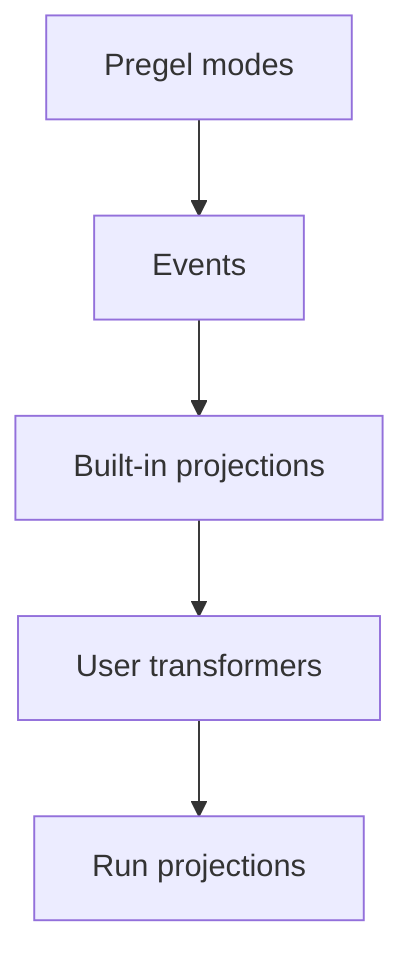

# Event streaming

> Stream LangGraph runs with typed projections for messages, state, subgraphs, output, and extensions.

Event streaming is the recommended in-process streaming model for most LangGraph application code. It returns a run stream object that can be consumed in multiple ways at the same time.

## Quickstart

```py
stream = graph.stream_events({
    "messages": [{"role": "user", "content": "What is 42 * 17?"}],
}, version="v3")

for message in stream.messages:
    for token in message.text:
        print(token, end="", flush=True)

final_state = stream.output
```

To stream against a graph deployed behind an Agent Server, see the [LangSmith Streaming API](https://docs.langchain.com/langsmith/streaming.md).

## How the pieces fit together

The streaming stack has two main layers:

1. **Streaming** emits raw graph execution events from the Pregel engine.
2. **Event streaming** normalizes those events, runs them through stream transformers, and exposes typed projections.

Pregel engineRuns graph steps

emits

Raw Pregel events`updates`, `values`, `messages`, `custom`, `checkpoints`, `tasks`, `debug`

sent to

Event routerRoutes each event through the transformer pipeline

cascades through

Stream transformers

ValuesTransformerMessagesTransformer...Custom transformers

produces

Event StreamProjected events for application code

The event router is the bridge between the two layers. It receives normalized Pregel events and passes each event through the registered stream transformers. Built-in transformers create standard projections such as `stream.messages`, `stream.values`, `stream.subgraphs`, and `stream.output`. Custom transformers can add application-specific projections under `stream.extensions`.

## What event streaming provides

The run stream exposes typed projections over one underlying event flow:

| Projection | Use |
| - | - |
| `stream` | Iterate every protocol event. |
| `stream.messages` | Stream chat model messages and token deltas. |
| `stream.values` | Iterate state snapshots and await the final value. |
| `stream.output` | Await the final output. |
| `stream.subgraphs` | Discover and observe nested graph executions. |
| `stream.interrupts` | Inspect human-in-the-loop interrupt payloads. |
| `stream.interrupted` | Check whether the run paused for human input. |
| `stream.extensions` | Consume custom stream transformer projections. |

Multiple consumers can read these projections concurrently. Reading `stream.messages` does not consume events needed by `stream.values`, `stream.subgraphs`, or `stream.output`.

Event streaming sits one level above [streaming](Streaming.md), which exposes raw graph execution events through `stream_mode` modes such as `updates`, `values`, `messages`, `custom`, `checkpoints`, `tasks`, and `debug`. Use streaming when you need low-level access to those modes; use event streaming when application code benefits from typed projections.

## Stream messages

Use `stream.messages` for chat model output:

```py
stream = graph.stream_events(input, version="v3")

for message in stream.messages:
    text = str(message.text)
    usage = message.output.usage_metadata

    print(text)
    print(usage)
```

`message.text` is iterable in synchronous code. Iterate it for token-by-token output, or call `str(message.text)` for the complete text.

`message.reasoning` exposes reasoning deltas. `message.tool_calls` exposes tool-call chunks. Each chunk holds the call's `id`, its `name`, and only the new part of its `args`. If you need text, reasoning, and tool-call chunks in exact arrival order, iterate the message stream's raw events instead of each projection separately.

## Stream subgraphs

Use `stream.subgraphs` to observe nested graph work without parsing namespace strings:

```py
stream = graph.stream_events(input, version="v3")

for subgraph in stream.subgraphs:
    print(subgraph.graph_name, subgraph.path)

    for message in subgraph.messages:
        print(message.text)
```

`subgraph.graph_name` is the `name` of the compiled graph or agent. A named agent dispatched from a tool (for example, a `create_agent(name=...)` invoked through the Deep Agents `task` tool) surfaces here under that name, and the `lifecycle` event that opens the scope carries a `cause` linking back to the dispatching tool call. See [Lifecycle](#lifecycle) for more information.

For product-specific streams, see [Deep Agents streaming](https://docs.langchain.com/oss/python/deepagents/event-streaming.md) for subagent streams and [LangChain agent streaming](https://docs.langchain.com/oss/python/langchain/streaming.md) for tool calls and middleware events.

## Stream state

Use `stream.values` to stream full state snapshots after each step:

```py
stream = graph.stream_events(input, version="v3")

for snapshot in stream.values:
    print(snapshot)

final_state = stream.output
```

## Stream multiple projections

For concurrent consumption in async code, use `astream_events` with `asyncio.gather`:

```py
import asyncio

stream = await graph.astream_events(input, version="v3")

async def consume_messages():
    async for message in stream.messages:
        print(f"[llm] node={message.node}")

async def consume_subgraphs():
    async for subgraph in stream.subgraphs:
        print(f"[subgraph] path={subgraph.path}")

await asyncio.gather(consume_messages(), consume_subgraphs())
```

For synchronous code, use `stream.interleave(...)` to consume multiple projections in strict arrival order:

```py
stream = graph.stream_events(input, version="v3")

for name, item in stream.interleave("values", "messages", "subgraphs"):
    if name == "values":
        print(f"[state] keys={list(item)}")
    elif name == "messages":
        print(f"[llm] node={item.node}")
    elif name == "subgraphs":
        print(f"[subgraph] path={item.path}")
```

## Resume after an interrupt

When a graph pauses for human input, inspect `stream.interrupted` and `stream.interrupts`, then resume by calling `stream_events(..., version="v3")` again with `Command`.

Resume requires a graph compiled with a checkpointer and a config carrying a thread ID — see [persistence](Persistence.md).

```py
from langgraph.types import Command

stream = graph.stream_events(input, version="v3")

for message in stream.messages:
    print(message.text)

if stream.interrupted:
    print(stream.interrupts)

stream = graph.stream_events(
    Command(resume={"decisions": [{"type": "approve"}]}),
    version="v3",
)
final_state = stream.output
```

## Stream all protocol events

Use the run object itself when you want the raw protocol event stream:

```py
stream = graph.stream_events({
    "messages": [{"role": "user", "content": "What is 42 * 17?"}],
}, version="v3")

for event in stream:
    namespace = event["params"]["namespace"]
    print(namespace, event["method"], event["params"]["data"])
```

Each event is a `ProtocolEvent` envelope wrapping a channel-specific payload. The same shape is what a transformer's `process(event)` receives.

```py
class ProtocolEvent(TypedDict):
    seq: int                    # strictly increasing within a run; use for ordering
    method: str                 # channel name: "messages", "values", "updates", "custom", "tools", "lifecycle", ...
    params: ProtocolEventParams


class ProtocolEventParams(TypedDict):
    namespace: list[str]        # path of "<name>:<runtime_id>" segments from the root graph; [] is the root
    timestamp: int              # wall-clock milliseconds; can drift, don't rely on for ordering
    data: Any                   # channel-specific payload; shape depends on `method`
```

The `namespace` is a path from the root graph to the scope that emitted the event. The root is the empty array `[]`. Each child execution adds one `"name:runtime_id"` segment, so a nested tool call inside a subgraph looks like `["researcher:6f4d", "tools:91ac"]`. The name before `:` is the stable graph or node name; the suffix is a per-invocation runtime ID. Filter raw events by namespace yourself when you only care about a specific subtree — `stream.subgraphs` already does this for nested graph executions.

## Channels and event lifecycle

Raw events flow on channels. The channel name appears as the event's `method`; each channel emits a specific event shape.

| Channel | Purpose |
| - | - |
| `values` | Full graph state snapshots. |
| `updates` | Per-node state deltas. |
| `messages` | Content-block-centric chat model output. |
| `tools` | Tool call start, streamed output, finish, and error events. |
| `lifecycle` | Run, subgraph, and subagent status changes. |
| `checkpoints` | Lightweight checkpoint envelopes for branching and time travel. |
| `input` | Human-in-the-loop input requests and responses. |
| `tasks` | Pregel task creation and result events. |
| `custom` | User-defined payloads from graph code. |
| `custom:<name>` | Application-defined stream transformer output. |

The typed projections (`stream.messages`, `stream.values`, etc.) are built from these channels. The channel name appears as the `method` field on raw events when you iterate the run object directly.

### Messages

The `messages` channel models output as content blocks. The data's `event` field is one of:

* `message-start`
* `content-block-start`
* `content-block-delta`
* `content-block-finish`
* `message-finish`

Content blocks have explicit boundaries: a block starts, emits zero or more deltas, and finishes before the next block in the same message starts. This makes token streaming, reasoning blocks, tool-call blocks, and multimodal content explicit without requiring provider-specific formats. `message-finish` may include token usage; unrecoverable model-call failures arrive as message error events.

Each `content-block-delta` event carries one delta for the block at its `index`:

| Delta `type` | Effect on the block |
| - | - |
| `text-delta` | Appends its `text` to the block's `text`. |
| `reasoning-delta` | Appends its `reasoning` to the block's `reasoning`. |
| `data-delta` | Appends its `data` to the block's `base64`. |
| `tool-call-delta` | Appends its `args` to the block's `args`. |
| `block-delta` | Sets each key in `fields` on the block, replacing the earlier value. |

`content-block-finish` carries the complete block. Ignore any delta type you do not recognize, and keep reading the stream.

To consume raw content-block events directly instead of using the `stream.messages` projection:

```py
for event in stream:
    if event["method"] != "messages":
        continue

    data = event["params"]["data"][0]
    if not isinstance(data, dict):
        continue
    if data.get("event") != "content-block-delta":
        continue

    block = data.get("delta") or {}
    if block.get("type") == "text-delta":
        print(block.get("text", ""), end="", flush=True)
    elif block.get("type") == "reasoning-delta":
        print(f"[thinking]{block.get('reasoning', '')}", end="", flush=True)
    elif block.get("type") == "tool-call-delta":
        print(f"[args]{block.get('args', '')}", end="", flush=True)
```

### Tools

The `tools` channel exposes tool execution. The data's `event` field is one of:

* `tool-started`
* `tool-output-delta`
* `tool-finished`
* `tool-error`

Tool events are correlated by tool call ID, so a tool execution can be joined back to its originating tool-call content block on the `messages` channel.

### Lifecycle

The `lifecycle` channel tracks root run, subgraph, and subagent status. The data's `event` field is one of:

* `started`
* `running`
* `completed`
* `failed`
* `interrupted`

Beyond `event`, lifecycle data may include an optional `graph_name`, `error`, and `cause` describing why a child scope started (parent tool call, fan-out send, edge transition).

## Build your own projection

Stream transformers are the projection layer in event streaming. They observe protocol events, keep their own state, and expose derived views of a run — things like tool activity, token totals, progress events, artifacts, or messages for another protocol. `StreamChannel` is the projection primitive transformers use to publish those views.

Built-in projections (`stream.messages`, `stream.values`, `stream.subgraphs`, `stream.output`) and product-specific projections (LangChain's `stream.tool_calls`, Deep Agents' `stream.subagents`) are themselves transformers using this same contract. User transformers stack on top via compile-time or call-time registration, and their projections appear under `stream.extensions`.

Write one when the existing projections don't match the shape an application needs.

### How transformers work

Event streaming starts with streaming output from the LangGraph Pregel engine. The runtime normalizes those chunks into protocol events, then a stream handler routes each event through a stack of stream transformers.



The stream handler is the central dispatcher for one stream. For every protocol event, it:

1. Calls each registered transformer's `process(event)` hook in order.
2. Wires named `StreamChannel` pushes back onto the protocol event stream.
3. Stores the event in the run stream unless a transformer suppresses it.
4. Calls `finalize()` or `fail()` on every transformer when the run ends.

Transformers are observational. They do not call back into the graph runtime. Instead, they consume events and push derived values into `StreamChannel`, promises, or other projection objects.

### Transformer shape

A transformer implements the `StreamTransformer` interface:

```py
from langgraph.stream import ProtocolEvent, StreamTransformer


class MyTransformer(StreamTransformer):
    def init(self) -> dict:
        ...

    def process(self, event: ProtocolEvent) -> bool:
        ...

    def finalize(self) -> None:
        ...

    def fail(self, err: BaseException) -> None:
        ...
```

* `init()` creates the projection object. User transformer projections appear under `stream.extensions`.
* `process()` observes each protocol event. See [Stream all protocol events](#stream-all-protocol-events) for the `ProtocolEvent` shape. Return `false` only when you intentionally want to suppress the original event.
* `finalize()` closes or resolves non-channel projections after a successful stream.
* `fail()` propagates errors to non-channel projections.

### Declaring required stream modes

`required_stream_modes` controls which Pregel stream modes the underlying graph emits during the stream. The runtime takes the union of every registered transformer's `required_stream_modes` and passes that union as the `stream_mode` argument to the graph's `.stream()` call. **Modes that no transformer requests are never emitted** — declaring `("custom",)` is what causes `custom` events to flow through the run at all.

```py
class CustomTransformer(StreamTransformer):
    required_stream_modes = ("custom",)  # [!code highlight]

    def process(self, event: ProtocolEvent) -> bool:
        if event["method"] == "custom":
            ...
        return True
```

`process()` receives every event the graph emits and is responsible for filtering by `event["method"]`. The declaration turns on upstream emission; it does not narrow what `process()` sees. Valid values are the Pregel stream modes: `"messages"`, `"tools"`, `"custom"`, `"values"`, `"updates"`, `"checkpoints"`, `"tasks"`, `"debug"`. Each transformer must declare every mode it acts on — an omitted mode is not emitted by the graph and never reaches `process()`.

### StreamChannel

`StreamChannel` is the projection primitive a transformer uses for streaming values. It always exposes an iterable stream on `stream.extensions.<name>`. The constructor argument decides whether each `push()` also flows into the run's main event stream as a `custom:<name>` event—that is, whether the projection's values show up when iterating raw protocol events.

| Need | Use |
| - | - |
| Side-channel projection only | `StreamChannel()` |
| Also flow each push into the main event stream | `StreamChannel(name)` |

Named channel payloads must be serializable, because each pushed value also becomes a `custom:<name>` protocol event in the main stream. Keep promises, async iterables, class instances, and other in-process handles in unnamed channels.

The stream handler owns channel lifecycle. Once `init()` returns a channel, the handler closes or fails it for you when the run ends. Transformers only push values.

### Example: named channel

Pass a string name to `StreamChannel` to expose a streaming projection through `stream.extensions` *and* forward each pushed value into the run's main event stream as a `custom:<name>` protocol event:

```py
from typing import TypedDict

from langgraph.stream import ProtocolEvent, StreamChannel, StreamTransformer


class ToolActivity(TypedDict):
    name: str
    status: str


class ToolActivityTransformer(StreamTransformer):
    required_stream_modes = ("tools",)

    def __init__(self, scope: tuple[str, ...] = ()) -> None:
        super().__init__(scope)
        self.activity = StreamChannel[ToolActivity]("tool_activity")

    def init(self) -> dict:
        return {"tool_activity": self.activity}

    def process(self, event: ProtocolEvent) -> bool:
        if event["method"] != "tools":
            return True

        data = event["params"]["data"]
        if isinstance(data, dict) and data.get("tool_name") and data.get("event"):
            status = "error" if data["event"] == "tool-error" else "started"
            self.activity.push({"name": data["tool_name"], "status": status})
        return True
```

### Example: unnamed channel

Without a name, the channel is a side-channel projection only — accessible on `stream.extensions` but not visible to consumers iterating raw events. This is the right choice for projections that hold in-process handles (promises, async iterables, class instances) that can't be serialized onto the main event stream.

The example below pairs an unnamed channel with `get_stream_writer`, which lets graph nodes emit `custom`-channel events that the transformer then drains into the projection:

```py
from langgraph.config import get_stream_writer
from langgraph.stream import ProtocolEvent, StreamChannel, StreamTransformer


def node(state):
    writer = get_stream_writer()
    writer({"kind": "progress", "message": "retrieving context"})
    return state


class CustomTransformer(StreamTransformer):
    required_stream_modes = ("custom",)

    def __init__(self, scope: tuple[str, ...] = ()) -> None:
        super().__init__(scope)
        self.log = StreamChannel()

    def init(self) -> dict:
        return {"custom": self.log}

    def process(self, event: ProtocolEvent) -> bool:
        if event["method"] == "custom":
            self.log.push(event["params"]["data"])
        return True


stream = graph.stream_events(input, version="v3", transformers=[CustomTransformer])

for item in stream.extensions["custom"]:
    print(item)
```

### Example: final-value projection

Use unnamed streams, promises, or other in-process objects when the projection should not flow into the main event stream:

```py
from langgraph.stream import ProtocolEvent, StreamChannel, StreamTransformer


class StatsTransformer(StreamTransformer):
    required_stream_modes = ("messages",)

    def __init__(self, scope: tuple[str, ...] = ()) -> None:
        super().__init__(scope)
        self.total_tokens = 0
        self.total_tokens_log = StreamChannel[int]()

    def init(self) -> dict:
        return {"total_tokens": self.total_tokens_log}

    def process(self, event: ProtocolEvent) -> bool:
        data = event["params"]["data"]
        if isinstance(data, dict):
            usage = data.get("usage") or {}
            self.total_tokens += usage.get("output_tokens") or 0
        return True

    def finalize(self) -> None:
        self.total_tokens_log.push(self.total_tokens)
        self.total_tokens_log.close()
```

### Register at call time or compile time

Pass transformers at call time for local experimentation:

```py
stream = graph.stream_events(
    input,
    version="v3",
    transformers=[StatsTransformer, ToolActivityTransformer],
)
```

Compile transformers into the graph when every run of that graph should produce the projection:

```py
graph = builder.compile(
    transformers=[StatsTransformer, ToolActivityTransformer],
)
```

### Built-in: `ToolCallTransformer`

LangGraph ships `ToolCallTransformer` as a built-in. Register it to expose `stream.tool_calls` on a plain `StateGraph`:

```py
from langgraph.prebuilt import ToolCallTransformer

stream = graph.stream_events(input, version="v3", transformers=[ToolCallTransformer])

for tool_call in stream.tool_calls:
    print(tool_call.tool_name, tool_call.input)
```

## Related

LangGraph defines the streaming primitives. For using streaming with LangChain or Deep Agents, review the relevant product docs:

* [LangChain agent streaming](https://docs.langchain.com/oss/python/langchain/event-streaming.md) covers ReAct-style agent messages, tool calls, and middleware updates.
* [Deep Agents streaming](https://docs.langchain.com/oss/python/deepagents/event-streaming.md) covers subagents, nested messages, and subagent tool calls.
* [LangChain frontend patterns](https://docs.langchain.com/oss/python/langchain/frontend/overview.md) and [LangGraph frontend patterns](../Frontend/Overview.md) show UI use cases built on top of streamed state.
* [LangSmith Streaming API](https://docs.langchain.com/langsmith/streaming.md) covers streaming against a graph deployed behind an Agent Server.

The wire-level event and command formats are defined in the [Agent Protocol](https://github.com/langchain-ai/agent-protocol) repository and consumable as [`langchain-protocol`](https://pypi.org/project/langchain-protocol/) on PyPI and [`@langchain/protocol`](https://www.npmjs.com/package/@langchain/protocol) on npm.
