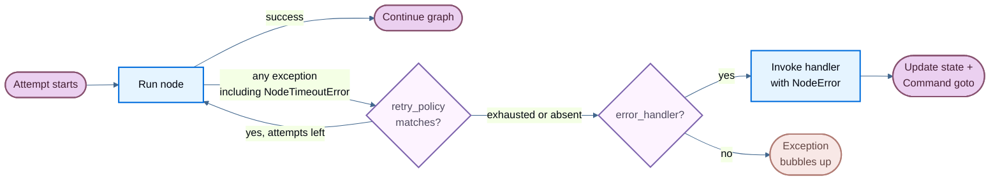

# Fault tolerance

> Configure per-node timeouts, retries, error handlers, and recovery strategies in LangGraph.

When a node fails—from a slow external API, a transient network error, or an unhandled exception—LangGraph gives you three composable mechanisms to respond:

* [**Retries**](#retries): automatically re-run failed attempts based on exception type and backoff settings
* [**Timeouts**](#timeouts): cap how long a single attempt may run
* [**Error handling**](#error-handling): run a recovery function after all retries are exhausted

Use [**`set_node_defaults`**](#graph-defaults) to configure these mechanisms once for all nodes instead of repeating them on every `add_node` call.

These compose in a fixed order: when a node attempt raises any exception (including [`NodeTimeoutError`](https://reference.langchain.com/python/langgraph/errors/NodeTimeoutError) from a timeout), the retry policy decides whether to retry. Only after retries are exhausted does the error handler run.

For stopping a run cleanly at a superstep boundary and resuming later, see [Graceful shutdown](#graceful-shutdown).

> [!NOTE]
>
> Per-node timeouts and node-level error handlers require `langgraph>=1.2`.



## Retries

A retry policy automatically re-runs a failed node attempt based on exception type and backoff settings.

Pass `retry_policy=` to [`add_node`](https://reference.langchain.com/python/langgraph/graph/state/StateGraph/add_node):

```python
from langgraph.types import RetryPolicy

builder.add_node(
    "call_api",
    call_api,
    retry_policy=RetryPolicy(max_attempts=3),
)
```

### Default behavior

By default, `retry_on` uses `default_retry_on`, which retries on **any** exception except the following (and their subclasses):

* `ValueError`
* `TypeError`
* `ArithmeticError`
* `ImportError`
* `LookupError`
* `NameError`
* `SyntaxError`
* `RuntimeError`
* `ReferenceError`
* `StopIteration`
* `StopAsyncIteration`
* `OSError`

For exceptions from popular HTTP libraries such as `requests` and `httpx`, it only retries on 5xx status codes. [`NodeTimeoutError`](https://reference.langchain.com/python/langgraph/errors/NodeTimeoutError) is retryable by default.

### Parameters

| Parameter | Type | Default | Description |
| - | - | - | - |
| `max_attempts` | `int` | `3` | Maximum number of attempts, including the first. |
| `initial_interval` | `float` | `0.5` | Seconds before the first retry. |
| `backoff_factor` | `float` | `2.0` | Multiplier applied to the interval after each retry. |
| `max_interval` | `float` | `128.0` | Maximum seconds between retries. |
| `jitter` | `bool` | `True` | Add random jitter to the interval. |
| `retry_on` | `type[Exception] \| Sequence[type[Exception]] \| Callable[[Exception], bool]` | `default_retry_on` | Exceptions to retry on, or a callable returning `True` for retryable exceptions. |

### Custom retry logic

Pass a callable or exception type to `retry_on`. Import `default_retry_on` to extend the default behavior:

```python
from langgraph.types import RetryPolicy, default_retry_on

def custom_retry_on(exc: BaseException) -> bool:
    if isinstance(exc, MyCustomError):
        return False
    return default_retry_on(exc)

builder.add_node(
    "call_api",
    call_api,
    retry_policy=RetryPolicy(max_attempts=3, retry_on=custom_retry_on),
)
```

### Inspect retry state

Use execution info inside a node to inspect the current attempt number. This is useful for switching to a fallback when the primary call keeps failing:

```python
from langgraph.graph import StateGraph, START, END
from langgraph.runtime import Runtime
from langgraph.types import RetryPolicy
from typing_extensions import TypedDict

class State(TypedDict):
    result: str

def my_node(state: State, runtime: Runtime) -> State:
    if runtime.execution_info.node_attempt > 1:  # [!code highlight]
        return {"result": call_fallback_api()}
    return {"result": call_primary_api()}

builder = StateGraph(State)
builder.add_node("my_node", my_node, retry_policy=RetryPolicy(max_attempts=3))
builder.add_edge(START, "my_node")
builder.add_edge("my_node", END)
```

`execution_info` exposes the following fields:

| Attribute | Type | Description |
| - | - | - |
| `node_attempt` | `int` | Current attempt number (1-indexed). `1` on the first try, `2` on the first retry, etc. |
| `node_first_attempt_time` | `float \| None` | Unix timestamp of when the first attempt started. Constant across retries. |
| `thread_id` | `str \| None` | Thread ID for the current execution. `None` without a checkpointer. |
| `run_id` | `str \| None` | Run ID for the current execution. `None` when not provided in config. |
| `checkpoint_id` | `str` | Checkpoint ID for the current execution. |
| `task_id` | `str` | Task ID for the current execution. |

`execution_info` is available even without a retry policy—`node_attempt` defaults to `1`.

## Retry boundaries and idempotency

A [retry](#retries) re-runs the entire node function from the start. That gives **at-least-once** semantics for node execution: when a policy matches, LangGraph invokes the node again. It does not make external side effects happen exactly once.

```text
attempt 1:  node starts -> call payment API -> payment succeeds -> process crashes
attempt 2:  node starts -> call payment API -> payment succeeds again
```

[Checkpoints](Checkpointers.md) are written at [super-step](../Build%20with%20the%20Graph%20API/Graph%20API%20overview.md#super-steps) boundaries, not mid-function. Graph writes from a failed attempt are discarded. Side effects during the node (payments, emails, external writes) are outside that boundary. Application code must make those effects idempotent.

The same re-execution model applies after an [interrupt](Interrupts.md) or a crash resume. See [Re-execution and idempotency](../Build%20with%20the%20Graph%20API/Graph%20API%20overview.md#re-execution-and-idempotency). To checkpoint work inside a node so resume can skip completed units, wrap each unit in a [task](../Build%20with%20the%20Graph%20API/Graph%20API%20overview.md#using-tasks-in-nodes).

### Protect side effects with an idempotency key

Send a stable idempotency key with the side effect so the provider can deduplicate retries. The key must already be durable **before** the side effect runs. Do not generate it inside the same node and rely on the return value:

```text
attempt 1:  node starts -> generate key K1 -> charge succeeds -> process dies before returning
attempt 2:  node starts -> state has no key -> generate key K2 -> charge runs again
```

`K1` was never checkpointed. Derive the key from state that is already durable:

```python
def charge_customer(state: State) -> dict:
    # Same order always produces the same key across retries and resumes.
    idempotency_key = f"charge:{state['order_id']}"

    provider.charge(
        customer_id=state["customer_id"],
        amount=state["amount"],
        idempotency_key=idempotency_key,
    )

    # Observability only. A retry must not depend on this return value.
    return {"last_payment_key": idempotency_key, "charged": True}
```

When no durable business identity exists, persist a generated key in its own node before the side effect. Across a process crash, that only works if the intervening checkpoint is durable. Use [sync durability](Checkpointers.md#durability-modes) for that pattern.

```python
import uuid

def reserve_key(state: State) -> dict:
    # Own node so the key is checkpointed before anything external runs.
    return {"payment_key": state.get("payment_key") or str(uuid.uuid4())}

def charge_customer(state: State) -> dict:
    provider.charge(..., idempotency_key=state["payment_key"])
    return {"charged": True}
```

Two requirements:

1. **The key is reproducible from durable state.** A retry or a resume in a fresh process reconstructs the same key.
2. **The external service honors the key.** Check the provider's documentation before relying on it.

### Treat a missing acknowledgement as unknown

If the provider commits and the acknowledgement is lost, the graph has no local record even though the side effect may have happened. A later attempt with the same key avoids blind duplication when the provider deduplicates, but the outcome is still unknown. Treat missing local state as unknown, not as proof the effect did not happen. Query the provider for the operation's status before compensating or continuing.

For side effects that cannot be made idempotent at the API level, move them out of retryable nodes. For example, run them from an [error handler](#error-handling) after retries are exhausted, or from a separate worker that deduplicates by task ID.

## Timeouts

> [!NOTE]
>
> Requires `langgraph>=1.2`.

The `timeout=` parameter on [`add_node`](https://reference.langchain.com/python/langgraph/graph/state/StateGraph/add_node) caps how long a single node attempt may run. Pass a number (seconds), a `timedelta`, or a [`TimeoutPolicy`](https://reference.langchain.com/python/langgraph/types/TimeoutPolicy) for separate run and idle limits:

```python
from datetime import timedelta
from langgraph.types import TimeoutPolicy

# Simple wall-clock cap
builder.add_node("call_model", call_model, timeout=60)
builder.add_node("call_model", call_model, timeout=timedelta(minutes=2))

# Separate run and idle limits
builder.add_node(
    "call_model",
    call_model,
    timeout=TimeoutPolicy(run_timeout=120, idle_timeout=30),
)
```

> [!WARNING]
>
> Node timeouts only apply to **async** nodes. Sync nodes with a `timeout` are rejected at compile time. To wrap blocking I/O, use `asyncio.to_thread` inside an async node.

### Run timeout

`run_timeout` is a hard wall-clock cap on a single attempt. It is never refreshed, regardless of node activity:

```python
from langgraph.types import TimeoutPolicy

builder.add_node(
    "call_model",
    call_model,
    timeout=TimeoutPolicy(run_timeout=120),
)
```

When the limit is exceeded, LangGraph raises [`NodeTimeoutError`](https://reference.langchain.com/python/langgraph/errors/NodeTimeoutError), clears any writes from the failed attempt, and lets the retry policy decide whether to retry.

### Idle timeout

`idle_timeout` is a progress-resetting cap. It fires only when the node stops making observable progress for the specified duration—unlike `run_timeout`, the clock resets whenever the node produces a progress signal:

```python
builder.add_node(
    "call_model",
    call_model,
    timeout=TimeoutPolicy(idle_timeout=30),
)
```

You can set `run_timeout` and `idle_timeout` together. Whichever fires first cancels the attempt.

#### Progress signals

Under the default `refresh_on="auto"`, the idle clock resets on any of the following:

* State writes via `CONFIG_KEY_SEND`
* Stream output (yielded async stream chunks)
* Child-task scheduling
* Runtime stream-writer calls
* Any LangChain callback event from the node or its descendants (LLM tokens, tool calls, chain start/end, etc.)

#### Heartbeat mode

Set `refresh_on="heartbeat"` to narrow the refresh source to explicit `runtime.heartbeat()` calls only. This is useful when you want a strict idle definition that isn't reset by chatty subordinates:

```python
builder.add_node(
    "call_model",
    call_model,
    timeout=TimeoutPolicy(idle_timeout=30, refresh_on="heartbeat"),
)
```

#### Manual heartbeats

For long-running work that doesn't naturally emit progress signals, call `runtime.heartbeat()` to manually reset the idle clock:

```python
from langgraph.graph import StateGraph, START, END
from langgraph.runtime import Runtime
from langgraph.types import TimeoutPolicy
from typing_extensions import TypedDict

class State(TypedDict):
    result: str

async def long_running_node(state: State, runtime: Runtime) -> State:
    for batch in fetch_batches():
        process(batch)
        runtime.heartbeat()  # [!code highlight]
    return {"result": "done"}

builder = StateGraph(State)
builder.add_node(
    "long_running_node",
    long_running_node,
    timeout=TimeoutPolicy(idle_timeout=30, refresh_on="heartbeat"),
)
builder.add_edge(START, "long_running_node")
builder.add_edge("long_running_node", END)
```

`runtime.heartbeat()` is a no-op outside an idle-timed attempt, so you can call it unconditionally.

### NodeTimeoutError

When a timeout fires, LangGraph raises [`NodeTimeoutError`](https://reference.langchain.com/python/langgraph/errors/NodeTimeoutError) with structured context about which limit was hit:

| Attribute | Type | Description |
| - | - | - |
| `node` | `str` | Name of the node whose execution timed out. |
| `elapsed` | `float` | Seconds elapsed before the timeout fired. |
| `kind` | `Literal["idle", "run"]` | Which timeout fired. |
| `idle_timeout` | `float \| None` | The configured idle timeout (seconds), if any. |
| `run_timeout` | `float \| None` | The configured run timeout (seconds), if any. |

`NodeTimeoutError` is retryable by default. Combining `timeout` with a retry policy works out of the box—the timeout clock resets on each new attempt, and writes from a timed-out attempt are cleared before the next retry:

```python
from langgraph.types import RetryPolicy, TimeoutPolicy

builder.add_node(
    "call_model",
    call_model,
    timeout=TimeoutPolicy(idle_timeout=30),
    retry_policy=RetryPolicy(max_attempts=3),
)
```

### Dynamic timeouts with Send

When using [`Send`](https://reference.langchain.com/python/langgraph/types/Send) to dispatch nodes dynamically (for example, in map-reduce patterns), you can pass a timeout directly on the `Send` to override the target node's static timeout for that specific push:

```python
from langgraph.types import Send, TimeoutPolicy

def fan_out(state: OverallState):
    return [
        Send("process_item", {"item": item}, timeout=TimeoutPolicy(idle_timeout=15))
        for item in state["items"]
    ]
```

If the timeout is omitted on the `Send`, the target node's timeout (set at [`add_node`](https://reference.langchain.com/python/langgraph/graph/state/StateGraph/add_node) time) applies. This lets you set a default timeout on the node and tighten it for individual calls.

## Error handling

> [!NOTE]
>
> Requires `langgraph>=1.2`.

An error handler runs after a node fails and all retries are exhausted. It receives the current state and can update it or route to a different node using [`Command`](https://reference.langchain.com/python/langgraph/types/Command). This is useful for compensation flows (Saga patterns) where you want to recover gracefully rather than abort the entire graph.

Pass `error_handler=` to [`add_node`](https://reference.langchain.com/python/langgraph/graph/state/StateGraph/add_node):

```python
from langgraph.errors import NodeError
from langgraph.types import Command, RetryPolicy
from langgraph.graph import StateGraph, START
from typing_extensions import TypedDict

class State(TypedDict):
    status: str

def charge_payment(state: State) -> State:
    raise RuntimeError("payment gateway timeout")

def payment_error_handler(state: State, error: NodeError) -> Command:
    return Command(
        update={"status": f"compensated: {error.error}"},
        goto="finalize",
    )

def finalize(state: State) -> State:
    return state

graph = (
    StateGraph(State)
    .add_node(
        "charge_payment",
        charge_payment,
        retry_policy=RetryPolicy(max_attempts=3, retry_on=ConnectionError),
        error_handler=payment_error_handler,
    )
    .add_node("finalize", finalize)
    .add_edge(START, "charge_payment")
    .compile()
)
```

The handler fires only after the retry policy is exhausted, or immediately if no retry policy is configured. The retry policy and the error handler stay decoupled: configure when to retry and when to compensate independently.

### NodeError

Error handlers receive failure context through a typed `error: NodeError` parameter, injected by type annotation (the same pattern as `runtime: Runtime`):

```python
from langgraph.errors import NodeError

def my_handler(state: State, error: NodeError) -> Command:
    print(f"Node {error.node} failed with: {error.error}")
    return Command(update={"status": "recovered"}, goto="next_step")
```

[`NodeError`](https://reference.langchain.com/python/langgraph/errors/NodeError) is a frozen dataclass with two fields:

| Attribute | Type | Description |
| - | - | - |
| `node` | `str` | Name of the node whose execution failed. |
| `error` | `BaseException` | The exception raised by the failed node. |

The `error: NodeError` parameter is opt-in. Handlers that don't need failure context can use simpler signatures like `(state)` or `(state, runtime)`.

### Route with Command

Error handlers can return a [`Command`](https://reference.langchain.com/python/langgraph/types/Command) to update state and route to a specific node, enabling Saga / compensation patterns:

```python
from langgraph.errors import NodeError
from langgraph.types import Command, RetryPolicy
from langgraph.graph import StateGraph, START
from typing_extensions import TypedDict

class State(TypedDict):
    status: str

def reserve_inventory(state: State) -> State:
    return {"status": "reserved"}

def charge_payment(state: State) -> State:
    raise RuntimeError("payment timeout")

def payment_error_handler(state: State, error: NodeError) -> Command:
    return Command(
        update={"status": f"compensated_after_{error.node}: {error.error}"},
        goto="finalize",
    )

def finalize(state: State) -> State:
    return state

graph = (
    StateGraph(State)
    .add_node("reserve_inventory", reserve_inventory)
    .add_node(
        "charge_payment",
        charge_payment,
        retry_policy=RetryPolicy(max_attempts=3, retry_on=ConnectionError),
        error_handler=payment_error_handler,
    )
    .add_node("finalize", finalize)
    .add_edge(START, "reserve_inventory")
    .add_edge("reserve_inventory", "charge_payment")
    .compile()
)
```

`charge_payment` retries on `ConnectionError` up to 3 times. If retries are exhausted (or the error isn't a `ConnectionError`), the handler compensates by updating state and routing to `finalize` instead of aborting the graph.

### Resume-safe failures

> [!NOTE]
>
> Failure provenance is checkpointed. If the graph is interrupted or the process crashes after a node fails but before the handler completes, the handler sees the same `NodeError` context when the graph resumes from its checkpoint.

### Behavior with `interrupt()`

> [!WARNING]
>
> `interrupt()` raised inside a node is **not** routed to the error handler. Interrupts use the `GraphBubbleUp` mechanism to pause graph execution for human-in-the-loop workflows, bypassing both retry policies and error handlers. The graph pauses as usual.

### Subgraph failures

If a node wraps a subgraph and the subgraph raises an unhandled exception, that exception surfaces to the parent node. If the parent node has an error handler, the handler fires with the subgraph's exception in `error.error`.

## Recovery strategies

Retries and error handlers cover automatic re-attempts and compensation after exhaustion. Two other common patterns live in your node logic:

| Strategy | Who fixes it | Mechanism |
| - | - | - |
| Transient errors | System | [Retry policy](#retries) on the node |
| Recoverable failure after retries | Developer | [`error_handler` / `errorHandler`](#error-handling) (Saga / compensation) |
| LLM-recoverable errors | LLM | Store the error in state and route back with [`Command`](https://reference.langchain.com/python/langgraph/types/Command) |
| User-fixable errors | Human | Pause with [`interrupt()`](Interrupts.md) |
| Unexpected errors | Developer | Let the exception bubble up and fail the run |

### LLM-recoverable errors

When a tool call or parse fails in a way the model can correct, catch that error in the node, write it into state, and route back to the agent so the LLM can adjust:

```python
from typing import Literal

from langgraph.types import Command
from typing_extensions import TypedDict


class ToolError(Exception):
    """Raised when a tool call fails in a way the model can correct."""


class State(TypedDict):
    tool_call: str
    tool_result: str | None


def run_tool(tool_call: str) -> str:
    if tool_call == "bad":
        raise ToolError("invalid args")
    return f"ok:{tool_call}"


def execute_tool(state: State) -> Command[Literal["agent", "execute_tool"]]:
    try:
        result = run_tool(state["tool_call"])
        return Command(update={"tool_result": result}, goto="agent")
    except ToolError as e:
        # Let the LLM see what went wrong and try again
        return Command(
            update={"tool_result": f"Tool error: {e}"},
            goto="agent",
        )
```

This is application-level control flow, not an `error_handler`. The node handles a known failure mode and keeps the run alive.

### Unexpected errors

Do not catch failures you cannot handle. Without a matching retry policy or error handler, the exception bubbles up and fails the run so you can fix the bug:

```python
from typing_extensions import TypedDict


class EmailAgentState(TypedDict):
    draft_response: str


class EmailService:
    def send(self, body: str) -> None:
        raise RuntimeError(f"SMTP unavailable while sending: {body}")


email_service = EmailService()


def send_reply(state: EmailAgentState) -> EmailAgentState:
    # Do not catch unexpected failures here. Let them bubble up and fail the run.
    email_service.send(state["draft_response"])
    return state
```

## Graph defaults

> [!NOTE]
>
> Requires `langgraph>=1.2`.

Instead of repeating the same `retry_policy=`, `error_handler=`, `timeout=`, or `cache_policy=` on every `add_node` call, use [`set_node_defaults`](https://reference.langchain.com/python/langgraph/graph/state/StateGraph/set_node_defaults) to configure graph-wide defaults in one place:

```python
from langgraph.errors import NodeError
from langgraph.types import RetryPolicy, TimeoutPolicy
from langgraph.graph import StateGraph, START
from typing_extensions import TypedDict

class State(TypedDict):
    status: str

def default_error_handler(state: State, error: NodeError) -> State:
    return {"status": f"handled: {error.error}"}

graph = (
    StateGraph(State)
    .set_node_defaults(
        retry_policy=RetryPolicy(max_attempts=3),
        error_handler=default_error_handler,
        timeout=TimeoutPolicy(run_timeout=30),
    )
    .add_node("step_a", step_a)
    .add_node("step_b", step_b)
    .add_edge(START, "step_a")
    .compile()
)
```

Both `step_a` and `step_b` now share the same retry policy, error handler, and timeout without any duplication.

### Precedence

Per-node values passed directly to `add_node()` always override the defaults set by `set_node_defaults()`. Defaults are resolved at `compile()` time, so you can call `set_node_defaults()` before or after `add_node()` in any order:

```python
graph = (
    StateGraph(State)
    .set_node_defaults(error_handler=default_error_handler)
    .add_node("step_a", step_a)                                     # uses default_error_handler
    .add_node("step_b", step_b, error_handler=custom_error_handler) # uses custom_error_handler
    .add_edge(START, "step_a")
    .compile()
)
```

### Default error handler

The `error_handler` default is particularly valuable when every graph run maps to an external process (for example a background job row) and any unhandled node failure should mark that process as failed, without repeating `error_handler=` on every `add_node`. Per-node handlers still take precedence when a step needs its own logic:

```python
from langgraph.errors import NodeError
from langgraph.graph import StateGraph, START
from langgraph.types import Command, RetryPolicy
from typing_extensions import TypedDict

class State(TypedDict):
    process_id: str
    status: str

def fetch_data(state: State) -> State:
    return {"status": "fetched"}

def charge_payment(state: State) -> State:
    raise RuntimeError("payment timeout")

def finalize(state: State) -> State:
    return state

def mark_process_failed(state: State, error: NodeError) -> State:
    # Persist failure on the external process row keyed by process_id.
    return {"status": f"failed at {error.node}: {error.error}"}

def refund_payment(state: State, error: NodeError) -> Command:
    return Command(
        update={"status": f"compensated after {error.node}"},
        goto="finalize",
    )

graph = (
    StateGraph(State)
    .set_node_defaults(
        retry_policy=RetryPolicy(max_attempts=3),
        error_handler=mark_process_failed,
    )
    .add_node("fetch_data", fetch_data)  # uses mark_process_failed
    .add_node(
        "charge_payment",
        charge_payment,
        error_handler=refund_payment,  # overrides the graph-wide default
    )
    .add_node("finalize", finalize)
    .add_edge(START, "fetch_data")
    .add_edge("fetch_data", "charge_payment")
    .compile()
)
```

If `fetch_data` fails after retries, `mark_process_failed` runs. If `charge_payment` fails after retries, `refund_payment` runs instead because the per-node handler overrides the default.

The handler accepts the same `(state, error: NodeError)` signature described in [Error handling](#error-handling). It also accepts `RunnableConfig` as an optional third argument if you need access to config values such as `thread_id`:

```python
from langchain_core.runnables import RunnableConfig

def mark_process_failed(
    state: State, error: NodeError, config: RunnableConfig
) -> State:
    thread_id = config["configurable"].get("thread_id")
    return {"status": f"failed on thread {thread_id}: {error.error}"}
```

### Applicability matrix

Not all defaults apply to all node types. Error-handler nodes (those registered via `add_node(error_handler=...)`) are excluded from certain defaults to prevent unsafe behavior:

| `set_node_defaults` parameter | Applies to regular nodes | Applies to error-handler nodes | Reason |
| - | - | - | - |
| `retry_policy` | ✅ | ✅ | Handlers should be retried on transient failures |
| `timeout` | ✅ | ✅ | Stuck handlers should be cancelled like stuck regular nodes |
| `error_handler` | ✅ | ❌ | Handlers must never catch themselves |
| `cache_policy` | ✅ | ❌ | Caching handler results is unsafe |

### Scope

Defaults set on a parent graph are **not** inherited by subgraphs. Each graph maintains its own defaults.

## Functional API

The same `timeout=` and `retry_policy=` parameters are available on `@task` and `@entrypoint` in the functional API:

```python
from langgraph.func import entrypoint, task
from langgraph.types import RetryPolicy, TimeoutPolicy

@task(
    timeout=TimeoutPolicy(idle_timeout=30),
    retry_policy=RetryPolicy(max_attempts=3),
)
async def call_api(url: str) -> str:
    response = await fetch(url)
    return response.text

@entrypoint(timeout=60)
async def my_workflow(inputs: dict) -> str:
    result = await call_api("https://api.example.com/data")
    return result
```

The behavior is identical to `add_node`: `NodeTimeoutError` is raised on timeout, buffered writes are cleared, and the retry policy decides whether to retry.

## Graceful shutdown

Cooperative shutdown lets you stop an in-flight graph run after the current superstep completes and save a resumable checkpoint. This is useful for handling SIGTERM signals or any external supervisor that needs to reclaim resources without losing work.

> [!NOTE]
>
> Requires `langgraph>=1.2`.

Create a [`RunControl`](https://reference.langchain.com/python/langgraph/runtime/RunControl) and pass it as `control=` to `invoke` or `stream`. Call `request_drain()` from any thread to signal that the run should stop:

```python
from langgraph.runtime import RunControl
from langgraph.errors import GraphDrained

control = RunControl()

# In a signal handler or supervisor:
# control.request_drain("sigterm")

try:
    result = graph.invoke(inputs, config, control=control)
except GraphDrained as e:
    # The graph stopped early and saved a checkpoint.
    # Resume later with the same config.
    print(f"Drained: {e.reason}")
```

### Semantics

Drain is cooperative and operates between supersteps, never preempting work that is already running:

| Scenario | Behavior |
| - | - |
| Node mid-execution | Runs to completion. Drain takes effect on the next superstep. |
| Node with a retry policy currently retrying | Retry loop runs to exhaustion or success. Drain takes effect after. |
| Graph finishes naturally on the same tick as drain | Returns normally. Inspect `control.drain_requested` to distinguish from a normal run. |
| More supersteps remain | Raises `GraphDrained(reason)`. Checkpoint is saved and resumable. |
| Subgraph requests drain | `GraphDrained` bubbles up through the parent and stops it at its own next superstep boundary. |

### Resume after drain

Resume a drained run with `invoke(None, config)` using the same `thread_id`:

```python
result = graph.invoke(None, config)
```

### Read drain state inside a node

Access drain state through the `runtime` parameter to adjust node behavior before the superstep boundary is reached:

```python
from langgraph.runtime import Runtime

async def my_node(state: State, runtime: Runtime) -> State:
    if runtime.drain_requested:
        # Skip expensive work and return a minimal result
        return {"status": "skipped", "reason": runtime.drain_reason}
    return {"status": await do_work()}
```

### SIGTERM hook pattern

The recommended pattern for handling process shutdown:

```python
import signal
from langgraph.runtime import RunControl
from langgraph.errors import GraphDrained

control = RunControl()
signal.signal(signal.SIGTERM, lambda *_: control.request_drain("sigterm"))

try:
    result = graph.invoke(inputs, config, control=control)
except GraphDrained as e:
    log.info("graph drained: %s", e.reason)
    # Resume on next startup with the same config
```

> [!NOTE]
>
> `request_drain()` does not cancel running asyncio tasks or kill threads. For a hard upper bound, pair drain with a graceful timeout and task cancellation.

## Limitations

* **Timeouts are async-only**: sync nodes with a `timeout` are rejected at compile time.
* **One handler per node**: each node can have at most one `error_handler`.
* **Handler failures bubble up**: if the error handler itself raises, that exception propagates as if the node had no handler.
* **`set_node_defaults` is not inherited by subgraphs**: each graph manages its own defaults independently.
