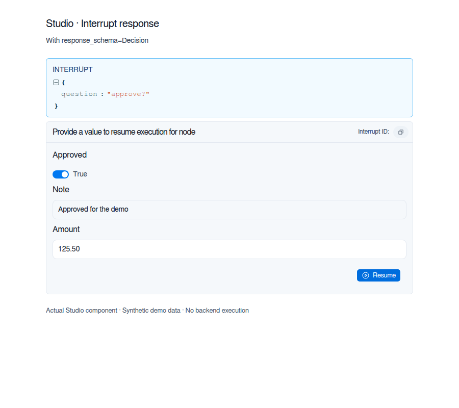
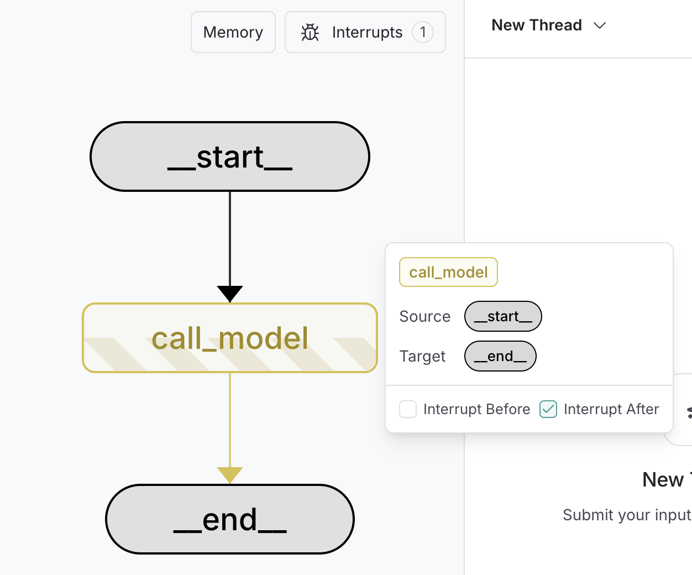

# Interrupts

Interrupts allow you to pause graph execution at specific points and wait for external input before continuing. This enables human-in-the-loop patterns where you need external input to proceed. When an interrupt is triggered, LangGraph saves the graph state using its [persistence](Persistence.md) layer and waits indefinitely until you resume execution.

Interrupts work by calling the `interrupt()` function at any point in your graph nodes. The function accepts any JSON-serializable value which is surfaced to the caller. When you're ready to continue, you resume execution by re-invoking the graph using `Command`, which then becomes the return value of the `interrupt()` call from inside the node.

Unlike static breakpoints (which pause before or after specific nodes), interrupts are **dynamic**: they can be placed anywhere in your code and can be conditional based on your application logic.

* **Checkpointing keeps your place:** the checkpointer writes the exact graph state so you can resume later, even when in an error state.
* **`thread_id` is your pointer:** set `config={"configurable": {"thread_id": ...}}` to tell the checkpointer which state to load.
* **Interrupt payloads surface via `stream.interrupts`:** when using [event streaming](Event%20streaming.md) (`graph.stream_events(..., version="v3")`), the values you pass to `interrupt()` appear on `stream.interrupts`, and `stream.interrupted` is `True` when the run pauses for input.

The `thread_id` you choose is effectively your persistent cursor. Reusing it resumes the same checkpoint; using a new value starts a brand-new thread with an empty state.

## Pause using `interrupt`

The [`interrupt`](https://reference.langchain.com/python/langgraph/types/interrupt) function pauses graph execution and returns a value to the caller. When you call [`interrupt`](https://reference.langchain.com/python/langgraph/types/interrupt) within a node, LangGraph saves the current graph state and waits for you to resume execution with input.

To use [`interrupt`](https://reference.langchain.com/python/langgraph/types/interrupt), you need:

1. A **checkpointer** to persist the graph state (use a durable checkpointer in production)
2. A **thread ID** in your config so the runtime knows which state to resume from
3. To call `interrupt()` where you want to pause (payload must be JSON-serializable)

```python
from langgraph.types import interrupt

def approval_node(state: State):
    # Pause and ask for approval
    approved = interrupt("Do you approve this action?")

    # When you resume, Command(resume=...) returns that value here
    return {"approved": approved}
```

When you call [`interrupt`](https://reference.langchain.com/python/langgraph/types/interrupt), here's what happens:

1. **Graph execution gets suspended** at the exact point where [`interrupt`](https://reference.langchain.com/python/langgraph/types/interrupt) is called

2. **State is saved** using the checkpointer so execution can be resumed later, In production, this should be a persistent checkpointer (e.g. backed by a database)

3. **Value is returned** to the caller on `stream.interrupts` when using [event streaming](Event%20streaming.md) (`graph.stream_events(..., version="v3")`), or under `__interrupt__` with the default `invoke()` API; it can be any JSON-serializable value (string, object, array, etc.)

4. **Graph waits indefinitely** until you resume execution with a response

5. **Response is passed back** into the node when you resume, becoming the return value of the `interrupt()` call

## Resuming interrupts

After an interrupt pauses execution, you resume the graph by invoking it again with a `Command` that contains the resume value. The resume value is passed back to the `interrupt` call, allowing the node to continue execution with the external input.

The recommended way to drive a graph that may interrupt is [event streaming](Event%20streaming.md) — it surfaces interrupts via `stream.interrupts` and `stream.interrupted`, and exposes the final state through `stream.output`.

```python
from langgraph.types import Command

# Initial run - hits the interrupt and pauses
# thread_id is the persistent pointer (stores a stable ID in production)
config = {"configurable": {"thread_id": "thread-1"}}
stream = graph.stream_events({"input": "data"}, config=config, version="v3")

# Drain the stream to drive the run; stream.output awaits the final state.
final = stream.output

# stream.interrupted is True when the run paused for human input, and
# stream.interrupts contains the payloads passed to interrupt().
if stream.interrupted:
    print(stream.interrupts)
    # > (Interrupt(value='Do you approve this action?'),)

# Resume with the human's response
# The resume payload becomes the return value of interrupt() inside the node
resumed = graph.stream_events(Command(resume=True), config=config, version="v3")
final = resumed.output
```

> [card] [View example trace](https://smith.langchain.com/public/cd7406ad-294e-4d98-b0ae-d9ed7930e117/r)
>
> Open a public LangSmith run for this example.

> [!NOTE]
>
> The default `graph.invoke(...)` API still works and surfaces interrupts under `result["__interrupt__"]`. Use it when you don't need streamed projections; otherwise prefer `graph.stream_events(..., version="v3")`.

**Key points about resuming:**

* You must use the **same thread ID** when resuming that was used when the interrupt occurred
* The value passed to `Command(resume=...)` becomes the return value of the [`interrupt`](https://reference.langchain.com/python/langgraph/types/interrupt) call
* The node restarts from the beginning of the node where the [`interrupt`](https://reference.langchain.com/python/langgraph/types/interrupt) was called when resumed, so any code before the [`interrupt`](https://reference.langchain.com/python/langgraph/types/interrupt) runs again
* You can pass any JSON-serializable value as the resume value, subject to validation when you specify a typed `response_schema`

> [!WARNING]
>
> `Command(resume=...)` is the **only** `Command` pattern intended as input to `invoke()`/`stream()`/`stream_events()`. The other `Command` parameters (`update`, `goto`, `graph`) are designed for [returning from node functions](../Build%20with%20the%20Graph%20API/Graph%20API%20overview.md#command). Do not pass `Command(update=...)` as input to continue multi-turn conversations—pass a plain input dict instead.

## Define an interrupt response schema

The `response_schema` argument to [`interrupt`](https://reference.langchain.com/python/langgraph/types/interrupt) describes the input expected when you resume the graph. Clients can use the schema to render typed input forms.

> [!NOTE]
>
> Interrupt response schemas require `langgraph>=1.2.12`.

Pass a Pydantic model class, a `TypedDict` from `typing_extensions`, or a dataclass to validate resume values. LangGraph converts the type to JSON Schema and includes it in `Interrupt.response_schema`, separately from the interrupt's `value` payload. The schema is available on interrupts returned to the caller and in checkpoint task interrupts.

This example uses the approval schema from LangGraph's interrupt tests:

```python
from typing import Any

from pydantic import BaseModel
from typing_extensions import TypedDict

from langgraph.checkpoint.memory import InMemorySaver
from langgraph.graph import START, StateGraph
from langgraph.types import Command, interrupt


class Decision(BaseModel):
    approved: bool
    note: str | None = None


class State(TypedDict):
    answer: Any


def node(state: State) -> State:
    answer = interrupt({"question": "approve?"}, response_schema=Decision)
    return {"answer": answer}


graph = (
    StateGraph(State)
    .add_node("node", node)
    .add_edge(START, "node")
    .compile(checkpointer=InMemorySaver())
)
config = {"configurable": {"thread_id": "1"}}

result = graph.invoke({"answer": None}, config)
pending = result["__interrupt__"][0]
assert pending.response_schema == Decision.model_json_schema()

result = graph.invoke(Command(resume={"approved": True}), config)
assert result["answer"] == Decision(approved=True)
```

With a typed schema, `interrupt()` returns the validated object: a Pydantic model instance, a dictionary for a `TypedDict`, or a dataclass instance. Pydantic's validation and coercion rules apply. Invalid input raises `pydantic.ValidationError`; you can retry with a corrected `Command(resume=...)` using the same thread ID.

You can also pass a JSON Schema dictionary as `response_schema`. LangGraph exposes that dictionary unchanged but does **not** validate resume values against it. When you omit `response_schema`, its value is `None`, and resume values pass through without schema validation.

Studio renders interrupt response schemas as typed input fields instead of a JSON editor. This preview of the Studio component uses example data with approval, note, and numeric amount fields.



## Common patterns

The key thing that interrupts unlock is the ability to pause execution and wait for external input. This is useful for a variety of use cases, including:

* &#x20;[Approval workflows](#approve-or-reject): Pause before executing critical actions (API calls, database changes, financial transactions)
* &#x20;[Handling multiple interrupts](#handling-multiple-interrupts): Pair interrupt IDs with resume values when resuming multiple interrupts in a single invocation
* &#x20;[Review and edit](#review-and-edit-state): Let humans review and modify LLM outputs or tool calls before continuing
* &#x20;[Interrupting tool calls](#interrupts-in-tools): Pause before executing tool calls to review and edit the tool call before execution
* &#x20;[Validating human input](#validating-human-input): Pause before proceeding to the next step to validate human input

### Stream with human-in-the-loop (HITL) interrupts

When building interactive agents with human-in-the-loop workflows, you can use [event streaming](Event%20streaming.md) to consume message chunks and state snapshots concurrently while handling interrupts.

Use the typed projections returned by `graph.stream_events(..., version="v3")` in a loop until the run finishes:

* Stream AI responses token-by-token via `stream.messages`
* Observe per-step state snapshots via `stream.values`
* Detect interrupts via `stream.interrupted` and read their payloads from `stream.interrupts`
* Resume execution by calling `stream_events` again with `Command(resume=...)` and repeat until `stream.interrupted` is false

```python
from langgraph.types import Command

stream_input: dict | Command = initial_input

while True:
    stream = graph.stream_events(stream_input, config=config, version="v3")

    # Stream LLM message chunks (including any in subgraphs) as they arrive.
    for message in stream.messages:
        for token in message.text:
            display_streaming_content(token)

    # After the run finishes (or pauses), check for interrupts and resume.
    if not stream.interrupted:
        final_state = stream.output
        break

    interrupt_info = stream.interrupts[0].value
    user_response = get_user_input(interrupt_info)
    stream_input = Command(resume=user_response)
```

> [card] [View example trace](https://smith.langchain.com/public/acab7c09-a2a5-46f3-96fb-15bd36c8df80/r)
>
> Open a public LangSmith run for this example.

* **`stream.messages`**: Chat-model output as content blocks; iterate each `message.text` for token deltas. For nested subgraphs, read message chunks from `stream.subgraphs[*].messages`.
* **`stream.values`**: Full state snapshots after each step
* **`stream.interrupted` / `stream.interrupts`**: After each run, check whether the graph paused; read payloads from `stream.interrupts`
* **`Command(resume=...)`**: Pass as the next `stream_events` input to resume; loop until the run completes without interrupting

### Handling multiple interrupts

When parallel branches interrupt simultaneously (for example, fan-out to multiple nodes that each call `interrupt()`), you may need to resume multiple interrupts in a single invocation.
When resuming multiple interrupts with a single invocation, map each interrupt ID to its resume value.
This ensures each response is paired with the correct interrupt at runtime.

```python
from typing import Annotated, TypedDict
import operator

from langgraph.checkpoint.memory import InMemorySaver
from langgraph.graph import END, START, StateGraph
from langgraph.types import Command, interrupt


class State(TypedDict):
    vals: Annotated[list[str], operator.add]


def node_a(state):
    answer = interrupt("question_a")
    return {"vals": [f"a:{answer}"]}


def node_b(state):
    answer = interrupt("question_b")
    return {"vals": [f"b:{answer}"]}


graph = (
    StateGraph(State)
    .add_node("a", node_a)
    .add_node("b", node_b)
    .add_edge(START, "a")
    .add_edge(START, "b")
    .add_edge("a", END)
    .add_edge("b", END)
    .compile(checkpointer=InMemorySaver())
)

config = {"configurable": {"thread_id": "1"}}

# Step 1: stream events to drive the run; both parallel nodes hit interrupt() and pause
stream = graph.stream_events({"vals": []}, config, version="v3")
_ = stream.output  # drive the stream to completion
# stream.interrupts contains the pending Interrupt payloads
print(stream.interrupts)
# > (Interrupt(value='question_a', id='...'), Interrupt(value='question_b', id='...'))

# Step 2: resume all pending interrupts at once
resume_map = {
    i.id: f"answer for {i.value}" for i in stream.interrupts
}
resumed = graph.stream_events(Command(resume=resume_map), config, version="v3")

print("Final state:", resumed.output)
# Final state: {'vals': ['a:answer for question_a', 'b:answer for question_b']}
```

> [card] [View example trace](https://smith.langchain.com/public/abe5fd52-e2d3-41fc-ab1d-c812bc885c3e/r)
>
> Open a public LangSmith run for this example.

### Approve or reject

One of the most common uses of interrupts is to pause before a critical action and ask for approval. For example, you might want to ask a human to approve an API call, a database change, or any other important decision.

```python
from typing import Literal
from langgraph.types import interrupt, Command

def approval_node(state: State) -> Command[Literal["proceed", "cancel"]]:
    # Pause execution; payload shows up on stream.interrupts (with stream_events) or result["__interrupt__"] (with invoke)
    is_approved = interrupt({
        "question": "Do you want to proceed with this action?",
        "details": state["action_details"]
    })

    # Route based on the response
    if is_approved:
        return Command(goto="proceed")  # Runs after the resume payload is provided
    else:
        return Command(goto="cancel")
```

When you resume the graph, pass `True` to approve or `False` to reject:

```python
# To approve
graph.stream_events(Command(resume=True), config=config, version="v3").output

# To reject
graph.stream_events(Command(resume=False), config=config, version="v3").output
```

> [accordion] Full example
>
> ```python theme={"theme":{"light":"catppuccin-latte","dark":"catppuccin-mocha"}}
> from typing import Literal, Optional, TypedDict
>
> from langgraph.checkpoint.memory import InMemorySaver
> from langgraph.graph import END, START, StateGraph
> from langgraph.types import Command, interrupt
>
>
> class ApprovalState(TypedDict):
>     action_details: str
>     status: Optional[Literal["pending", "approved", "rejected"]]
>
>
> def approval_node(state: ApprovalState) -> Command[Literal["proceed", "cancel"]]:
>     # Expose details so the caller can render them in a UI
>     decision = interrupt(
>         {
>             "question": "Approve this action?",
>             "details": state["action_details"],
>         }
>     )
>
>     # Route to the appropriate node after resume
>     return Command(goto="proceed" if decision else "cancel")
>
>
> def proceed_node(state: ApprovalState):
>     return {"status": "approved"}
>
>
> def cancel_node(state: ApprovalState):
>     return {"status": "rejected"}
>
>
> builder = StateGraph(ApprovalState)
> builder.add_node("approval", approval_node)
> builder.add_node("proceed", proceed_node)
> builder.add_node("cancel", cancel_node)
> builder.add_edge(START, "approval")
> builder.add_edge("proceed", END)
> builder.add_edge("cancel", END)
>
> # Use a more durable checkpointer in production
> checkpointer = InMemorySaver()
> graph = builder.compile(checkpointer=checkpointer)
>
> config = {"configurable": {"thread_id": "approval-123"}}
> initial = graph.stream_events(
>     {"action_details": "Transfer $500", "status": "pending"},
>     config=config,
>     version="v3",
> )
> _ = initial.output  # drive the stream to completion
> print(initial.interrupts)  # -> (Interrupt(value={'question': ..., 'details': ...}),)
>
> # Resume with the decision; True routes to proceed, False to cancel
> resumed = graph.stream_events(Command(resume=True), config=config, version="v3")
> print(resumed.output["status"])
> ```
>
> > [card] [View example trace](https://smith.langchain.com/public/125fbf83-2cf8-4dc7-a148-94f39bc31b8a/r)
> >
> > Open a public LangSmith run for this example.

### Review and edit state

Sometimes you want to let a human review and edit part of the graph state before continuing. This is useful for correcting LLMs, adding missing information, or making adjustments.

```python
from langgraph.types import interrupt

def review_node(state: State):
    # Pause and show the current content for review (payload surfaces on stream.interrupts)
    edited_content = interrupt({
        "instruction": "Review and edit this content",
        "content": state["generated_text"]
    })

    # Update the state with the edited version
    return {"generated_text": edited_content}
```

When resuming, provide the edited content:

```python
graph.stream_events(
    Command(resume="The edited and improved text"),  # Value becomes the return from interrupt()
    config=config,
    version="v3",
).output
```

> [accordion] Full example
>
> ```python theme={"theme":{"light":"catppuccin-latte","dark":"catppuccin-mocha"}}
> from typing import TypedDict
>
> from langgraph.checkpoint.memory import MemorySaver
> from langgraph.graph import END, START, StateGraph
> from langgraph.types import Command, interrupt
>
>
> class ReviewState(TypedDict):
>     generated_text: str
>
>
> def review_node(state: ReviewState):
>     # Ask a reviewer to edit the generated content
>     updated = interrupt(
>         {
>             "instruction": "Review and edit this content",
>             "content": state["generated_text"],
>         }
>     )
>     return {"generated_text": updated}
>
>
> builder = StateGraph(ReviewState)
> builder.add_node("review", review_node)
> builder.add_edge(START, "review")
> builder.add_edge("review", END)
>
> checkpointer = MemorySaver()
> graph = builder.compile(checkpointer=checkpointer)
>
> config = {"configurable": {"thread_id": "review-42"}}
> initial = graph.stream_events(
>     {"generated_text": "Initial draft"}, config=config, version="v3"
> )
> _ = initial.output  # drive the stream to completion
> print(initial.interrupts)  # -> (Interrupt(value={'instruction': ..., 'content': ...}),)
>
> # Resume with the edited text from the reviewer
> final_state = graph.stream_events(
>     Command(resume="Improved draft after review"),
>     config=config,
>     version="v3",
> )
> print(final_state.output["generated_text"])  # -> "Improved draft after review"
> ```
>
> > [card] [View example trace](https://smith.langchain.com/public/0698f1a4-d39f-459b-be4c-1d189f830d06/r)
> >
> > Open a public LangSmith run for this example.

### Interrupts in tools

You can also place interrupts directly inside tool functions. This makes the tool itself pause for approval whenever it's called, and allows for human review and editing of the tool call before it is executed.

First, define a tool that uses [`interrupt`](https://reference.langchain.com/python/langgraph/types/interrupt):

```python
from langchain.tools import tool
from langgraph.types import interrupt

@tool
def send_email(to: str, subject: str, body: str):
    """Send an email to a recipient."""

    # Pause before sending; payload surfaces on stream.interrupts when using event streaming
    response = interrupt({
        "action": "send_email",
        "to": to,
        "subject": subject,
        "body": body,
        "message": "Approve sending this email?"
    })

    if response.get("action") == "approve":
        # Resume value can override inputs before executing
        final_to = response.get("to", to)
        final_subject = response.get("subject", subject)
        final_body = response.get("body", body)
        return f"Email sent to {final_to} with subject '{final_subject}'"
    return "Email cancelled by user"
```

This approach is useful when you want the approval logic to live with the tool itself, making it reusable across different parts of your graph. The LLM can call the tool naturally, and the interrupt will pause execution whenever the tool is invoked, allowing you to approve, edit, or cancel the action.

> [accordion] Full example
>
> ```python theme={"theme":{"light":"catppuccin-latte","dark":"catppuccin-mocha"}}
> import sqlite3
> import operator
> from typing import TypedDict, Annotated, Literal
> from langchain.tools import tool
> from langchain_anthropic import ChatAnthropic
> from langgraph.checkpoint.sqlite import SqliteSaver
> from langgraph.graph import StateGraph, START, END
> from langgraph.types import Command, interrupt
> from langchain.messages import AnyMessage, SystemMessage, ToolMessage
>
>
> class AgentState(TypedDict):
>     messages: Annotated[list[AnyMessage], operator.add]
>
>
> @tool
> def send_email(to: str, subject: str, body: str):
>     """Send an email to a recipient."""
>
>     # Pause before sending; payload surfaces on stream.interrupts when using event streaming
>     response = interrupt({
>         "action": "send_email",
>         "to": to,
>         "subject": subject,
>         "body": body,
>         "message": "Approve sending this email?",
>     })
>
>     if response.get("action") == "approve":
>         final_to = response.get("to", to)
>         final_subject = response.get("subject", subject)
>         final_body = response.get("body", body)
>
>         # Actually send the email (your implementation here)
>         print(f"[send_email] to={final_to} subject={final_subject} body={final_body}")
>         return f"Email sent to {final_to}"
>
>     return "Email cancelled by user"
>
>
> model = ChatAnthropic(model="claude-sonnet-4-6").bind_tools([send_email])
> tools_by_name = {"send_email": send_email}
>
>
> def agent_node(state: AgentState):
>     # LLM may decide to call the tool; interrupt pauses before sending
>     result = model.invoke(state["messages"])
>     return {"messages": [result]}
>
> def tool_node(state: AgentState):
>     """Performs the tool call"""
>     result = []
>     for tool_call in state["messages"][-1].tool_calls:
>         tool = tools_by_name[tool_call["name"]]
>         observation = tool.invoke(tool_call["args"])
>         result.append(ToolMessage(content=observation, tool_call_id=tool_call["id"]))
>     return {"messages": result}
>
> def should_continue(state: AgentState) -> Literal["tool_node", END]:
>     """Decide if we should continue the loop or stop based upon whether the LLM made a tool call"""
>     messages = state["messages"]
>     last_message = messages[-1]
>
>     if last_message.tool_calls:
>         return "tool_node"
>     return END
>
> builder = StateGraph(AgentState)
> builder.add_node("agent", agent_node)
> builder.add_node("tool_node", tool_node)
>
> builder.add_edge(START, "agent")
> builder.add_conditional_edges("agent", should_continue, ["tool_node", END])  # Routes to "tools" or END
> builder.add_edge("tool_node", "agent")  # Loop back after tools
>
> checkpointer = SqliteSaver(
>     sqlite3.connect("tool-approval.db", check_same_thread=False)
> )
> graph = builder.compile(checkpointer=checkpointer)
>
> config = {"configurable": {"thread_id": "email-workflow"}}
> initial = graph.stream_events(
>     {
>         "messages": [
>             {"role": "user", "content": "Send an email to alice@example.com about the meeting"}
>         ]
>     },
>     config=config,
>     version="v3",
> )
> initial.output  # drive the stream to completion
> print(initial.interrupts)  # -> (Interrupt(value={'action': 'send_email', ...}),)
>
> # Resume with approval and optionally edited arguments
> resumed = graph.stream_events(
>     Command(resume={"action": "approve", "subject": "Updated subject"}),
>     config=config,
>     version="v3",
> )
> print(resumed.output["messages"][-1])  # -> Tool result returned by send_email
> ```

### Validating human input

Sometimes you need to validate input from humans and re-prompt if the value is invalid. The recommended approach is to call `interrupt()` **once per node invocation**, return from the node with the error message stored in state, and use a **conditional edge** to loop back to the node until a valid value is provided.

> [!WARNING]
>
> **Avoid `while True` + `interrupt()` loops inside a single node.** Because the node re-runs from the beginning on every resume (see [Rules of interrupts](#rules-of-interrupts)), a loop that calls `interrupt()` multiple times causes each resume to replay all previous iterations: the first resume replays 1 iteration, the second replays 2, and so on.

The correct pattern:

1. Store the re-prompt question in state (e.g. `pending_question`).
2. In the node, call `interrupt()` **exactly once**, passing the current question from state.
3. If the answer is invalid, return the updated `pending_question` so the next invocation re-prompts.
4. Use `add_conditional_edges` to route back to the node until a valid value is collected.

```python
from typing import TypedDict

from langgraph.graph import END, START, StateGraph
from langgraph.types import interrupt


class FormState(TypedDict):
    age: int | None
    pending_question: str | None


def get_age_node(state: FormState):
    question = state.get("pending_question") or "What is your age?"
    answer = interrupt(question)  # called exactly once per invocation
    if isinstance(answer, int) and answer > 0:
        return {"age": answer, "pending_question": None}
    return {"pending_question": f"'{answer}' is not a valid age. Please enter a positive number."}


def route(state: FormState):
    return END if state.get("age") is not None else "collect_age"


builder = StateGraph(FormState)
builder.add_node("collect_age", get_age_node)
builder.add_edge(START, "collect_age")
builder.add_conditional_edges("collect_age", route)
```

In this example, an invalid answer causes the node to return the updated question. During the same graph run, the conditional edge invokes the node again, and this new invocation pauses at `interrupt()`. On a later resume, the node still restarts from the beginning, so any code before `interrupt()` runs again. See [Rules of interrupts](#rules-of-interrupts).

> [accordion] Full example
>
> ```python theme={"theme":{"light":"catppuccin-latte","dark":"catppuccin-mocha"}}
> from typing import TypedDict
>
> from langgraph.checkpoint.memory import InMemorySaver
> from langgraph.graph import END, START, StateGraph
> from langgraph.types import Command, interrupt
>
>
> class FormState(TypedDict):
>     age: int | None
>     pending_question: str | None
>
>
> def get_age_node(state: FormState):
>     question = state.get("pending_question") or "What is your age?"
>     answer = interrupt(question)  # called exactly once per node invocation
>     print(f"I got {answer}")  # runs exactly once per resume
>     if isinstance(answer, int) and answer > 0:
>         return {"age": answer, "pending_question": None}
>     return {"pending_question": f"'{answer}' is not a valid age. Please enter a positive number."}
>
>
> def route(state: FormState):
>     # Loop back to collect_age until we have a valid age
>     return END if state.get("age") is not None else "collect_age"
>
>
> builder = StateGraph(FormState)
> builder.add_node("collect_age", get_age_node)
> builder.add_edge(START, "collect_age")
> builder.add_conditional_edges("collect_age", route)
>
> checkpointer = InMemorySaver()
> graph = builder.compile(checkpointer=checkpointer)
>
> config = {"configurable": {"thread_id": "form-1"}}
> first = graph.stream_events({"age": None, "pending_question": None}, config=config, version="v3")
> _ = first.output  # drive the stream to completion
> print(first.interrupts)  # -> (Interrupt(value='What is your age?', ...),)
>
> # Provide invalid data; the node re-prompts via the conditional edge
> retry = graph.stream_events(Command(resume="thirty"), config=config, version="v3")
> _ = retry.output
> print(retry.interrupts)  # -> (Interrupt(value="'thirty' is not a valid age...", ...),)
>
> # Provide valid data; route() returns END and the graph finishes
> final = graph.stream_events(Command(resume=30), config=config, version="v3")
> print(final.output["age"])  # -> 30
> ```

## Rules of interrupts

When you call [`interrupt`](https://reference.langchain.com/python/langgraph/types/interrupt) within a node, LangGraph suspends execution by raising an exception that signals the runtime to pause. This exception propagates up through the call stack and is caught by the runtime, which notifies the graph to save the current state and wait for external input.

When execution resumes (after you provide the requested input), the runtime restarts the entire node from the beginning—it does not resume from the exact line where [`interrupt`](https://reference.langchain.com/python/langgraph/types/interrupt) was called. This means any code that ran before the [`interrupt`](https://reference.langchain.com/python/langgraph/types/interrupt) will execute again. Because of this, there's a few important rules to follow when working with interrupts to ensure they behave as expected.

### Do not wrap `interrupt` calls in try/except

The way that [`interrupt`](https://reference.langchain.com/python/langgraph/types/interrupt) pauses execution at the point of the call is by throwing a special exception. If you wrap the [`interrupt`](https://reference.langchain.com/python/langgraph/types/interrupt) call in a try/except block, you will catch this exception and the interrupt will not be passed back to the graph.

* ✅ Separate [`interrupt`](https://reference.langchain.com/python/langgraph/types/interrupt) calls from error-prone code
* ✅ Use specific exception types in try/except blocks

```python Separating logic
def node_a(state: State):
    # ✅ Good: interrupting first, then handling
    # error conditions separately
    interrupt("What's your name?")
    try:
        fetch_data()  # This can fail
    except Exception as e:
        print(e)
    return state
```

```python Explicit exception handling
def node_a(state: State):
    # ✅ Good: catching specific exception types
    # will not catch the interrupt exception
    try:
        name = interrupt("What's your name?")
        fetch_data()  # This can fail
    except NetworkException as e:
        print(e)
    return state
```

* 🔴 Do not wrap [`interrupt`](https://reference.langchain.com/python/langgraph/types/interrupt) calls in bare try/except blocks

```python
def node_a(state: State):
    # ❌ Bad: wrapping interrupt in bare try/except
    # will catch the interrupt exception
    try:
        interrupt("What's your name?")
    except Exception as e:
        print(e)
    return state
```

### Do not reorder `interrupt` calls within a node

It's common to use multiple interrupts in a single node, however this can lead to unexpected behavior if not handled carefully.

When a node contains multiple interrupt calls, LangGraph keeps a list of resume values specific to the task executing the node. Whenever execution resumes, it starts at the beginning of the node. For each interrupt encountered, LangGraph checks if a matching value exists in the task's resume list. Matching is **strictly index-based**, so the order of interrupt calls within the node is important.

* ✅ Keep [`interrupt`](https://reference.langchain.com/python/langgraph/types/interrupt) calls consistent across node executions

```python
def node_a(state: State):
    # ✅ Good: interrupt calls happen in the same order every time
    name = interrupt("What's your name?")
    age = interrupt("What's your age?")
    city = interrupt("What's your city?")

    return {
        "name": name,
        "age": age,
        "city": city
    }
```

* 🔴 Do not conditionally skip [`interrupt`](https://reference.langchain.com/python/langgraph/types/interrupt) calls within a node
* 🔴 Do not loop [`interrupt`](https://reference.langchain.com/python/langgraph/types/interrupt) calls using logic that isn't deterministic across executions, including `while True` validation loops. Use a conditional edge instead (see [Validating human input](#validating-human-input))

```python Skipping interrupts
def node_a(state: State):
    # ❌ Bad: conditionally skipping interrupts changes the order
    name = interrupt("What's your name?")

    # On first run, this might skip the interrupt
    # On resume, it might not skip it - causing index mismatch
    if state.get("needs_age"):
        age = interrupt("What's your age?")

    city = interrupt("What's your city?")

    return {"name": name, "city": city}
```

```python Looping interrupts
def node_a(state: State):
    # ❌ Bad: looping based on non-deterministic data
    # The number of interrupts changes between executions
    results = []
    for item in state.get("dynamic_list", []):  # List might change between runs
        result = interrupt(f"Approve {item}?")
        results.append(result)

    return {"results": results}
```

### Do not return complex values in `interrupt` calls

Depending on which checkpointer is used, complex values may not be serializable (e.g. you can't serialize a function). To make your graphs adaptable to any deployment, it's best practice to only use values that can be reasonably serialized.

* ✅ Pass simple, JSON-serializable types to [`interrupt`](https://reference.langchain.com/python/langgraph/types/interrupt)
* ✅ Pass dictionaries/objects with simple values

```python Simple values
def node_a(state: State):
    # ✅ Good: passing simple types that are serializable
    name = interrupt("What's your name?")
    count = interrupt(42)
    approved = interrupt(True)

    return {"name": name, "count": count, "approved": approved}
```

```python Structured data
def node_a(state: State):
    # ✅ Good: passing dictionaries with simple values
    response = interrupt({
        "question": "Enter user details",
        "fields": ["name", "email", "age"],
        "current_values": state.get("user", {})
    })

    return {"user": response}
```

* 🔴 Do not pass functions, class instances, or other complex objects to [`interrupt`](https://reference.langchain.com/python/langgraph/types/interrupt)

```python Functions
def validate_input(value):
    return len(value) > 0

def node_a(state: State):
    # ❌ Bad: passing a function to interrupt
    # The function cannot be serialized
    response = interrupt({
        "question": "What's your name?",
        "validator": validate_input  # This will fail
    })
    return {"name": response}
```

```python Class instances
class DataProcessor:
    def __init__(self, config):
        self.config = config

def node_a(state: State):
    processor = DataProcessor({"mode": "strict"})

    # ❌ Bad: passing a class instance to interrupt
    # The instance cannot be serialized
    response = interrupt({
        "question": "Enter data to process",
        "processor": processor  # This will fail
    })
    return {"result": response}
```

### Side effects called before `interrupt` must be idempotent

Because interrupts work by re-running the nodes they were called from, side effects called before [`interrupt`](https://reference.langchain.com/python/langgraph/types/interrupt) should (ideally) be idempotent. For context, idempotency means that the same operation can be applied multiple times without changing the result beyond the initial execution.

As an example, you might have an API call to update a record inside of a node. If [`interrupt`](https://reference.langchain.com/python/langgraph/types/interrupt) is called after that call is made, it will be re-run multiple times when the node is resumed, potentially overwriting the initial update or creating duplicate records.

* ✅ Use idempotent operations before [`interrupt`](https://reference.langchain.com/python/langgraph/types/interrupt)
* ✅ Place side effects after [`interrupt`](https://reference.langchain.com/python/langgraph/types/interrupt) calls
* ✅ Separate side effects into separate nodes when possible

In the post-approval examples below, side effects run only when approval succeeds. If a node fails after committing a side effect but before completing, retrying the node can repeat the effect. Use idempotent operations or deduplicate writes in the external system.

```python Idempotent operations
def node_a(state: State):
    # ✅ Good: using upsert operation which is idempotent
    # Running this multiple times will have the same result
    db.upsert_user(
        user_id=state["user_id"],
        status="pending_approval"
    )

    approved = interrupt("Approve this change?")

    return {"approved": approved}
```

```python Side effects after interrupt
def node_a(state: State):
    # ✅ Good: placing side effect after the interrupt
    # Approval gates this side effect; retries still need idempotency
    approved = interrupt("Approve this change?")

    if approved:
        db.create_audit_log(
            user_id=state["user_id"],
            action="approved"
        )

    return {"approved": approved}
```

```python Separating into different nodes
def approval_node(state: State):
    # ✅ Good: only handling the interrupt in this node
    approved = interrupt("Approve this change?")

    return {"approved": approved}

def notification_node(state: State):
    # ✅ Good: side effect happens in a separate node
    # Approval gates this side effect; retries still need idempotency
    if (state.approved):
        send_notification(
            user_id=state["user_id"],
            status="approved"
        )

    return state
```

* 🔴 Do not perform non-idempotent operations before [`interrupt`](https://reference.langchain.com/python/langgraph/types/interrupt)
* 🔴 Do not create new records without checking if they exist

```python Creating records
def node_a(state: State):
    # ❌ Bad: creating a new record before interrupt
    # This will create duplicate records on each resume
    audit_id = db.create_audit_log({
        "user_id": state["user_id"],
        "action": "pending_approval",
        "timestamp": datetime.now()
    })

    approved = interrupt("Approve this change?")

    return {"approved": approved, "audit_id": audit_id}
```

```python Appending to lists
def node_a(state: State):
    # ❌ Bad: appending to a list before interrupt
    # This will add duplicate entries on each resume
    db.append_to_history(state["user_id"], "approval_requested")

    approved = interrupt("Approve this change?")

    return {"approved": approved}
```

## Using with subgraphs called as functions

When invoking a subgraph within a node, the parent graph will resume execution from the **beginning of the node** where the subgraph was invoked and the [`interrupt`](https://reference.langchain.com/python/langgraph/types/interrupt) was triggered. Similarly, the **subgraph** will also resume from the beginning of the node where [`interrupt`](https://reference.langchain.com/python/langgraph/types/interrupt) was called.

```python
def node_in_parent_graph(state: State):
    some_code()  # <-- This will re-execute when resumed
    # Invoke a subgraph as a function.
    # The subgraph contains an `interrupt` call.
    subgraph_result = subgraph.invoke(some_input)
    # ...

def node_in_subgraph(state: State):
    some_other_code()  # <-- This will also re-execute when resumed
    result = interrupt("What's your name?")
    # ...
```

## Debugging with interrupts

To debug and test a graph, you can use static interrupts as breakpoints to step through the graph execution one node at a time. Static interrupts are triggered at defined points either before or after a node executes. You can set these by specifying `interrupt_before` and `interrupt_after` when compiling the graph.

> [!NOTE]
>
> Static interrupts are **not** recommended for human-in-the-loop workflows. Use the [`interrupt`](https://reference.langchain.com/python/langgraph/types/interrupt) function instead.

> [tab] At compile time
>
> ```python theme={"theme":{"light":"catppuccin-latte","dark":"catppuccin-mocha"}}
> graph = builder.compile(
>     interrupt_before=["node_a"],  # [!code highlight]
>     interrupt_after=["node_b", "node_c"],  # [!code highlight]
>     checkpointer=checkpointer,
> )
>
> # Pass a thread ID to the graph
> config = {
>     "configurable": {
>         "thread_id": "some_thread"
>     }
> }
>
> # Run the graph until the breakpoint
> graph.invoke(inputs, config=config)  # [!code highlight]
>
> # Resume the graph
> graph.invoke(None, config=config)  # [!code highlight]
> ```
>
> 1. The breakpoints are set during `compile` time.
> 2. `interrupt_before` specifies the nodes where execution should pause before the node is executed.
> 3. `interrupt_after` specifies the nodes where execution should pause after the node is executed.
> 4. A checkpointer is required to enable breakpoints.
> 5. The graph is run until the first breakpoint is hit.
> 6. The graph is resumed by passing in `None` for the input. This will run the graph until the next breakpoint is hit.

> [tab] At run time
>
> ```python theme={"theme":{"light":"catppuccin-latte","dark":"catppuccin-mocha"}}
> config = {
>     "configurable": {
>         "thread_id": "some_thread"
>     }
> }
>
> # Run the graph until the breakpoint
> graph.invoke(
>     inputs,
>     interrupt_before=["node_a"],  # [!code highlight]
>     interrupt_after=["node_b", "node_c"],  # [!code highlight]
>     config=config,
> )
>
> # Resume the graph
> graph.invoke(None, config=config)  # [!code highlight]
> ```
>
> 1. `graph.invoke` is called with the `interrupt_before` and `interrupt_after` parameters. This is a run-time configuration and can be changed for every invocation.
> 2. `interrupt_before` specifies the nodes where execution should pause before the node is executed.
> 3. `interrupt_after` specifies the nodes where execution should pause after the node is executed.
> 4. The graph is run until the first breakpoint is hit.
> 5. The graph is resumed by passing in `None` for the input. This will run the graph until the next breakpoint is hit.

> [!TIP]
>
> To debug your interrupts, use [LangSmith](https://docs.langchain.com/langsmith/observability.md).

### Using LangSmith Studio

You can use [LangSmith Studio](../LangSmith%20Studio.md) to set static interrupts in your graph in the UI before running the graph. You can also use the UI to inspect the graph state at any point in the execution.


