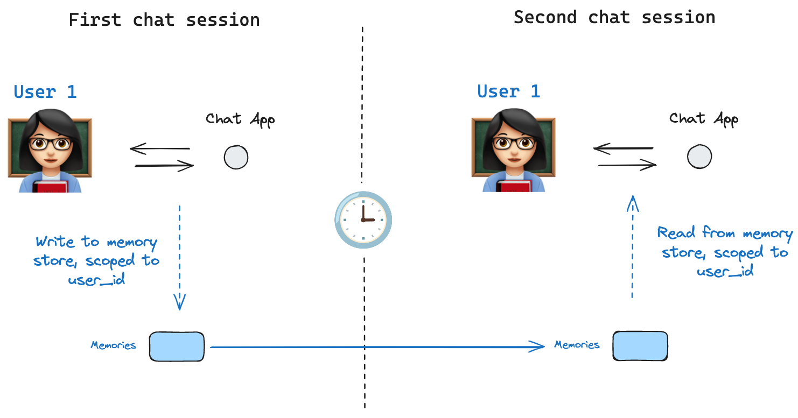

# Stores

> LangGraph stores provide cross-thread long-term memory, complementing per-thread checkpointer persistence.

Stores let agents persist information across threads, including user preferences, accumulated knowledge, and facts that should survive beyond a single conversation. Unlike [checkpointers](Checkpointers.md), which save the full graph state scoped to one thread, stores hold arbitrary key-value data accessible from any thread.



> [!NOTE]
>
> **Agent Server handles stores automatically**
> When using the [Agent Server](https://docs.langchain.com/langsmith/agent-server.md), you do not need to implement or configure stores manually. The API handles all storage infrastructure for you behind the scenes.

> [!NOTE]
>
> [InMemoryStore](https://reference.langchain.com/python/langchain-core/stores/InMemoryStore) is suitable for development and testing. For production, use a persistent store like `PostgresStore`, `MongoDBStore`, `RedisStore`, or `UpstashStore`. All implementations extend [BaseStore](https://reference.langchain.com/python/langchain-core/stores/BaseStore), which is the type annotation to use in node function signatures.

> [!NOTE]
>
> See [store integrations](https://docs.langchain.com/oss/python/integrations/long-term-memory/index.md) for the full list of available providers.

## Basic usage

The following code snippet shows the [InMemoryStore](https://reference.langchain.com/python/langchain-core/stores/InMemoryStore) in isolation without using LangGraph:

```python
from langgraph.store.memory import InMemoryStore
store = InMemoryStore()
```

Memories are namespaced by a `tuple`, which is `(<user_id>, "memories")` in the following example. The namespace can be any length and represent anything, does not have to be user specific.

```python
user_id = "1"
namespace_for_memory = (user_id, "memories")
```

Use the `store.put` method to save memories to the namespace in the store. Specify the namespace, as defined above, and a key-value pair for the memory: the key is simply a unique identifier for the memory (`memory_id`) and the value (a dictionary) is the memory itself.

```python
memory_id = str(uuid7())
memory = {"food_preference" : "I like pizza"}
store.put(namespace_for_memory, memory_id, memory)
```

Read out memories from your namespace using the `store.search` method, which returns memories for a given user as a list, up to the `limit` argument (default `10`). With `InMemoryStore`, items are returned in insertion order, so the most recent memory is last in the list; other backends may order memories differently (see [Listing items in a namespace](#listing-items-in-a-namespace)).

```python
memories = store.search(namespace_for_memory)
memories[-1].dict()
{'value': {'food_preference': 'I like pizza'},
 'key': '07e0caf4-1631-47b7-b15f-65515d4c1843',
 'namespace': ['1', 'memories'],
 'created_at': '2024-10-02T17:22:31.590602+00:00',
 'updated_at': '2024-10-02T17:22:31.590605+00:00'}
```

Each memory type is a Python class ([`Item`](https://reference.langchain.com/python/langgraph.store/base/Item)) with certain attributes. We can access it as a dictionary by converting with `.dict`.

The attributes it has are:

* `value`: The value (itself a dictionary) of this memory

* `key`: A unique key for this memory in this namespace

* `namespace`: A tuple of strings, the namespace of this memory type

  > [!NOTE]
  >
  > While the type is `tuple[str, ...]`, it may be serialized as a list when converted to JSON (for example, `['1', 'memories']`).

* `created_at`: Timestamp for when this memory was created

* `updated_at`: Timestamp for when this memory was updated

## Listing items in a namespace

Calling [`store.search`](https://reference.langchain.com/python/langgraph/store) (or the async [`store.asearch`](https://reference.langchain.com/python/langgraph/store)) with no `query` and no `filter` returns the items stored under `namespace_prefix`, up to `limit`. Use this to enumerate everything in a namespace when you don't need semantic ranking.

```python
# Return up to 100 items stored under ("alice", "memories").
items = store.search(("alice", "memories"), limit=100)
```

Three behaviors to keep in mind:

* **`namespace_prefix` matches by prefix, not exactly.** `("alice",)` also returns items under `("alice", "memories")`, `("alice", "preferences")`, and so on. To restrict to a single level, pass the full namespace or filter the returned items client-side on `item.namespace`.
* **Results past `limit` are silently truncated.** There is no overflow signal—set `limit` above your expected maximum, or paginate with `offset`.
* **Default ordering depends on the store backend.** `PostgresStore` and `AsyncPostgresStore` return results ordered by `updated_at` descending (most recently updated first). `InMemoryStore` returns results in insertion order (most recently inserted last). Do not rely on a specific order across implementations; sort client-side on `item.updated_at` if order matters.

To page through a large namespace:

```python
page_size = 50
offset = 0
while True:
    page = store.search(("alice", "memories"), limit=page_size, offset=offset)
    if not page:
        break
    for item in page:
        pass
    offset += page_size
```

To discover which namespaces exist (for example, to iterate over every user before listing their memories), use [`store.list_namespaces`](https://reference.langchain.com/python/langgraph/store) or [`store.alist_namespaces`](https://reference.langchain.com/python/langgraph/store):

```python
# All namespaces that start with ("alice",), truncated to two levels deep.
namespaces = store.list_namespaces(prefix=("alice",), max_depth=2)
```

## Semantic search

Beyond simple retrieval, the store also supports semantic search, allowing you to find memories based on meaning rather than exact matches. To enable this, configure the store with an embedding model:

```python
from langchain.embeddings import init_embeddings

store = InMemoryStore(
    index={
        "embed": init_embeddings("openai:text-embedding-3-small"),  # Embedding provider
        "dims": 1536,                              # Embedding dimensions
        "fields": ["food_preference", "$"]              # Fields to embed
    }
)
```

Now when searching, you can use natural language queries to find relevant memories:

```python
# Find memories about food preferences
# (This can be done after putting memories into the store)
memories = store.search(
    namespace_for_memory,
    query="What does the user like to eat?",
    limit=3  # Return top 3 matches
)
```

You can control which parts of your memories get embedded by configuring the `fields` parameter or by specifying the `index` parameter when storing memories:

```python
# Store with specific fields to embed
store.put(
    namespace_for_memory,
    str(uuid7()),
    {
        "food_preference": "I love Italian cuisine",
        "context": "Discussing dinner plans"
    },
    index=["food_preference"]  # Only embed "food_preferences" field
)

# Store without embedding (still retrievable, but not searchable)
store.put(
    namespace_for_memory,
    str(uuid7()),
    {"system_info": "Last updated: 2024-01-01"},
    index=False
)
```

## Using in LangGraph

The store works hand-in-hand with the checkpointer: the checkpointer saves state to threads, as discussed above, and the store allows you to store arbitrary information for access *across* threads. Compile the graph with both the checkpointer and the store as follows.

```python
from dataclasses import dataclass
from langgraph.checkpoint.memory import InMemorySaver

@dataclass
class Context:
    user_id: str

# We need this because we want to enable threads (conversations)
checkpointer = InMemorySaver()

# ... Define the graph ...

# Compile the graph with the checkpointer and store
builder = StateGraph(MessagesState, context_schema=Context)
# ... add nodes and edges ...
graph = builder.compile(checkpointer=checkpointer, store=store)
```

Then invoke the graph with a `thread_id`, as before, and also with a `user_id`, which serves as the namespace for memories for this particular user as before.

```python
# Invoke the graph
config = {"configurable": {"thread_id": "1"}}

# First let's just say hi to the AI
for update in graph.stream(
    {"messages": [{"role": "user", "content": "hi"}]},
    config,
    stream_mode="updates",
    context=Context(user_id="1"),
):
    print(update)
```

You can access the store and the `user_id` from *any node* by using the `Runtime` object. The `Runtime` is automatically injected by LangGraph when you add it as a parameter to your node function. You can use it to save memories:

```python
from langgraph.runtime import Runtime
from dataclasses import dataclass

@dataclass
class Context:
    user_id: str

async def update_memory(state: MessagesState, runtime: Runtime[Context]):

    # Get the user id from the runtime context
    user_id = runtime.context.user_id

    # Namespace the memory
    namespace = (user_id, "memories")

    # ... Analyze conversation and create a new memory

    # Create a new memory ID
    memory_id = str(uuid7())

    # We create a new memory
    await runtime.store.aput(namespace, memory_id, {"memory": memory})

```

You can also access the store from any node and use the `store.search` method to get memories. Memories are returned as a list of objects that can be converted to a dictionary.

```python
memories[-1].dict()
{'value': {'food_preference': 'I like pizza'},
 'key': '07e0caf4-1631-47b7-b15f-65515d4c1843',
 'namespace': ['1', 'memories'],
 'created_at': '2024-10-02T17:22:31.590602+00:00',
 'updated_at': '2024-10-02T17:22:31.590605+00:00'}
```

You access the memories and use them in model calls.

```python
from dataclasses import dataclass
from langgraph.runtime import Runtime

@dataclass
class Context:
    user_id: str

async def call_model(state: MessagesState, runtime: Runtime[Context]):
    # Get the user id from the runtime context
    user_id = runtime.context.user_id

    # Namespace the memory
    namespace = (user_id, "memories")

    # Search based on the most recent message
    memories = await runtime.store.asearch(
        namespace,
        query=state["messages"][-1].content,
        limit=3
    )
    info = "\n".join([d.value["memory"] for d in memories])

    # ... Use memories in the model call
```

If you create a new thread, you can still access the same memories so long as the `user_id` is the same.

```python
# Invoke the graph on a new thread
config = {"configurable": {"thread_id": "2"}}

# Let's say hi again
for update in graph.stream(
    {"messages": [{"role": "user", "content": "hi, tell me about my memories"}]},
    config,
    stream_mode="updates",
    context=Context(user_id="1"),
):
    print(update)
```

When you use LangSmith locally (e.g., in [Studio](../LangSmith%20Studio.md)) or [hosted](https://docs.langchain.com/langsmith/platform-setup.md), the base store is available to use by default and you do not need to specify it during graph compilation. To enable semantic search, however, you **do** need to configure the indexing settings in your `langgraph.json` file. For example:

```json
{
    ...
    "store": {
        "index": {
            "embed": "openai:text-embeddings-3-small",
            "dims": 1536,
            "fields": ["$"]
        }
    }
}
```

See the [deployment guide](https://docs.langchain.com/langsmith/semantic-search.md) for more details and configuration options.

## Build a custom store

To use a storage backend other than the built-in implementations, subclass [BaseStore](https://reference.langchain.com/python/langchain-core/stores/BaseStore) and implement its required methods. The built-in [InMemoryStore](https://reference.langchain.com/python/langchain-core/stores/InMemoryStore) is the simplest reference implementation.

### Base contract

All five async methods are required. Sync counterparts (`put`, `get`, `delete`, `search`, `list_namespaces`) are optional but recommended for compatibility with sync graph execution.

| Method | Description |
| - | - |
| `aput(namespace, key, value, index=None)` | Store or overwrite a single item |
| `aget(namespace, key)` | Retrieve a single item by key; return `None` if missing |
| `adelete(namespace, key)` | Delete a single item |
| `asearch(namespace_prefix, *, query=None, filter=None, limit=10, offset=0)` | Search items under a namespace prefix; optionally by semantic query |
| `alist_namespaces(*, prefix=None, suffix=None, max_depth=None, limit=100, offset=0)` | List namespaces matching a prefix/suffix pattern |

Look up exact signatures before implementing:

```python
import inspect
from langgraph.store.base import BaseStore
print(inspect.getsource(BaseStore))
```

### Namespace design

Namespaces are tuples of strings, e.g. `("user_id", "memories")`. Store implementations must support:

* **Prefix matching**: `asearch(("alice",))` returns items under `("alice",)`, `("alice", "memories")`, and any other sub-namespace.
* **Exact key lookup**: `aget(("alice", "memories"), "some-key")` must be O(1) or close to it.

For SQL backends, a common schema:

```sql
CREATE TABLE store_items (
    namespace   TEXT[] NOT NULL,
    key         TEXT NOT NULL,
    value       JSONB NOT NULL,
    created_at  TIMESTAMPTZ DEFAULT now(),
    updated_at  TIMESTAMPTZ DEFAULT now(),
    PRIMARY KEY (namespace, key)
);

CREATE INDEX ON store_items USING gin(namespace);
```

### Serialization

Store values are plain Python dicts — no special serializer is required. Serialize with `json.dumps` / `json.loads` or a JSONB column directly. Do not store raw Python objects that are not JSON-serializable.

### Semantic search support

If your backend supports vector search, implement the `query` parameter on `asearch`:

* Accept a `query: str | None` argument.
* When `query` is not `None`, embed it and rank results by cosine similarity.
* Results should include a `score` field on each `Item` when `query` is provided.

If your backend does not support vector search, raise `NotImplementedError` when `query` is passed.

### Testing

There is currently no conformance suite for custom stores. Test against [InMemoryStore](https://reference.langchain.com/python/langchain-core/stores/InMemoryStore) as the reference:

```python
import pytest
from langgraph.store.memory import InMemoryStore
from your_module import YourStore

@pytest.fixture
async def store():
    async with YourStore.create() as s:
        yield s

@pytest.fixture
def reference():
    return InMemoryStore()

async def test_put_and_get(store, reference):
    ns = ("test", "ns")
    for s in [store, reference]:
        await s.aput(ns, "k1", {"val": 1})
        item = await s.aget(ns, "k1")
        assert item is not None
        assert item.value == {"val": 1}

async def test_delete(store, reference):
    ns = ("test", "ns")
    for s in [store, reference]:
        await s.aput(ns, "k1", {"val": 1})
        await s.adelete(ns, "k1")
        assert await s.aget(ns, "k1") is None

async def test_search_prefix(store, reference):
    for s in [store, reference]:
        await s.aput(("user", "memories"), "m1", {"text": "likes pizza"})
        results = await s.asearch(("user",))
        assert any(r.key == "m1" for r in results)
```

### Next steps

* [Add a custom store to Agent Server](https://docs.langchain.com/langsmith/custom-store.md) — deploying your implementation
* [Checkpointers](Checkpointers.md) — thread-scoped state persistence
