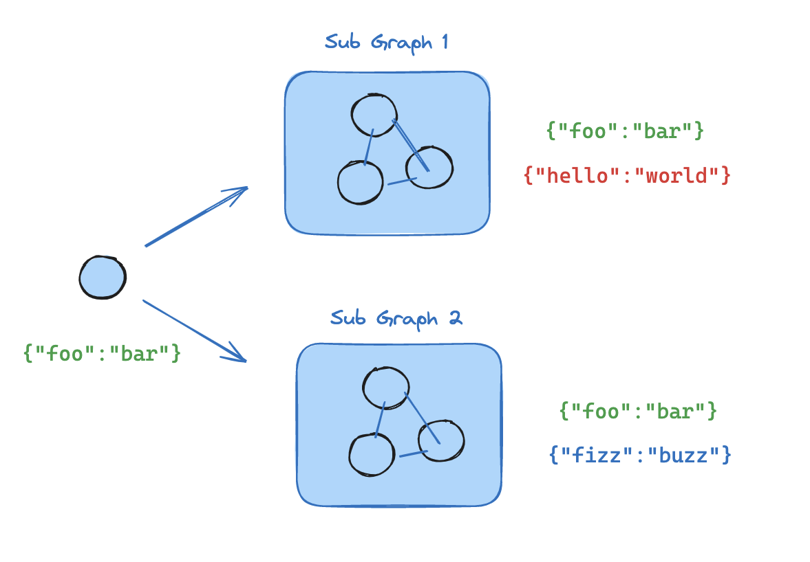

# Subgraphs

This guide explains the mechanics of using subgraphs. A subgraph is a [graph](../Build%20with%20the%20Graph%20API/Graph%20API%20overview.md#graphs) that is used as a [node](../Build%20with%20the%20Graph%20API/Graph%20API%20overview.md#nodes) in another graph.

Subgraphs are useful for:

* Building [multi-agent systems](https://docs.langchain.com/oss/python/langchain/multi-agent.md)
* Reusing a set of nodes in multiple graphs
* Distributing development: when you want different teams to work on different parts of the graph independently, you can define each part as a subgraph, and as long as the subgraph interface (the input and output schemas) is respected, the parent graph can be built without knowing any details of the subgraph

## Setup

```bash pip
pip install -U langgraph
```

```bash uv
uv add langgraph
```

> [!TIP]
>
> **Set up LangSmith for LangGraph development**
> Sign up for [LangSmith](https://smith.langchain.com?utm_source=docs&utm_medium=cta&utm_campaign=langsmith-signup&utm_content=oss-langgraph-use-subgraphs) to quickly spot issues and improve the performance of your LangGraph projects. LangSmith lets you use trace data to debug, test, and monitor your LLM apps built with LangGraph—read more about [how to get started with LangSmith](https://docs.langchain.com/langsmith/observability.md).

## Define subgraph communication

When adding subgraphs, you need to define how the parent graph and the subgraph communicate:

| Pattern | When to use | State schemas |
| - | - | - |
| [Call a subgraph inside a node](#call-a-subgraph-inside-a-node) | Parent and subgraph have **different state schemas** (no shared keys), or you need to transform state between them | You write a wrapper function that maps parent state to subgraph input and subgraph output back to parent state |
| [Add a subgraph as a node](#add-a-subgraph-as-a-node) | Parent and subgraph **share state keys**—the subgraph reads from and writes to the same channels as the parent | You pass the compiled subgraph directly to `add_node`—no wrapper function needed |

### Call a subgraph inside a node

When the parent graph and subgraph have **different state schemas** (no shared keys), invoke the subgraph inside a node function. This is common when you want to keep a private message history for each agent in a [multi-agent](https://docs.langchain.com/oss/python/langchain/multi-agent.md) system.

The node function transforms the parent state to the subgraph state before invoking the subgraph, and transforms the results back to the parent state before returning.

```python
from typing_extensions import TypedDict
from langgraph.graph.state import StateGraph, START

class SubgraphState(TypedDict):
    bar: str

# Subgraph

def subgraph_node_1(state: SubgraphState):
    return {"bar": "hi! " + state["bar"]}

subgraph_builder = StateGraph(SubgraphState)
subgraph_builder.add_node(subgraph_node_1)
subgraph_builder.add_edge(START, "subgraph_node_1")
subgraph = subgraph_builder.compile()

# Parent graph

class State(TypedDict):
    foo: str

def call_subgraph(state: State):
    # Transform the state to the subgraph state
    subgraph_output = subgraph.invoke({"bar": state["foo"]})  # [!code highlight]
    # Transform response back to the parent state
    return {"foo": subgraph_output["bar"]}

builder = StateGraph(State)
builder.add_node("node_1", call_subgraph)
builder.add_edge(START, "node_1")
graph = builder.compile()
```

> [accordion] Full example: different state schemas
>
> ```python theme={"theme":{"light":"catppuccin-latte","dark":"catppuccin-mocha"}}
> from typing_extensions import TypedDict
> from langgraph.graph.state import StateGraph, START
> from langgraph.stream import UpdatesTransformer
>
> # Define subgraph
> class SubgraphState(TypedDict):
>     # note that none of these keys are shared with the parent graph state
>     bar: str
>     baz: str
>
> def subgraph_node_1(state: SubgraphState):
>     return {"baz": "baz"}
>
> def subgraph_node_2(state: SubgraphState):
>     return {"bar": state["bar"] + state["baz"]}
>
> subgraph_builder = StateGraph(SubgraphState)
> subgraph_builder.add_node(subgraph_node_1)
> subgraph_builder.add_node(subgraph_node_2)
> subgraph_builder.add_edge(START, "subgraph_node_1")
> subgraph_builder.add_edge("subgraph_node_1", "subgraph_node_2")
> subgraph = subgraph_builder.compile()
>
> # Define parent graph
> class ParentState(TypedDict):
>     foo: str
>
> def node_1(state: ParentState):
>     return {"foo": "hi! " + state["foo"]}
>
> def node_2(state: ParentState):
>     # Transform the state to the subgraph state
>     response = subgraph.invoke({"bar": state["foo"]})
>     # Transform response back to the parent state
>     return {"foo": response["bar"]}
>
>
> builder = StateGraph(ParentState)
> builder.add_node("node_1", node_1)
> builder.add_node("node_2", node_2)
> builder.add_edge(START, "node_1")
> builder.add_edge("node_1", "node_2")
> graph = builder.compile()
>
> stream = graph.stream_events({"foo": "foo"}, version="v3", transformers=[UpdatesTransformer])
> for event in stream:
>     if event["method"] == "updates":
>         print(event["params"]["namespace"], event["params"]["data"])
> ```
>
> ```
> [] {'node_1': {'foo': 'hi! foo'}}
> ['node_2:577b710b-64ae-31fb-9455-6a4d4cc2b0b9'] {'subgraph_node_1': {'baz': 'baz'}}
> ['node_2:577b710b-64ae-31fb-9455-6a4d4cc2b0b9'] {'subgraph_node_2': {'bar': 'hi! foobaz'}}
> [] {'node_2': {'foo': 'hi! foobaz'}}
> ```

> [accordion] Full example: different state schemas (two levels of subgraphs)
>
> This is an example with two levels of subgraphs: parent -> child -> grandchild.
>
> ```python theme={"theme":{"light":"catppuccin-latte","dark":"catppuccin-mocha"}}
> # Grandchild graph
> from typing_extensions import TypedDict
> from langgraph.graph.state import StateGraph, START, END
> from langgraph.stream import UpdatesTransformer
>
> class GrandChildState(TypedDict):
>     my_grandchild_key: str
>
> def grandchild_1(state: GrandChildState) -> GrandChildState:
>     # NOTE: child or parent keys will not be accessible here
>     return {"my_grandchild_key": state["my_grandchild_key"] + ", how are you"}
>
>
> grandchild = StateGraph(GrandChildState)
> grandchild.add_node("grandchild_1", grandchild_1)
>
> grandchild.add_edge(START, "grandchild_1")
> grandchild.add_edge("grandchild_1", END)
>
> grandchild_graph = grandchild.compile()
>
> # Child graph
> class ChildState(TypedDict):
>     my_child_key: str
>
> def call_grandchild_graph(state: ChildState) -> ChildState:
>     # NOTE: parent or grandchild keys won't be accessible here
>     grandchild_graph_input = {"my_grandchild_key": state["my_child_key"]}
>     grandchild_graph_output = grandchild_graph.invoke(grandchild_graph_input)
>     return {"my_child_key": grandchild_graph_output["my_grandchild_key"] + " today?"}
>
> child = StateGraph(ChildState)
> # We're passing a function here instead of just compiled graph (`grandchild_graph`)
> child.add_node("child_1", call_grandchild_graph)
> child.add_edge(START, "child_1")
> child.add_edge("child_1", END)
> child_graph = child.compile()
>
> # Parent graph
> class ParentState(TypedDict):
>     my_key: str
>
> def parent_1(state: ParentState) -> ParentState:
>     # NOTE: child or grandchild keys won't be accessible here
>     return {"my_key": "hi " + state["my_key"]}
>
> def parent_2(state: ParentState) -> ParentState:
>     return {"my_key": state["my_key"] + " bye!"}
>
> def call_child_graph(state: ParentState) -> ParentState:
>     child_graph_input = {"my_child_key": state["my_key"]}
>     child_graph_output = child_graph.invoke(child_graph_input)
>     return {"my_key": child_graph_output["my_child_key"]}
>
> parent = StateGraph(ParentState)
> parent.add_node("parent_1", parent_1)
> # We're passing a function here instead of just a compiled graph (`child_graph`)
> parent.add_node("child", call_child_graph)
> parent.add_node("parent_2", parent_2)
>
> parent.add_edge(START, "parent_1")
> parent.add_edge("parent_1", "child")
> parent.add_edge("child", "parent_2")
> parent.add_edge("parent_2", END)
>
> parent_graph = parent.compile()
>
> stream = parent_graph.stream_events({"my_key": "Bob"}, version="v3", transformers=[UpdatesTransformer])
> for event in stream:
>     if event["method"] == "updates":
>         print(event["params"]["namespace"], event["params"]["data"])
> ```
>
> ```
> [] {'parent_1': {'my_key': 'hi Bob'}}
> ['child:2e26e9ce-602f-862c-aa66-1ea5a4655e3b', 'child_1:781bb3b1-3971-84ce-810b-acf819a03f9c'] {'grandchild_1': {'my_grandchild_key': 'hi Bob, how are you'}}
> ['child:2e26e9ce-602f-862c-aa66-1ea5a4655e3b'] {'child_1': {'my_child_key': 'hi Bob, how are you today?'}}
> [] {'child': {'my_key': 'hi Bob, how are you today?'}}
> [] {'parent_2': {'my_key': 'hi Bob, how are you today? bye!'}}
> ```

### Add a subgraph as a node

When the parent graph and subgraph **share state keys**, you can pass a compiled subgraph directly to `add_node`. No wrapper function is needed—the subgraph reads from and writes to the parent's state channels automatically. For example, in [multi-agent](https://docs.langchain.com/oss/python/langchain/multi-agent.md) systems, the agents often communicate over a shared [messages](../Build%20with%20the%20Graph%20API/Graph%20API%20overview.md#why-use-messages) key.



If your subgraph shares state keys with the parent graph, you can follow these steps to add it to your graph:

1. Define the subgraph workflow (`subgraph_builder` in the example below) and compile it
2. Pass compiled subgraph to the [`add_node`](https://reference.langchain.com/python/langgraph/graph/state/StateGraph/add_node) method when defining the parent graph workflow

```python
from typing_extensions import TypedDict
from langgraph.graph.state import StateGraph, START

class State(TypedDict):
    foo: str

# Subgraph

def subgraph_node_1(state: State):
    return {"foo": "hi! " + state["foo"]}

subgraph_builder = StateGraph(State)
subgraph_builder.add_node(subgraph_node_1)
subgraph_builder.add_edge(START, "subgraph_node_1")
subgraph = subgraph_builder.compile()

# Parent graph

builder = StateGraph(State)
builder.add_node("node_1", subgraph)  # [!code highlight]
builder.add_edge(START, "node_1")
graph = builder.compile()
```

> [accordion] Full example: shared state schemas
>
> ```python theme={"theme":{"light":"catppuccin-latte","dark":"catppuccin-mocha"}}
> from typing_extensions import TypedDict
> from langgraph.graph.state import StateGraph, START
> from langgraph.stream import UpdatesTransformer
>
> # Define subgraph
> class SubgraphState(TypedDict):
>     foo: str  # shared with parent graph state
>     bar: str  # private to SubgraphState
>
> def subgraph_node_1(state: SubgraphState):
>     return {"bar": "bar"}
>
> def subgraph_node_2(state: SubgraphState):
>     # note that this node is using a state key ('bar') that is only available in the subgraph
>     # and is sending update on the shared state key ('foo')
>     return {"foo": state["foo"] + state["bar"]}
>
> subgraph_builder = StateGraph(SubgraphState)
> subgraph_builder.add_node(subgraph_node_1)
> subgraph_builder.add_node(subgraph_node_2)
> subgraph_builder.add_edge(START, "subgraph_node_1")
> subgraph_builder.add_edge("subgraph_node_1", "subgraph_node_2")
> subgraph = subgraph_builder.compile()
>
> # Define parent graph
> class ParentState(TypedDict):
>     foo: str
>
> def node_1(state: ParentState):
>     return {"foo": "hi! " + state["foo"]}
>
> builder = StateGraph(ParentState)
> builder.add_node("node_1", node_1)
> builder.add_node("node_2", subgraph)
> builder.add_edge(START, "node_1")
> builder.add_edge("node_1", "node_2")
> graph = builder.compile()
>
> stream = graph.stream_events({"foo": "foo"}, version="v3", transformers=[UpdatesTransformer])
> for event in stream:
>     if event["method"] == "updates" and not event["params"]["namespace"]:
>         print(event["params"]["data"])
> ```
>
> ```
> {'node_1': {'foo': 'hi! foo'}}
> {'node_2': {'foo': 'hi! foobar'}}
> ```

## Subgraph persistence

When you use a subgraph, you need to decide what happens to its internal data between calls. Consider a customer support bot that delegates to specialist subagents: should the "billing expert" subagent remember the customer's earlier questions, or start fresh each time it's called?

The `checkpointer` parameter on `.compile()` controls subgraph persistence:

| Mode | `checkpointer=` | Behavior |
| - | - | - |
| [Per-invocation](#per-invocation-default) | `None` (default) | Each call starts fresh and inherits the parent's checkpointer to support [interrupts](Interrupts.md) and [durable execution](Persistence.md) within a single call. |
| [Per-thread](#per-thread) | `True` | State accumulates across calls on the same thread. Each call picks up where the last one left off. |
| [Stateless](#stateless) | `False` | No checkpointing at all—runs like a plain function call. No interrupts or durable execution. |

Per-invocation is the right choice for most applications, including [multi-agent](https://docs.langchain.com/oss/python/langchain/multi-agent.md) systems where subagents handle independent requests. Use per-thread when a subagent needs multi-turn conversation memory (for example, a research assistant that builds context over several exchanges).

> [!NOTE]
>
> The parent graph must be compiled with a checkpointer for subgraph persistence features (interrupts, state inspection, per-thread memory) to work. See [persistence](Persistence.md).

> [!NOTE]
>
> The examples below use LangChain's [`create_agent`](https://reference.langchain.com/python/langchain/agents/factory/create_agent), which is a common way to build agents. `create_agent` produces a [LangGraph graph](../Build%20with%20the%20Graph%20API/Graph%20API%20overview.md) under the hood, so all subgraph persistence concepts apply directly. If you're building with raw LangGraph `StateGraph`, the same patterns and configuration options apply—see the [Graph API](../Build%20with%20the%20Graph%20API/Graph%20API%20overview.md) for details.

### Stateful

Stateful subgraphs inherit the parent graph's checkpointer, which enables [interrupts](Interrupts.md), [persistence](Persistence.md), and state inspection. The two stateful modes differ in how long state is retained.

#### Per-invocation (default)

> [!TIP]
>
> This is the recommended mode for most applications, including [multi-agent](https://docs.langchain.com/oss/python/langchain/multi-agent.md) systems where subagents are invoked as tools. It supports [interrupts](Interrupts.md), [persistence](Persistence.md), and parallel calls while keeping each invocation isolated.

Use per-invocation persistence when each call to the subgraph is independent and the subagent doesn't need to remember anything from previous calls. This is the most common pattern, especially for [multi-agent](https://docs.langchain.com/oss/python/langchain/multi-agent.md) systems where subagents handle one-off requests like "look up this customer's order" or "summarize this document."

Omit `checkpointer` or set it to `None`. Each call starts fresh, but within a single call the subgraph inherits the parent's checkpointer and can use `interrupt()` to pause and resume.

The following examples use two subagents (fruit expert, veggie expert) wrapped as tools for an outer agent:

```python
from langchain.agents import create_agent
from langchain.tools import tool
from langgraph.checkpoint.memory import MemorySaver
from langgraph.types import Command, interrupt

@tool
def fruit_info(fruit_name: str) -> str:
    """Look up fruit info."""
    return f"Info about {fruit_name}"

@tool
def veggie_info(veggie_name: str) -> str:
    """Look up veggie info."""
    return f"Info about {veggie_name}"

# Subagents - no checkpointer setting (inherits parent)
fruit_agent = create_agent(
    model="gpt-5.4-mini",
    tools=[fruit_info],
    prompt="You are a fruit expert. Use the fruit_info tool. Respond in one sentence.",
)

veggie_agent = create_agent(
    model="gpt-5.4-mini",
    tools=[veggie_info],
    prompt="You are a veggie expert. Use the veggie_info tool. Respond in one sentence.",
)

# Wrap subagents as tools for the outer agent
@tool
def ask_fruit_expert(question: str) -> str:
    """Ask the fruit expert. Use for ALL fruit questions."""
    response = fruit_agent.invoke(
        {"messages": [{"role": "user", "content": question}]},
    )
    return response["messages"][-1].content

@tool
def ask_veggie_expert(question: str) -> str:
    """Ask the veggie expert. Use for ALL veggie questions."""
    response = veggie_agent.invoke(
        {"messages": [{"role": "user", "content": question}]},
    )
    return response["messages"][-1].content

# Outer agent with checkpointer
agent = create_agent(
    model="gpt-5.4-mini",
    tools=[ask_fruit_expert, ask_veggie_expert],
    prompt=(
        "You have two experts: ask_fruit_expert and ask_veggie_expert. "
        "ALWAYS delegate questions to the appropriate expert."
    ),
    checkpointer=MemorySaver(),
)
```

> [tab] Interrupts
>
> Each invocation can use `interrupt()` to pause and resume. Add `interrupt()` to a tool function to require user approval before proceeding:
>
> ```python theme={"theme":{"light":"catppuccin-latte","dark":"catppuccin-mocha"}}
> @tool
> def fruit_info(fruit_name: str) -> str:
>     """Look up fruit info."""
>     interrupt("continue?")  # [!code highlight]
>     return f"Info about {fruit_name}"
> ```
>
> ```python theme={"theme":{"light":"catppuccin-latte","dark":"catppuccin-mocha"}}
> from langgraph.types import Command
>
> config = {"configurable": {"thread_id": "1"}}
>
> # Stream events - the subagent's tool calls interrupt()
> stream = agent.stream_events(
>     {"messages": [{"role": "user", "content": "Tell me about apples"}]},
>     config=config,
>     version="v3",
> )
> output = stream.output  # drive the stream to completion
> # stream.interrupts contains pending interrupts (and stream.interrupted is True)
>
> # Resume - approve the interrupt
> resumed = agent.stream_events(Command(resume=True), config=config, version="v3")
> final = resumed.output
> ```
>
> > [card] [View example trace](https://smith.langchain.com/public/17bf6cab-dbeb-4977-8c29-bb855291903e/r)
> >
> > Open a public LangSmith run for this example.

> [tab] Multi-turn
>
> Each invocation starts with a fresh subagent state. The subagent does not remember previous calls:
>
> ```python theme={"theme":{"light":"catppuccin-latte","dark":"catppuccin-mocha"}}
> config = {"configurable": {"thread_id": "1"}}
>
> # First call
> response = agent.invoke(
>     {"messages": [{"role": "user", "content": "Tell me about apples"}]},
>     config=config,
> )
> # Subagent message count: 4
>
> # Second call - subagent starts fresh, no memory of apples
> response = agent.invoke(
>     {"messages": [{"role": "user", "content": "Now tell me about bananas"}]},
>     config=config,
> )
> # Subagent message count: 4 (still fresh!)
> ```

> [tab] Multiple subgraph calls
>
> Multiple calls to the same subgraph work without conflicts, since each invocation gets its own checkpoint namespace:
>
> ```python theme={"theme":{"light":"catppuccin-latte","dark":"catppuccin-mocha"}}
> config = {"configurable": {"thread_id": "1"}}
>
> # LLM calls ask_fruit_expert for both apples and bananas
> response = agent.invoke(
>     {"messages": [{"role": "user", "content": "Tell me about apples and bananas"}]},
>     config=config,
> )
> # Subagent message count: 4 (apples - fresh)
> # Subagent message count: 4 (bananas - fresh)
> ```

#### Per-thread

Use per-thread persistence when a subagent needs to remember previous interactions. For example, a research assistant that builds up context over several exchanges, or a coding assistant that tracks what files it has already edited. The subagent's conversation history and data accumulate across calls on the same thread. Each call picks up where the last one left off.

Compile with `checkpointer=True` to enable this behavior.

> [!WARNING]
>
> Per-thread subgraphs do not support parallel tool calls. When an LLM has access to a per-thread subagent as a tool, it may try to call that tool multiple times in parallel (for example, asking the fruit expert about apples and bananas simultaneously). This causes checkpoint conflicts because both calls write to the same namespace.
>
> The examples below use LangChain's `ToolCallLimitMiddleware` to prevent this. If you're building with pure LangGraph `StateGraph`, you need to prevent parallel tool calls yourself—for example, by configuring your model to disable parallel tool calling or by adding logic to ensure the same subgraph is not invoked multiple times in parallel.

The following examples use a fruit expert subagent compiled with `checkpointer=True`:

```python
from langchain.agents import create_agent
from langchain.agents.middleware import ToolCallLimitMiddleware
from langchain.tools import tool
from langgraph.checkpoint.memory import MemorySaver
from langgraph.types import Command, interrupt

@tool
def fruit_info(fruit_name: str) -> str:
    """Look up fruit info."""
    return f"Info about {fruit_name}"

# Subagent with checkpointer=True for persistent state
fruit_agent = create_agent(
    model="gpt-5.4-mini",
    tools=[fruit_info],
    prompt="You are a fruit expert. Use the fruit_info tool. Respond in one sentence.",
    checkpointer=True,  # [!code highlight]
)

# Wrap subagent as a tool for the outer agent
@tool
def ask_fruit_expert(question: str) -> str:
    """Ask the fruit expert. Use for ALL fruit questions."""
    response = fruit_agent.invoke(
        {"messages": [{"role": "user", "content": question}]},
    )
    return response["messages"][-1].content

# Outer agent with checkpointer
# Use ToolCallLimitMiddleware to prevent parallel calls to per-thread subagents,
# which would cause checkpoint conflicts.
agent = create_agent(
    model="gpt-5.4-mini",
    tools=[ask_fruit_expert],
    prompt="You have a fruit expert. ALWAYS delegate fruit questions to ask_fruit_expert.",
    middleware=[  # [!code highlight]
        ToolCallLimitMiddleware(tool_name="ask_fruit_expert", run_limit=1),  # [!code highlight]
    ],  # [!code highlight]
    checkpointer=MemorySaver(),
)
```

> [tab] Interrupts
>
> Per-thread subagents support `interrupt()` just like per-invocation. Add `interrupt()` to a tool function to require user approval:
>
> ```python theme={"theme":{"light":"catppuccin-latte","dark":"catppuccin-mocha"}}
> @tool
> def fruit_info(fruit_name: str) -> str:
>     """Look up fruit info."""
>     interrupt("continue?")  # [!code highlight]
>     return f"Info about {fruit_name}"
> ```
>
> ```python theme={"theme":{"light":"catppuccin-latte","dark":"catppuccin-mocha"}}
> from langgraph.types import Command
>
> config = {"configurable": {"thread_id": "1"}}
>
> # Stream events - the subagent's tool calls interrupt()
> stream = agent.stream_events(
>     {"messages": [{"role": "user", "content": "Tell me about apples"}]},
>     config=config,
>     version="v3",
> )
> output = stream.output  # drive the stream to completion
> # stream.interrupts contains pending interrupts (and stream.interrupted is True)
>
> # Resume - approve the interrupt
> resumed = agent.stream_events(Command(resume=True), config=config, version="v3")
> final = resumed.output
> ```
>
> > [card] [View example trace](https://smith.langchain.com/public/17bf6cab-dbeb-4977-8c29-bb855291903e/r)
> >
> > Open a public LangSmith run for this example.

> [tab] Multi-turn
>
> State accumulates across invocations—the subagent remembers past conversations:
>
> ```python theme={"theme":{"light":"catppuccin-latte","dark":"catppuccin-mocha"}}
> config = {"configurable": {"thread_id": "1"}}
>
> # First call
> response = agent.invoke(
>     {"messages": [{"role": "user", "content": "Tell me about apples"}]},
>     config=config,
> )
> # Subagent message count: 4
>
> # Second call - subagent REMEMBERS apples conversation
> response = agent.invoke(
>     {"messages": [{"role": "user", "content": "Now tell me about bananas"}]},
>     config=config,
> )
> # Subagent message count: 8 (accumulated!)
> ```

> [tab] Multiple subgraph calls
>
> When you have multiple **different** per-thread subgraphs (for example, a fruit expert and a veggie expert), each one needs its own storage space so their checkpoints don't overwrite each other. This is called **namespace isolation**.
>
> If you [call subgraphs inside a node](#call-a-subgraph-inside-a-node), LangGraph assigns namespaces based on call order (first call, second call, etc.). This means reordering your calls can mix up which subgraph loads which state. To avoid this, wrap each subagent in its own `StateGraph` with a unique node name—this gives each subgraph a stable, unique namespace:
>
> ```python theme={"theme":{"light":"catppuccin-latte","dark":"catppuccin-mocha"}}
> from langgraph.graph import MessagesState, StateGraph
>
> def create_sub_agent(model, *, name, **kwargs):
>     """Wrap an agent with a unique node name for namespace isolation."""
>     agent = create_agent(model=model, name=name, **kwargs)
>     return (
>         StateGraph(MessagesState)
>         .add_node(name, agent)  # unique name → stable namespace  # [!code highlight]
>         .add_edge("__start__", name)
>         .compile()
>     )
>
> fruit_agent = create_sub_agent(
>     "gpt-5.4-mini", name="fruit_agent",
>     tools=[fruit_info], prompt="...", checkpointer=True,
> )
> veggie_agent = create_sub_agent(
>     "gpt-5.4-mini", name="veggie_agent",
>     tools=[veggie_info], prompt="...", checkpointer=True,
> )
>
> config = {"configurable": {"thread_id": "1"}}
>
> # First call - LLM calls both fruit and veggie experts
> response = agent.invoke(
>     {"messages": [{"role": "user", "content": "Tell me about cherries and broccoli"}]},
>     config=config,
> )
> # Fruit subagent message count: 4
> # Veggie subagent message count: 4
>
> # Second call - both agents accumulate independently
> response = agent.invoke(
>     {"messages": [{"role": "user", "content": "Now tell me about oranges and carrots"}]},
>     config=config,
> )
> # Fruit subagent message count: 8 (remembers cherries!)
> # Veggie subagent message count: 8 (remembers broccoli!)
> ```
>
> Subgraphs [added as nodes](#add-a-subgraph-as-a-node) already get name-based namespaces automatically, so they don't need this wrapper.

### Stateless

Use this when you want to run a subagent like a plain function call with no checkpointing overhead. The subgraph cannot pause/resume and does not benefit from [durable execution](Persistence.md). Compile with `checkpointer=False`.

> [!WARNING]
>
> Without checkpointing, the subgraph has no durable execution. If the process crashes mid-run, the subgraph cannot recover and must be re-run from the beginning.

```python
subgraph_builder = StateGraph(...)
subgraph = subgraph_builder.compile(checkpointer=False)  # [!code highlight]
```

### Checkpointer reference

Control subgraph persistence with the `checkpointer` parameter on `.compile()`:

```python
subgraph = builder.compile(checkpointer=False)  # or True / None
```

| Feature | Per-invocation (default) | Per-thread | Stateless |
| - | - | - | - |
| `checkpointer=` | `None` | `True` | `False` |
| Interrupts (HITL) | ✅ | ✅ | ❌ |
| Multi-turn memory | ❌ | ✅ | ❌ |
| Multiple calls (different subgraphs) | ✅ | ⚠️ (Calls to multiple per-thread subgraphs in the same node can cause namespace conflicts. Workarounds are available.) | ✅ |
| Multiple calls (same subgraph) | ✅ | ❌ | ✅ |
| State inspection | ⚠️ (State inspection with per-invocation persistence is available for the current invocation only (while interrupted). Each invocation starts fresh, so there is no accumulated state to inspect after the invocation completes.) | ✅ | ❌ |

* **Interrupts (HITL)**: The subgraph can use [interrupt()](Interrupts.md) to pause execution and wait for user input, then resume where it left off.
* **Multi-turn memory**: The subgraph retains its state across multiple invocations within the same [thread](Checkpointers.md#threads). Each call picks up where the last one left off rather than starting fresh.
* **Multiple calls (different subgraphs)**: Multiple different subgraph instances can be invoked within a single node without checkpoint namespace conflicts.
* **Multiple calls (same subgraph)**: The same subgraph instance can be invoked multiple times within a single node. With stateful persistence, these calls write to the same checkpoint namespace and conflict—use per-invocation persistence instead.
* **State inspection**: The subgraph's state is available via `get_state(config, subgraphs=True)` for debugging and monitoring.

## View subgraph state

When you enable [persistence](Persistence.md), you can inspect the subgraph state using the subgraphs option. With [stateless](#stateless) checkpointing (`checkpointer=False`), no subgraph checkpoints are saved, so subgraph state is not available.

> [!NOTE]
>
> Viewing subgraph state requires that LangGraph can **statically discover** the subgraph—i.e., it is [added as a node](#add-a-subgraph-as-a-node) or [called inside a node](#call-a-subgraph-inside-a-node). It does not work when a subgraph is called inside a [tool](https://docs.langchain.com/oss/python/langchain/tools.md) function or other indirection (e.g., the [subagents](https://docs.langchain.com/oss/python/langchain/multi-agent/subagents.md) pattern). Interrupts still propagate to the top-level graph regardless of nesting.

> [tab] Per-invocation
>
> Returns subgraph state for the **current invocation only**. Each invocation starts fresh.
>
> ```python theme={"theme":{"light":"catppuccin-latte","dark":"catppuccin-mocha"}}
> from langgraph.graph import START, StateGraph
> from langgraph.checkpoint.memory import MemorySaver
> from langgraph.types import interrupt, Command
> from typing_extensions import TypedDict
>
> class State(TypedDict):
>     foo: str
>
> # Subgraph
> def subgraph_node_1(state: State):
>     value = interrupt("Provide value:")
>     return {"foo": state["foo"] + value}
>
> subgraph_builder = StateGraph(State)
> subgraph_builder.add_node(subgraph_node_1)
> subgraph_builder.add_edge(START, "subgraph_node_1")
> subgraph = subgraph_builder.compile()  # inherits parent checkpointer
>
> # Parent graph
> builder = StateGraph(State)
> builder.add_node("node_1", subgraph)
> builder.add_edge(START, "node_1")
>
> checkpointer = MemorySaver()
> graph = builder.compile(checkpointer=checkpointer)
>
> config = {"configurable": {"thread_id": "1"}}
>
> graph.invoke({"foo": ""}, config)
>
> # View subgraph state for the current invocation
> subgraph_state = graph.get_state(config, subgraphs=True).tasks[0].state  # [!code highlight]
>
> # Resume the subgraph
> graph.invoke(Command(resume="bar"), config)
> ```

> [tab] Per-thread
>
> Returns **accumulated** subgraph state across all invocations on this thread.
>
> ```python theme={"theme":{"light":"catppuccin-latte","dark":"catppuccin-mocha"}}
> from langgraph.graph import START, StateGraph, MessagesState
> from langgraph.checkpoint.memory import MemorySaver
>
> # Subgraph with its own persistent state
> subgraph_builder = StateGraph(MessagesState)
> # ... add nodes and edges
> subgraph = subgraph_builder.compile(checkpointer=True)  # [!code highlight]
>
> # Parent graph
> builder = StateGraph(MessagesState)
> builder.add_node("agent", subgraph)
> builder.add_edge(START, "agent")
>
> checkpointer = MemorySaver()
> graph = builder.compile(checkpointer=checkpointer)
>
> config = {"configurable": {"thread_id": "1"}}
>
> graph.invoke({"messages": [{"role": "user", "content": "hi"}]}, config)
> graph.invoke({"messages": [{"role": "user", "content": "what did I say?"}]}, config)
>
> # View accumulated subgraph state (includes messages from both invocations)
> subgraph_state = graph.get_state(config, subgraphs=True).tasks[0].state  # [!code highlight]
> ```

## Stream subgraph outputs

To observe nested graph executions, we recommend [event streaming](Event%20streaming.md): the `stream.subgraphs` projection discovers each nested run and exposes its `path`, `messages`, and `values` without parsing namespace strings.

```python
stream = graph.stream_events({"foo": "foo"}, version="v3")  # [!code highlight]

for subgraph in stream.subgraphs:
    print(subgraph.graph_name, subgraph.path)

    for snapshot in subgraph.values:
        print(subgraph.path, snapshot)
```

If you need the raw protocol events, iterate the stream directly and filter on `event["method"]` and `event["params"]["namespace"]`:

```python
from langgraph.stream import UpdatesTransformer

stream = graph.stream_events({"foo": "foo"}, version="v3", transformers=[UpdatesTransformer])
for event in stream:
    if event["method"] == "updates":
        print(event["params"]["namespace"], event["params"]["data"])
```

> [accordion] Stream from subgraphs
>
> ```python theme={"theme":{"light":"catppuccin-latte","dark":"catppuccin-mocha"}}
> from typing_extensions import TypedDict
> from langgraph.graph.state import StateGraph, START
> from langgraph.stream import UpdatesTransformer
>
> # Define subgraph
> class SubgraphState(TypedDict):
>     foo: str
>     bar: str
>
> def subgraph_node_1(state: SubgraphState):
>     return {"bar": "bar"}
>
> def subgraph_node_2(state: SubgraphState):
>     # note that this node is using a state key ('bar') that is only available in the subgraph
>     # and is sending update on the shared state key ('foo')
>     return {"foo": state["foo"] + state["bar"]}
>
> subgraph_builder = StateGraph(SubgraphState)
> subgraph_builder.add_node(subgraph_node_1)
> subgraph_builder.add_node(subgraph_node_2)
> subgraph_builder.add_edge(START, "subgraph_node_1")
> subgraph_builder.add_edge("subgraph_node_1", "subgraph_node_2")
> subgraph = subgraph_builder.compile()
>
> # Define parent graph
> class ParentState(TypedDict):
>     foo: str
>
> def node_1(state: ParentState):
>     return {"foo": "hi! " + state["foo"]}
>
> builder = StateGraph(ParentState)
> builder.add_node("node_1", node_1)
> builder.add_node("node_2", subgraph)
> builder.add_edge(START, "node_1")
> builder.add_edge("node_1", "node_2")
> graph = builder.compile()
>
> stream = graph.stream_events({"foo": "foo"}, version="v3", transformers=[UpdatesTransformer])  # [!code highlight]
> for event in stream:
>     if event["method"] == "updates":
>         print(event["params"]["namespace"], event["params"]["data"])
> ```
>
> ```
> [] {'node_1': {'foo': 'hi! foo'}}
> ['node_2:e58e5673-a661-ebb0-70d4-e298a7fc28b7'] {'subgraph_node_1': {'bar': 'bar'}}
> ['node_2:e58e5673-a661-ebb0-70d4-e298a7fc28b7'] {'subgraph_node_2': {'foo': 'hi! foobar'}}
> [] {'node_2': {'foo': 'hi! foobar'}}
> ```
