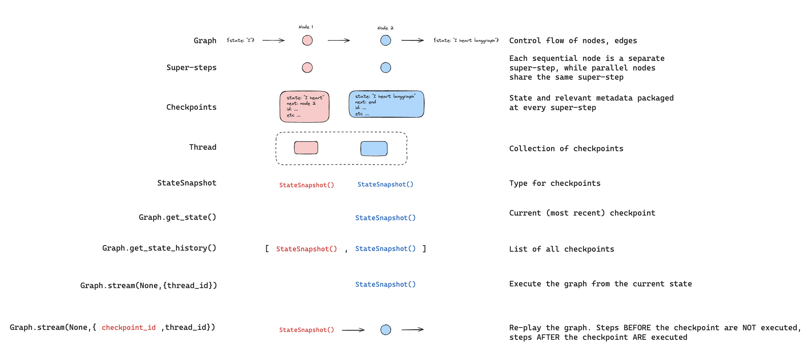
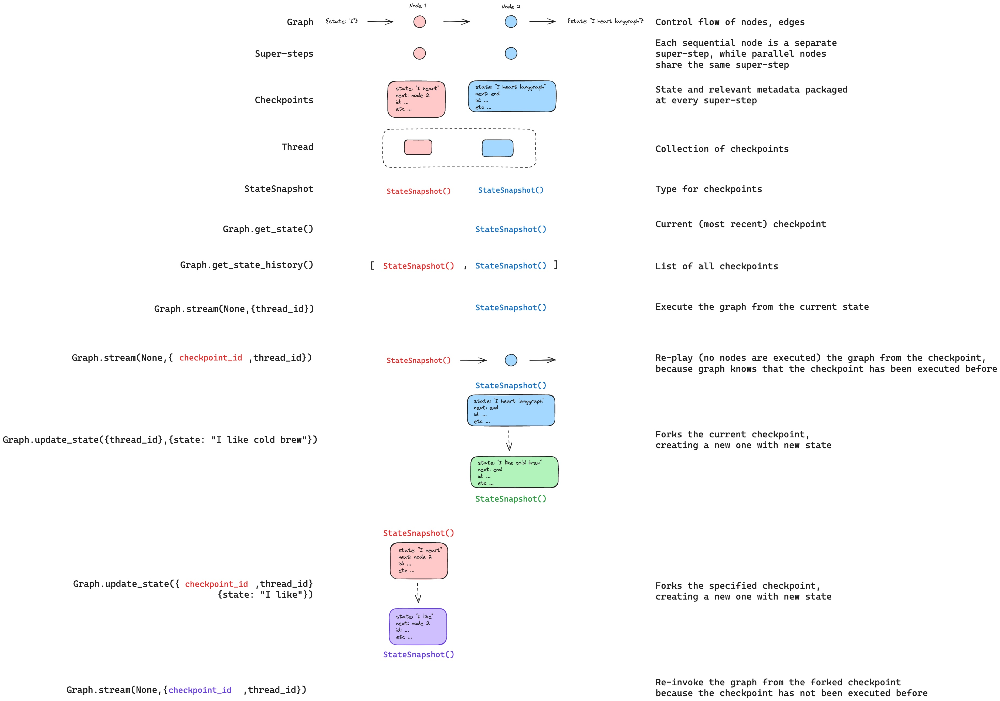

# Use time-travel

> Replay past executions and fork to explore alternative paths in LangGraph

## Overview

LangGraph supports time travel through [checkpoints](Checkpointers.md#checkpoints):

* **[Replay](#replay)**: Retry from a prior checkpoint.
* **[Fork](#fork)**: Branch from a prior checkpoint with modified state to explore an alternative path.

Both work by resuming from a prior checkpoint. Nodes before the checkpoint are not re-executed (results are already saved). Nodes after the checkpoint re-execute, including any LLM calls, API requests, and [interrupts](Interrupts.md) (which may produce different results).

## Replay

Invoke the graph with a prior checkpoint's config to replay from that point.

> [!WARNING]
>
> Replay re-executes nodes—it doesn't just read from cache. LLM calls, API requests, and [interrupts](Interrupts.md) fire again and may return different results. Replaying from the final checkpoint (no `next` nodes) is a no-op.



Use [`get_state_history`](https://reference.langchain.com/python/langgraph/graphs/#langgraph.graph.state.CompiledStateGraph.get_state_history) to find the checkpoint you want to replay from, then call [`invoke`](https://reference.langchain.com/python/langgraph/graphs/#langgraph.graph.state.CompiledStateGraph.invoke) with that checkpoint's config:

```python
from langgraph.graph import StateGraph, START
from langgraph.checkpoint.memory import InMemorySaver
from typing_extensions import TypedDict, NotRequired
from langchain_core.utils.uuid import uuid7

class State(TypedDict):
    topic: NotRequired[str]
    joke: NotRequired[str]


def generate_topic(state: State):
    return {"topic": "socks in the dryer"}


def write_joke(state: State):
    return {"joke": f"Why do {state['topic']} disappear? They elope!"}


checkpointer = InMemorySaver()
graph = (
    StateGraph(State)
    .add_node("generate_topic", generate_topic)
    .add_node("write_joke", write_joke)
    .add_edge(START, "generate_topic")
    .add_edge("generate_topic", "write_joke")
    .compile(checkpointer=checkpointer)
)

# Step 1: Run the graph
config = {"configurable": {"thread_id": str(uuid7())}}
result = graph.invoke({}, config)

# Step 2: Find a checkpoint to replay from
history = list(graph.get_state_history(config))
# History is in reverse chronological order
for state in history:
    print(f"next={state.next}, checkpoint_id={state.config['configurable']['checkpoint_id']}")

# Step 3: Replay from a specific checkpoint
# Find the checkpoint before write_joke
before_joke = next(s for s in history if s.next == ("write_joke",))
replay_result = graph.invoke(None, before_joke.config)
# write_joke re-executes (runs again), generate_topic does not
```

## Fork

Fork creates a new branch from a past checkpoint with modified state. Call [`update_state`](https://reference.langchain.com/python/langgraph/graphs/#langgraph.graph.state.CompiledStateGraph.update_state) on a prior checkpoint to create the fork, then [`invoke`](https://reference.langchain.com/python/langgraph/graphs/#langgraph.graph.state.CompiledStateGraph.invoke) with `None` to continue execution.



> [!WARNING]
>
> `update_state` does **not** roll back a thread. It creates a new checkpoint that branches from the specified point. The original execution history remains intact.

```python
# Find checkpoint before write_joke
history = list(graph.get_state_history(config))
before_joke = next(s for s in history if s.next == ("write_joke",))

# Fork: update state to change the topic
fork_config = graph.update_state(
    before_joke.config,
    values={"topic": "chickens"},
)

# Resume from the fork — write_joke re-executes with the new topic
fork_result = graph.invoke(None, fork_config)
print(fork_result["joke"])  # A joke about chickens, not socks
```

### From a specific node

When you call [`update_state`](https://reference.langchain.com/python/langgraph/graphs/#langgraph.graph.state.CompiledStateGraph.update_state), values are applied using the specified node's writers (including [reducers](../Build%20with%20the%20Graph%20API/Graph%20API%20overview.md#reducers)). The checkpoint records that node as having produced the update, and execution resumes from that node's successors.

By default, LangGraph infers `as_node` from the checkpoint's version history. When forking from a specific checkpoint, this inference is almost always correct.

Specify `as_node` explicitly when:

* **Parallel branches**: Multiple nodes updated state in the same step, and LangGraph can't determine which was last (`InvalidUpdateError`).
* **No execution history**: Setting up state on a fresh thread (common in [testing](../Deployment/Test.md)).
* **Skipping nodes**: Set `as_node` to a later node to make the graph think that node already ran.

```python
# graph: generate_topic -> write_joke

# Treat this update as if generate_topic produced it.
# Execution resumes at write_joke (the successor of generate_topic).
fork_config = graph.update_state(
    before_joke.config,
    values={"topic": "chickens"},
    as_node="generate_topic",
)
```

## Interrupts

If your graph uses [`interrupt`](https://reference.langchain.com/python/langgraph/types/interrupt) for [human-in-the-loop](Interrupts.md) workflows, interrupts are always re-triggered during time travel. The node containing the interrupt re-executes, and `interrupt()` pauses for a new `Command(resume=...)`.

```python
from langgraph.types import interrupt, Command

class State(TypedDict):
    value: list[str]

def ask_human(state: State):
    answer = interrupt("What is your name?")
    return {"value": [f"Hello, {answer}!"]}

def final_step(state: State):
    return {"value": ["Done"]}

graph = (
    StateGraph(State)
    .add_node("ask_human", ask_human)
    .add_node("final_step", final_step)
    .add_edge(START, "ask_human")
    .add_edge("ask_human", "final_step")
    .compile(checkpointer=InMemorySaver())
)

config = {"configurable": {"thread_id": "1"}}

# First run: hits interrupt
graph.invoke({"value": []}, config)
# Resume with answer
graph.invoke(Command(resume="Alice"), config)

# Replay from before ask_human
history = list(graph.get_state_history(config))
before_ask = [s for s in history if s.next == ("ask_human",)][-1]

replay_result = graph.invoke(None, before_ask.config)
# Pauses at interrupt — waiting for new Command(resume=...)

# Fork from before ask_human
fork_config = graph.update_state(before_ask.config, {"value": ["forked"]})
fork_result = graph.invoke(None, fork_config)
# Pauses at interrupt — waiting for new Command(resume=...)

# Resume the forked interrupt with a different answer
graph.invoke(Command(resume="Bob"), fork_config)
# Result: {"value": ["forked", "Hello, Bob!", "Done"]}
```

### Multiple interrupts

If your graph collects input at several points (for example, a multi-step form), you can fork from between the interrupts to change a later answer without re-asking earlier questions.

```python
def ask_name(state):
    name = interrupt("What is your name?")
    return {"value": [f"name:{name}"]}

def ask_age(state):
    age = interrupt("How old are you?")
    return {"value": [f"age:{age}"]}

# Graph: ask_name -> ask_age -> final
# After completing both interrupts:

# Fork from BETWEEN the two interrupts (after ask_name, before ask_age)
history = list(graph.get_state_history(config))
between = [s for s in history if s.next == ("ask_age",)][-1]

fork_config = graph.update_state(between.config, {"value": ["modified"]})
result = graph.invoke(None, fork_config)
# ask_name result preserved ("name:Alice")
# ask_age pauses at interrupt — waiting for new answer
```

## Subgraphs

Time travel with [subgraphs](Subgraphs.md) depends on whether the subgraph has its own checkpointer. This determines the granularity of checkpoints you can time travel from.

> [tab] Inherited checkpointer (default)
>
> By default, a subgraph inherits the parent's checkpointer. The parent treats the entire subgraph as a **single super-step** — there is only one parent-level checkpoint for the whole subgraph execution. Time traveling from before the subgraph re-executes it from scratch.
>
> You cannot time travel to a point *between* nodes in a default subgraph — you can only time travel from the parent level.
>
> ```python theme={"theme":{"light":"catppuccin-latte","dark":"catppuccin-mocha"}}
> # Subgraph without its own checkpointer (default)
> subgraph = (
>     StateGraph(State)
>     .add_node("step_a", step_a)       # Has interrupt()
>     .add_node("step_b", step_b)       # Has interrupt()
>     .add_edge(START, "step_a")
>     .add_edge("step_a", "step_b")
>     .compile()  # No checkpointer — inherits from parent
> )
>
> graph = (
>     StateGraph(State)
>     .add_node("subgraph_node", subgraph)
>     .add_edge(START, "subgraph_node")
>     .compile(checkpointer=InMemorySaver())
> )
>
> config = {"configurable": {"thread_id": "1"}}
>
> # Complete both interrupts
> graph.invoke({"value": []}, config)            # Hits step_a interrupt
> graph.invoke(Command(resume="Alice"), config)  # Hits step_b interrupt
> graph.invoke(Command(resume="30"), config)     # Completes
>
> # Time travel from before the subgraph
> history = list(graph.get_state_history(config))
> before_sub = [s for s in history if s.next == ("subgraph_node",)][-1]
>
> fork_config = graph.update_state(before_sub.config, {"value": ["forked"]})
> result = graph.invoke(None, fork_config)
> # The entire subgraph re-executes from scratch
> # You cannot time travel to a point between step_a and step_b
> ```

> [tab] Subgraph checkpointer
>
> Set `checkpointer=True` on the subgraph to give it its own checkpoint history. This creates checkpoints at each step **within** the subgraph, allowing you to time travel from a specific point inside it — for example, between two interrupts.
>
> Use [`get_state`](https://reference.langchain.com/python/langgraph/graphs/#langgraph.graph.state.CompiledStateGraph.get_state) with `subgraphs=True` to access the subgraph's own checkpoint config, then fork from it:
>
> ```python theme={"theme":{"light":"catppuccin-latte","dark":"catppuccin-mocha"}}
> # Subgraph with its own checkpointer
> subgraph = (
>     StateGraph(State)
>     .add_node("step_a", step_a)       # Has interrupt()
>     .add_node("step_b", step_b)       # Has interrupt()
>     .add_edge(START, "step_a")
>     .add_edge("step_a", "step_b")
>     .compile(checkpointer=True)  # Own checkpoint history
> )
>
> graph = (
>     StateGraph(State)
>     .add_node("subgraph_node", subgraph)
>     .add_edge(START, "subgraph_node")
>     .compile(checkpointer=InMemorySaver())
> )
>
> config = {"configurable": {"thread_id": "1"}}
>
> # Run until step_a interrupt
> graph.invoke({"value": []}, config)
>
> # Resume step_a -> hits step_b interrupt
> graph.invoke(Command(resume="Alice"), config)
>
> # Get the subgraph's own checkpoint (between step_a and step_b)
> parent_state = graph.get_state(config, subgraphs=True)
> sub_config = parent_state.tasks[0].state.config
>
> # Fork from the subgraph checkpoint
> fork_config = graph.update_state(sub_config, {"value": ["forked"]})
> result = graph.invoke(None, fork_config)
> # step_b re-executes, step_a's result is preserved
> ```

See [subgraph persistence](Subgraphs.md#subgraph-persistence) for more on configuring subgraph checkpointers.
