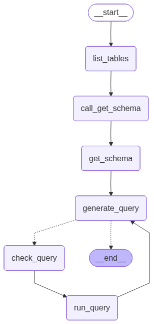

# Build a custom SQL agent

In this tutorial we will build a custom agent that can answer questions about a SQL database using LangGraph.

LangChain offers built-in [agent](https://docs.langchain.com/oss/python/langchain/agents.md) implementations, implemented using [LangGraph](../../LangGraph%20overview.md) primitives. If deeper customization is required, agents can be implemented directly in LangGraph. This guide demonstrates an example implementation of a SQL agent. For a practical introduction, see [building a SQL agent using higher-level LangChain abstractions](https://docs.langchain.com/oss/python/langchain/sql-agent.md).

> [!WARNING]
>
> Building Q\&A systems of SQL databases requires executing model-generated SQL queries. There are inherent risks in doing this. Make sure that your database connection permissions are always scoped as narrowly as possible for your agent's needs. This will mitigate, though not eliminate, the risks of building a model-driven system.

The [prebuilt agent](https://docs.langchain.com/oss/python/langchain/sql-agent.md) lets us get started quickly, but we relied on the system prompt to constrain its behavior—for example, we instructed the agent to always start with the "list tables" tool, and to always run a query-checker tool before executing the query.

We can enforce a higher degree of control in LangGraph by customizing the agent. Here, we implement a simple ReAct-agent setup, with dedicated nodes for specific tool-calls. We will use the same \[state] as the prebuilt agent.

### Concepts

We will cover the following concepts:

* [Tools](https://docs.langchain.com/oss/python/langchain/tools.md) for reading from SQL databases
* The LangGraph [Graph API](../../Build%20with%20the%20Graph%20API/Graph%20API%20overview.md), including state, nodes, edges, and conditional edges.
* [Human-in-the-loop](../../Capabilities/Interrupts.md) processes

## Setup

### Installation

```bash pip
pip install langchain langgraph
```

### LangSmith

Set up [LangSmith](https://smith.langchain.com?utm_source=docs&utm_medium=cta&utm_campaign=langsmith-signup&utm_content=oss-langgraph-sql-agent) to inspect what is happening inside your chain or agent. Then set the following environment variables:

```shell
export LANGSMITH_TRACING="true"
export LANGSMITH_API_KEY="..."
```

## 1. Select an LLM

Select a model that supports [tool-calling](https://docs.langchain.com/oss/python/integrations/providers/overview.md):

> [tab] OpenAI
>
> 👉 Read the [OpenAI chat model integration docs](https://docs.langchain.com/oss/python/integrations/chat/openai/)
>
> ```bash pip theme={"theme":{"light":"catppuccin-latte","dark":"catppuccin-mocha"}}
> pip install -U "langchain[openai]"
> ```
>
> ```bash uv theme={"theme":{"light":"catppuccin-latte","dark":"catppuccin-mocha"}}
> uv add "langchain[openai]"
> ```
>
> ```python init_chat_model theme={"theme":{"light":"catppuccin-latte","dark":"catppuccin-mocha"}}
> import os
> from langchain.chat_models import init_chat_model
>
> os.environ["OPENAI_API_KEY"] = "sk-..."
>
> model = init_chat_model("gpt-5.5")
> ```
>
> ```python Model Class theme={"theme":{"light":"catppuccin-latte","dark":"catppuccin-mocha"}}
> import os
> from langchain_openai import ChatOpenAI
>
> os.environ["OPENAI_API_KEY"] = "sk-..."
>
> model = ChatOpenAI(model="gpt-5.5")
> ```

> [tab] Anthropic
>
> 👉 Read the [Anthropic chat model integration docs](https://docs.langchain.com/oss/python/integrations/chat/anthropic/)
>
> ```bash pip theme={"theme":{"light":"catppuccin-latte","dark":"catppuccin-mocha"}}
> pip install -U "langchain[anthropic]"
> ```
>
> ```bash uv theme={"theme":{"light":"catppuccin-latte","dark":"catppuccin-mocha"}}
> uv add "langchain[anthropic]"
> ```
>
> ```python init_chat_model theme={"theme":{"light":"catppuccin-latte","dark":"catppuccin-mocha"}}
> import os
> from langchain.chat_models import init_chat_model
>
> os.environ["ANTHROPIC_API_KEY"] = "sk-..."
>
> model = init_chat_model("claude-sonnet-4-6")
> ```
>
> ```python Model Class theme={"theme":{"light":"catppuccin-latte","dark":"catppuccin-mocha"}}
> import os
> from langchain_anthropic import ChatAnthropic
>
> os.environ["ANTHROPIC_API_KEY"] = "sk-..."
>
> model = ChatAnthropic(model="claude-sonnet-4-6")
> ```

> [tab] Azure
>
> 👉 Read the [Azure chat model integration docs](https://docs.langchain.com/oss/python/integrations/chat/azure_chat_openai/)
>
> ```bash pip theme={"theme":{"light":"catppuccin-latte","dark":"catppuccin-mocha"}}
> pip install -U "langchain[openai]"
> ```
>
> ```bash uv theme={"theme":{"light":"catppuccin-latte","dark":"catppuccin-mocha"}}
> uv add "langchain[openai]"
> ```
>
> ```python init_chat_model theme={"theme":{"light":"catppuccin-latte","dark":"catppuccin-mocha"}}
> import os
> from langchain.chat_models import init_chat_model
>
> os.environ["AZURE_OPENAI_API_KEY"] = "..."
> os.environ["AZURE_OPENAI_ENDPOINT"] = "..."
> os.environ["OPENAI_API_VERSION"] = "2025-03-01-preview"
>
> model = init_chat_model(
>     "azure_openai:gpt-5.5",
>     azure_deployment=os.environ["AZURE_OPENAI_DEPLOYMENT_NAME"],
> )
> ```
>
> ```python Model Class theme={"theme":{"light":"catppuccin-latte","dark":"catppuccin-mocha"}}
> import os
> from langchain_openai import AzureChatOpenAI
>
> os.environ["AZURE_OPENAI_API_KEY"] = "..."
> os.environ["AZURE_OPENAI_ENDPOINT"] = "..."
> os.environ["OPENAI_API_VERSION"] = "2025-03-01-preview"
>
> model = AzureChatOpenAI(
>     model="gpt-5.5",
>     azure_deployment=os.environ["AZURE_OPENAI_DEPLOYMENT_NAME"]
> )
> ```

> [tab] Google Gemini
>
> 👉 Read the [Google GenAI chat model integration docs](https://docs.langchain.com/oss/python/integrations/chat/google_generative_ai/)
>
> ```bash pip theme={"theme":{"light":"catppuccin-latte","dark":"catppuccin-mocha"}}
> pip install -U "langchain[google-genai]"
> ```
>
> ```bash uv theme={"theme":{"light":"catppuccin-latte","dark":"catppuccin-mocha"}}
> uv add "langchain[google-genai]"
> ```
>
> ```python init_chat_model theme={"theme":{"light":"catppuccin-latte","dark":"catppuccin-mocha"}}
> import os
> from langchain.chat_models import init_chat_model
>
> os.environ["GOOGLE_API_KEY"] = "..."
>
> model = init_chat_model("google_genai:gemini-3.7-flash")
> ```
>
> ```python Model Class theme={"theme":{"light":"catppuccin-latte","dark":"catppuccin-mocha"}}
> import os
> from langchain_google_genai import ChatGoogleGenerativeAI
>
> os.environ["GOOGLE_API_KEY"] = "..."
>
> model = ChatGoogleGenerativeAI(model="gemini-3.7-flash")
> ```

> [tab] AWS Bedrock
>
> 👉 Read the [AWS Bedrock chat model integration docs](https://docs.langchain.com/oss/python/integrations/chat/bedrock/)
>
> ```bash pip theme={"theme":{"light":"catppuccin-latte","dark":"catppuccin-mocha"}}
> pip install -U "langchain[aws]"
> ```
>
> ```bash uv theme={"theme":{"light":"catppuccin-latte","dark":"catppuccin-mocha"}}
> uv add "langchain[aws]"
> ```
>
> ```python init_chat_model theme={"theme":{"light":"catppuccin-latte","dark":"catppuccin-mocha"}}
> from langchain.chat_models import init_chat_model
>
> # Follow the steps here to configure your credentials:
> # https://docs.aws.amazon.com/bedrock/latest/userguide/getting-started.html
>
> model = init_chat_model(
>     "us.anthropic.claude-sonnet-4-6",
>     model_provider="bedrock_converse",
> )
> ```
>
> ```python Model Class theme={"theme":{"light":"catppuccin-latte","dark":"catppuccin-mocha"}}
> from langchain_aws import ChatBedrock
>
> model = ChatBedrock(model="us.anthropic.claude-sonnet-4-6")
> ```

> [tab] HuggingFace
>
> 👉 Read the [HuggingFace chat model integration docs](https://docs.langchain.com/oss/python/integrations/chat/huggingface/)
>
> ```bash pip theme={"theme":{"light":"catppuccin-latte","dark":"catppuccin-mocha"}}
> pip install -U "langchain[huggingface]"
> ```
>
> ```bash uv theme={"theme":{"light":"catppuccin-latte","dark":"catppuccin-mocha"}}
> uv add "langchain[huggingface]"
> ```
>
> ```python init_chat_model theme={"theme":{"light":"catppuccin-latte","dark":"catppuccin-mocha"}}
> import os
> from langchain.chat_models import init_chat_model
>
> os.environ["HUGGINGFACEHUB_API_TOKEN"] = "hf_..."
>
> model = init_chat_model(
>     "microsoft/Phi-3-mini-4k-instruct",
>     model_provider="huggingface",
>     temperature=0.7,
>     max_tokens=1024,
> )
> ```
>
> ```python Model Class theme={"theme":{"light":"catppuccin-latte","dark":"catppuccin-mocha"}}
> import os
> from langchain_huggingface import ChatHuggingFace, HuggingFaceEndpoint
>
> os.environ["HUGGINGFACEHUB_API_TOKEN"] = "hf_..."
>
> llm = HuggingFaceEndpoint(
>     repo_id="microsoft/Phi-3-mini-4k-instruct",
>     temperature=0.7,
>     max_length=1024,
> )
> model = ChatHuggingFace(llm=llm)
> ```

> [tab] OpenRouter
>
> 👉 Read the [OpenRouter chat model integration docs](https://docs.langchain.com/oss/python/integrations/chat/openrouter/)
>
> ```bash pip theme={"theme":{"light":"catppuccin-latte","dark":"catppuccin-mocha"}}
> pip install -U "langchain-openrouter"
> ```
>
> ```bash uv theme={"theme":{"light":"catppuccin-latte","dark":"catppuccin-mocha"}}
> uv add "langchain-openrouter"
> ```
>
> ```python init_chat_model theme={"theme":{"light":"catppuccin-latte","dark":"catppuccin-mocha"}}
> import os
> from langchain.chat_models import init_chat_model
>
> os.environ["OPENROUTER_API_KEY"] = "sk-..."
>
> model = init_chat_model(
>     "auto",
>     model_provider="openrouter",
> )
> ```
>
> ```python Model Class theme={"theme":{"light":"catppuccin-latte","dark":"catppuccin-mocha"}}
> import os
> from langchain_openrouter import ChatOpenRouter
>
> os.environ["OPENROUTER_API_KEY"] = "sk-..."
>
> model = ChatOpenRouter(model="auto")
> ```

The output shown in the examples below used OpenAI.

## 2. Configure the database

You will be creating a [SQLite database](https://www.sqlitetutorial.net/sqlite-sample-database/) for this tutorial. SQLite is a lightweight database that is easy to set up and use. We will be loading the `chinook` database, which is a sample database that represents a digital media store.

For convenience, we have hosted the database (`Chinook.db`) on a public GCS bucket.

```python
import pathlib
import requests

url = "https://storage.googleapis.com/benchmarks-artifacts/chinook/Chinook.db"
local_path = pathlib.Path("Chinook.db")

if local_path.exists():
    print(f"{local_path} already exists, skipping download.")
else:
    response = requests.get(url, timeout=60)
    if response.status_code == 200:
        local_path.write_bytes(response.content)
        print(f"File downloaded and saved as {local_path}")
    else:
        print(f"Failed to download the file. Status code: {response.status_code}")
```

We will use Python's built-in `sqlite3` module to interact with the database:

```python
import sqlite3

con = sqlite3.connect("Chinook.db")
cursor = con.cursor()

cursor.execute("SELECT name FROM sqlite_master WHERE type='table';")
tables = [row[0] for row in cursor.fetchall() if not row[0].startswith("sqlite_")]

print("Dialect: sqlite")
print(f"Available tables: {tables}")

cursor.execute("SELECT * FROM Artist LIMIT 5;")
print(f"Sample output: {cursor.fetchall()}")
con.close()
```

```
Dialect: sqlite
Available tables: ['Album', 'Artist', 'Customer', 'Employee', 'Genre', 'Invoice', 'InvoiceLine', 'MediaType', 'Playlist', 'PlaylistTrack', 'Track']
Sample output: [(1, 'AC/DC'), (2, 'Accept'), (3, 'Aerosmith'), (4, 'Alanis Morissette'), (5, 'Alice In Chains')]
```

## 3. Add tools for database interactions

> [!WARNING]
>
> The following database tools are minimal wrappers for demonstration purposes only. They are not intended to be secure or used in production. Use narrowly scoped database permissions and add application-specific validation before executing model-generated SQL.

We can implement database [tools](https://docs.langchain.com/oss/python/langchain/tools.md) as thin wrappers using the `@tool` decorator from `langchain.tools`:

```python
import sqlite3
from langchain.tools import tool

# Below are minimal tools for demonstration purposes.


@tool
def sql_db_list_tables() -> str:
    """Input is an empty string, output is a comma-separated list of tables in the database."""
    con = sqlite3.connect("Chinook.db")
    try:
        cursor = con.cursor()
        cursor.execute("SELECT name FROM sqlite_master WHERE type='table';")
        tables = [
            row[0]
            for row in cursor.fetchall()
            if not row[0].startswith("sqlite_")
        ]
        return ", ".join(tables)
    finally:
        con.close()


@tool
def sql_db_schema(table_names: str) -> str:
    """Input to this tool is a comma-separated list of tables, output is the schema and sample rows for those tables.
    Be sure that the tables actually exist by calling sql_db_list_tables first!
    Example Input: table1, table2, table3"""
    con = sqlite3.connect("Chinook.db")
    try:
        cursor = con.cursor()
        cursor.execute("SELECT name FROM sqlite_master WHERE type='table';")
        valid_tables = {
            row[0] for row in cursor.fetchall() if not row[0].startswith("sqlite_")
        }
        results = []
        for table in table_names.split(","):
            table = table.strip()
            if table not in valid_tables:
                results.append(
                    f"Error: table_names {{{table!r}}} not found in database"
                )
                continue
            cursor.execute(
                "SELECT sql FROM sqlite_master WHERE type='table' AND name=?;",
                (table,),
            )
            schema_row = cursor.fetchone()
            if schema_row:
                results.append(schema_row[0])
                try:
                    quoted_table = '"' + table.replace('"', '""') + '"'
                    cursor.execute(f"SELECT * FROM {quoted_table} LIMIT 3;")
                    rows = cursor.fetchall()
                    if rows:
                        col_names = [description[0] for description in cursor.description]
                        results.append(
                            f"/*\n3 rows from {table} table:\n"
                            + "\t".join(col_names)
                            + "\n"
                            + "\n".join(
                                "\t".join(str(x) for x in row) for row in rows
                            )
                            + "\n*/"
                        )
                except Exception as e:
                    results.append(f"Error fetching sample rows: {e}")
        return "\n\n".join(results)
    finally:
        con.close()


@tool
def sql_db_query(query: str) -> str:
    """Input to this tool is a detailed and correct SQL query, output is a result from the database.
    If the query is not correct, an error message will be returned.
    If an error is returned, rewrite the query, check the query, and try again.
    If you encounter an issue with Unknown column 'xxxx' in 'field list', use sql_db_schema to query the correct table fields."""
    con = sqlite3.connect("Chinook.db")
    try:
        cursor = con.cursor()
        cursor.execute(query)
        res = cursor.fetchall()
        return str(res)
    except Exception as e:
        return f"Error: {e}"
    finally:
        con.close()


tools = [sql_db_list_tables, sql_db_schema, sql_db_query]

# Use a distinct loop variable so it does not shadow the `tool` decorator,
# which is reused later to wrap the query tool for human review.
for t in tools:
    print(f"{t.name}: {t.description}\n")
```

```
sql_db_list_tables: Input is an empty string, output is a comma-separated list of tables in the database.

sql_db_schema: Input to this tool is a comma-separated list of tables, output is the schema and sample rows for those tables.
    Be sure that the tables actually exist by calling sql_db_list_tables first!
    Example Input: table1, table2, table3

sql_db_query: Input to this tool is a detailed and correct SQL query, output is a result from the database.
    If the query is not correct, an error message will be returned.
    If an error is returned, rewrite the query, check the query, and try again.
    If you encounter an issue with Unknown column 'xxxx' in 'field list', use sql_db_schema to query the correct table fields.
```

## 4. Define application steps

We construct dedicated nodes for the following steps:

* Listing DB tables
* Calling the "get schema" tool
* Generating a query
* Checking the query

Putting these steps in dedicated nodes lets us (1) force tool-calls when needed, and (2) customize the prompts associated with each step.

```python
from typing import Literal

from langchain.messages import AIMessage
from langchain_core.runnables import RunnableConfig
from langgraph.graph import END, START, MessagesState, StateGraph
from langgraph.prebuilt import ToolNode

get_schema_tool = next(tool for tool in tools if tool.name == "sql_db_schema")
get_schema_node = ToolNode([get_schema_tool], name="get_schema")

run_query_tool = next(tool for tool in tools if tool.name == "sql_db_query")
run_query_node = ToolNode([run_query_tool], name="run_query")


# Example: create a predetermined tool call
def list_tables(state: MessagesState):
    tool_call = {
        "name": "sql_db_list_tables",
        "args": {},
        "id": "abc123",
        "type": "tool_call",
    }
    tool_call_message = AIMessage(content="", tool_calls=[tool_call])

    list_tables_tool = next(tool for tool in tools if tool.name == "sql_db_list_tables")
    tool_message = list_tables_tool.invoke(tool_call)
    response = AIMessage(f"Available tables: {tool_message.content}")

    return {"messages": [tool_call_message, tool_message, response]}


# Example: force a model to create a tool call
def call_get_schema(state: MessagesState):
    # Note that LangChain enforces that all models accept `tool_choice="any"`
    # as well as `tool_choice=<string name of tool>`.
    llm_with_tools = model.bind_tools([get_schema_tool], tool_choice="any")
    response = llm_with_tools.invoke(state["messages"])

    return {"messages": [response]}


generate_query_system_prompt = """
You are an agent designed to interact with a SQL database.
Given an input question, create a syntactically correct {dialect} query to run,
then look at the results of the query and return the answer. Unless the user
specifies a specific number of examples they wish to obtain, always limit your
query to at most {top_k} results.

You can order the results by a relevant column to return the most interesting
examples in the database. Never query for all the columns from a specific table,
only ask for the relevant columns given the question.

DO NOT make any DML statements (INSERT, UPDATE, DELETE, DROP etc.) to the database.
""".format(
    dialect="sqlite",
    top_k=5,
)


def generate_query(state: MessagesState):
    system_message = {
        "role": "system",
        "content": generate_query_system_prompt,
    }
    # We do not force a tool call here, to allow the model to
    # respond naturally when it obtains the solution.
    llm_with_tools = model.bind_tools([run_query_tool])
    response = llm_with_tools.invoke([system_message] + state["messages"])

    return {"messages": [response]}


check_query_system_prompt = """
You are a SQL expert with a strong attention to detail.
Double check the {dialect} query for common mistakes, including:
- Using NOT IN with NULL values
- Using UNION when UNION ALL should have been used
- Using BETWEEN for exclusive ranges
- Data type mismatch in predicates
- Properly quoting identifiers
- Using the correct number of arguments for functions
- Casting to the correct data type
- Using the proper columns for joins

If there are any of the above mistakes, rewrite the query. If there are no mistakes,
just reproduce the original query.

You will call the appropriate tool to execute the query after running this check.
""".format(dialect="sqlite")


def check_query(state: MessagesState):
    system_message = {
        "role": "system",
        "content": check_query_system_prompt,
    }

    # Generate an artificial user message to check
    tool_call = state["messages"][-1].tool_calls[0]
    user_message = {"role": "user", "content": tool_call["args"]["query"]}
    llm_with_tools = model.bind_tools([run_query_tool], tool_choice="any")
    response = llm_with_tools.invoke([system_message, user_message])
    response.id = state["messages"][-1].id

    return {"messages": [response]}
```

## 5. Implement the agent

We can now assemble these steps into a workflow using the [Graph API](../../Build%20with%20the%20Graph%20API/Graph%20API%20overview.md). We define a [conditional edge](../../Build%20with%20the%20Graph%20API/Graph%20API%20overview.md#conditional-edges) at the query generation step that will route to the query checker if a query is generated, or end if there are no tool calls present, such that the LLM has delivered a response to the query.

```python
def should_continue(state: MessagesState) -> Literal[END, "check_query"]:
    messages = state["messages"]
    last_message = messages[-1]
    if not last_message.tool_calls:
        return END
    else:
        return "check_query"


builder = StateGraph(MessagesState)
builder.add_node(list_tables)
builder.add_node(call_get_schema)
builder.add_node(get_schema_node, "get_schema")
builder.add_node(generate_query)
builder.add_node(check_query)
builder.add_node(run_query_node, "run_query")

builder.add_edge(START, "list_tables")
builder.add_edge("list_tables", "call_get_schema")
builder.add_edge("call_get_schema", "get_schema")
builder.add_edge("get_schema", "generate_query")
builder.add_conditional_edges(
    "generate_query",
    should_continue,
)
builder.add_edge("check_query", "run_query")
builder.add_edge("run_query", "generate_query")

agent = builder.compile()
```

We visualize the application below:

```python
import pathlib

pathlib.Path("graph.png").write_bytes(agent.get_graph().draw_mermaid_png())
```



We can now invoke the graph:

```python
question = "Which genre on average has the longest tracks?"

stream = agent.stream_events(
    {"messages": [{"role": "user", "content": question}]},
    version="v3",
)
for message in stream.messages:
    for token in message.text:
        print(token, end="", flush=True)

final_state = stream.output
```

```
================================ Human Message =================================

Which genre on average has the longest tracks?
================================== Ai Message ==================================

Available tables: Album, Artist, Customer, Employee, Genre, Invoice, InvoiceLine, MediaType, Playlist, PlaylistTrack, Track
================================== Ai Message ==================================
Tool Calls:
  sql_db_schema (call_yzje0tj7JK3TEzDx4QnRR3lL)
 Call ID: call_yzje0tj7JK3TEzDx4QnRR3lL
  Args:
    table_names: Genre, Track
================================= Tool Message =================================
Name: sql_db_schema


CREATE TABLE "Genre" (
	"GenreId" INTEGER NOT NULL,
	"Name" NVARCHAR(120),
	PRIMARY KEY ("GenreId")
)

/*
3 rows from Genre table:
GenreId	Name
1	Rock
2	Jazz
3	Metal
*/


CREATE TABLE "Track" (
	"TrackId" INTEGER NOT NULL,
	"Name" NVARCHAR(200) NOT NULL,
	"AlbumId" INTEGER,
	"MediaTypeId" INTEGER NOT NULL,
	"GenreId" INTEGER,
	"Composer" NVARCHAR(220),
	"Milliseconds" INTEGER NOT NULL,
	"Bytes" INTEGER,
	"UnitPrice" NUMERIC(10, 2) NOT NULL,
	PRIMARY KEY ("TrackId"),
	FOREIGN KEY("MediaTypeId") REFERENCES "MediaType" ("MediaTypeId"),
	FOREIGN KEY("GenreId") REFERENCES "Genre" ("GenreId"),
	FOREIGN KEY("AlbumId") REFERENCES "Album" ("AlbumId")
)

/*
3 rows from Track table:
TrackId	Name	AlbumId	MediaTypeId	GenreId	Composer	Milliseconds	Bytes	UnitPrice
1	For Those About To Rock (We Salute You)	1	1	1	Angus Young, Malcolm Young, Brian Johnson	343719	11170334	0.99
2	Balls to the Wall	2	2	1	U. Dirkschneider, W. Hoffmann, H. Frank, P. Baltes, S. Kaufmann, G. Hoffmann	342562	5510424	0.99
3	Fast As a Shark	3	2	1	F. Baltes, S. Kaufman, U. Dirkscneider & W. Hoffman	230619	3990994	0.99
*/
================================== Ai Message ==================================
Tool Calls:
  sql_db_query (call_cb9ApLfZLSq7CWg6jd0im90b)
 Call ID: call_cb9ApLfZLSq7CWg6jd0im90b
  Args:
    query: SELECT Genre.Name, AVG(Track.Milliseconds) AS AvgMilliseconds FROM Track JOIN Genre ON Track.GenreId = Genre.GenreId GROUP BY Genre.GenreId ORDER BY AvgMilliseconds DESC LIMIT 5;
================================== Ai Message ==================================
Tool Calls:
  sql_db_query (call_DMVALfnQ4kJsuF3Yl6jxbeAU)
 Call ID: call_DMVALfnQ4kJsuF3Yl6jxbeAU
  Args:
    query: SELECT Genre.Name, AVG(Track.Milliseconds) AS AvgMilliseconds FROM Track JOIN Genre ON Track.GenreId = Genre.GenreId GROUP BY Genre.GenreId ORDER BY AvgMilliseconds DESC LIMIT 5;
================================= Tool Message =================================
Name: sql_db_query

[('Sci Fi & Fantasy', 2911783.0384615385), ('Science Fiction', 2625549.076923077), ('Drama', 2575283.78125), ('TV Shows', 2145041.0215053763), ('Comedy', 1585263.705882353)]
================================== Ai Message ==================================

The genre with the longest tracks on average is "Sci Fi & Fantasy," with an average track length of approximately 2,911,783 milliseconds. Other genres with relatively long tracks include "Science Fiction," "Drama," "TV Shows," and "Comedy."
```

> [!TIP]
>
> See [LangSmith trace](https://smith.langchain.com/public/94b8c9ac-12f7-4692-8706-836a1f30f1ea/r) for the above run.

## 6. Implement human-in-the-loop review

It can be prudent to check the agent's SQL queries before they are executed for any unintended actions or inefficiencies.

Here we leverage LangGraph's [human-in-the-loop](../../Capabilities/Interrupts.md) features to pause the run before executing a SQL query and wait for human review. Using LangGraph's [persistence layer](../../Capabilities/Persistence.md), we can pause the run indefinitely (or at least as long as the persistence layer is alive).

Let's wrap the `sql_db_query` tool in a node that receives human input. We can implement this using the [interrupt](../../Capabilities/Interrupts.md) function. Below, we allow for input to approve the tool call, edit its arguments, or provide user feedback.

```python
from langchain.tools import tool
from langgraph.types import interrupt
from langchain_core.runnables import RunnableConfig


@tool(
    run_query_tool.name,
    description=run_query_tool.description,
    args_schema=run_query_tool.args_schema,
)
def run_query_tool_with_interrupt(config: RunnableConfig, **tool_input):
    request = {
        "action": run_query_tool.name,
        "args": tool_input,
        "description": "Please review the tool call",
    }
    response = interrupt([request])  # [!code highlight]
    # approve the tool call
    if response["type"] == "accept":
        tool_response = run_query_tool.invoke(tool_input, config)
    # update tool call args
    elif response["type"] == "edit":
        tool_input = response["args"]["args"]
        tool_response = run_query_tool.invoke(tool_input, config)
    # respond to the LLM with user feedback
    elif response["type"] == "response":
        user_feedback = response["args"]
        tool_response = user_feedback
    else:
        raise ValueError(f"Unsupported interrupt response type: {response['type']}")

    return tool_response


# Redefine the tool node to use the interrupt version
run_query_node = ToolNode([run_query_tool_with_interrupt], name="run_query")  # [!code highlight]
```

> [!NOTE]
>
> The above implementation follows the [tool interrupt example](../../Capabilities/Interrupts.md#interrupts-in-tools) in the broader [human-in-the-loop](../../Capabilities/Interrupts.md) guide. Refer to that guide for details and alternatives.

Let's now re-assemble our graph. We will replace the programmatic check with human review. Note that we now include a [checkpointer](../../Capabilities/Persistence.md); this is required to pause and resume the run.

```python
from langgraph.checkpoint.memory import InMemorySaver

def should_continue(state: MessagesState) -> Literal[END, "run_query"]:
    messages = state["messages"]
    last_message = messages[-1]
    if not last_message.tool_calls:
        return END
    else:
        return "run_query"

builder = StateGraph(MessagesState)
builder.add_node(list_tables)
builder.add_node(call_get_schema)
builder.add_node(get_schema_node, "get_schema")
builder.add_node(generate_query)
builder.add_node(run_query_node, "run_query")

builder.add_edge(START, "list_tables")
builder.add_edge("list_tables", "call_get_schema")
builder.add_edge("call_get_schema", "get_schema")
builder.add_edge("get_schema", "generate_query")
builder.add_conditional_edges(
    "generate_query",
    should_continue,
)
builder.add_edge("run_query", "generate_query")

checkpointer = InMemorySaver()  # [!code highlight]
agent = builder.compile(checkpointer=checkpointer)  # [!code highlight]
```

We can invoke the graph as before. This time, execution is interrupted:

```python
question = "Which genre on average has the longest tracks?"

stream = agent.stream_events(
    {"messages": [{"role": "user", "content": question}]},
    config,
    version="v3",
)
for message in stream.messages:
    for token in message.text:
        print(token, end="", flush=True)
if stream.interrupted:
    action = stream.interrupts[0]
    print("INTERRUPTED:")
    for request in action.value:
        print(json.dumps(request, indent=2))
```

```
...

INTERRUPTED:
{
  "action": "sql_db_query",
  "args": {
    "query": "SELECT Genre.Name, AVG(Track.Milliseconds) AS AvgLength FROM Track JOIN Genre ON Track.GenreId = Genre.GenreId GROUP BY Genre.Name ORDER BY AvgLength DESC LIMIT 5;"
  },
  "description": "Please review the tool call"
}
```

We can accept or edit the tool call using [Command](../../Build%20with%20the%20Graph%20API/Use%20Send%20and%20Command.md#combine-control-flow-and-state-updates-with-command):

```python
from langgraph.types import Command

stream = agent.stream_events(
    Command(resume={"type": "accept"}),
    # Command(resume={"type": "edit", "args": {"query": "..."}}),
    config,
    version="v3",
)
for message in stream.messages:
    for token in message.text:
        print(token, end="", flush=True)
if stream.interrupted:
    action = stream.interrupts[0]
    print("INTERRUPTED:")
    for request in action.value:
        print(json.dumps(request, indent=2))
```

```
================================== Ai Message ==================================
Tool Calls:
  sql_db_query (call_t4yXkD6shwdTPuelXEmY3sAY)
 Call ID: call_t4yXkD6shwdTPuelXEmY3sAY
  Args:
    query: SELECT Genre.Name, AVG(Track.Milliseconds) AS AvgLength FROM Track JOIN Genre ON Track.GenreId = Genre.GenreId GROUP BY Genre.Name ORDER BY AvgLength DESC LIMIT 5;
================================= Tool Message =================================
Name: sql_db_query

[('Sci Fi & Fantasy', 2911783.0384615385), ('Science Fiction', 2625549.076923077), ('Drama', 2575283.78125), ('TV Shows', 2145041.0215053763), ('Comedy', 1585263.705882353)]
================================== Ai Message ==================================

The genre with the longest average track length is "Sci Fi & Fantasy" with an average length of about 2,911,783 milliseconds. Other genres with long average track lengths include "Science Fiction," "Drama," "TV Shows," and "Comedy."
```

Refer to the [human-in-the-loop guide](../../Capabilities/Interrupts.md) for details.

## Next steps

Check out the [Evaluate a graph](https://docs.langchain.com/langsmith/evaluate-graph.md) guide for evaluating LangGraph applications, including SQL agents like this one, using LangSmith.
