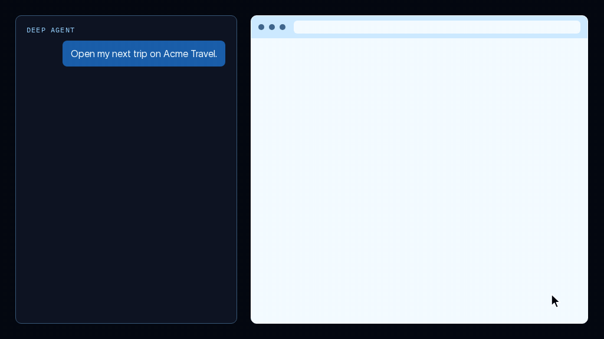
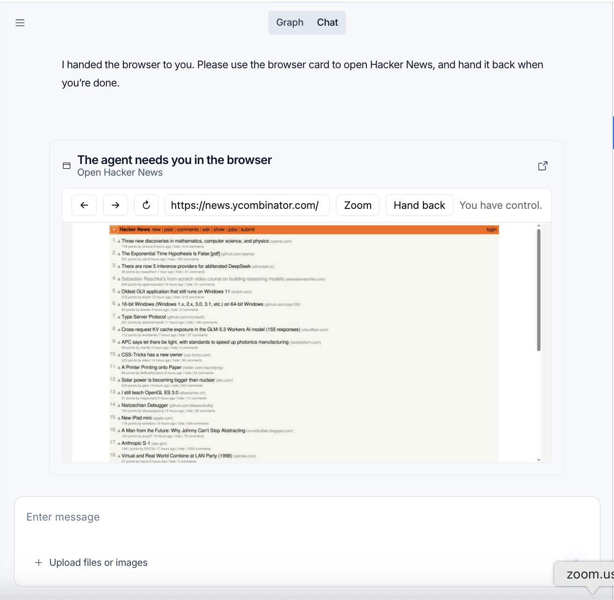

# Browser use

> Configure browser sharing, website logins, and human handoff for a managed deep agent.

Give a managed deep agent a browser to act on websites without a public API, such as booking a restaurant reservation, research a topic by following links across sites, or test an app through its UI after changing its code. The agent can navigate, click, fill forms, and inspect the result. Managed Deep Agents manages the browser and its tools.

Use a direct API when one supports the task. See [Connections](Manage%20connections.md) to authenticate API calls with a user's connected account. For browser choices and open source setup, see [Browser use with Deep Agents](https://docs.langchain.com/oss/python/deepagents/browser-use.md).

## Declare a browser

Export a named `browser` at the [project root](../Get%20started/Managed%20Deep%20Agents%20project%20structure.md):

```python browser.py
from managed_deepagents import define_browser

browser = define_browser(
    scope="thread",
    idle_ttl_seconds=600,
)
```

The CLI discovers this root file. Do not put the declaration inside `browser/` or `sandbox/`: those locations do not enable browser support.

| Option | Default | Description |
| - | - | - |
| `scope` | `"thread"` | Share a browser within one thread or across a signed-in user's threads |
| `idle_ttl_seconds` | `600` | Seconds of inactivity before the browser stops; accepts `60` through `86400` |

## Choose a scope

| Scope | Browser state | Use it for |
| - | - | - |
| `"thread"` (default) | One browser per conversation; authorized participants share it across turns | Testing a web app change across multiple turns in one conversation |
| `"user"` | One browser per authenticated person, with a separate window for each thread and shared cookies and logins | Reusing a website login across conversations |

Thread scope starts each new conversation without another thread's cookies or logins. For example, sign in to a web app with a test account, then reuse the tabs and login as you iterate on a change in the same thread. A separate app-testing conversation gets an isolated browser. Starting another thread does not delete the previous browser.

For user scope, change the declaration:

```python browser.py
from managed_deepagents import define_browser

browser = define_browser(scope="user", idle_ttl_seconds=600)
```

For example, sign in to a booking site in one conversation, then request another reservation in a new thread. The same user's new window can reuse the login. Other authenticated people get different browsers. User scope follows [verified caller identity](Add%20identity%20to%20Managed%20Deep%20Agents.md), not a name in a prompt; non-person principals use thread scope.

Shared login state is not account isolation: logging out or switching accounts can affect the person's other threads. Coordinate purchases and bookings across conversations. Finishing a run releases the client, not the login; the idle timeout stops the browser rather than logging out. Website expiry or browser replacement can still invalidate saved state.

## Browser tools

Managed Deep Agents includes these tools automatically when a browser is defined:

| Tool | What it does |
| - | - |
| `browser_snapshot` | Reads the active page's accessibility tree and assigns element IDs for interactions |
| `browser_run` | Navigates and interacts through JavaScript or batches of actions against snapshot IDs |
| `browser_screenshot` | Captures the page; an optional absolute `path` saves the image to the agent's sandbox |
| `browser_handoff` | Gives a person control of the window for login, CAPTCHA, or two-factor authentication |

Take a new snapshot after navigation or when element IDs become stale. Browsing does not require an agent [sandbox](Add%20a%20sandbox%20to%20Managed%20Deep%20Agents.md); saving screenshot files does.

## Hand off the browser

Human handoff lets you sign in or handle a page the agent cannot complete on its own. The agent calls `browser_handoff(reason)` to give you control of its thread's browser window.

Custom clients must render the handoff artifact to provide the embedded browser or browser link.

To complete a login and return control:

1. Ask the agent to perform the website task. If login, CAPTCHA, or two-factor authentication requires your input, the agent requests a handoff and explains why.
2. Use the embedded browser or open the browser link supplied by your client. Studio shows a **The agent needs you in the browser** card with an embedded browser and an option to open it in a new tab. Enter credentials directly on the website, not in chat, and complete any required authentication steps.
3. Click **Hand back** in the browser window when you are finished.
4. The agent is notified that you handed control back. It inspects the current page to check whether login succeeded, then continues the task.



Animated browser handoff demo: sign in on the website, then hand control back to the agent.

In Studio, the handoff card embeds the browser and shows when you have control. Use **Hand back** to return control to the agent:



Browser handoff in Studio, with Hacker News open and the Hand back control above the page.

While you control the window, the agent's browser tools cannot act on it. Handoff returns immediately, so the agent can perform other work. The link expires after 15 minutes; expiry ends the handoff but does not prove that the website task is complete.

After you hand back control, the agent receives a notification to continue. If the conversation is waiting for a separate approval, complete that approval first. If the agent does not resume, send it a new message. Requesting another handoff replaces the previous link.

> [!WARNING]
>
> Keep handoff links private: anyone with a valid link can control the browser. Do not store passwords in prompts, chat messages, or agent-written files. Sign in directly during handoff, and avoid exposing secrets in page content that the agent can later inspect. Browser scope controls session reuse; it is not a password vault.

## Choose a browser per run

Set `browser` explicitly in a [graph factory](Define%20a%20Managed%20Deep%20Agent.md#select-configuration-per-run) to choose the scope and idle timeout for a run:

```python agent.py
from managed_deepagents import ManagedServerRuntime, define_browser, define_deep_agent


def agent(runtime: ManagedServerRuntime):
    return define_deep_agent(
        name="browsing",
        browser=define_browser(scope="user", idle_ttl_seconds=900),
    )
```

Keep the root browser declaration even when the factory selects a different configuration. It enables browser support and installs the deployment's browser dependencies. A factory cannot add a browser without that file.

To disable browser tools for a run, pass `browser=None` in Python or `browser: null` in TypeScript. Pass a browser definition, not a middleware instance. Static agent definitions configure browser support in the declaration file instead.

## See also

* [Browser use](https://docs.langchain.com/oss/python/deepagents/browser-use.md)
* [Project structure](../Get%20started/Managed%20Deep%20Agents%20project%20structure.md)
* [Sandboxes](Add%20a%20sandbox%20to%20Managed%20Deep%20Agents.md)
* [Identity](Add%20identity%20to%20Managed%20Deep%20Agents.md)
