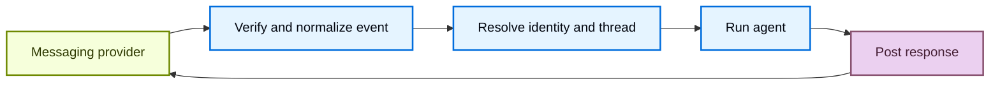

# Connect Managed Deep Agents to channels

> Connect Managed Deep Agents to external messaging services that can start runs and receive responses.

A channel makes a managed deep agent available in an external messaging service. Messages from the service can start agent runs, and the agent's final responses return through the same service.

> [!NOTE]
>
> Managed Deep Agents is in **public [beta](../../../../../LangSmith%20setup/Cloud/Reference/Release%20stages.md)** on [LangSmith Cloud](../../../../../LangSmith%20setup/Cloud/Cloud%20%28SaaS%29.md) and [Bring Your Own Cloud (BYOC)](../../../../../LangSmith%20setup/BYOC/Bring%20Your%20Own%20Cloud%20%28BYOC%29.md). Use Managed Deep Agents CLI and SDK v0.10 or later for BYOC.

## Project structure

Channel declarations live in the project-level `channels/` directory:

```text
my-agent/
  agent.py
  channels/
    slack.py
```

## Understand channels

A channel combines three parts of an external messaging integration:

* **Inbound events**: Verify and normalize provider events, then start an agent run.
* **Outbound messaging**: Send the agent's response back to the originating conversation.
* **Provisioning**: Create and configure the provider resources that connect the service to the deployed agent.

In Managed Deep Agents, a channel connects a deployed agent to a messaging provider.

The managed runtime handles the channel lifecycle:



Provider adapters determine which events are accepted, how provider conversations map to Managed Deep Agents threads, and how responses are delivered. The channel declaration exposes the supported configuration for that provider.

### Send messages to a running agent

Steering lets a user add to a run that is already in progress. When the same user sends a message while the agent runs on that thread, the message joins the active run at its next model call. It does not start a new run.

> [!NOTE]
>
> Steering is in beta and requires `managed-deepagents` 0.10.2 or later.

## Declare channels in a project

Put each channel in a separate module under `channels/`.

Export a module-level `channel` from each file.

The file name becomes the configured channel name and identifies the channel within the deployment.

Do not name a declaration `channels/channel.py`.

Channel names must be unique within a project.

The provider factory creates the declaration.

For example, `channels.slack()` creates a Slack channel.

See the provider guide for its declaration, app configuration, and deployment procedure.

## Distinguish channels from connectors

A channel receives messages that start agent runs and delivers responses. An [MCP connector](../Connect%20to%20MCP%20servers.md) gives the agent tools from a remote MCP server. A project can use either or both.

## Supported channels

> [card] [Slack](Connect%20a%20Managed%20Deep%20Agent%20to%20Slack.md)
>
> Start runs from Slack mentions, direct messages, and thread replies.

> [card] [Custom (HTTP)](Connect%20a%20Managed%20Deep%20Agent%20to%20a%20custom%20channel%20over%20HTTP.md)
>
> Start runs from any service that can send a JSON webhook.

An HTTP adapter can also live in a community-maintained package. See [Share a channel adapter as a package](Connect%20a%20Managed%20Deep%20Agent%20to%20a%20custom%20channel%20over%20HTTP.md#share-a-channel-adapter-as-a-package) to publish reusable provider code that users import into their channel declarations.

## See also

* [Identity](../Add%20identity%20to%20Managed%20Deep%20Agents.md): authenticate callers and scope channel runs to the resolved user.
* [Schedules](../Add%20schedules%20to%20Managed%20Deep%20Agents.md): deliver scheduled results through a configured channel.
* [Deploy an agent](../../Build%20and%20deploy/Deploy%20a%20Managed%20Deep%20Agent.md): deploy project changes and configure secrets.
* [CLI reference](../../Build%20and%20deploy/Managed%20Deep%20Agents%20CLI%20reference.md): review channel project-file conventions.
