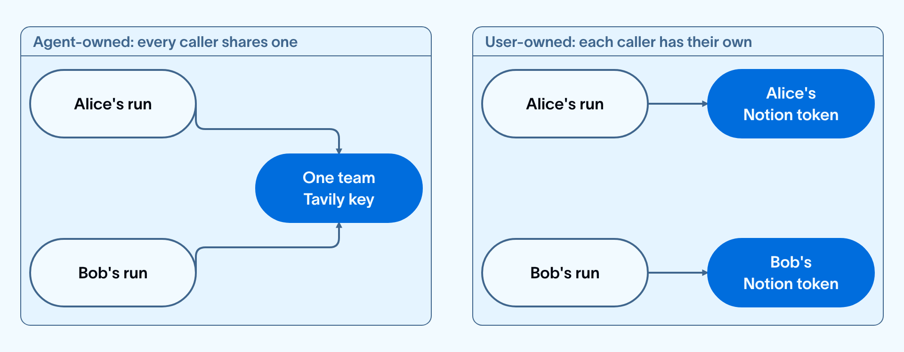

# Manage connections

> Store API keys and OAuth grants so Managed Deep Agents can authenticate with external services at runtime.

A connection links a managed deep agent to an external service such as GitHub, Notion, or Tavily. The credential lives in your LangSmith workspace. Use `connections.get(...)` in an authored tool or MCP server definition to resolve it at runtime.

Connections let you:

* **Keep credentials out of your project**: `mda deploy` collects `.env` values as deployment secrets on every deploy. A connection value stays in the workspace instead.
* **Give each caller their own identity**: A user-owned connection resolves the credential of the person who made the request, so the agent reads that person's documents and acts under their name. An environment variable holds one value for everyone.
* **Skip the OAuth plumbing**: Managed Deep Agents runs the authorization round-trip, so a project needs no callback route, token store, or consent screen. These flows are handled automatically by your Managed Deep Agent.
* **Reuse one slug across agents**: Connections belong to the workspace, so several deployments can resolve the same slug. Each deployment holds its own credential under that slug: run `mda connections create <slug>` once from each project root. Rotating a deployment's value takes effect on its next run, with no redeploy.

Storing a credential in LangSmith to use across your Managed Deep Agents takes one command:

```bash
uv run mda connections create organization-tavily --secret-from-env TAVILY_API_KEY
```

And reading it takes one line:

```python
api_key = await connections.get("organization-tavily", {"type": "agent"})
```

The rest of this page covers the two choices around those steps: who owns the credential, and how the service authenticates.

> [!NOTE]
>
> Managed Deep Agents is in **public [beta](../../../../LangSmith%20setup/Cloud/Reference/Release%20stages.md)** on [LangSmith Cloud](../../../../LangSmith%20setup/Cloud/Cloud%20%28SaaS%29.md) and [Bring Your Own Cloud (BYOC)](../../../../LangSmith%20setup/BYOC/Bring%20Your%20Own%20Cloud%20%28BYOC%29.md). Use Managed Deep Agents CLI and SDK v0.10 or later for BYOC.

## Choose a credential owner

Every `connections.get(...)` call names who owns the credential it resolves:

| Owner | Resolves to | Use when |
| - | - | - |
| `agent` | One credential that belongs to the deployment. Every caller uses it. | Every caller needs the same capability: web search with Tavily, a shared knowledge base, or posting to one team channel. |
| `user` | The calling person's own credential. Each person authorizes their own account. | The agent acts as the person who asked: searching Notion pages only they can see, filing an issue under their name, or sending email as them. |

Two callers of the same agent share an agent-owned credential and hold separate user-owned ones:



```python
tavily_key = await connections.get("organization-tavily", {"type": "agent"})
notion_token = await connections.get("engineering-notion", {"type": "user"})
```

`connections.get(...)` resolves to the credential value as a string.

A connection groups credentials under one slug. It belongs to the workspace rather than to an owner. Each credential it holds has its own owner. There is no `--owner` flag: the [create mode](#choose-a-create-mode) you use sets the owner.

`connections.get(...)` selects an owner. It does not create one. Asking for an owner with no credential of its own fails the run for `agent`, and raises a [`credential_authorization_required` interrupt](#handle-the-authorization-interrupt) for `user`. A credential stored under the same slug for a different owner does not satisfy the lookup.

Agent-owned credentials belong to the project's deployment, so create them after at least one successful [`mda deploy`](../Build%20and%20deploy/Deploy%20a%20Managed%20Deep%20Agent.md). A deployment reads only the credential it owns. To resolve the same slug from a second deployment, run `mda connections create <slug>` again from that project root: on an existing slug the command attaches a new agent-owned credential instead of failing.

### Identify the caller

A user-owned connection resolves against the caller identity that Managed Deep Agents attaches to the run. Where that identity comes from depends on how the agent is called:

| Surface | Caller identity |
| - | - |
| [Slack channel](Channels/Connect%20a%20Managed%20Deep%20Agent%20to%20Slack.md) | The Slack user who sent the message. |
| LangSmith Studio | The signed-in LangSmith user. |
| SDK client or custom frontend | The identity that the project's [identity declaration](Add%20identity%20to%20Managed%20Deep%20Agents.md) authenticates. |

The default identity declaration verifies a LangSmith API key. That key authenticates the calling client, not an individual person, so every caller who presents it resolves to the same identity. To give each signed-in person their own credentials, declare [Supabase identity](Add%20identity%20to%20Managed%20Deep%20Agents.md#configure-identity-with-supabase).

Code never passes a user ID to `connections.get(...)`. The runtime resolves the caller and returns that person's credential.

> [!NOTE]
>
> Slack and Studio complete the authorization round-trip for the caller. First-class support for custom channels is in development. To build a custom frontend against caller identity today, see [Handle the authorization interrupt](#handle-the-authorization-interrupt) and contact the [LangChain team](https://forum.langchain.com/c/help/langsmith/).

## Choose a create mode

Ownership decides what the agent does with a credential. The create mode decides how that credential reaches the workspace, and depends on how the external service authenticates:

| Mode | Use when | Create with | Credential owner |
| - | - | - | - |
| **Opaque secret** | The service uses a fixed API key or other static secret. | `--secret-from-env`, `--secret-from-file`, stdin, or an interactive prompt | The agent |
| **General OAuth** | You register your own OAuth app (BYOT), such as with GitHub or Google. | `--oauth <service>` from the catalog, or `--authorize-url` and `--token-url` for a custom provider | Each caller, or the agent with [`--authorize`](#authorize-an-agent-owned-oauth-account) or [client credentials](#create-a-client-credentials-connection) |
| **MCP OAuth** | An MCP server advertises OAuth and registers a client automatically. | `--mcp <url>`, or the slug alone when the project already declares that user-owned MCP server | Each caller, or the agent with [`--authorize`](#authorize-an-agent-owned-oauth-account) |

The following decision tree picks the create mode a service needs and shows which owner that mode supports:


For example:

```bash
# Opaque secret: store a fixed API key for the agent
uv run mda connections create organization-tavily --secret-from-env TAVILY_API_KEY

# General OAuth: register your own app, and let each caller authorize
uv run mda connections create frontend-github --oauth github \
  --client-id "********" --secret-from-env GITHUB_CLIENT_SECRET

# MCP OAuth: let the MCP server register a client for you
uv run mda connections create engineering-notion --mcp https://mcp.notion.com/mcp
```

Do not mix modes in one command. For example, `--mcp` cannot combine with `--oauth`, custom endpoints, `--client-id`, or a secret value.

### Name a connection

The first argument to `mda connections create` is a slug: your name for the connection, and the name your code passes to `connections.get(...)`. It is not the provider name, which goes to `--oauth`:

```bash
mda connections create frontend-github --oauth github
#                      ^ your slug      ^ catalog provider
```

Slugs are unique within a workspace. Use lowercase letters, numbers, and single hyphens, and pick a name that identifies which account the connection points at, such as `organization-tavily` or `engineering-notion`.

## Create an opaque secret

Store a fixed secret for the agent. Read the value from an environment variable, a file, stdin, or a prompt. This mode fits API keys for custom tools, such as a Tavily search key. Opaque secrets created with the CLI are agent-owned.

Put the source value in the shell environment or project `.env` file, then create the connection from that variable. Run the command from the project root. The CLI requires a LangSmith API key and workspace ID.

```bash
uv run mda connections create organization-tavily --secret-from-env TAVILY_API_KEY
```

This stores the value from `TAVILY_API_KEY` as an agent-owned secret. Runtime code resolves it with `connections.get(...)`.

Other ways to supply the value:

* **`--secret-from-file PATH`**: Read one value from a file that contains only the secret.
* **stdin**: Pipe or redirect the value, for example `printf '%s' "$ACME_API_KEY" | mda connections create acme-api`.
* **Interactive prompt**: Omit a value flag on a TTY. The CLI hides the input so the secret does not appear on screen or in shell history.

Opaque secrets created with the CLI are always agent-owned. For per-caller credentials, use an [OAuth connection](#create-a-general-oauth-connection).

Issue a key that belongs to the agent rather than reusing a personal key. A dedicated key can be scoped, rotated, and revoked without affecting anything else that shares it.

### Use an opaque secret in a custom tool

The following tool resolves the `organization-tavily` connection for the agent, then sends it to the Tavily API:

```python tools/search_web.py
import httpx
from langchain.tools import tool
from managed_deepagents import connections


@tool(parse_docstring=True)
async def search_web(query: str) -> str:
    """
    Search the web.

    Args:
        query: Search query.
    """
    api_key = await connections.get("organization-tavily", {"type": "agent"})
    async with httpx.AsyncClient(timeout=30.0) as client:
        response = await client.post(
            "https://api.tavily.com/search",
            json={"api_key": api_key, "query": query, "max_results": 5},
        )
        response.raise_for_status()
        return response.text
```

See [Custom tools](Add%20custom%20tools%20to%20Managed%20Deep%20Agents.md) to add the tool to the agent.

## Create a general OAuth connection

Register a bring-your-own-app (BYOT) OAuth client so callers can grant the agent access to a provider API. Use this mode for REST or GraphQL APIs where you own the OAuth app registration. For MCP servers that discover and register clients automatically, use [MCP OAuth](#create-an-mcp-oauth-connection) instead.

### Use the OAuth catalog

Every OAuth provider needs the same five settings: an authorization URL, a token URL, a token endpoint authentication method, authorization parameters, and default scopes. A catalog entry supplies all five, so `--oauth <service>` plus your own client ID and secret is the whole configuration.

The catalog is not a gate on which providers you can use. For a service it does not cover, [pass the endpoints yourself](#register-a-provider-with-custom-endpoints).

List the catalog with:

```bash
uv run mda connections catalog
```

The command prints each service's default scopes and the page where you register an app. It does not call LangSmith, so it needs no workspace ID or API key. Pass a value from the first column to `--oauth`.

| `--oauth` value | Register an app | Default scopes |
| - | - | - |
| `atlassian` | [Atlassian](https://developer.atlassian.com/console/myapps/) | `read:me` `offline_access` |
| `bitbucket` | [Bitbucket](https://bitbucket.org/account/settings/app-auth/) | `account` |
| `box` | [Box](https://app.box.com/developers/console) | None |
| `click-up` | [ClickUp](https://app.clickup.com/settings/apps) | None |
| `discord` | [Discord](https://discord.com/developers/applications) | `identify` `email` |
| `dropbox` | [Dropbox](https://www.dropbox.com/developers/apps) | `account_info.read` |
| `facebook` | [Facebook](https://developers.facebook.com/apps/) | `email` `public_profile` |
| `figma` | [Figma](https://www.figma.com/developers/apps) | `current_user:read` |
| `github` | [GitHub](https://github.com/settings/developers) | `read:user` |
| `gitlab` | [GitLab](https://gitlab.com/-/user_settings/applications) | `read_user` |
| `google` | [Google](https://console.cloud.google.com/apis/credentials) | `openid` `https://www.googleapis.com/auth/userinfo.email` |
| `hubspot` | [HubSpot](https://developers.hubspot.com/) | `oauth` |
| `huggingface` | [Hugging Face](https://huggingface.co/settings/applications/new) | `openid` `profile` `email` |
| `linear` | [Linear](https://linear.app/settings/api/applications/new) | `read` |
| `linkedin` | [LinkedIn](https://www.linkedin.com/developers/apps) | `openid` `profile` `email` |
| `notion-api` | [Notion API](https://www.notion.so/my-integrations) | None |
| `patreon` | [Patreon](https://www.patreon.com/portal/registration/register-clients) | `identity` `identity[email]` |
| `reddit` | [Reddit](https://www.reddit.com/prefs/apps) | `identity` |
| `salesforce` | [Salesforce](https://login.salesforce.com/) | `api` `refresh_token` |
| `slack` | [Slack](https://api.slack.com/apps) | `chat:write` |
| `spotify` | [Spotify](https://developer.spotify.com/dashboard) | `user-read-email` |
| `stripe-link` | [Stripe Link](https://docs.stripe.com/agentic-commerce/link-cli/oauth) | `payment_methods.agentic` `userinfo:read` |
| `twitch` | [Twitch](https://dev.twitch.tv/console/apps) | `user:read:email` |
| `x` | [X](https://developer.x.com/en/portal/dashboard) | `tweet.read` `users.read` `offline.access` |

A service with no default scopes requires `--scope`.

> [accordion] Some services run separate OAuth apps for their API and their MCP server
>
> Notion is one of them. `--oauth notion-api` registers an app against Notion's REST API, and that app does not authorize Notion's MCP server. To use the MCP server, create an [MCP OAuth connection](#create-an-mcp-oauth-connection) instead. Check the provider's documentation when a service offers both.

GitHub requires an OAuth client ID and client secret. Set `GITHUB_CLIENT_SECRET`, then create the connection. Replace `********` with the client ID:

```bash
uv run mda connections create frontend-github \
  --oauth github \
  --client-id "********" \
  --secret-from-env GITHUB_CLIENT_SECRET
```

On create, the CLI prints the redirect URI to register with the provider. Register that URI on the provider's app settings page before callers authorize. The URI follows your LangSmith host, for example `https://api.smith.langchain.com/v1/agent-auth/oauth/callback` on production. On [BYOC](../../../../LangSmith%20setup/BYOC/Bring%20Your%20Own%20Cloud%20%28BYOC%29.md), it follows your data plane endpoint instead.

Optional flags:

* **`--scope SCOPE`**: Replace the catalog defaults. Repeat for each scope.
* **`--allowed-scope SCOPE`**: Ceiling any later authorization may request. Defaults to the `--scope` values and must cover every `--scope`.
* **`--authorization-param KEY=VALUE`**: Extra authorization query parameter. Repeat for each parameter.
* **`--auth-method METHOD`**: How the client authenticates to the token endpoint: `client_secret_basic`, `client_secret_post`, or `none` for a public client. Defaults to the catalog service's method.

### Register a provider with custom endpoints

For a service the catalog does not cover, pass both endpoints plus a client ID and scopes:

```bash
uv run mda connections create acme \
  --authorize-url https://auth.acme.com/authorize \
  --token-url https://auth.acme.com/token \
  --client-id "********" \
  --secret-from-env ACME_CLIENT_SECRET \
  --scope read
```

Most providers reject an authorization request with no `scope` parameter. Pass `--scope` for manual registrations, or use `--oauth <service>` when the catalog covers the provider.

For providers such as Stripe that require custom headers at the token endpoint, add `--token-request-header KEY=VALUE` to `mda connections create`. Repeat the flag for each header. This option supports both authorization code and client credentials grants. Header values are write-only.

### Create a client credentials connection

The OAuth client credentials grant authenticates the agent as an application rather than as a person. Pass `--grant-type client_credentials` and the CLI requests the token as it creates the connection. No one signs in through a browser, and no caller sees an authorization prompt.

Use this mode when the provider issues machine-to-machine OAuth credentials. When the provider's API authenticates only as a person, [authorize an agent-owned account](#authorize-an-agent-owned-oauth-account) instead.

A client credentials connection needs a token URL, a client ID, and a client secret. Set `ACME_CLIENT_SECRET`, then create the connection. Replace `********` with the client ID:

```bash
uv run mda connections create acme-api \
  --grant-type client_credentials \
  --token-url https://auth.acme.com/oauth/token \
  --client-id "********" \
  --secret-from-env ACME_CLIENT_SECRET \
  --scope read
```

The CLI prints the slug, the grant type, and the scopes it stored. Run it from the project directory, because the token belongs to that project's deployment. When the token request fails, the CLI deletes the connection rather than leaving an unusable one behind.

`--oauth <service>` also works, for a catalog entry that carries a token URL. The catalog's default scopes and authorization parameters do not apply to this grant, so pass `--scope` for a provider that requires scopes.

Optional flags:

* **`--scope SCOPE`**: Request a scope. Repeat for each scope.
* **`--auth-method METHOD`**: Send the client secret as `client_secret_basic` or `client_secret_post`. Defaults to `client_secret_basic`. A public client (`none`) cannot use this grant.
* **`--token-param KEY=VALUE`**: Add a parameter to the token request, such as `--token-param audience=https://api.acme.com`. Repeat for each parameter. The grant sets `grant_type`, `client_id`, `client_secret`, and `scope` itself, so those four keys are rejected.

This grant rejects the authorization code flags `--authorize-url`, `--authorization-param`, and `--allowed-scope`.

A client credentials connection is always agent-owned, so every caller acts as the application. Runtime code resolves it like any other agent-owned credential:

```python
access_token = await connections.get("acme-api", {"type": "agent"})
```

### Authorize an agent-owned OAuth account

When a provider issues its own application credential, such as a Slack bot token, a GitHub App installation token, or a Notion internal integration token, prefer that credential stored as an [agent-owned secret](#create-an-opaque-secret). An application credential is scoped to the application, is revocable on its own, and does not depend on any person's account. When the provider issues that application identity through OAuth, create a [client credentials connection](#create-a-client-credentials-connection).

Use `--authorize` when the provider offers no application identity and its API authenticates only as a person.

By default, an OAuth connection collects a grant from each caller at runtime. Pass `--authorize` to sign in once yourself and store the grant for the deployment. Every caller then acts as that one account, and no caller sees an authorization prompt:

```bash
uv run mda connections create support-linear \
  --oauth linear \
  --client-id "********" \
  --secret-from-env LINEAR_CLIENT_SECRET \
  --scope read --scope write \
  --authorize
```

The CLI starts an authorization flow for the account you sign in with and stores the resulting grant for the deployment. Runtime code resolves it as an agent-owned credential:

```python
access_token = await connections.get("support-linear", {"type": "agent"})
```

`--authorize` applies to OAuth connections only. Combine it with `--oauth`, custom endpoints, or `--mcp`. Run it from the project directory, because the grant belongs to that project's deployment.

Use an agent-owned OAuth account when every caller should act as one shared account rather than as themselves. A company Notion account that grants read access to a question-answering agent is one example.

> [!TIP]
>
> Authorize a dedicated account that your team owns, not your own. The account you sign in with becomes the identity behind every action the agent takes, for every caller. Using a personal account costs you three things:
>
> * The agent gets your full access at that provider.
> * The provider's audit log shows your name for what the agent did.
> * The agent stops working when your own access changes.
>
> A grant made this way stays tied to the account that authorized it, even a dedicated one. A password reset, a revoked session, or a deactivated account ends the grant, so treat that account as production infrastructure.
>
> Give the dedicated account the narrowest `--scope` values the agent needs. Set `--allowed-scope` to cap what any later authorization can request.

### Access an OAuth token in a custom tool

This tool resolves the authenticated caller's GitHub connection and calls the GitHub REST API:

```python tools/get_github_user.py
import httpx
from langchain.tools import tool
from managed_deepagents import connections


@tool
async def get_github_user() -> str:
    """Get the authenticated caller's GitHub login."""
    # Replace `frontend-github` with the name of your connection.
    access_token = await connections.get("frontend-github", {"type": "user"})
    async with httpx.AsyncClient(timeout=30.0) as client:
        response = await client.get(
            "https://api.github.com/user",
            headers={"Authorization": f"Bearer {access_token}"},
        )
        response.raise_for_status()
        return response.json()["login"]
```

## Create an MCP OAuth connection

For remote MCP servers that support OAuth client registration, Managed Deep Agents discovers the server's OAuth metadata and registers a client automatically. You do not supply a client ID or client secret.

### Declare the MCP server first

Add the server in `tools/mcp.py` and reference the connection slug.

```python tools/mcp.py
from managed_deepagents import connections, define_mcp

mcp = define_mcp(
    servers={
        "notion": {
            "transport": "http",
            "url": "https://mcp.notion.com/mcp",
            "connection": connections.get("engineering-notion", {"type": "user"}),
        },
    },
)
```

For more information, see [Connect to MCP servers](Connect%20to%20MCP%20servers.md).

### Create from the project declaration

When the slug matches exactly one user-owned MCP connection in the project, create with the slug alone. The CLI reads the server URL from the MCP declaration:

```bash
uv run mda connections create engineering-notion
```

### Create from an explicit MCP URL

Pass `--mcp` when you want to name the server URL explicitly, or when the slug is not yet declared in the project:

```bash
uv run mda connections create engineering-notion --mcp https://mcp.notion.com/mcp
```

A scheme-less value such as `mcp.notion.com/mcp` is stored as `https://mcp.notion.com/mcp`.

If the server cannot register a client automatically, the CLI says so and points you at general OAuth (`--oauth` or manual endpoints) instead.

`mda deploy` applies the same inference to missing user-owned MCP connections. It leaves existing connections unchanged, creates each unique missing MCP connection through OAuth discovery, and fails before deployment when discovery or registration is unavailable.

## Handle the authorization interrupt

Managed Deep Agents runs the OAuth round-trip for you. A project needs no callback route, no token store, no refresh logic, and no consent screen. The run pauses, the caller grants access, and the run resumes with that person's credential.

A caller who already connected the service goes straight to the tool call. A caller without a grant takes the authorization round-trip first, then reaches the same tool call:


Before the first model turn, Managed Deep Agents checks every user-owned connection the run needs. If the caller is missing one or more grants, the credential gate raises a single LangGraph interrupt. Slack and LangSmith Studio handle that interrupt for the caller. A custom frontend reads the same payload from the LangChain frontend SDK and resumes after the caller connects.

User-owned connections require an authenticated caller. Anonymous or agent-only runs cannot complete the credential gate. See [Identify the caller](#identify-the-caller) for where that identity comes from.

### Interrupt payload

With [`useStream`](https://docs.langchain.com/oss/python/langchain/frontend/human-in-the-loop#setting-up-usestream) (`@langchain/react`, `@langchain/vue`, `@langchain/svelte`) or `injectStream` (`@langchain/angular`), the pending interrupt is on `stream.interrupt`. The credential gate payload is `stream.interrupt.value`.

For a missing OAuth grant, each entry in `credentials` carries the URL where the caller completes consent:

```json
{
  "type": "credential_authorization_required",
  "message": "Connect the following integrations to continue.",
  "credentials": [
    {
      "slug": "engineering-notion",
      "kind": "oauth2",
      "connect_url": "https://api.smith.langchain.com/v1/agent-auth/...",
      "auth_id": "sess_abc123"
    }
  ]
}
```

One interrupt lists every missing grant. Handle each entry before resuming. An entry with `"kind": "secret"` represents a user-owned API key rather than an OAuth grant. Slack and Studio do not collect those. For more information, see [Review current limitations](#review-current-limitations).

| Field | Present for | Meaning |
| - | - | - |
| `type` | Always | Discriminator. Must be `credential_authorization_required`. |
| `message` | Always | Human-readable summary to show above the pending grants. |
| `credentials` | Always | One entry per missing grant. |
| `credentials[].slug` | Always | Connection slug to authorize. |
| `credentials[].kind` | Always | `secret` for a password-style API key, or `oauth2` for OAuth. |
| `credentials[].connect_url` | `oauth2` | HTTPS URL where the caller completes consent. |
| `credentials[].auth_id` | `oauth2` | Authorization session id used to poll status. |

### Read the interrupt in your UI

The frontend that renders this interrupt is a web application, so these examples are TypeScript whether the agent is written in Python or TypeScript.

Detect the credential gate payload on `stream.interrupt`, render a connect card, then resume with `stream.respond` after every grant is stored:

```tsx React
import { useStream } from "@langchain/react";

type CredentialAuthorizationRequired = {
  type: "credential_authorization_required";
  message?: string;
  credentials: Array<{
    slug: string;
    kind: "oauth2" | "secret";
    connect_url?: string;
    auth_id?: string;
  }>;
};

function isCredentialAuthorization(
  value: unknown
): value is CredentialAuthorizationRequired {
  return (
    typeof value === "object" &&
    value !== null &&
    "type" in value &&
    value.type === "credential_authorization_required"
  );
}

export function Chat() {
  const stream = useStream({
    apiUrl: "https://your-deployment.example",
    assistantId: "agent",
  });

  const payload = stream.interrupt?.value;
  const credentialAuth = isCredentialAuthorization(payload) ? payload : null;

  return (
    <div>
      {/* messages … */}
      {credentialAuth && (
        <ConnectCard
          payload={credentialAuth}
          onComplete={async (connectedSlugs) => {
            await stream.respond(
              {
                type: "credential_authorization_completed",
                connected_slugs: connectedSlugs,
              },
              { interruptId: stream.interrupt?.id }
            );
          }}
        />
      )}
    </div>
  );
}
```

```vue Vue
<script setup lang="ts">
import { computed } from "vue";
import { useStream } from "@langchain/vue";

const stream = useStream({
  apiUrl: "https://your-deployment.example",
  assistantId: "agent",
});

const credentialAuth = computed(() => {
  const value = stream.interrupt.value?.value;
  return value?.type === "credential_authorization_required" ? value : null;
});

async function onComplete(connectedSlugs: string[]) {
  await stream.respond(
    {
      type: "credential_authorization_completed",
      connected_slugs: connectedSlugs,
    },
    { interruptId: stream.interrupt.value?.id }
  );
}
</script>

<template>
  <div>
    <!-- messages … -->
    <ConnectCard
      v-if="credentialAuth"
      :payload="credentialAuth"
      @complete="onComplete"
    />
  </div>
</template>
```

```svelte Svelte
<script lang="ts">
  import { useStream } from "@langchain/svelte";

  const stream = useStream({
    apiUrl: "https://your-deployment.example",
    assistantId: "agent",
  });

  $: payload = stream.interrupt?.value;
  $: credentialAuth =
    payload?.type === "credential_authorization_required" ? payload : null;

  async function onComplete(connectedSlugs: string[]) {
    await stream.respond(
      {
        type: "credential_authorization_completed",
        connected_slugs: connectedSlugs,
      },
      { interruptId: stream.interrupt?.id }
    );
  }
</script>

<div>
  <!-- messages … -->
  {#if credentialAuth}
    <ConnectCard payload={credentialAuth} onComplete={onComplete} />
  {/if}
</div>
```

```ts Angular
import { Component, computed } from "@angular/core";
import { injectStream } from "@langchain/angular";

@Component({
  selector: "app-chat",
  template: `
    <!-- messages … -->
    @if (credentialAuth(); as auth) {
      <app-connect-card
        [payload]="auth"
        (complete)="onComplete($event)"
      />
    }
  `,
})
export class ChatComponent {
  stream = injectStream({
    apiUrl: "https://your-deployment.example",
    assistantId: "agent",
  });

  credentialAuth = computed(() => {
    const value = this.stream.interrupt()?.value;
    return value?.type === "credential_authorization_required" ? value : null;
  });

  async onComplete(connectedSlugs: string[]) {
    await this.stream.respond(
      {
        type: "credential_authorization_completed",
        connected_slugs: connectedSlugs,
      },
      { interruptId: this.stream.interrupt()?.id }
    );
  }
}
```

For the general interrupt lifecycle (`stream.interrupt`, resume, checkpoints), see [Human-in-the-loop](https://docs.langchain.com/oss/python/langchain/frontend/human-in-the-loop.md).

### Handle OAuth grants (`kind: "oauth2"`)

For each OAuth entry:

1. Show the `slug` and a Connect control that opens `connect_url` (HTTPS only; reject URLs with embedded credentials).
2. Long-poll Agent Auth until the session completes:

```http
GET /v1/agent-auth/oauth-authorization-sessions/{auth_id}?wait_seconds=25
```

The response `status` is `pending`, `completed`, `failed`, or `expired`. Keep polling while the status is `pending`. On `completed`, mark that slug connected. On `failed` or `expired`, ask the caller to start a new run for a fresh connect link.

Do not put the access token in your UI. Agent Auth stores the grant for the caller; the agent reads it on resume through `connections.get(...)`.

### Resume the run

After every entry in `credentials` is connected, resume with:

```json
{
  "type": "credential_authorization_completed",
  "connected_slugs": ["engineering-notion"]
}
```

Pass that object to `stream.respond(resume, { interruptId: stream.interrupt?.id })` as shown above. If you resume while a grant is still missing, the gate interrupts again with a fresh payload.

### Built-in Slack handling

When the agent runs through the Slack channel, Slack renders OAuth entries that include an HTTPS `connect_url`. The caller opens the link, completes consent, and Slack resumes the run, so nobody has to open LangSmith to connect a service.

**Screenshot placeholder:** Add the Slack OAuth authorization prompt screenshot here.

Slack OAuth authorization prompt

## Inspect and delete connections

Use `list` or `get` to inspect connection metadata. `list` shows every connection in the workspace, not only the ones this project uses:

```bash
uv run mda connections list
uv run mda connections get organization-tavily
uv run mda connections delete organization-tavily
```

Pass `--json` to `list` or `get` for machine-readable output. Pass `--yes` to `delete` to skip the confirmation prompt.

## Develop locally

For `mda dev`, an agent-owned opaque connection reads `MDA_DEV_<SLUG>`. The CLI converts the slug to uppercase and replaces hyphens with underscores. For example, `organization-tavily` reads `MDA_DEV_ORGANIZATION_TAVILY`.

User-owned connections require an authenticated caller and Agent Auth. Deploy the agent to exercise the [authorization interrupt](#handle-the-authorization-interrupt) end to end.

## Review current limitations

Connections are part of the Managed Deep Agents public beta. The following gaps apply to the current release:

* **User-owned API keys**: A user-owned connection holds an OAuth grant. Slack and Studio do not collect a per-caller API key, and the CLI does not create an empty slot for one. Use an agent-owned secret instead, or collect the key in a custom frontend as described in the following section.
* **Custom channels**: Slack and Studio resolve caller identity and complete authorization for the caller. A custom frontend handles the [authorization interrupt](#handle-the-authorization-interrupt) itself.
* **Workspace UI**: LangSmith does not list connections in the UI. Use `mda connections list` and `mda connections get` for connection metadata.
* **Grant visibility**: `mda connections list` is workspace-scoped and does not report which deployments hold a credential under a slug. A run that fails with `no agent connection is set for slug '<slug>'` means this deployment owns no credential for it, even when `list` shows the slug. Run `mda connections create <slug>` from the project root to mint one.

> [accordion] Store a user-owned API key through Agent Auth
>
> An interrupt entry with `"kind": "secret"` has no `connect_url`. To collect one in a custom frontend, prompt for the value with a hidden input, then create the credential against the existing connection slug:
>
> ```http theme={"theme":{"light":"catppuccin-latte","dark":"catppuccin-mocha"}}
> POST /v1/agent-auth/connections
> ```
>
> ```json theme={"theme":{"light":"catppuccin-latte","dark":"catppuccin-mocha"}}
> {
>   "slug": "organization-tavily",
>   "display_name": "organization-tavily",
>   "credential": {
>     "kind": "secret",
>     "owner_type": "user",
>     "owner_id": "<caller-identity-id>",
>     "value": "<api-key>"
>   }
> }
> ```
>
> Agent Auth reuses the existing connection for that slug and attaches the caller's secret. Secret material is write-only. After a successful create, mark that slug connected and resume the run. For more information, see [Set up Agent Auth](../../../../Deploy/Agent%20Server/Auth%20%26%20access%20control/Set%20up%20Agent%20Auth.md).

## See also

* [Managed Deep Agents CLI reference](../Build%20and%20deploy/Managed%20Deep%20Agents%20CLI%20reference.md)
* [Connect to MCP servers](Connect%20to%20MCP%20servers.md)
* [Add custom tools](Add%20custom%20tools%20to%20Managed%20Deep%20Agents.md)
* [Add identity to Managed Deep Agents](Add%20identity%20to%20Managed%20Deep%20Agents.md)
* [Deploy an agent](../Build%20and%20deploy/Deploy%20a%20Managed%20Deep%20Agent.md)
* [Human-in-the-loop](https://docs.langchain.com/oss/python/langchain/frontend/human-in-the-loop.md)
* [Set up Agent Auth](../../../../Deploy/Agent%20Server/Auth%20%26%20access%20control/Set%20up%20Agent%20Auth.md)
