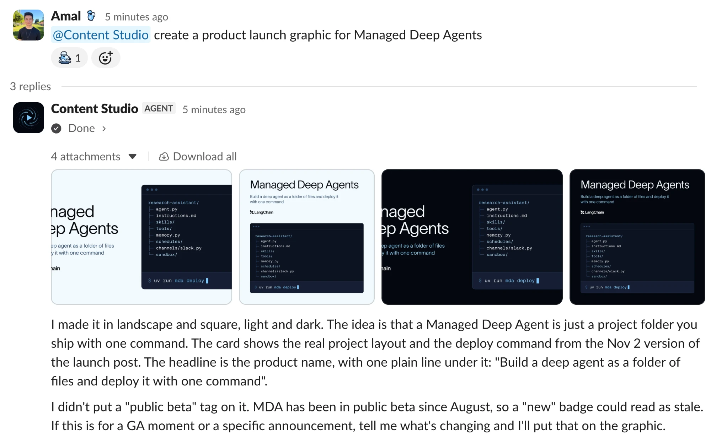

# Deploy the open-source design agent

> Deploy Content Studio, an open-source design agent, to Slack as a Managed Deep Agents project.

[Content Studio](https://github.com/langchain-ai/design-agent) is an open-source design agent built on Managed Deep Agents. Your team requests work in Slack, and the agent returns finished files in the thread.

> [!NOTE]
>
> Managed Deep Agents is in **public [beta](../../../../LangSmith%20setup/Cloud/Reference/Release%20stages.md)** on [LangSmith Cloud](../../../../LangSmith%20setup/Cloud/Cloud%20%28SaaS%29.md) and [Bring Your Own Cloud (BYOC)](../../../../LangSmith%20setup/BYOC/Bring%20Your%20Own%20Cloud%20%28BYOC%29.md). Use Managed Deep Agents CLI and SDK v0.10 or later for BYOC.

## Deploy the agent

Before you start, make sure you have:

* A [LangSmith Cloud](../../../../LangSmith%20setup/Cloud/Cloud%20%28SaaS%29.md) account and an [API key](../../../../LangSmith%20setup/Account/Create%20an%20account%20and%20API%20key.md) that can deploy.
* A key for your model provider. On the [LLM Gateway](../../../../LLM%20Gateway/Get%20started/LLM%20Gateway.md), the agent uses your LangSmith key instead.
* Permission to install apps in your Slack workspace, or a workspace admin who can approve the agent's Slack app.

To deploy with a coding agent such as Claude Code, Codex, or Cursor, paste this prompt. It installs the agent, checks the setup, and asks before anything that bills or deploys.

Deploy the design agent with your coding agent

Deploy the open-source design agent to my Slack workspace with Managed Deep Agents.

1. Install it with `curl -fsSL https://raw.githubusercontent.com/langchain-ai/design-agent/main/install.sh | bash`, then work in the `design-agent` folder it creates.
2. Read `AGENTS.md` and follow the `design-agent-deploy` skill.
3. Tell me which keys you need. I will type them myself with `uv run design-agent config set <KEY>` in my terminal; never ask me to paste a key in chat.
4. Run `uv run design-agent doctor` and fix what it flags. Its `mda-deploy` line lists what a deploy still needs.
5. Ask me before `uv run design-agent sandbox publish`, which bills. Then have me run the first deploy, `uv run mda deploy`, in my own terminal, since it sets up the Slack app.
6. When it is live, walk me through messaging the agent in Slack and sending a first request.

To deploy it yourself:

**1. Install the project**

The installer installs uv if needed, then clones the repository and sets it up.

```bash
curl -fsSL https://raw.githubusercontent.com/langchain-ai/design-agent/main/install.sh | bash
cd design-agent
```

**2. Add your keys**

```bash
uv run design-agent config set LANGSMITH_API_KEY ANTHROPIC_API_KEY
```

The command asks for each key and keeps it hidden. On the [LLM Gateway](../../../../LLM%20Gateway/Get%20started/LLM%20Gateway.md), skip the provider key and run `uv run design-agent config set DESIGN_AGENT_MODEL=langsmith:anthropic/claude-opus-5-5` instead.

`mda deploy` forwards every key in `.env` as a deployment secret, except `LANGSMITH_API_KEY`, which signs the deploy.

**3. Publish the sandbox**

```bash
uv run design-agent sandbox publish
```

`mda deploy` builds `sandbox/setup.sh` into a snapshot on its own. That build uses a Docker image base, which gets a 1 GiB filesystem. The design agent's machine, with Chrome, FFmpeg, and HyperFrames, is about 1.3 GiB. This command builds a larger snapshot in your [workspace](../../../../LangSmith%20setup/Govern/Organization/Overview.md#workspaces) instead and points `sandbox/__init__.py` at it.

It takes 10 to 15 minutes and runs once per workspace. Publish again only when `sandbox/setup.sh` changes.

**4. Deploy**

```bash
uv run mda deploy
```

The first deploy provisions the agent's Slack app. If the command prints a Slack link, open it, approve the app for your workspace, and press Enter. A workspace admin may need to approve the app first.

**5. Send a first request**

After the first deploy, the agent sends you a direct message. Reply there, or invite it to a channel and mention it with a request, such as a launch graphic for a product. Progress updates and finished files appear in the same thread.



Example Slack thread: progress updates, then finished files.

## Customize the design agent

Most changes are edits to files in the repository. Common ones:

* **Brand pack**: Your colors, fonts, logos, and voice live in `workspace/brand/`. Ask your coding agent to build the pack from your website and brand guide.
* **Skills**: Each workflow is a folder in `skills/`. Add one for a request your team makes often, such as a weekly newsletter header.
* **Instructions**: The always-on prompt is `instructions.md`. Keep it short, and put workflows in skills.
* **MCP servers**: Copy `config/mcp.example.toml` to `config/mcp.toml` and turn on servers such as Notion or GitHub. Each person signs in as themselves through a [workspace connection](../Agent%20capabilities/Manage%20connections.md).
* **Model**: Set `DESIGN_AGENT_MODEL` with `uv run design-agent config set`. Any chat model with tool calling and vision works.

To try a change and ship it, use these [`mda` commands](../Build%20and%20deploy/Managed%20Deep%20Agents%20CLI%20reference.md):

| Command | What it does |
| - | - |
| `uv run mda dev` | Runs the agent locally and opens it in [LangSmith Studio](../../../../Test/Test%20from%20Studio/LangSmith%20Studio.md) |
| `uv run mda deploy --name design-agent-test` | Deploys a separate copy to test changes without touching the one your team uses |
| `uv run mda deploy` | Ships your changes to the deployment your team uses |
| `uv run mda logs` | Tails the logs of the deployed agent |
| `uv run mda build` | Compiles what would ship into `.mda/build/` without deploying |

For more information, see [Customization](https://github.com/langchain-ai/design-agent/blob/main/docs/customization.md) in the repository.

## Explore the project

Each managed capability is a file or folder at the root of the repository:

| Path | In this agent | Learn more |
| - | - | - |
| `agent.py` | Builds the agent with `define_deep_agent` from one shared assembly of model, tools, middleware, and subagents | [Agent definition](../Agent%20capabilities/Define%20a%20Managed%20Deep%20Agent.md) |
| `instructions.md` | A short always-on prompt, with workflows kept in skills | [Instructions](../Agent%20capabilities/Add%20instructions%20to%20Managed%20Deep%20Agents.md) |
| `skills/` | 35 skills and a design wiki, synced to Context Hub and loaded only when a job needs them | [Skills](../Agent%20capabilities/Add%20skills%20to%20Managed%20Deep%20Agents.md) |
| `sandbox/` | A pinned recipe for the Linux machine each thread clones, with Chrome, FFmpeg, HyperFrames, D2, and your fonts | [Sandboxes](../Agent%20capabilities/Add%20a%20sandbox%20to%20Managed%20Deep%20Agents.md) |
| `channels/slack.py` | The managed Slack app for mentions, DMs, thread replies, files, and approval cards | [Slack channel](../Agent%20capabilities/Channels/Connect%20a%20Managed%20Deep%20Agent%20to%20Slack.md) |
| `memory.py` | Team memory everyone shares and personal memory for each person | [Memory](../Agent%20capabilities/Add%20memory%20to%20Managed%20Deep%20Agents.md) |
| `tools/mcp.py` | MCP servers from `config/mcp.toml`, with each person signed in as themselves | [MCP connectors](../Agent%20capabilities/Connect%20to%20MCP%20servers.md) |
| `schedules/housekeeping.py` | Runs every 15 minutes to sweep work a restart stopped, with no model call | [Schedules](../Agent%20capabilities/Add%20schedules%20to%20Managed%20Deep%20Agents.md) |
| `identity.py` | Authenticates API callers with a LangSmith API key | [Identity](../Agent%20capabilities/Add%20identity%20to%20Managed%20Deep%20Agents.md) |
| `src/design_agent/` | Application code the agent entry imports, such as host tools and middleware | [Tools](../Agent%20capabilities/Add%20custom%20tools%20to%20Managed%20Deep%20Agents.md) |

## Architecture

Managed Deep Agents provides the Slack app, identity, schedules, and a sandbox per thread. The repository adds the design workflows, brand pack, and rendering tools.


Request path from Slack through the agent and sandbox back to the thread.

Long jobs like video generation run in the background. The main agent hands parts to [subagents](../Agent%20capabilities/Subagents.md) on the same sandbox and stays free to talk. A one-time [schedule](../Agent%20capabilities/Add%20schedules%20to%20Managed%20Deep%20Agents.md) wakes the main agent when a background job finishes or stalls.

The brand pack in `workspace/brand/` is the source of colors, fonts, logos, and voice. The agent checks each render against that pack before posting.

## See also

* [Design agent repository](https://github.com/langchain-ai/design-agent)
* [Run the demo locally, with no API keys](https://github.com/langchain-ai/design-agent#try-it-locally)
* [Paid media agent template](Deploy%20the%20open-source%20paid%20media%20agent.md)
* [Deploy with Managed Deep Agents, in the repository](https://github.com/langchain-ai/design-agent/blob/main/docs/deploy-mda.md)
* [Managed Deep Agents project structure](../Get%20started/Managed%20Deep%20Agents%20project%20structure.md)
* [Deploy a Managed Deep Agents project](../Build%20and%20deploy/Deploy%20a%20Managed%20Deep%20Agent.md)
