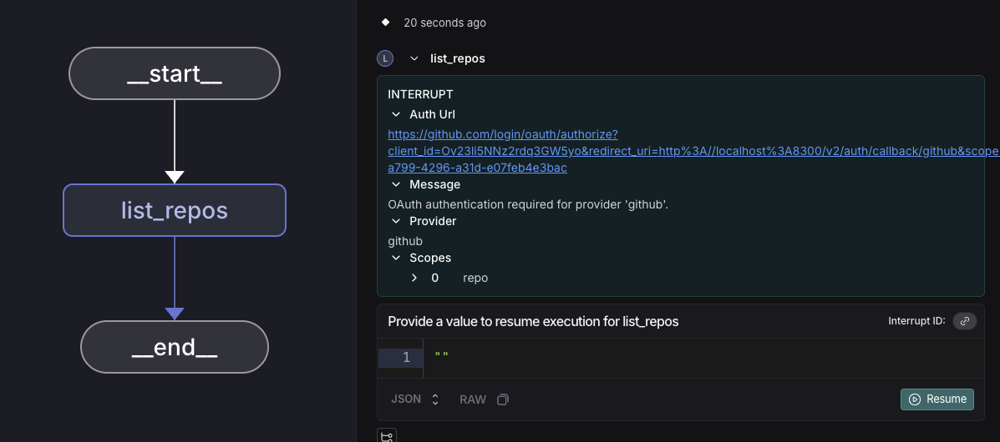
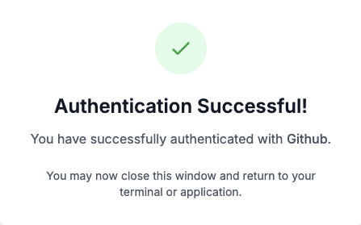

# Set up Agent Auth

> Enable secure access from agents to any system using OAuth 2.0 credentials with Agent Auth.

> [!NOTE]
>
> Agent Auth is in **[beta](../../../LangSmith%20setup/Cloud/Reference/Release%20stages.md)** and under active development. To provide feedback or use this feature, reach out to the [LangChain team](https://forum.langchain.com/c/help/langsmith/8).

## Installation

> [tab] Python
>
> ```bash pip theme={"theme":{"light":"catppuccin-latte","dark":"catppuccin-mocha"}}
> pip install langchain-auth
> ```
>
> ```bash uv theme={"theme":{"light":"catppuccin-latte","dark":"catppuccin-mocha"}}
> uv add langchain-auth
> ```

> [tab] JavaScript
>
> ```bash theme={"theme":{"light":"catppuccin-latte","dark":"catppuccin-mocha"}}
> npm install @langchain/auth
> ```

## Quickstart

### 1. Initialize the client

> [tab] Python
>
> ```python theme={"theme":{"light":"catppuccin-latte","dark":"catppuccin-mocha"}}
> from langchain_auth import Client
>
> client = Client(api_key="<API_KEY>")
> ```

> [tab] JavaScript
>
> ```javascript theme={"theme":{"light":"catppuccin-latte","dark":"catppuccin-mocha"}}
> import { Client } from '@langchain/auth';
>
> const client = new Client({ apiKey: '<API_KEY>' });
> ```

#### Self-hosted configuration

For self-hosted LangSmith instances, specify the API URL using the `/api-host` path on your instance.

> [tab] Environment Variable
>
> ```bash theme={"theme":{"light":"catppuccin-latte","dark":"catppuccin-mocha"}}
> export LANGSMITH_API_URL="https://your-langsmith-instance.com/api-host"
> ```
>
> Then initialize the client normally:
>
> ```python theme={"theme":{"light":"catppuccin-latte","dark":"catppuccin-mocha"}}
> client = Client(api_key="<API_KEY>")
> ```

> [tab] Explicit Configuration (Python)
>
> ```python theme={"theme":{"light":"catppuccin-latte","dark":"catppuccin-mocha"}}
> client = Client(
>     api_key="<API_KEY>",
>     api_url="https://your-langsmith-instance.com/api-host"
> )
> ```

> [tab] Explicit Configuration (JavaScript)
>
> ```javascript theme={"theme":{"light":"catppuccin-latte","dark":"catppuccin-mocha"}}
> const client = new Client({
>     apiKey: '<API_KEY>',
>     apiUrl: 'https://your-langsmith-instance.com/api-host'
> });
> ```

### 2. Set up OAuth providers

Before agents can authenticate, you need to configure an OAuth provider using the following process:

1. Select a unique identifier for your OAuth provider to use in LangChain's platform (e.g., "github-local-dev", "google-workspace-prod").

2. Go to your OAuth provider's developer console and create a new OAuth application.

3. Set the callback URL in your OAuth provider:

> [tab] LangSmith Cloud
>
> ```
> https://smith.langchain.com/host-oauth-callback/{provider_id}
> ```
>
> For example, if your provider\_id is "github-local-dev", use:
>
> ```
> https://smith.langchain.com/host-oauth-callback/github-local-dev
> ```

> [tab] Self-hosted
>
> ```
> https://{your-langsmith-instance}/host-oauth-callback/{provider_id}
> ```
>
> For example, if your instance is `langsmith.example.com` and provider\_id is "github", use:
>
> ```
> https://langsmith.example.com/host-oauth-callback/github
> ```

4. Use `client.create_oauth_provider()` with the credentials from your OAuth app:

> [tab] Python
>
> ```python theme={"theme":{"light":"catppuccin-latte","dark":"catppuccin-mocha"}}
> new_provider = await client.create_oauth_provider(
>     provider_id="{provider_id}",  # Provide any unique ID
>     name="{provider_display_name}",  # Provide any display name
>     client_id="{your_client_id}",
>     client_secret="<API_KEY>",
>     auth_url="{auth_url_of_your_provider}",
>     token_url="{token_url_of_your_provider}",
> )
> ```

> [tab] JavaScript
>
> ```javascript theme={"theme":{"light":"catppuccin-latte","dark":"catppuccin-mocha"}}
> const newProvider = await client.createOAuthProvider({
>     providerId: '{provider_id}',  // Provide any unique ID
>     name: '{provider_display_name}',  // Provide any display name
>     clientId: '{your_client_id}',
>     clientSecret: '<API_KEY>',
>     authUrl: '{auth_url_of_your_provider}',
>     tokenUrl: '{token_url_of_your_provider}',
> });
> ```

### 3. Authenticate from an agent

The client `authenticate()` API is used to get OAuth tokens from pre-configured providers. On the first call, it takes the caller through an OAuth 2.0 auth flow.

#### In LangGraph context

By default, tokens are scoped to the calling agent using the Assistant ID parameter.

```python
auth_result = await client.authenticate(
    provider="{provider_id}",
    scopes=["scopeA"],
    user_id="your_user_id"  # Any unique identifier to scope this token to the human caller
)

# Or explicitly specify an agent_id for agent-scoped tokens
auth_result = await client.authenticate(
    provider="{provider_id}",
    scopes=["scopeA"],
    user_id="your_user_id",
    agent_id="specific-agent-id"  # Optional: explicitly set agent scope
)
```

During execution, if authentication is required, the SDK will throw an [interrupt](../Capabilities/Human-in-the-loop%20using%20server%20API.md). The agent execution pauses and presents the OAuth URL to the user:



Studio interrupt showing OAuth URL

After the user completes OAuth authentication and we receive the callback from the provider, they will see the auth success page.



GitHub OAuth success page

The agent then resumes execution from the point it left off at, and the token can be used for any API calls. We store and refresh OAuth tokens so that future uses of the service by either the user or agent do not require an OAuth flow.

```python
token = auth_result.token
```

#### Outside LangGraph context

Provide the `auth_url` to the user for out-of-band OAuth flows.

> [tab] Python
>
> ```python theme={"theme":{"light":"catppuccin-latte","dark":"catppuccin-mocha"}}
> auth_result = await client.authenticate(
>     provider="{provider_id}",
>     scopes=["scopeA"],
>     user_id="your_user_id"
> )
>
> if auth_result.status == "pending":
>     print(f"Complete OAuth at: {auth_result.url}")
>     # Wait for user to complete OAuth
>     completed_auth = await client.wait_for_completion(auth_result.auth_id)
>     print("Authentication completed!")
> else:
>     token = auth_result.token
>     print(f"Already authenticated, token: {token}")
> ```

> [tab] JavaScript
>
> ```javascript theme={"theme":{"light":"catppuccin-latte","dark":"catppuccin-mocha"}}
> const authResult = await client.authenticate({
>     provider: '{provider_id}',
>     scopes: ['scopeA'],
>     userId: 'your_user_id'
> });
>
> if (authResult.status === 'pending') {
>     console.log(`Complete OAuth at: ${authResult.authUrl}`);
>     // Wait for user to complete OAuth
>     const completedAuth = await client.waitForCompletion(authResult.authId);
>     console.log('Authentication completed!');
> } else {
>     const token = authResult.token;
>     console.log(`Already authenticated, token: ${token}`);
> }
> ```

## Troubleshooting

### Self-hosted: 405 Method Not Allowed

If you receive a `405 Method Not Allowed` error, ensure `LANGSMITH_API_URL` points to the `/api-host` path:

```bash
export LANGSMITH_API_URL="https://your-instance.com/api-host"
```

### Self-hosted: Malformed OAuth callback URL

Ensure your OAuth provider's redirect URI matches your LangSmith instance URL:

```
https://your-instance.com/host-oauth-callback/{provider_id}
```
