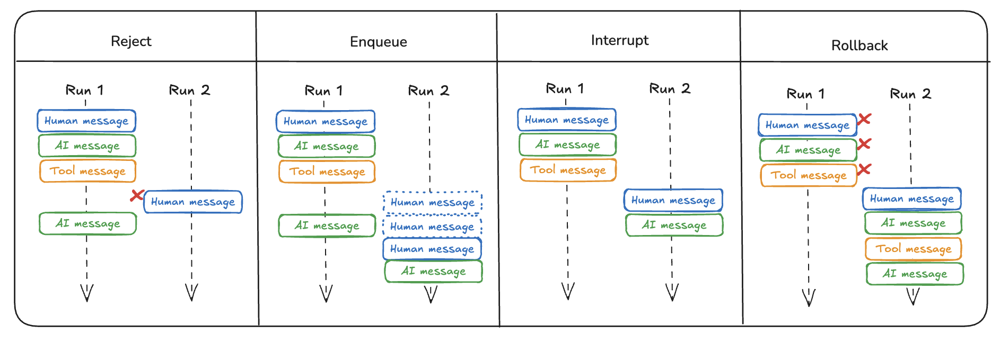

# Double texting

> [!NOTE]
>
> **Prerequisites**
>
> * [Agent Server](../Agent%20Server.md)

Many times users might interact with your graph in unintended ways.
For instance, a user may send one message and before the graph has finished running send a second message.
More generally, users may invoke the graph a second time before the first run has finished.
We call this "double texting".

[Enqueue](#enqueue-default) is the default double texting (multi-tasking) strategy when creating runs in the [Agent Server](../Agent%20Server.md).

> [!NOTE]
>
> Double texting is a feature of LangSmith Agent Server. It is not available in the [LangGraph open source framework](https://docs.langchain.com/oss/python/langgraph/overview.md).

## Enqueue (default)

This option allows the current run to finish before processing any new input. Incoming requests are queued and executed sequentially once prior runs complete.

For configuring the enqueue double text option, refer to the [how-to guide](Enqueue%20concurrent.md).

## Reject

This option rejects any additional incoming runs while a current run is in progress and prevents concurrent execution or double texting.

For configuring the reject double text option, refer to the [how-to guide](Reject%20Concurrent.md).

## Interrupt

This option halts the current execution and preserves the progress made up to the interruption point. The new user input is then inserted, and execution continues from that state.

When using this option, your graph must account for potential edge cases. For example, a tool call may have been initiated but not yet completed at the time of interruption. In these cases, handling or removing partial tool calls may be necessary to avoid unresolved operations.

For configuring the interrupt double text option, refer to the [how-to guide](Interrupt%20concurrent.md).

## Rollback

This option halts the current execution and reverts all progress—including the initial run input—before processing the new user input. The new input is treated as a fresh run, starting from the initial state.

For configuring the rollback double text option, refer to the [how-to guide](Rollback%20Concurrent.md).
