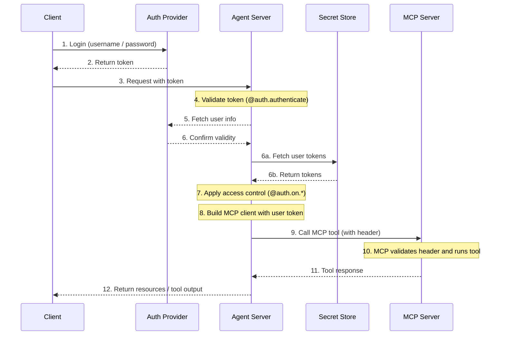

# MCP endpoint in Agent Server

The Model Context Protocol (MCP) is an open protocol for describing tools and data sources in a model-agnostic format, enabling LLMs to discover and use them via a structured API.

[Agent Server](Agent%20Server.md) implements MCP using the [Streamable HTTP transport](https://modelcontextprotocol.io/specification/2025-03-26/basic/transports#streamable-http). This allows LangGraph **agents** to be exposed as **MCP tools**, making them usable with any MCP-compliant client supporting Streamable HTTP.

The MCP endpoint is available at `/mcp` on [Agent Server](Agent%20Server.md).

Agent Server supports MCP protocol revisions `2024-11-05` through `2026-07-28`. Clients on revisions up to `2025-11-25` start with an `initialize` handshake. On `2026-07-28`, each request carries its own protocol metadata, in `_meta` and in the `MCP-Protocol-Version` header, so clients connect without a handshake. When an agent pauses for input, Agent Server asks a client that supports elicitation for it. For more information, see [Human-in-the-loop over MCP](Human-in-the-loop%20over%20MCP.md).

> [!NOTE]
>
> The protocol revisions, tool fields, result format, session behavior, and `Origin` check described on this page require `langgraph-api>=0.18.0`.

Managed Deep Agents deployments run on Agent Server, so they expose the same `/mcp` endpoint. For Managed Deep Agents URL discovery and identity headers, see [Connect MCP clients to a managed deep agent](../../../Build/Python/Managed%20Deep%20Agents/Build%20and%20deploy/Connect%20MCP%20clients%20to%20a%20Managed%20Deep%20Agent.md).

You can set up [custom authentication middleware](../Auth%20%26%20access%20control/Add%20custom%20authentication.md) to authenticate a user with an MCP server to get access to user-scoped tools within your LangSmith deployment.

An example architecture for this flow:



## Requirements

To use MCP, ensure you have the following dependencies installed:

* `langgraph-api >= 0.2.3`
* `langgraph-sdk >= 0.1.61`

Install them with:

```bash pip
pip install "langgraph-api>=0.2.3" "langgraph-sdk>=0.1.61"
```

```bash uv
uv add "langgraph-api>=0.2.3" "langgraph-sdk>=0.1.61"
```

In `langgraph-api` 0.18.0 or later, the endpoint also needs the `mcp` package in the version range that `langgraph-api` requires. Installing `langgraph-api` provides it. If your dependencies pin another version of `mcp`, Agent Server starts without the endpoint and logs `MCP endpoint disabled: the installed MCP SDK is not supported`. The `/info` response then reports `"mcp": false` under `flags`.

## Usage overview

To enable MCP:

* Upgrade to use langgraph-api>=0.2.3. If you are deploying LangSmith, this will be done for you automatically if you create a new revision.
* MCP tools (agents) will be automatically exposed.
* Connect with any MCP-compliant client that supports Streamable HTTP.

### Client

Use an MCP-compliant client to connect to the Agent Server. The following examples show how to connect using different programming languages.

> [tab] JavaScript/TypeScript
>
> ```bash theme={"theme":{"light":"catppuccin-latte","dark":"catppuccin-mocha"}}
> npm install @modelcontextprotocol/sdk
> ```
>
> > **Note**
> > Replace `serverUrl` with your Agent Server URL and configure authentication headers as needed.
>
> ```js theme={"theme":{"light":"catppuccin-latte","dark":"catppuccin-mocha"}}
> import { Client } from "@modelcontextprotocol/sdk/client/index.js";
> import { StreamableHTTPClientTransport } from "@modelcontextprotocol/sdk/client/streamableHttp.js";
>
> // Connects to the LangGraph MCP endpoint
> async function connectClient(url) {
>     const baseUrl = new URL(url);
>     const client = new Client({
>         name: 'streamable-http-client',
>         version: '1.0.0'
>     });
>
>     const transport = new StreamableHTTPClientTransport(baseUrl);
>     await client.connect(transport);
>
>     console.log("Connected using Streamable HTTP transport");
>     console.log(JSON.stringify(await client.listTools(), null, 2));
>     return client;
> }
>
> const serverUrl = "http://localhost:2024/mcp";
>
> connectClient(serverUrl)
>     .then(() => {
>         console.log("Client connected successfully");
>     })
>     .catch(error => {
>         console.error("Failed to connect client:", error);
>     });
> ```

> [tab] Python
>
> Install LangChain with the MCP extra:
>
> ```bash pip theme={"theme":{"light":"catppuccin-latte","dark":"catppuccin-mocha"}}
> pip install "langchain[mcp]"
> ```
>
> ```bash uv theme={"theme":{"light":"catppuccin-latte","dark":"catppuccin-mocha"}}
> uv add "langchain[mcp]"
> ```
>
> Connect to a remote MCP endpoint and use an agent as a tool:
>
> ```python theme={"theme":{"light":"catppuccin-latte","dark":"catppuccin-mocha"}}
> import asyncio
> import os
>
> from fastmcp.client import Client
> from fastmcp.client.transports import StreamableHttpTransport
> from langchain.agents import create_agent
> from langchain.mcp import MCPAdapter
>
>
> async def main():
>     async with MCPAdapter(
>         Client(
>             StreamableHttpTransport(
>                 "https://mcp-finance-agent.xxx.us.langgraph.app/mcp",
>                 headers={"X-Api-Key": os.environ["LANGSMITH_API_KEY"]},
>             )
>         )
>     ) as adapter:
>         # Load the remote graph as if it was a tool
>         tools = await adapter.list_tools()
>
>         agent = create_agent("gpt-6.1-sol", tools)
>         agent_response = await agent.ainvoke(
>             {"messages": "What can the finance agent do for me?"}
>         )
>         print(agent_response)
>
>
> if __name__ == "__main__":
>     asyncio.run(main())
> ```

## Expose an agent as MCP tool

When deployed, your agent will appear as a tool in the MCP endpoint
with this configuration:

* **Tool name**: The agent's name. Agent Server trims it and replaces each run of whitespace with `_`. It also removes characters that MCP does not allow in tool names and cuts the name to 128 characters.
* **Tool title**: The agent's name.
* **Tool description**: The agent's description, or `Tool based on the <name> assistant` when the agent has none.
* **Tool input schema**: The agent's input schema.
* **Tool annotations**: `readOnlyHint`, `destructiveHint`, and `idempotentHint` are `false`, and `openWorldHint` is `true`.

An agent whose input schema cannot be generated is left out of the tool list.

The tool returns the agent's final output as JSON text. When a run fails, the result is an error whose text gives the exception type and message, separated by a colon.

To set the agent's [runtime context](https://docs.langchain.com/oss/python/langgraph/graph-api.md#runtime-context), add a `context` object to the `tools/call` parameters, next to `arguments`.

### Setting name and description

You can set the name and description of your agent in `langgraph.json`:

```json
{
    "graphs": {
        "my_agent": {
            "path": "./my_agent/agent.py:graph",
            "description": "A description of what the agent does"
        }
    },
    "env": ".env"
}
```

After deployment, you can update the name and description using the LangGraph SDK.

### Schema

Define clear, minimal input and output schemas to avoid exposing unnecessary internal complexity to the LLM.

The default [MessagesState](https://docs.langchain.com/oss/python/langgraph/graph-api.md#messagesstate) uses `AnyMessage`, which supports many message types but is too general for direct LLM exposure.

Instead, define **custom agents or workflows** that use explicitly typed input and output structures.

For example, a workflow answering documentation questions might look like this:

```python
from langgraph.graph import StateGraph, START, END
from typing_extensions import TypedDict

# Define input schema
class InputState(TypedDict):
    question: str

# Define output schema
class OutputState(TypedDict):
    answer: str

# Combine input and output
class OverallState(InputState, OutputState):
    pass

# Define the processing node
def answer_node(state: InputState):
    # Replace with actual logic and do something useful
    return {"answer": "bye", "question": state["question"]}

# Build the graph with explicit schemas
builder = StateGraph(OverallState, input_schema=InputState, output_schema=OutputState)
builder.add_node(answer_node)
builder.add_edge(START, "answer_node")
builder.add_edge("answer_node", END)
graph = builder.compile()

# Run the graph
print(graph.invoke({"question": "hi"}))
```

For more details, see the [low-level concepts guide](https://docs.langchain.com/oss/python/langgraph/graph-api.md#state).

## Use user-scoped MCP tools in your deployment

> [!TIP]
>
> **Prerequisites**
> You have added your own [custom auth middleware](../Auth%20%26%20access%20control/Add%20custom%20authentication.md) that populates the `langgraph_auth_user` object, making it accessible through configurable context for every node in your graph.

To make user-scoped tools available to your LangSmith deployment, start with implementing a snippet like the following:

```python
from fastmcp.client import Client
from langchain.mcp import MCPAdapter


async def mcp_tools_node(state, config):
    user = config["configurable"].get("langgraph_auth_user")
    # user includes github_token, email, etc.

    async with MCPAdapter(
        Client(
            "https://my-github-mcp-server/mcp",  # (1)
            auth=user["github_token"],  # (2)
        )
    ) as adapter:
        tools = await adapter.list_tools()  # (3)

    # Your tool-calling logic here

    tool_messages = ...
    return {"messages": tool_messages}
```

1. Your MCP server URL. A URL target uses Streamable HTTP.
2. Pass a bearer token with `auth=` on `Client`. For non-bearer headers (such as `x-api-key`), use `StreamableHttpTransport(url, headers=...)` instead. See [Authentication](https://docs.langchain.com/oss/python/langchain/mcp/auth.md).
3. Discover tools from the MCP server.

*This can also be done by [rebuilding your graph at runtime](../Server%20customization/Rebuild%20graph%20at%20runtime.md) to have a different configuration for a new run*

## Session behavior

The MCP endpoint does not use sessions. Each `/mcp` request is independent, and Agent Server answers it with JSON, not an event stream. The endpoint accepts only `POST` requests. A tool call that pauses for input keeps its state on the server between requests, linked by `requestState`. For more information, see [Human-in-the-loop over MCP](Human-in-the-loop%20over%20MCP.md).

## Authentication

The `/mcp` endpoint uses the same authentication as the rest of the LangGraph API. Refer to the [authentication guide](../Auth%20%26%20access%20control/Authentication%20%26%20access%20control.md) for setup details.

Requests that include an `Origin` header, such as requests from a browser, must come from an allowed origin. Agent Server reads the allowed origins from `allow_origins` or `allow_origin_regex` in the [`http.cors` configuration](../../Get%20started/Reference/LangGraph%20CLI.md#customizing-http-middleware-and-headers), or from the `CORS_ALLOW_ORIGINS` environment variable. A wildcard (`*`) does not allow any origin on this endpoint. Agent Server always allows origins on `localhost`, `127.0.0.1`, and `[::1]`, and rejects a request from any other origin with HTTP 403.

## Disable MCP

To disable the MCP endpoint, set `disable_mcp` to `true` in your `langgraph.json` configuration file:

```json
{
  "$schema": "https://langgra.ph/schema.json",
  "http": {
    "disable_mcp": true
  }
}
```

This will prevent the server from exposing the `/mcp` endpoint.

The endpoint runs each tool call through the runs API. When `disable_runs` is `true`, every tool call fails with JSON-RPC error `-32602`.
