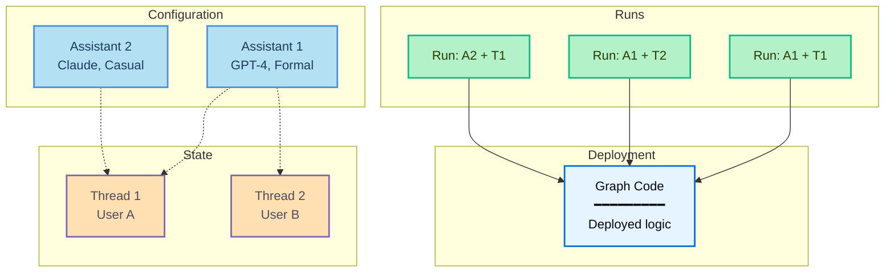

# Runs

> An overview of runs in Agent Server, including how to kick off background runs, stateless runs, and cancel runs.

A *run* is an invocation of an [assistant](../Assistants/Assistants.md). When you execute a run, you specify which assistant to use—either by graph ID for the default assistant, or by assistant ID for a specific configuration.

This diagram shows how a **run** combines an assistant with a thread to execute the graph:

* **Graph** (light blue): The deployed code containing your agent's logic
* **Assistants** (blue): Configuration options (model, prompts, tools)
* **Threads** (orange): State containers for conversation history
* **Runs** (green): Executions that pair an assistant + thread

**Example combinations:**

* **Run: A1 + T1**: Assistant 1 configuration applied to User A's conversation
* **Run: A1 + T2**: Same assistant serving User B (different conversation)
* **Run: A2 + T1**: Different assistant applied to User A's conversation (configuration switch)

When executing a run:

* Each run may have its own input, configuration overrides, and metadata.
* Runs can be stateless (no thread) or stateful (executed on a [thread](../Use%20threads.md) for conversation persistence).
* Multiple runs can use the same assistant configuration.
* The assistant's configuration affects how the underlying graph executes.

The Agent Server API provides several endpoints for creating and managing runs. For more details, refer to the [API reference](../../../Get%20started/Reference/Agent%20Server%20API/Agent%20Server%20API%20reference.md).

## In this section

> [card] [Kick off background runs](How%20to%20kick%20off%20background%20runs.md)
>
> Run your agent asynchronously and poll for results.

> [card] [Run multiple agents on the same thread](How%20to%20run%20multiple%20assistants%20on%20the%20same%20thread.md)
>
> Use multiple assistants on a shared thread to combine agent capabilities.

> [card] [Stateless runs](Stateless%20runs.md)
>
> Execute runs without persisting state when conversation history isn't needed.

> [card] [Cancel a run](How%20to%20cancel%20a%20run.md)
>
> Cancel a single run or multiple runs via the API.
