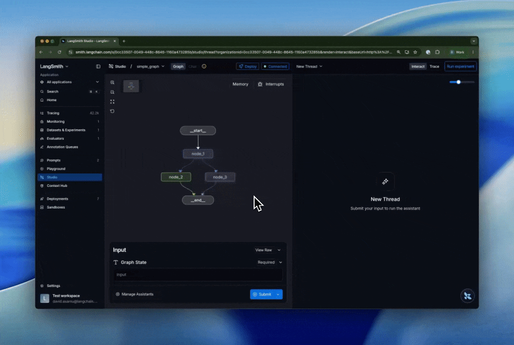

# Deploy your app to cloud

> Deploy your first application to LangSmith Cloud in GCP using the LangGraph CLI.

This quickstart shows you how to deploy an application to LangSmith Cloud in GCP using the [`langgraph deploy`](Reference/LangGraph%20CLI.md#deploy) command. Any app that exports a graph from a [`langgraph.json`](../Agent%20Server/Develop%20your%20application/Application%20structure.md#configuration-file-concepts) config deploys the same way, regardless of which framework you used to author the agent.

> [!TIP]
>
> For a comprehensive Cloud deployment guide including GitHub-based deployments and all configuration options, refer to the [Cloud deployment setup guide](../Deploy%20to%20Cloud/Deployment%20guide/Create%20an%20Agent%20Server.md).

> [!NOTE]
>
> The `langgraph deploy` command is in **[beta](../../LangSmith%20setup/Cloud/Reference/Release%20stages.md)**. On LangSmith Cloud (SaaS) in AWS, local builds require `langgraph-cli` 0.4.35 or later.

## Prerequisites

Before you begin, ensure you have:

* A [LangSmith account](https://smith.langchain.com?utm_source=docs&utm_medium=cta&utm_campaign=langsmith-signup&utm_content=langsmith-deployment-quickstart) on the [Plus plan or above](https://www.langchain.com/pricing) and an [API key](../../LangSmith%20setup/Account/Create%20an%20account%20and%20API%20key.md).
* (Optional) **Docker** installed and the Docker daemon running for local builds. Not required for remote builds. [Install Docker Desktop](https://docs.docker.com/get-docker/). If Docker is not available, `langgraph deploy` triggers a remote build automatically.
* (Optional) On Apple Silicon (M1/M2/M3): [Docker Buildx](https://docs.docker.com/build/install-buildx/) for cross-compiling to `linux/amd64` during local builds.
* The [LangGraph CLI](Reference/LangGraph%20CLI.md):

  ```shell
  uv tool install langgraph-cli
  ```

## Get started with your coding agent

A coding agent can follow this quickstart to prepare, test, and deploy your application. To get started, paste this prompt into your coding agent:

Deploy an application to LangSmith Cloud

Help deploy an application from this working directory to LangSmith Cloud.

Read [https://docs.langchain.com/langsmith/deployment-quickstart.md](Deploy%20your%20app%20to%20cloud.md) first.
Use it as the source of truth for the deployment steps. Read linked pages
as needed by appending .md to their URLs.

1. Inspect the project and ask whether to deploy an existing application
   or create a new one. For a new application, ask what it should do and
   use the LangGraph template from the quickstart. For an existing
   application, preserve its framework and follow the linked application
   structure and framework deployment guides to export a graph from
   langgraph.json.
2. Check the prerequisites, including a LangSmith account on the Plus plan
   or above. Install the LangGraph CLI with uv tool install langgraph-cli
   if it is missing. Follow the local development guide to install any
   additional dependencies needed to test the application.
3. Ask the user to set LANGSMITH\_API\_KEY and any required model provider
   keys in the shell or a local .env file, then wait for confirmation.
   Do not ask them to paste secrets into chat. Ensure secret files are
   ignored by Git, and never print or commit credentials.
4. Read [https://docs.langchain.com/langsmith/local-dev-testing.md](Develop%20%26%20test/Local%20development%20%26%20testing.md), run
   langgraph dev, and test the graph locally. Resolve errors before
   deploying. If a Studio action requires the user, explain what to do
   and wait for the result.
5. Explain the target Agent Server and that cloud usage can incur charges.
   Ask for confirmation before running langgraph deploy. Do not overwrite
   an existing Agent Server without explicit approval.
6. Follow the quickstart to test the deployed application in Studio and
   through its API. Report the Agent Server URL and test result, or the
   exact blocker if deployment or testing did not complete.

To follow the steps yourself, continue below.

## 1. Create a deployable app

`langgraph deploy` deploys any project whose `langgraph.json` exports a graph. Pick the path that matches how you author your agent:

> [tab] LangGraph template
>
> Create a new app from the [`new-langgraph-project-python` template](https://github.com/langchain-ai/new-langgraph-project):
>
> ```shell theme={"theme":{"light":"catppuccin-latte","dark":"catppuccin-mocha"}}
> langgraph new path/to/your/app --template new-langgraph-project-python
> cd path/to/your/app
> ```
>
> > [!TIP]
> >
> > Run `langgraph new` without `--template` for an interactive menu of available templates.

> [tab] Bring your own framework
>
> Agents authored with Claude Agent SDK, Strands, CrewAI, AutoGen, or Google ADK deploy through the same CLI once they expose a graph from `langgraph.json`. For end-to-end examples, see [Deploy other frameworks](Frameworks%20and%20platforms/Deploy%20other%20frameworks.md). Once your project exports a graph, return here for the remaining steps.

## 2. Set your API key

Add your LangSmith API key to a `.env` file in your project root:

```shell
LANGSMITH_API_KEY=lsv2_...
```

The `langgraph deploy` command reads this automatically. Alternatively, pass it inline:

```shell
LANGSMITH_API_KEY=lsv2_... langgraph deploy
```

## 3. Deploy

Deploy directly from the CLI or via the UI.

> [tab] Deploy from CLI
>
> Run the deploy command from your project directory:
>
> ```shell theme={"theme":{"light":"catppuccin-latte","dark":"catppuccin-mocha"}}
> langgraph deploy
> ```
>
> This creates a Serverless Agent Server named after your project directory. Use `--name` to change the name, or `--agent-server-type dedicated` for a [Dedicated Agent Server](../Deploy%20to%20Cloud/Cloud%20platform%20features.md#deployment-types).
>
> > [!TIP]
> >
> > To update an existing Agent Server after making code changes, re-run `langgraph deploy`. It finds the existing Agent Server by name and updates it in place.
>
> You can also use `langgraph deploy list` to see all Agent Servers, `langgraph deploy logs` to tail runtime logs, and `langgraph deploy delete <ID>` to remove an Agent Server. For details, refer to the [CLI reference](Reference/LangGraph%20CLI.md#deploy).

> [tab] Deploy from Studio
>
> To deploy from studio:
>
> 1. Start the [local development server](Develop%20%26%20test/Local%20development%20%26%20testing.md#langgraph-dev). This will automatically open up [Studio](../../Test/Test%20from%20Studio/LangSmith%20Studio.md), an interactive agent IDE.
>
> ```shell theme={"theme":{"light":"catppuccin-latte","dark":"catppuccin-mocha"}}
> langgraph dev
> ```
>
> 2. Click the `deploy` button.
>
>    

## 4. Test in Studio

[Studio](../../Test/Test%20from%20Studio/LangSmith%20Studio.md) is an interactive agent IDE connected directly to your Agent Server. Use it to send messages, inspect intermediate state at each node, edit state mid-run, and replay from any prior checkpoint without writing code.

Once the Agent Server is ready:

1. Go to [LangSmith](https://smith.langchain.com?utm_source=docs&utm_medium=cta&utm_campaign=langsmith-signup&utm_content=langsmith-deployment-quickstart) and select **Agent Servers** in the left sidebar.
2. Select your Agent Server to view its details.
3. Click **Studio** in the top right corner to open [Studio](../../Test/Test%20from%20Studio/LangSmith%20Studio.md).

## 5. Test the API

In LangSmith, copy the Agent Server address from the **URL** row in the Agent Server details view. Use it to call your application:

> [tab] Python SDK (Async)
>
> 1. Install the LangGraph Python SDK:
>    ```shell theme={"theme":{"light":"catppuccin-latte","dark":"catppuccin-mocha"}}
>    pip install langgraph-sdk
>    ```
> 2. Send a message to the assistant (stateless run):
>    ```python theme={"theme":{"light":"catppuccin-latte","dark":"catppuccin-mocha"}}
>    from langgraph_sdk import get_client
>
>    client = get_client(url="your-deployment-url", api_key="<API_KEY>")
>
>    async for chunk in client.runs.stream(
>        None,  # Threadless run
>        "agent", # Name of assistant. Defined in langgraph.json.
>        input={
>            "messages": [{
>                "role": "human",
>                "content": "Say hello.",
>            }],
>        },
>        stream_mode="updates",
>    ):
>        print(f"Receiving new event of type: {chunk.event}...")
>        print(chunk.data)
>        print("\n\n")
>    ```

> [tab] Python SDK (Sync)
>
> 1. Install the LangGraph Python SDK:
>    ```shell theme={"theme":{"light":"catppuccin-latte","dark":"catppuccin-mocha"}}
>    pip install langgraph-sdk
>    ```
> 2. Send a message to the assistant (threadless run):
>    ```python theme={"theme":{"light":"catppuccin-latte","dark":"catppuccin-mocha"}}
>    from langgraph_sdk import get_sync_client
>
>    client = get_sync_client(url="your-deployment-url", api_key="<API_KEY>")
>
>    for chunk in client.runs.stream(
>        None,  # Threadless run
>        "agent", # Name of assistant. Defined in langgraph.json.
>        input={
>            "messages": [{
>                "role": "human",
>                "content": "Say hello.",
>            }],
>        },
>        stream_mode="updates",
>    ):
>        print(f"Receiving new event of type: {chunk.event}...")
>        print(chunk.data)
>        print("\n\n")
>    ```

> [tab] JavaScript SDK
>
> 1. Install the LangGraph JS SDK:
>    ```shell theme={"theme":{"light":"catppuccin-latte","dark":"catppuccin-mocha"}}
>    npm install @langchain/langgraph-sdk
>    ```
> 2. Send a message to the assistant (threadless run):
>    ```js theme={"theme":{"light":"catppuccin-latte","dark":"catppuccin-mocha"}}
>    const { Client } = await import("@langchain/langgraph-sdk");
>
>    const client = new Client({ apiUrl: "your-deployment-url", apiKey: "<API_KEY>" });
>
>    const streamResponse = client.runs.stream(
>        null, // Threadless run
>        "agent", // Assistant ID
>        {
>            input: {
>                "messages": [
>                    { "role": "user", "content": "Say hello."}
>                ]
>            },
>            streamMode: "messages",
>        }
>    );
>
>    for await (const chunk of streamResponse) {
>        console.log(`Receiving new event of type: ${chunk.event}...`);
>        console.log(JSON.stringify(chunk.data));
>        console.log("\n\n");
>    }
>    ```

> [tab] Rest API
>
> ```bash theme={"theme":{"light":"catppuccin-latte","dark":"catppuccin-mocha"}}
> curl -s --request POST \
>     --url <DEPLOYMENT_URL>/runs/stream \
>     --header 'Content-Type: application/json' \
>     --header "X-Api-Key: <LANGSMITH API KEY>" \
>     --data "{
>         \"assistant_id\": \"agent\",
>         \"input\": {
>             \"messages\": [
>                 {
>                     \"role\": \"human\",
>                     \"content\": \"Say hello.\"
>                 }
>             ]
>         },
>         \"stream_mode\": \"updates\"
>     }"
> ```

## Next steps

> [card] [Assistants](../Agent%20Server/Capabilities/Assistants/Assistants.md)
>
> Deploy the same graph with different models, prompts, or tools per assistant.

> [card] [Threads](../Agent%20Server/Capabilities/Use%20threads.md)
>
> Persist state across multiple runs so your agent remembers context between interactions.

> [card] [Runs](../Agent%20Server/Capabilities/Runs/How%20to%20kick%20off%20background%20runs.md)
>
> Kick off background runs for long-running jobs and stream results back to your client.
