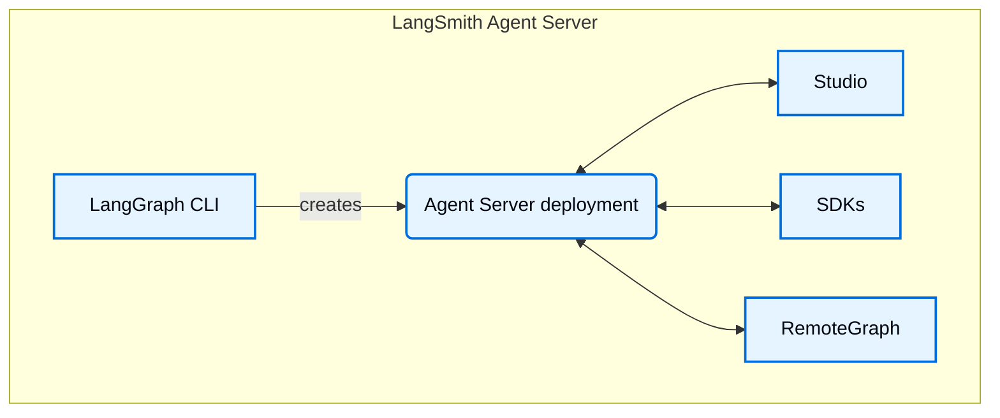

# LangSmith Agent Server components

> Overview of Agent Server, LangGraph CLI, Studio, SDKs, RemoteGraph, control plane, and data plane components.

[LangSmith Agent Server](../LangSmith%20Agent%20Server.md) and its hosting infrastructure include the following components. Together these tools and services provide a complete solution for building, deploying, and managing graphs (including agentic applications), whether on [Cloud](../../../LangSmith%20setup/Cloud/Cloud%20%28SaaS%29.md) or in your own [self-hosted](../../../LangSmith%20setup/Self-hosted/Self-hosted%20LangSmith.md) infrastructure:

> [!NOTE]
>
> LangSmith Deployment is now **LangSmith Agent Server**.

* [Agent Server](../../Agent%20Server/Capabilities/Agent%20Server.md): Defines an opinionated API and runtime for deploying graphs and agents. Handles execution, state management, and persistence so you can focus on building logic rather than server infrastructure.
* [LangGraph CLI](../Reference/LangGraph%20CLI.md): A command-line interface to build, package, and interact with graphs locally and prepare them for deployment.
* [Studio](../../../Test/Test%20from%20Studio/LangSmith%20Studio.md): A specialized IDE for visualization, interaction, and debugging. Connects to a local Agent Server for developing and testing your graph.
* [Python/JS SDK](../../../Monitor/Reference/LangSmith%20reference.md): The Python/JS SDK provides a programmatic way to interact with deployed graphs and agents from your applications.
* [RemoteGraph](../../Agent%20Server/Capabilities/How%20to%20interact%20with%20a%20deployment%20using%20RemoteGraph.md): Allows you to interact with a deployed graph as though it were running locally.
* [Control Plane](LangSmith%20control%20plane.md): The UI and APIs for creating, updating, and managing Agent Server deployments.
* [Data Plane](LangSmith%20data%20plane.md): The runtime layer that executes your graphs, including Agent Servers, their backing services (PostgreSQL, Redis, etc.), and the listener that reconciles state from the control plane.
