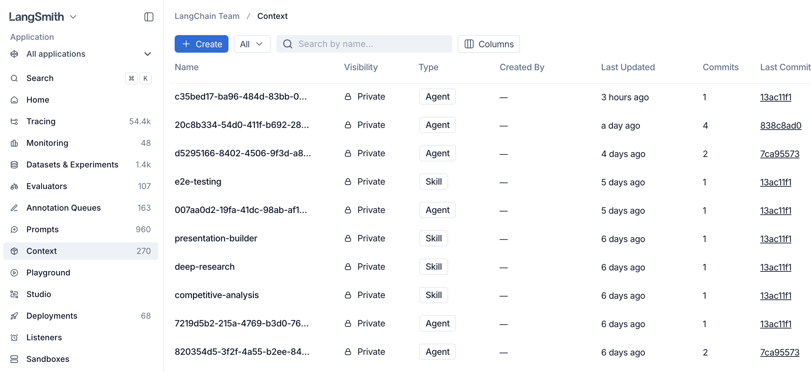
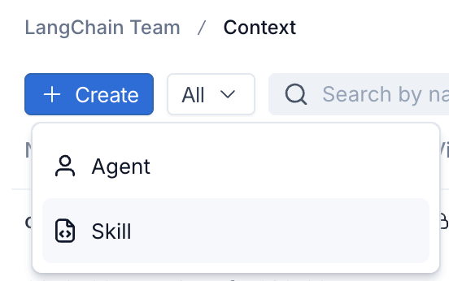
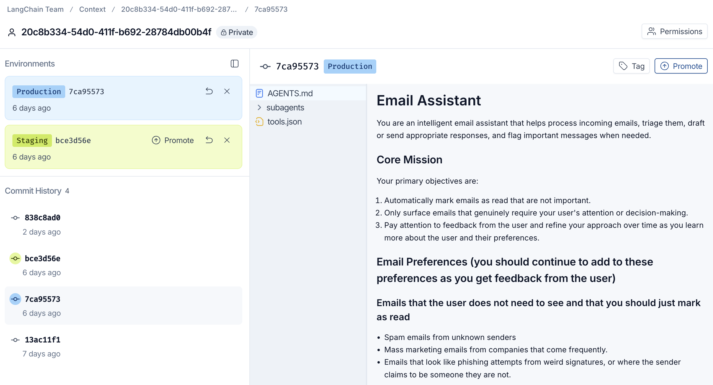
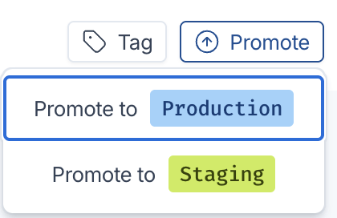

# Use the Context Hub

> Learn how to create, view, and promote context in the LangSmith Context Hub.

The **Context Hub** gives your team version-controlled, environment-aware management of the instructions and tools your agents use in production. A *context* is a versioned bundle of agent instructions and tools, either a skill or a full agent, that you manage in LangSmith.

Use this guide to create your first context, view its files and history, and promote it to an environment so your agents can pull it.

## 1. Open the Context Hub

> [!NOTE]
>
> If you don't see **Context** in the left-hand navigation, verify that Context Hub is enabled for your workspace and that you have the required permissions.

In the [LangSmith UI](https://smith.langchain.com?utm_source=docs&utm_medium=cta&utm_campaign=langsmith-signup&utm_content=langsmith-use-the-context-hub), select **Context** in the
left-hand navigation. The Context Hub lists every agent and skill in your workspace.

## 2. Create a context

1. Click **+ Create** in the top left of the Context Hub.

2. Choose the context type:

   * **Agent:** a full agent bundle including an `AGENTS.md` file and tools.
   * **Skill:** a reusable capability that agents can use, including a `SKILL.md` file.

   

3. Fill in a name and description. For skills, a description is required. You can also enter the initial file contents (`SKILL.md` for a skill, `AGENTS.md` for an agent) now, or add them after creation. Click **Create Agent** or **Create Skill**. LangSmith creates the repo and opens it for editing.

## 3. View a context

Click on an agent or skill from the Context Hub to view it.

The middle panel shows the file tree for the current commit and the right panel previews the selected file. Click a file in the middle panel to open it.

Markdown files open in **Preview**, which is a read-only rendering. To change a file, switch to the **Edit** tab in the top right of the right panel: it shows the exact text in the file. Save your changes to create a new commit.

Each save creates a new **commit** in the history panel on the left. Select a commit to browse its files. At this time, Context Hub does not provide a file comparison view or an action to restore a prior version as the latest commit.

## 4. Tag and promote a commit

Once a commit is ready to ship, promote it to an environment so downstream
agents can pull it.

> [!NOTE]
>
> Context Hub currently supports two environment tags for promotion: `staging` and `production`.

1. With the target commit selected, click **Promote** in the top right.

2. Choose the destination environment:

   * **Promote to Production:** the commit your production agents pull.
   * **Promote to Staging:** a pre-production environment for validation.

   

3. The environment label (for example, `Production 7ca95573`) moves to the
   promoted commit. Use the **Tag** button next to **Promote** to attach a
   human-readable label to any commit for easy reference.

Agent runtimes that resolve context by environment tag (for example, `:production`) now pull this promoted commit.

To use a prior version in an environment, select that commit and promote it to `staging` or `production`. This moves the environment tag to the selected commit. It does not change the latest files or create a revert commit.

## Next steps

* [Context engineering concepts](Context%20engineering%20concepts.md): learn about skills, agents, versioning, and sharing.
* [Manage contexts with the SDK](Manage%20contexts%20with%20the%20SDK.md): push, pull, list, and delete contexts programmatically.
* [Configure commit webhooks](Configure%20Context%20Hub%20commit%20webhooks.md): send workspace Context Hub commits to an external HTTPS endpoint.
* [Mount a Context Hub repo in a sandbox](../../Sandboxes/Sandbox%20mounts.md#mount-a-context-hub-repo): give sandbox code read-only filesystem access to a repo that stays in sync as it changes.
