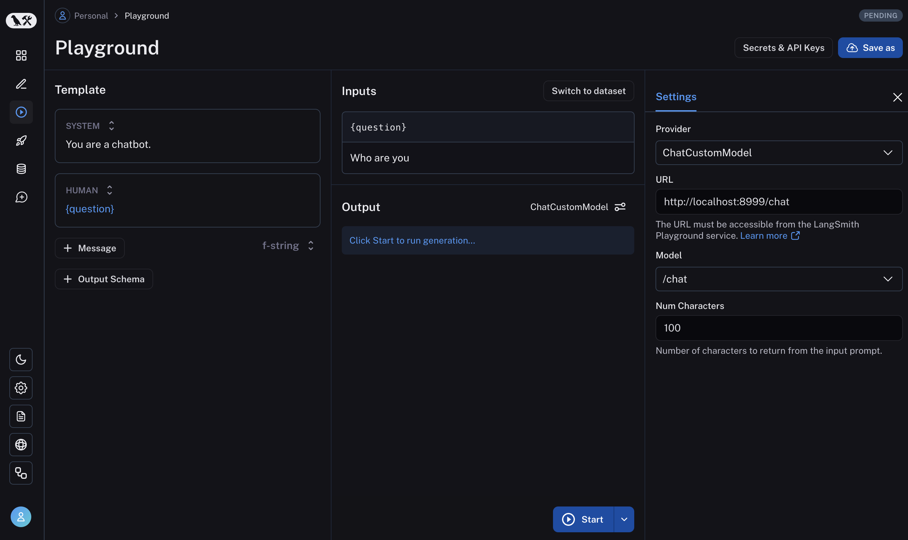

# Connect to a custom model

The Playground allows you to use your own custom models. You can deploy a model server that exposes your model's API via [LangServe](https://github.com/langchain-ai/langserve), an open source library for serving LangChain applications. Behind the scenes, the Playground will interact with your model server to generate responses.

## Deploy a custom model server

For your convenience, we have provided a [sample model server](https://github.com/langchain-ai/langsmith-model-server) that you can use as a reference. We highly recommend using the sample model server as a starting point.

Depending on your model is an instruct-style or chat-style model, you will need to implement either `custom_model.py` or `custom_chat_model.py` respectively.

## Adding configurable fields

It is often useful to configure your model with different parameters. These might include temperature, model\_name, max\_tokens, etc.

To make your model configurable in the Playground, you need to add configurable fields to your model server. These fields can be used to change model parameters from the Playground.

You can add configurable fields by implementing the `with_configurable_fields` function in the `config.py` file. You can

```python
def with_configurable_fields(self) -> Runnable:
    """Expose fields you want to be configurable in the Playground. We will automatically expose these to the
    Playground. If you don't want to expose any fields, you can remove this method."""
    return self.configurable_fields(n=ConfigurableField(
        id="n",
        name="Num Characters",
        description="Number of characters to return from the input prompt.",
    ))
```

## Use the model in the Playground

Once you have deployed a model server, you can use it in the Playground. Enter the Playground and select either the `ChatCustomModel` or the `CustomModel` provider for chat-style model or instruct-style models.

Enter the `URL`. The Playground will automatically detect the available endpoints and configurable fields. You can then invoke the model with the desired parameters.



If everything is set up correctly, you should see the model's response in the Playground as well as the configurable fields specified in the `with_configurable_fields`.

For more information, see [how to store your model configuration for later use](../Create%20and%20manage%20prompts/Configure%20prompt%20settings.md).
