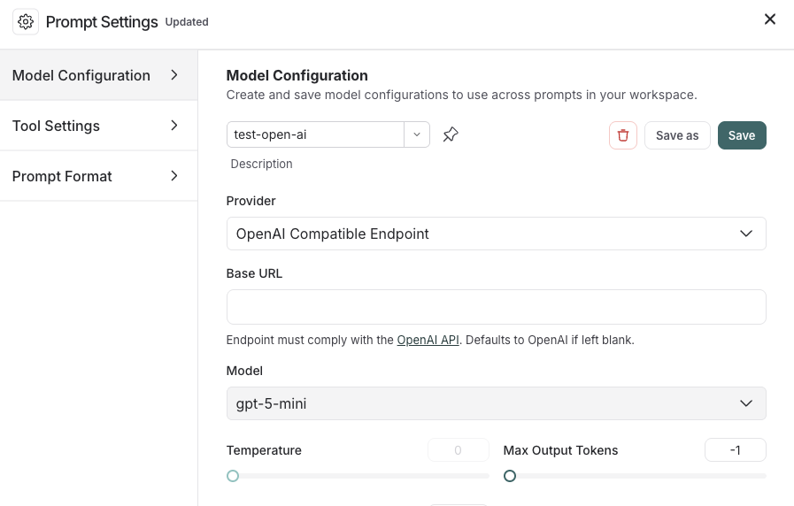

# Connect to an OpenAI compliant model provider/proxy

The Playground allows you to use any model that is compliant with the OpenAI API. You can utilize your model by setting the Proxy Provider for  in the Playground.

## Deploy an OpenAI compliant model

Many providers offer OpenAI compliant models or proxy services. Some examples of this include:

* [LiteLLM Proxy](https://github.com/BerriAI/litellm?tab=readme-ov-file#quick-start-proxy---cli)
* [Ollama](https://ollama.com/)

You can use these providers to deploy your model and get an API endpoint that is compliant with the OpenAI API.

Take a look at the full [specification](https://platform.openai.com/docs/api-reference/chat) for more information.

## Use the model in the Playground

Once you have deployed a model server, you can use it in the [Playground](../Prompt%20engineering%20concepts.md#playground).

To access the **Prompt Settings** menu:

1. Under the **Prompts** heading select the gear  icon next to the model name.
2. In the **Model Configuration** tab, select the model to edit in the dropdown.
3. For the **Provider** dropdown, select **OpenAI Compatible Endpoint**.
4. Add your OpenAI Compatible Endpoint to the **Base URL** input. See [Base URL format](#base-url-format) for examples.

   

If everything is set up correctly, you should see the model's response in the Playground. You can also use this functionality to invoke downstream pipelines.

For information on how to store your model configuration, refer to [Configure prompt settings](../Create%20and%20manage%20prompts/Configure%20prompt%20settings.md).

If your OpenAI-compatible endpoint sits behind an OAuth2 gateway, store the OAuth `client_credentials` on the model configuration instead of distributing a static API key as a workspace secret. See [OAuth client credentials](../../../../LangSmith%20setup/Govern/Organization/Workspace%20setup/Manage%20model%20configurations.md#oauth-client-credentials).

## Base URL format

The **Base URL** should point to the root of your OpenAI-compatible API server.
LangSmith appends `/chat/completions` automatically—do not include it in the Base URL.

### Example Base URLs

| Provider | Example Base URL |
| - | - |
| [Ollama](https://ollama.com/) (local) | `http://localhost:11434/v1` |
| [LiteLLM Proxy](https://github.com/BerriAI/litellm) (local) | `http://localhost:4000` |
| [vLLM](https://docs.vllm.ai/) (local) | `http://localhost:8000/v1` |
| Self-hosted (remote) | `https://my-model-server.example.com/v1` |

Custom path prefixes are supported. If your server exposes completions at `/api/v2/chat/completions`,
set the Base URL to `https://my-server.example.com/api/v2`.
