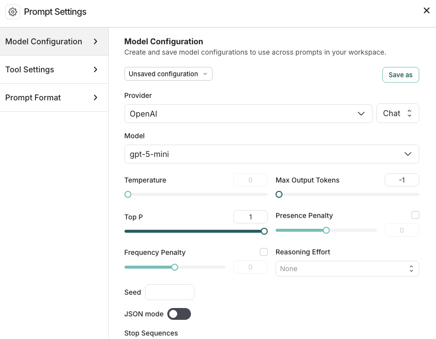

# Configure prompt settings

The [Playground](../Prompt%20engineering%20concepts.md#playground) enables you to control various settings for your prompts. The **Prompt Settings** window contains:

* [Model configuration](#model-configurations)
* [Tool settings](#tool-settings)
* [Prompt formatting](#prompt-formatting)

To access **Prompt Settings**:

1. Navigate to the **Playground** in the left sidebar.
2. Under the **Prompts** heading select the gear  icon next to the model name, which will launch the **Prompt Settings** window.

   

## Model configurations

[Model configurations](../../../../LangSmith%20setup/Govern/Organization/Workspace%20setup/Manage%20model%20configurations.md) define the parameters your prompt runs against. Configurations are shared across your workspace—any configuration saved here is available in other LangSmith features and visible to admins in **Settings** > **Model configurations**. For details on specific settings, refer to your model provider’s documentation (for example, [Anthropic](https://platform.claude.com/docs/en/api/messages) or [OpenAI](https://platform.openai.com/docs/api-reference/responses/create)).

### Create saved configurations

1. In the **Model Configurations** tab, adjust the model configuration as needed—you can select a [saved configuration to edit](#edit-configurations).
2. Click the **Save As** button in the top bar.
3. Enter a name and optional description for your configuration and confirm.
4. Now that you've saved the configuration, anyone in your organization's [workspace](../../../../LangSmith%20setup/Govern/Organization/Overview.md#workspaces) can access it. All saved configurations are available in the **Model Configuration** dropdown.
5. Once you have created a saved configuration, you can set it as your default, so any new prompt you create will automatically use this configuration. To set a configuration as your default, click the **Set as default**  icon next to the model name in the dropdown.

> [!NOTE]
>
> OAuth client credential fields appear in this popover only after the configuration is saved as a preset. To attach OAuth to a one-off configuration, save it as a preset first (refer to [OAuth client credentials](../../../../LangSmith%20setup/Govern/Organization/Workspace%20setup/Manage%20model%20configurations.md#oauth-client-credentials)).

### Edit configurations

1. To rename a saved configuration, or update the description, select the configuration name or description and make the necessary changes.
2. Update the current configuration's parameters as needed and click the **Save** button at the top.

### Delete configurations

1. Select the configuration you want to remove.
2. Click the trash  icon to delete it.

### Extra parameters

The **Extra Parameters** field allows you to pass additional model parameters that aren't directly supported in the LangSmith interface. This is particularly useful in two scenarios:

1. When model providers release new parameters that haven't yet been integrated into the LangSmith interface. You can specify these parameters in JSON format to use them right away. For example:

   ```json
   {
       "reasoning_effort": "medium"
   }
   ```

2. When troubleshooting parameter-related errors in the Playground, such as:

   ```
   TypeError: AsyncCompletions.create() got an unexpected keyword argument 'max_concurrency'
   ```

   If you receive an error about unnecessary parameters (which is more common when using [LangChain JS](https://docs.langchain.com/oss/python/langchain/overview.md) for run tracing), you can use this field to remove the extra parameters.

## Tool settings

[*Tools*](../Prompt%20engineering%20concepts.md#tools) enable your LLM to perform tasks like searching the web, looking up information, and so on. In the **Tools Settings** tab, you can manage the ways your LLM uses and accesses the tools you have defined in your prompt, including:

* **Parallel Tool Calls**: Calling multiple tools in parallel when appropriate. This allows the model to gather information from different sources simultaneously. (Dependent on model support for parallel execution.)
* **Tool Choice**: Select the tools that the model can access. For more details, refer to [Use tools in a prompt](Use%20tools%20in%20a%20prompt.md).

To manage which tools are available in your workspace, including enabling, disabling, and editing tools across prompts, refer to [Manage tools with the registry](Use%20tools%20in%20a%20prompt.md#manage-tools-with-the-registry).

## Prompt formatting

The **Prompt Format** tab allows you to specify:

* The **Prompt type**. For details on chat and completion prompts, refer to [Prompt engineering](../Prompt%20engineering%20concepts.md#prompt-types) concepts.
* The **Template format**. For details on prompt templating and using variables, refer to [F-string vs. mustache](../Prompt%20engineering%20concepts.md#f-string-vs-mustache).
