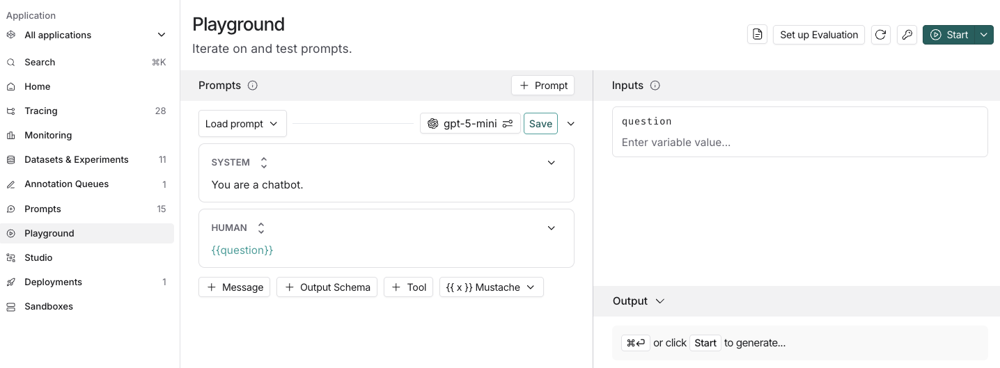
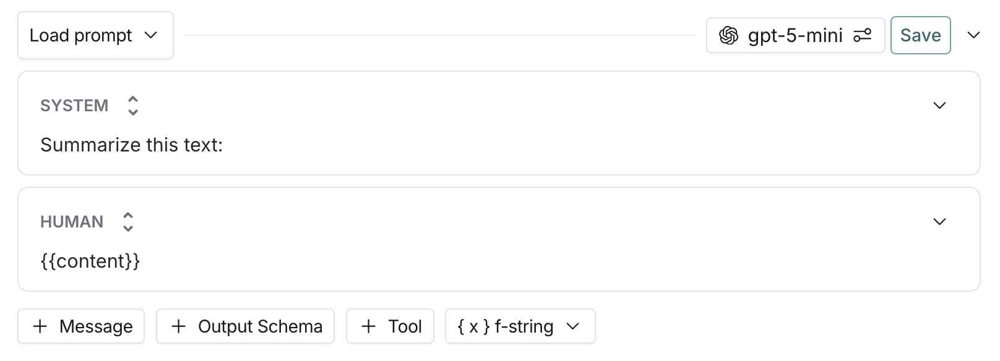
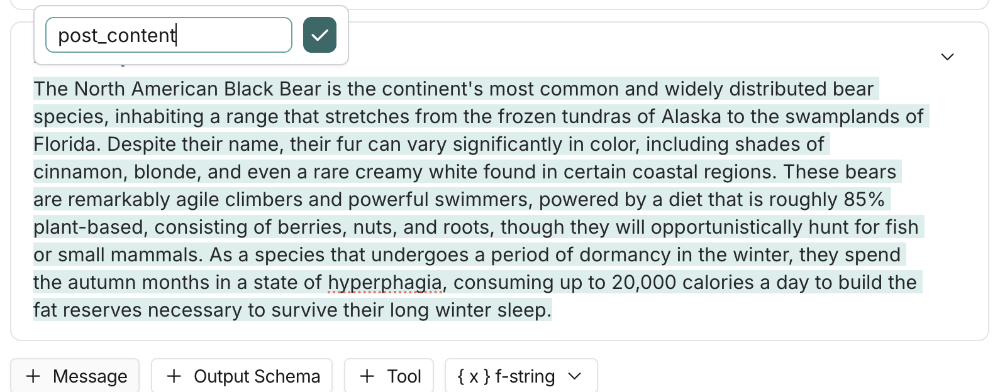

# Create a prompt

In the [LangSmith UI](https://smith.langchain.com?utm_source=docs&utm_medium=cta&utm_campaign=langsmith-signup&utm_content=langsmith-create-a-prompt), navigate to the **Playground** in the left-hand sidebar or from the application homepage.

## Compose your prompt

The left panel of the playground is an editable view of the prompt.

The prompt is made up of messages, each of which has a *role*, including:

* **System**: The "instruction manual". Use this to define the AI's persona, tone, and ground rules (e.g., "You are a helpful assistant that explains things like the weather").
* **Human**: The "user". This represents the person asking questions or providing instructions to the AI.
* **AI**: The "assistant". This is the model’s response. In the playground, you can use this to provide "few-shot" examples—showing the AI exactly how you want it to respond.
* **Tool / Function**: These roles represent the output from external tools (like a calculator or a search engine). They help you test how the AI should behave after receiving specific data.
* **Chat**: A general-purpose role, often used when importing logs or conversation history where specific labels haven't been assigned.
* **Messages List**: A dynamic placeholder. This allows you to add a variable that contains an entire list of previous messages, making it easy to manage long conversation histories.

### Template format

The default [template format](Prompt%20template%20format%20guide.md) is f-string, but you can change the prompt template format to mustache by clicking on the dropbox below the prompt boxes.

### Add a template variable

Prompts become particularly useful when you add variables in your prompt. You can use variables to add dynamic content to your prompt. Add a template variable in one of two ways:

* Add `{variable_name}` to your prompt (with one curly brace on each side for f-string or two for mustache).

  

* Highlight text you want to templatize and click **Convert to variable** tooltip button that displays. Enter a name for your variable, and convert.

  

Once you've added a variable, the right panel of the playground will have an **Input** box for a sample input for the prompt variable. Fill these in with values to test the prompt.

For more details on the prompt template formats generally and examples in both syntax, refer to the [Prompt template format](Prompt%20template%20format%20guide.md) guide.

### Structured output

Adding an output schema to your prompt will get output in a structured format. Learn more about [structured output](../Prompt%20engineering%20concepts.md#structured-output).

### Tools

You can also add a tool by clicking the **+ Tool** button at the bottom of the prompt editor. For more information on how to use tools, refer to [Use tools](Use%20tools%20in%20a%20prompt.md).

Use the **[Chat](../../../../Test/Datasets%20%26%20Experiments/Analyze%20experiment%20results/LangSmith%20Chat.md)** in the Playground to generate tools, create output schemas, and optimize your prompts with AI assistance.

## Run the prompt

To run a prompt, use  **Start** at the top of the right panel in the playground.

## Set model fallbacks

To use backup models when your prompt's primary model fails, [configure per-prompt fallbacks through LLM Gateway](../../../../LLM%20Gateway/Models%20and%20reliability/Model%20fallbacks.md#set-fallbacks-for-a-prompt). Select **LangSmith Gateway** as the provider and reference a saved model configuration with `custom/<my_config_name>`.

## Save your prompt

To save your prompt, click the **Save** button and name your prompt.

The model and configuration you select in the playground settings will be saved with the prompt. When you reopen the prompt, the model and configuration will automatically load from the saved version.

> [!TIP]
>
> The first time you create a public prompt, you'll be asked to set a LangChain Hub handle. All your public prompts will be linked to this handle. In a shared workspace, this handle will be set for the whole workspace.

## View your prompts

After you've created a prompt, you can view a table of your prompts under **Prompts** in the left-hand side bar.

The **All Prompts** filter excludes prompts linked to LLM-as-a-judge evaluators, including both online and offline evaluators. To view those prompts, select **Used in Evaluators** from the filter dropdown.

## Add metadata

To add metadata to your prompt, click the  **More** icon on the top right-hand side of the page and then click the  **Update metadata** from the dropdown. This brings you to a page where you can add additional information about the prompt, including a description and README.

# Next steps

Now that you've created a prompt, you can use it in your application code. See [how to pull a prompt programmatically](Manage%20prompts%20programmatically.md#pull-a-prompt).
