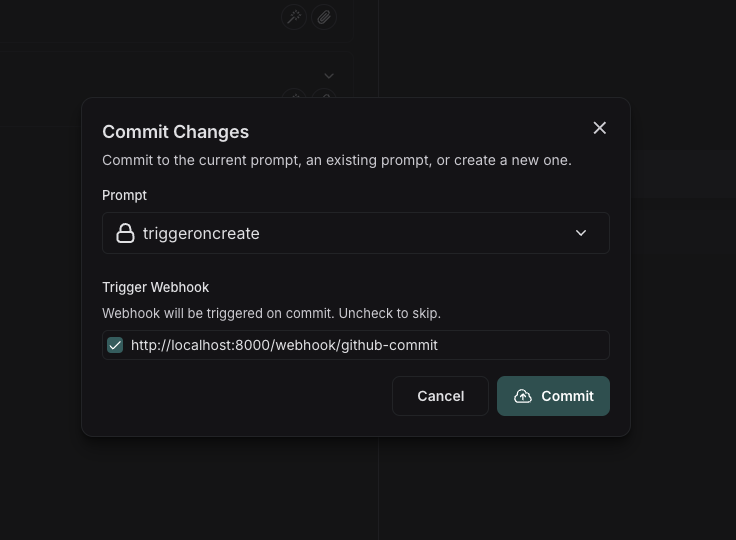
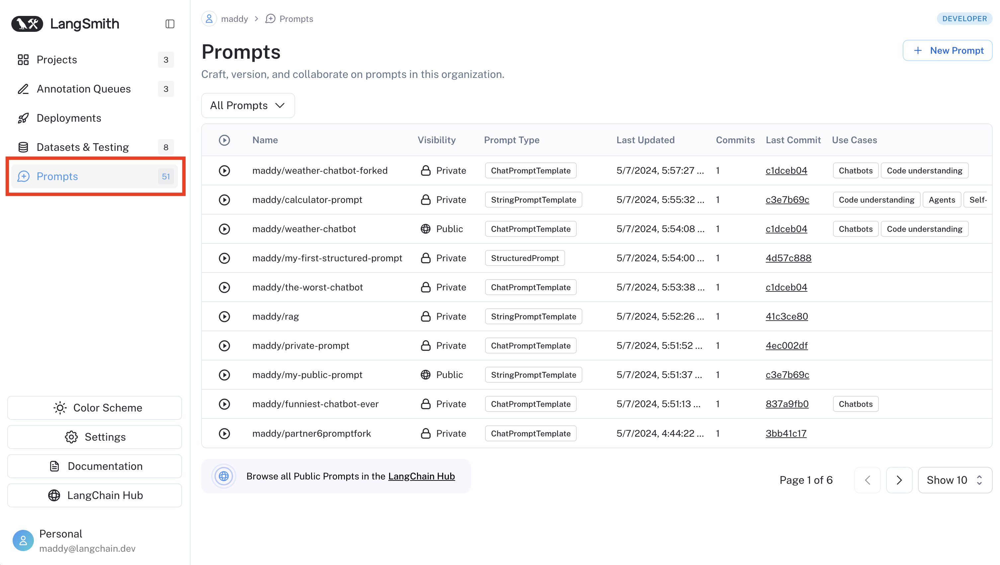

# Manage prompts

> Manage prompt versions, environments, and access controls in LangSmith.

LangSmith provides several tools to help you manage your [*prompts*](../Prompt%20engineering%20concepts.md) effectively. This page describes the following features:

* [Environments](#environments) for promoting commits through **Staging** and **Production**.
* [Commit tags](#commit-tags) for version control and environment management.
* [Prompt owners](#prompt-owners) for controlling who can promote commits and delete a prompt.
* [Webhook triggers](#trigger-a-webhook-on-prompt-commit) for automating workflows when prompts are updated.
* [Public prompt hub](#public-prompt-hub) for discovering and using community-created prompts.

## Prompt detail page

Select a prompt from the [**Prompts** table](Create%20a%20prompt.md#view-your-prompts) to open its detail page, which uses a two-pane layout: commit history and environments appear on the left, and commit details appear on the right.

You can compare a commit with its previous version by toggling **Diff** in the top-right corner.

## Environments

Environments represent named deployment targets, **Staging** and **Production**, that you can assign to specific commits. They let you track which version of a prompt is active in each environment and promote commits between them.

Environments are defined by reserved [commit tags](#commit-tags) (`staging` and `production`) that are managed through the promotion UI rather than the freeform tag picker.

### Promote a commit

Promoting a commit assigns it to an environment. You can promote any commit to Staging or Production.

To promote a commit:

1. Hover over a commit in the left pane to reveal **Promote**, or click **Promote** in the upper-right corner of the page. Select **Staging** or **Production** from the dropdown.
2. A deployment modal opens, showing which commit is currently assigned to that environment and will be replaced.
3. Confirm the promotion. The environment pointer updates immediately.

> [!NOTE]
>
> Promoting a commit to Production does not remove it from Staging. If a commit is in Staging and you promote it to Production, it remains in Staging as well.

### Roll back an environment

Each environment maintains an ordered history of which commits were assigned to it and when. To roll back to a previous commit:

1. In the left pane, find the environment you want to roll back.
2. Click the rollback icon for that environment.
3. From the displayed **Rollback history**, select the commit you want to roll back to. The environment pointer will update to that commit.

## Commit tags

[*Commit tags*](../Prompt%20engineering%20concepts.md#tags) are labels that reference a specific [*commit*](../Prompt%20engineering%20concepts.md#commits) in your prompt's version history. They help you mark significant versions and control which versions run in different environments. By referencing tags rather than commit IDs in your code, you can update which version is being used without modifying the code itself.

Each tag references exactly one commit, though you can reassign a tag to point to a different commit.

> [!NOTE]
>
> **Reserved tags:** The `staging` and `production` tags are reserved for environment management and are not enabled in the freeform tag picker. Use the [promotion flow](#promote-a-commit) to assign commits to these environments.

> [!NOTE]
>
> **Not to be confused with resource tags**: Commit tags are specific to prompt versioning and reference individual commits in a prompt's history. [Resource tags](../../../../LangSmith%20setup/Govern/Organization/Workspace%20setup/Set%20up%20resource%20tags.md) are key-value pairs used to organize workspace resources like projects, datasets, and prompts. While both can use similar naming conventions (like `prod` or `staging`), commit tags control **which version** of a prompt runs, while resource tags help you **organize and filter** resources across your workspace.

### Create a tag

To create a tag, select the commit you want to tag in the left pane of the prompt detail page. Click **Tag** at the top right of the right pane. In the dropdown, click **Commit Tag** and enter a name.

### Move a tag

To point a tag to a different commit, select the destination commit in the left pane of the prompt detail page. Click **Tag** at the top right of the right pane. In the dropdown, select the tag you want to move. This automatically updates the tag to point to the new commit.

### Delete a tag

To delete a tag, click **Tag** at the top right of the right pane. (It does not matter which commit is selected). In the dropdown, click the delete icon next to the tag you want to delete. This removes the tag entirely and it will no longer be associated with any commit.

### Use tags in code

Tags provide a stable way to reference specific versions of your prompts in code. Instead of using commit hashes directly, you can reference tags that can be updated without changing your code.

Here is an example of pulling a prompt by tag in Python:

```python
prompt = client.pull_prompt("joke-generator:production")
# If production tag points to commit a1b2c3d4, this is equivalent to:
prompt = client.pull_prompt("joke-generator:a1b2c3d4")
```

For more information on how to use prompts in code, refer to [Managing prompts programmatically](Manage%20prompts%20programmatically.md).

## Prompt owners

The prompt owners feature gives you fine-grained control over who can tag commits and delete a specific prompt. This is useful for production promotion flows where you want to limit which team members can promote a commit to an environment by assigning or moving tags.

### Access modes

Each prompt has two access modes, configured under **Access and Permissions** in the [UI](https://smith.langchain.com?utm_source=docs&utm_medium=cta&utm_campaign=langsmith-signup&utm_content=langsmith-manage-prompts):

* **Workspace authorized users** (default): any workspace user with the [`prompts:tag`](../../../../LangSmith%20setup/Govern/Users%20%26%20access%20control/Organization%20and%20workspace%20operations%20reference.md#prompts) permission can create, update, and delete tags and delete the prompt.
* **Owners only**: only users added as prompt owners can create or update commit tags, promote commits to environments, and delete the prompt.

LangSmith automatically adds the prompt creator as an owner.

### Configure access and permissions

1. Open the prompt in the LangSmith UI.
2. Click the  **More** icon in the upper-right corner and select **Access and Permissions**.
3. Select **Owners only** mode.
4. Add or remove users from the owners group.

> [!WARNING]
>
> If you save changes that remove yourself as an owner, you will lose the ability to manage owners or switch the prompt back to workspace authorized users mode. Only another owner can restore your access.

When **Owners only** mode is active, only an owner can disable it or add or remove other owners.

## Trigger a webhook on prompt commit

You can configure a webhook to be triggered whenever a commit is made to a prompt.

Some common use cases of this include:

* Triggering a CI/CD pipeline when prompts are updated.
* Synchronizing prompts with a GitHub repository.
* Notifying team members about prompt modifications.

### Configure a webhook

Navigate to the **Prompts** section in the left-hand sidebar or from the application homepage. In the top right corner, click on the `+ Webhook` button.

Add a webhook URL and any required headers.

> [!NOTE]
>
> You can only configure one webhook per workspace. If you want to configure multiple per workspace or set up a different webhook for each prompt, let us know in the [LangChain Forum](https://forum.langchain.com/).

To test out your webhook, click the **Send test notification** button. This will send a test notification to the webhook URL you provided with a sample payload.

The sample payload is a JSON object with the following fields:

* `prompt_id`: The ID of the prompt that was committed.
* `prompt_name`: The name of the prompt that was committed.
* `commit_hash`: The commit hash of the prompt.
* `created_at`: The date of the commit.
* `created_by`: The author of the commit.
* `manifest`: The manifest of the prompt.

### Trigger the webhook

Commit to a prompt to trigger the webhook you've configured.

#### Use the Playground

If you do this in the Playground, you'll be prompted to deselect the webhooks you'd like to avoid triggering.



#### Using the API

If you commit via the API, you can specify to skip triggering the webhook by setting the `skip_webhooks` parameter to `true` or to an array of webhook ids to ignore. Refer to the [API docs](../../../../Monitor/Reference/LangSmith%20REST%20API/Prompts%20%26%20Playground/Create%20a%20commit.md) for more information.

## Public prompt hub

LangSmith's public prompt hub is a collection of prompts that have been created by the LangChain community that you can use for reference.

> [!NOTE]
>
> Note that prompts are user-generated and unverified. LangChain does not review or endorse public prompts, use these at your own risk. Use of Prompt Hub is subject to our [Terms of Service](https://www.langchain.com/terms-of-service).

Navigate to the **Prompts** section of the left-hand sidebar and click on **Browse all Public Prompts in the LangChain Hub**.

Here you'll find all of the publicly listed prompts in the LangChain Hub. You can search for prompts by name, handle, use cases, descriptions, or models. You can fork prompts to your personal organization, view the prompt's details, and run the prompt in the Playground. You can [pull any public prompt into your code](Manage%20prompts%20programmatically.md) using the SDK.

To view prompts tied to your workspace, navigate to **Prompts** in the sidebar.


