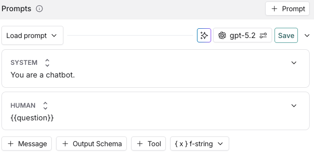
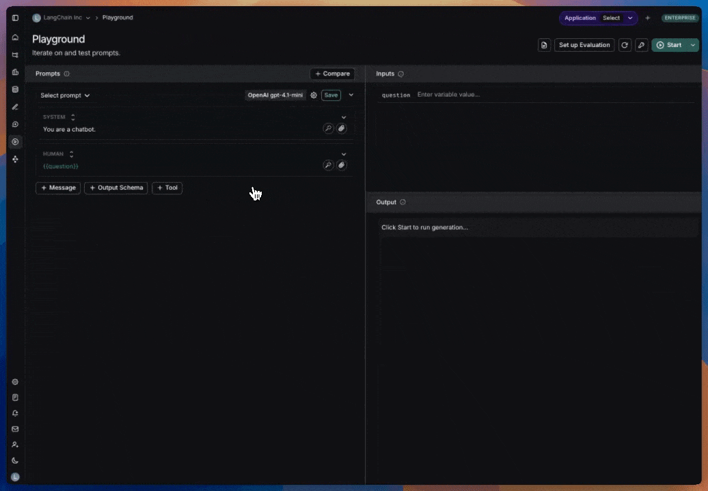
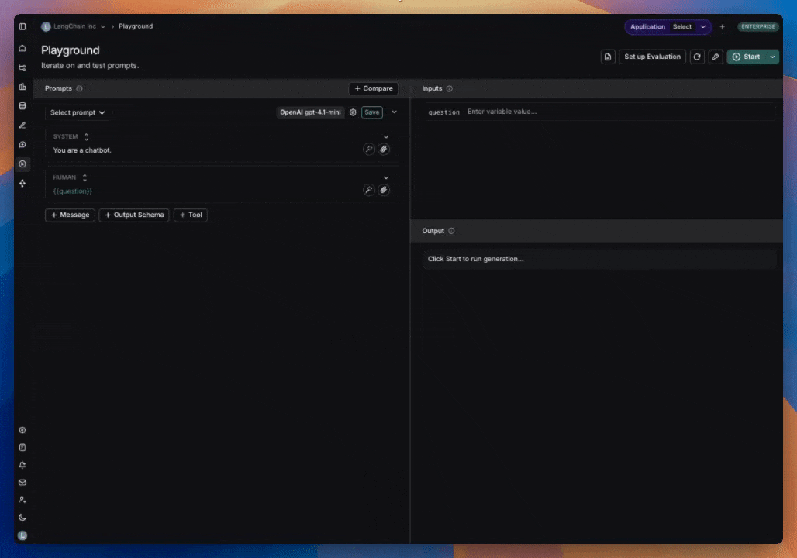
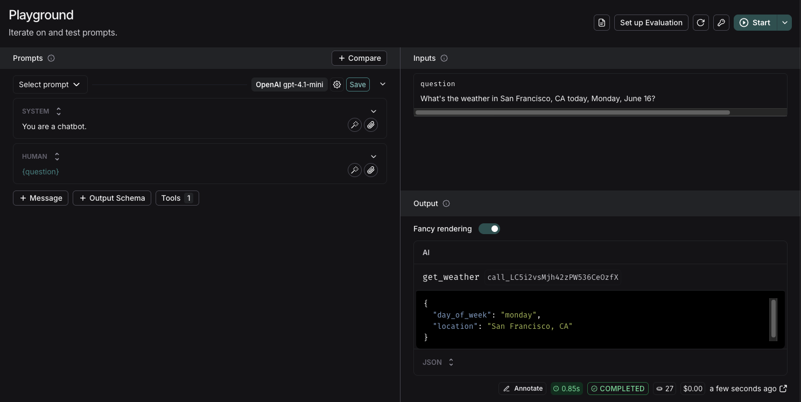
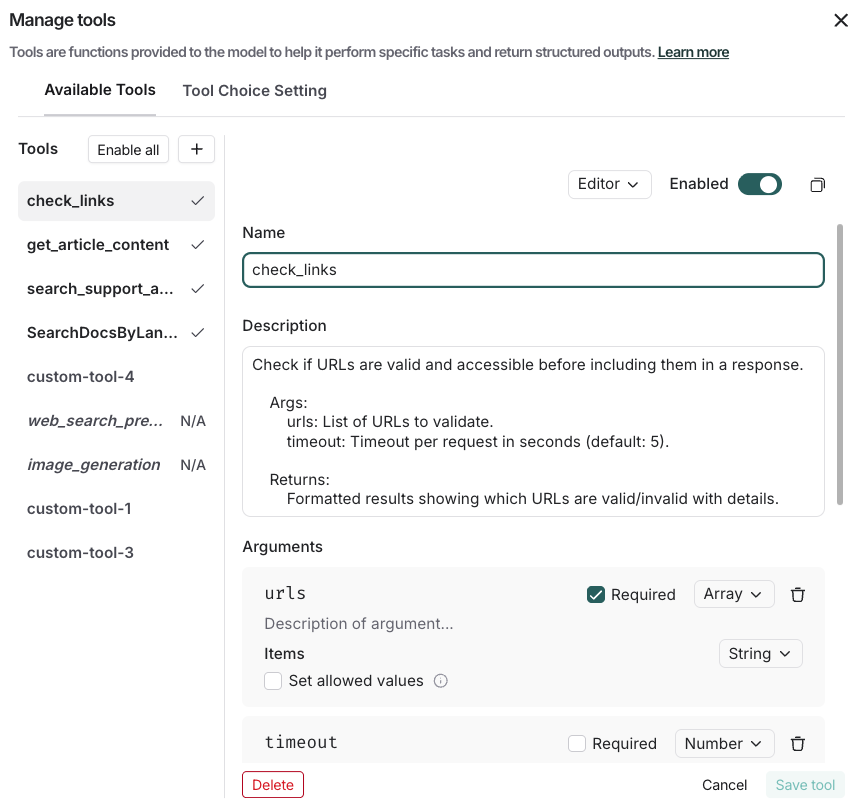
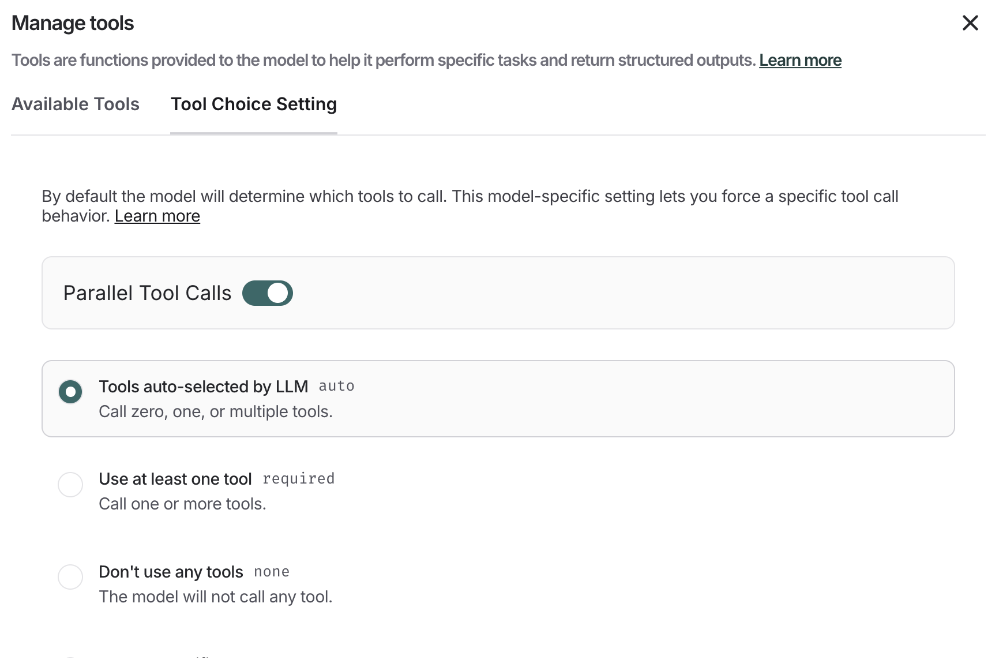

# Use tools in a prompt

Tools allow language models to interact with external systems and perform actions beyond just generating text. In the Playground, you can use two types of tools:

1. [**Built-in tools**](#built-in-tools): Pre-configured tools provided by model providers (like OpenAI and Anthropic) that are ready to use. Use built-in tools when you need common capabilities like web search or code interpretation.
2. [**Custom tools**](#create-a-custom-tool): Functions you define to perform specific tasks. These are useful when you need to integrate with your own systems or create specialized functionality. When you define custom tools within the Playground, you can verify that the model correctly identifies and calls these tools with the correct arguments.

LangSmith automatically saves tools you create to a workspace-wide [tool registry](#manage-tools-with-the-registry), which makes them available for reuse across all your prompts and sessions.

## Built-in tools

The Playground has native support for a variety of tools from OpenAI and Anthropic. If you want to use a tool that isn't explicitly listed in the Playground, you can still add it by manually specifying its `type` and any required arguments.

### OpenAI tools

* **Web search**: [Search the web for real-time information](https://platform.openai.com/docs/guides/tools-web-search?api-mode=responses).
* **Image generation**: [Generate images based on a text prompt](https://platform.openai.com/docs/guides/tools-image-generation).
* **MCP**: [Gives the model access to tools hosted on a remote MCP server](https://platform.openai.com/docs/guides/tools-remote-mcp).
* [View all OpenAI tools](https://platform.openai.com/docs/guides/tools?api-mode=responses).

### Anthropic tools

* **Web search**: [Search the web for up-to-date information](https://platform.claude.com/docs/en/agents-and-tools/tool-use/web-search-tool).
* [View all Anthropic tools](https://platform.claude.com/docs/en/agents-and-tools/tool-use/overview).

## Add and use tools

The Playground lets you quickly [add tools](#add-a-tool) to any prompt with a single click. You can choose from built-in tools provided by model providers like OpenAI and Anthropic, or define your own [custom tools](#create-a-custom-tool) tailored to your specific needs. Once you create a custom tool, it's automatically added to a workspace-wide [tool registry](#manage-tools-with-the-registry) where you can enable, disable, or edit it across different prompts without recreating it.

### Add a tool

To add a tool to your prompt, click the **+ Tool** button at the bottom of the prompt editor.

### Use a built-in tool

1. In the tool section, select the built-in tool you want to use. You'll only see the tools that are compatible with the provider and model you've chosen.
2. When the model calls the tool, the Playground will display the response.

   

### Create a custom tool

To create a custom tool, you'll need to provide:

* **Name**: A descriptive name for your tool.
* **Description**: Clear explanation of what the tool does.
* **Arguments**: The inputs your tool requires.

When running a custom tool in the Playground, the model will respond with a JSON object containing the tool name and the tool call.

### Manage tools with the registry

The Playground includes a [workspace](../../../../LangSmith%20setup/Govern/Organization/Overview.md#workspaces)-scoped **tool registry** that persists both custom and built-in tools across prompts and sessions. When you create a custom tool or add a built-in tool, it's automatically saved to your workspace registry and becomes available for reuse in any prompt. You can enable or disable tools per prompt to control which tools are active for each specific prompt, and when editing a shared tool, you can choose to update the registry version or save as a new tool.

Click the **+ Tool** button in the Playground to open **Manage tools**. You can do the following:

* Select and view existing tools in the **Available Tools** tab.
* Toggle individual tools on/off using the **Enabled** switch.
* Edit existing tools by clicking on them in the list.
* Delete tools using the **Delete** at the bottom of **Manage tools**.

Tools are stored with their complete configuration including name, description, parameters, and metadata. The registry supports both custom function tools and built-in tool configurations.

## Tool choice settings

Some models provide control over which tools are called. To configure this:

1. Select **+ Tool** under the prompt editor.
2. Navigate to the **Tool Choice Setting** tab.
3. Select your tool choice.

To understand the available tool choice options, check the documentation for your specific provider. For example, [OpenAI's documentation on tool choice](https://platform.openai.com/docs/guides/function-calling).

