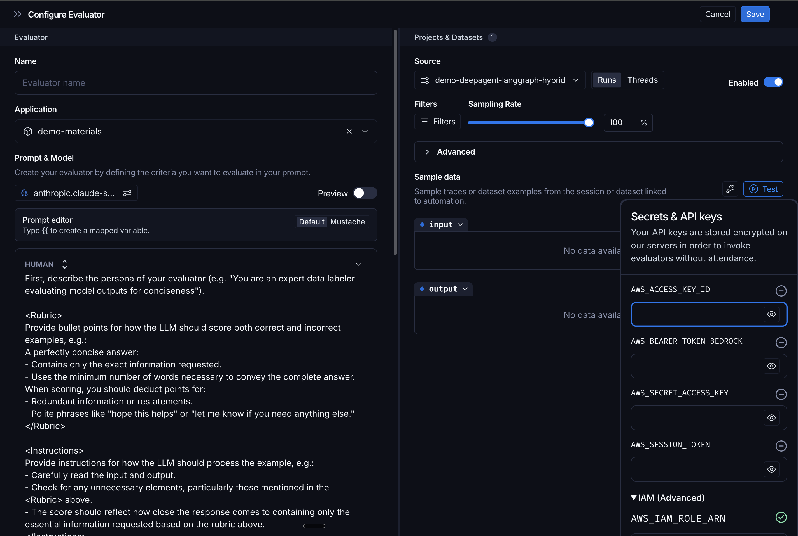

# Model providers

> Configure model providers for the LangSmith Playground and LLM-as-a-judge evaluators.

The [Playground](Prompt%20engineering%20concepts.md#playground) supports a wide range of model providers. You can select a provider, configure your preferred settings, and save these configurations to reuse across multiple prompts.

> [!NOTE]
>
> To send Playground requests through the [LLM Gateway](../../../LLM%20Gateway/Get%20started/LLM%20Gateway.md), select **LangSmith Gateway** as the provider. The providers on this page call the model provider directly with your workspace secrets, so gateway policies and [fallback chains](../../../LLM%20Gateway/Models%20and%20reliability/Model%20fallbacks.md#set-fallbacks-for-a-prompt) do not apply to them.

Use this page for a list of the available providers and their configuration options:


Amazon Bedrock

[Open](#amazon-bedrock)


Anthropic

[Open](#anthropic)


Azure OpenAI

[Open](#azure-openai)


Databricks

[Open](#databricks)


DeepSeek

[Open](#deepseek)


Fireworks

[Open](#fireworks)


Google Gemini

[Open](#google-gemini)


Gemini Enterprise Agent Platform

[Open](#gemini-enterprise-agent-platform)


Groq

[Open](#groq)


Mistral AI

[Open](#mistral-ai)


OpenAI

[Open](#openai)

[OpenAI compatible endpoint](#openai-compatible-endpoint)


XAI

[Open](#xai)

For details on creating and managing model configurations, refer to the [Configure prompt settings](Create%20and%20manage%20prompts/Configure%20prompt%20settings.md) page.

## Amazon Bedrock

Before you use this model, ensure you have AWS credentials, an [IAM role](https://docs.aws.amazon.com/bedrock/latest/userguide/security-iam.html), or an [Amazon Bedrock API key](https://docs.aws.amazon.com/bedrock/latest/userguide/api-keys.html).

### Authentication

Amazon Bedrock supports three authentication methods. **IAM trusted entity is the recommended approach** because it avoids sharing long-lived AWS access keys with LangSmith.

#### IAM trusted entity (recommended)

> [!NOTE]
>
> **Not available for [self-hosted LangSmith](../../../LangSmith%20setup/Self-hosted/Self-hosted%20LangSmith.md) or for [BYOC](../../../LangSmith%20setup/BYOC/Bring%20Your%20Own%20Cloud%20%28BYOC%29.md) on GCP or Azure.** Use access keys or the Bedrock API key instead. On BYOC AWS data planes, follow [IAM trusted entity on BYOC](#iam-trusted-entity-on-byoc) instead of the steps below.

With IAM trusted entity authentication, you create an IAM role in your AWS account and allow LangSmith to assume it. No access keys are stored in LangSmith. Instead, LangSmith uses [AWS STS](https://docs.aws.amazon.com/STS/latest/APIReference/welcome.html) to assume the role on each request.

The `AWS_IAM_ROLE_ARN` secret set here is also read by the [LLM Gateway](../../../LLM%20Gateway/Authentication/Provider%20authentication.md#use-an-iam-role). One role covers Playground, LLM-as-a-judge evaluators, and gateway requests. If you also use the role with the gateway, add the [gateway's permissions](../../../LLM%20Gateway/Authentication/Provider%20authentication.md#use-an-iam-role) to the role.

To set this up:

1. Create an IAM role in your AWS account with permissions to invoke Bedrock models:

```json
{
  "Version": "2012-10-17",
  "Statement": [
    {
      "Effect": "Allow",
      "Action": [
        "bedrock:InvokeModel",
        "bedrock:InvokeModelWithResponseStream"
      ],
      "Resource": "*"
    }
  ]
}
```

2. Add a trust policy that allows LangSmith's AWS account (`808407022534`) to assume the role, using your LangSmith workspace ID as the external ID. You can copy this policy, with your workspace ID filled in, from the Bedrock provider's secrets configuration:

```json
{
  "Version": "2012-10-17",
  "Statement": [
    {
      "Effect": "Allow",
      "Principal": {
        "AWS": "arn:aws:iam::808407022534:root"
      },
      "Action": "sts:AssumeRole",
      "Condition": {
        "StringEquals": {
          "sts:ExternalId": "<your-langsmith-workspace-id>"
        }
      }
    }
  ]
}
```

> [!TIP]
>
> You can find your workspace ID in your [LangSmith workspace settings](https://smith.langchain.com/settings).

3. In the LangSmith Playground, open the Bedrock provider's secrets configuration by clicking the **Key** icon (the IAM Trusted Entity option is not available in the model configuration dropdown itself). Then expand the **IAM Trusted Entity** section and enter the ARN of the role you created.

   

For more details on trust policies, see the [AWS documentation](https://aws.amazon.com/blogs/security/how-to-use-trust-policies-with-iam-roles/).

#### IAM trusted entity on BYOC

On [BYOC](../../../LangSmith%20setup/BYOC/Bring%20Your%20Own%20Cloud%20%28BYOC%29.md) AWS data planes, two roles in your data plane's AWS account assume your role. LangSmith's AWS account does not. A playground role serves the Playground and LLM-as-a-judge evaluators. The data plane's workload role serves the [LLM Gateway](../../../LLM%20Gateway/Authentication/Provider%20authentication.md#use-an-iam-role). Both can only assume roles that carry the `LangSmithBedrock=true` tag, and only with an external ID.

If your data plane uses [bring your own IAM](../../../LangSmith%20setup/BYOC/AWS/Bring%20your%20own%20IAM%20roles%20%28AWS%29.md), create it with version `v0.17.67` or later of the [`byoiam` Terraform module](https://github.com/langchain-ai/terraform/tree/main/modules/byoc/aws/byoiam). If your data plane was created with an earlier version, upgrade the module to `v0.17.67` or later and re-apply it. Then contact [LangSmith support](https://support.langchain.com) to turn on IAM trusted entity authentication for the data plane.

To set this up:

1. Create an IAM role with the permissions policy from [IAM trusted entity (recommended)](#iam-trusted-entity-recommended). If the LLM Gateway also uses the role, add the [gateway's permissions](../../../LLM%20Gateway/Authentication/Provider%20authentication.md#use-an-iam-role) as well.
2. Add the tag `LangSmithBedrock` with the value `true` to the role.
3. Add a trust policy that allows both roles to assume your role, using your LangSmith workspace ID as the external ID. Because the roles tag their sessions, the policy must also allow `sts:TagSession` in a separate statement without the `sts:ExternalId` condition. Without that statement, AWS denies the role assumption. You can copy this policy, with both role ARNs and your workspace ID filled in, from the Bedrock provider's secrets configuration:

```json
{
  "Version": "2012-10-17",
  "Statement": [
    {
      "Effect": "Allow",
      "Principal": {
        "AWS": ["<playground-role-arn>", "<gateway-role-arn>"]
      },
      "Action": "sts:AssumeRole",
      "Condition": {
        "StringEquals": {
          "sts:ExternalId": "<your-langsmith-workspace-id>"
        }
      }
    },
    {
      "Effect": "Allow",
      "Principal": {
        "AWS": ["<playground-role-arn>", "<gateway-role-arn>"]
      },
      "Action": "sts:TagSession"
    }
  ]
}
```

4. In the Playground, enter the role ARN in the Bedrock provider's **IAM Trusted Entity** section, as described in step 3 of [IAM trusted entity (recommended)](#iam-trusted-entity-recommended).

#### Access keys

Alternatively, you can authenticate with AWS access keys (`AWS_ACCESS_KEY_ID` and `AWS_SECRET_ACCESS_KEY`). Enter these in the Bedrock provider configuration in the Playground. This method is simpler to set up but less secure because it requires storing long-lived credentials.

#### Bedrock API key

Bedrock API keys authenticate requests with a bearer token instead of AWS credentials. To configure a Bedrock API key:

1. [Generate an API key](https://docs.aws.amazon.com/bedrock/latest/userguide/api-keys.html) in the Amazon Bedrock console.
2. In LangSmith, navigate to  **Settings** > **Integrations** > **Provider secrets** and select **+ Secret**.
3. Under **Provider**, select **Amazon Bedrock**.
4. Under **Authentication**, select **Bearer token**.
5. Enter the API key as `AWS_BEARER_TOKEN_BEDROCK`.
6. (Optional) Set `AWS_BEDROCK_REGION`. The default is `us-east-1`.
7. Select **Save**.

### Available models

AWS Bedrock provides access to foundation models from multiple providers:

* **Anthropic:** Claude models.
* **Amazon:** Titan models.
* **Cohere:** Command models.
* **Meta:** Llama models.
* **Others:** Additional providers available based on region.

For the current list of available models, refer to the [AWS Bedrock documentation](https://docs.aws.amazon.com/bedrock/latest/userguide/models-supported.html).

### Configuration parameters

Parameters depend on the underlying model provider:

#### For Anthropic models

Uses Anthropic configuration (see [Anthropic](#anthropic) section below).

#### For Amazon Titan

| Parameter | Range | Description |
| - | - | - |
| **Temperature** | 0.0 - 1.0 | Response randomness |
| **Max Tokens** | 1+ | Maximum response length |
| **Top P** | 0.0 - 1.0 | Nucleus sampling |

#### AWS-specific settings

* **Region:** AWS region for model deployment.

### Tool calling

Depends on underlying model:

* **Anthropic models:** `auto`, `any`.
* **Cohere models:** `auto`.

## Anthropic

Before you use this model, ensure you have an [Anthropic API key](https://console.anthropic.com/settings/keys).

### Available models

Anthropic offers three tiers of models across their Claude generations:

* **Opus:** Highest intelligence and capability.
* **Sonnet:** Balanced performance and cost.
* **Haiku:** Fast and cost-effective.

Recent Claude models support extended thinking capabilities for showing reasoning processes.

For the current list of available models, refer to the [Anthropic documentation](https://docs.anthropic.com/claude/docs/models-overview).

### Configuration parameters

| Parameter | Range | Default | Description |
| - | - | - | - |
| **Temperature** | 0.0 - 1.0 | Optional | Randomness control (uncheck to use model default) |
| **Max Output Tokens** | 1+ | 1024 | Maximum response length |
| **Top P** | 0.0 - 1.0 | Optional | Nucleus sampling (uncheck for model default) |
| **Top K** | 1+ | Optional | Limits to top K tokens (uncheck for model default) |

> [!NOTE]
>
> Temperature, Top P, and Top K are optional. When unchecked, Claude uses its internal defaults.

#### Extended Thinking

Available on supported Claude models. Enable the model to show reasoning before responding, similar to OpenAI's o-series.

| Parameter | Range | Description |
| - | - | - |
| **Enable Extended Thinking** | Toggle | Show/hide thinking process |
| **Budget Tokens** | 1+ | Max tokens for thinking (default: 1024) |

When enabled, responses include:

1. A "thinking" section with the model's reasoning.
2. The final response.

#### Advanced options

* **Base URL:** Override API endpoint for custom deployments.

### Tool calling

* **Supported Tool Choices:** `auto`, `any` (requires at least one tool).
* **Parallel Execution:** No (sequential only).

## Azure OpenAI

Before you use this model, create an [Azure OpenAI resource and model deployment](https://learn.microsoft.com/en-us/azure/ai-services/openai/quickstart).

### Authentication

#### API key

In the Azure OpenAI provider configuration, enter your endpoint, deployment name, API version, and API key.

#### Workload identity for self-hosted LangSmith

> [!NOTE]
>
> Azure OpenAI workload identity requires self-hosted LangSmith `0.16.58` or later on Azure Kubernetes Service (AKS).

Use [AKS workload identity](https://learn.microsoft.com/en-us/azure/aks/workload-identity-overview) to authenticate without storing an API key:

1. Enable the OIDC issuer and workload identity on your AKS cluster.
2. Create or select a user-assigned managed identity.
3. Add a [federated identity credential](https://learn.microsoft.com/en-us/azure/aks/workload-identity-deploy-cluster#create-the-federated-identity-credential) to the managed identity. Use the AKS OIDC issuer and audience `api://AzureADTokenExchange`. Set its subject to `system:serviceaccount:<namespace>:<playground-service-account-name>`.
4. Assign the managed identity the least-privilege `Cognitive Services OpenAI User` role. Scope the role to the Azure OpenAI resource. See [Azure OpenAI role-based access control](https://learn.microsoft.com/en-us/azure/ai-services/openai/how-to/role-based-access-control).
5. Add the following values to your LangSmith Helm configuration:

```yaml Helm
playground:
  serviceAccount:
    annotations:
      azure.workload.identity/client-id: "<managed-identity-client-id>"
  deployment:
    labels:
      azure.workload.identity/use: "true"
```

In the Azure OpenAI provider configuration, enter the endpoint, deployment name, and API version. Leave the API key empty.

When no explicit API key or token provider is supplied, LangSmith automatically uses the Playground workload identity. It obtains short-lived tokens for Playground invocations and evaluator batch calls. Explicit credentials take precedence over workload identity.

Workload identity tokens are restricted to HTTPS Azure AI and Azure OpenAI endpoints on port `443`. Each configuration must use one supported Azure cloud: public, US Government, or China. LangSmith rejects invalid endpoints and configurations that mix Azure clouds.

For broader AKS deployment guidance, see [Self-host LangSmith on Azure](../../../LangSmith%20setup/Self-hosted/Get%20started%20by%20cloud%20provider/Self-hosted%20LangSmith%20on%20Azure.md).

### Available models

Azure OpenAI provides the same model families as OpenAI:

* **GPT series:** General-purpose chat models.
* **o-series:** Reasoning-focused models.
* **Legacy models:** GPT-3.5 and GPT-4 variants.

Model availability varies by Azure region and requires deployment before use.

For the current list of available models, refer to the [Azure OpenAI documentation](https://learn.microsoft.com/en-us/azure/ai-services/openai/concepts/models).

### Configuration parameters

Azure OpenAI supports the same parameters as OpenAI:

#### Standard parameters

| Parameter | Range | Description |
| - | - | - |
| **Temperature** | 0.0 - 2.0 | Controls randomness. Lower = more focused, higher = more creative. |
| **Max Output Tokens** | 1+ | Maximum length of the response |
| **Top P** | 0.0 - 1.0 | Nucleus sampling threshold. Alternative to temperature. |
| **Presence Penalty** | -2.0 - 2.0 | Penalize new topics (positive) or encourage them (negative) |
| **Frequency Penalty** | -2.0 - 2.0 | Penalize repetition (positive) or allow it (negative) |
| **Seed** | Integer | For reproducible outputs |

#### Advanced parameters

**Reasoning Effort:** Available on reasoning-optimized models (o-series and newer GPT models).

**Service Tier:** Available on newer models.

**Other parameters:**

* **JSON Mode:** Force valid JSON responses.
* **Parallel Tool Calls:** Execute multiple tools concurrently.

#### Azure-specific features

* **Deployment Management:** Models must be deployed before use.
* **Regional Availability:** Choose Azure regions for data residency.
* **Content Filtering:** Built-in content moderation and safety features.
* **Managed Identity:** Azure AD authentication support.
* **Private Endpoints:** VNet integration for secure access.

### Tool calling

* **Supported Tool Choices:** `auto`, `required`, `none`, or specific tool name.
* **Parallel Execution:** Yes.

## Databricks

Before you use this model, ensure you have a Databricks workspace and an [access token](https://docs.databricks.com/aws/en/dev-tools/auth/pat).

### Available models

Databricks provides foundation models including Claude, GPT, Gemini, and Llama.

For the current list of available models, refer to [Databricks' model documentation](https://docs.databricks.com/aws/en/machine-learning/foundation-model-apis/supported-models).

### Configuration parameters

| Parameter | Value | Description |
| - | - | - |
| **Databricks workspace URL** | HTTPS URL | Your workspace root URL, without an API path. |
| **Databricks API route** | See options below | API used to query your endpoint. |
| **Max Output Tokens** | 1+ | Maximum response length in tokens. |
| **Stop Sequences** | List of strings | Sequences where the model stops generating. |
| **Timeout** | Seconds | Request timeout. |
| **Max Retries** | Integer | Maximum number of retries on failed requests. |

Choose the API route that matches your endpoint:

* **Model Serving endpoints**: Query a Databricks Model Serving endpoint.
* **AI Gateway (MLflow API)**: Query AI Gateway through the MLflow API.
* **AI Gateway (native OpenAI API)**: Query AI Gateway through its native OpenAI-compatible API.

## DeepSeek

Before you use this model, ensure you have a [DeepSeek API key](https://platform.deepseek.com/api_keys).

### Available models

DeepSeek offers general-purpose models, reasoning-optimized models (R-series), and coding-specialized models.

For the current list of available models, refer to [DeepSeek's documentation](https://platform.deepseek.com/api-docs/).

### Configuration parameters

| Parameter | Range | Description |
| - | - | - |
| **Temperature** | 0.0 - 2.0 | Response randomness |
| **Max Tokens** | 1+ | Maximum response length |
| **Top P** | 0.0 - 1.0 | Nucleus sampling |
| **Presence Penalty** | -2.0 - 2.0 | |
| **Frequency Penalty** | -2.0 - 2.0 | |

## Fireworks

Before you use this model, ensure you have a [Fireworks API key](https://fireworks.ai/api-keys).

### Available models

Fireworks provides high-speed inference for popular open-source models and fine-tuned variants, including:

* **Llama:** Meta's Llama models in various sizes.
* **Mixtral:** Mistral's mixture-of-experts models.
* **Qwen:** Alibaba's multilingual models.
* **DeepSeek:** DeepSeek models.
* **Other open models:** Gemma, Phi, and more.

For the current list of available models, refer to [Fireworks' model documentation](https://docs.fireworks.ai/models).

### Configuration parameters

| Parameter | Range | Description |
| - | - | - |
| **Temperature** | 0.0 - 2.0 | Response randomness |
| **Max Tokens** | 1+ | Maximum response length |
| **Top P** | 0.0 - 1.0 | Nucleus sampling |

### Tool calling

* **Supported Tool Choices:** `auto`, `required`, `none`.
* **Parallel Execution:** Yes.

## Google Gemini

Before you use this model, ensure you have a [Google AI API key](https://aistudio.google.com/app/apikey).

### Available models

Google offers Gemini models in multiple tiers (Ultra, Pro, Flash) optimized for different use cases.

For the current list of available models, refer to [Google's Gemini documentation](https://ai.google.dev/models/gemini).

### Configuration parameters

| Parameter | Range | Description |
| - | - | - |
| **Temperature** | 0.0 - 2.0 | Response randomness |
| **Max Output Tokens** | 1+ | Maximum response length |
| **Top P** | 0.0 - 1.0 | Nucleus sampling |
| **Top K** | 1+ | Top-k sampling |

### Tool calling

* **Supported Tool Choices:** `auto`, `any`, `none`.
* **Parallel Execution:** No.

## Gemini Enterprise Agent Platform

Before you use this model, ensure you have a [Google Cloud project](https://cloud.google.com/resource-manager/docs/creating-managing-projects) with the [Gemini Enterprise Agent Platform API enabled](https://docs.cloud.google.com/gemini-enterprise-agent-platform/machine-learning/start/client-libraries).

### Authentication

#### Service account JSON key

You can authenticate by storing a service account JSON key in LangSmith. This JSON file contains credentials for a service account with Gemini Enterprise Agent Platform access.

**Step 1: Create a service account**

1. Go to the [Google Cloud Console > IAM & Admin > Service Accounts](https://console.cloud.google.com/iam-admin/serviceaccounts).
2. Select your project and click **Create Service Account**.
3. Give it a name (e.g., `langsmith-vertex-ai`) and click **Create and Continue**.
4. Assign the role **Vertex AI User** (`roles/aiplatform.user`) and click **Done**.

**Step 2: Download the JSON key**

1. Click on the service account you just created.
2. Go to the **Keys** tab and click **Add Key > Create new key**.
3. Choose **JSON** and click **Create**. A `.json` file will download to your machine.

The downloaded file looks like this:

```json
{
  "type": "service_account",
  "project_id": "your-project-id",
  "private_key_id": "key-id",
  "private_key": "<PRIVATE_KEY_HEADER>\n...\n<PRIVATE_KEY_FOOTER>\n",
  "client_email": "langsmith-vertex-ai@your-project-id.iam.gserviceaccount.com",
  "client_id": "...",
  "auth_uri": "https://accounts.google.com/o/oauth2/auth",
  "token_uri": "https://oauth2.googleapis.com/token"
}
```

**Step 3: Configure in the LangSmith Playground**

In the LangSmith Playground, open the Gemini Enterprise Agent Platform provider configuration and paste the **entire contents** of the downloaded JSON key file into the **Service Account JSON** field.

> [!WARNING]
>
> Treat your service account JSON key like a password. Do not share it or commit it to source control. If a key is compromised, revoke it immediately from the [Google Cloud Console](https://console.cloud.google.com/iam-admin/serviceaccounts) and create a new one.

#### Workload identity for self-hosted LangSmith

Self-hosted LangSmith on GKE can use Workload Identity Federation and Application Default Credentials (ADC) instead of a JSON key. This keyless alternative supports Playground, Chat (`polly` in Helm), and Insights. See [Authenticate Vertex AI with GKE workload identity](../../../LangSmith%20setup/Self-hosted/Configure%20an%20instance/Authenticate%20Vertex%20AI%20with%20GKE%20workload%20identity.md) to configure each workload identity.

### Available models

Google offers Gemini models in multiple tiers (Ultra, Pro, Flash) optimized for different use cases, plus other models available through Gemini Enterprise Agent Platform.

For the current list of available models, refer to the [Gemini Enterprise Agent Platform documentation](https://docs.cloud.google.com/gemini-enterprise-agent-platform/models/google-models).

### Configuration parameters

| Parameter | Range | Description |
| - | - | - |
| **Temperature** | 0.0 - 2.0 | Response randomness |
| **Max Output Tokens** | 1+ | Maximum response length |
| **Top P** | 0.0 - 1.0 | Nucleus sampling |
| **Top K** | 1+ | Top-k sampling |

#### Advanced options

* **Region Selection:** Deploy in specific Google Cloud regions.
* **Safety Settings:** Configure content filtering thresholds.

### Tool calling

* **Supported Tool Choices:** `auto`, `any`, `none`.
* **Parallel Execution:** No.

## Groq

Before you use this model, ensure you have a [Groq API key](https://console.groq.com/keys).

### Available models

Groq provides high-speed inference for popular open-source models including Llama, Mixtral, and Gemma variants.

For the current list of available models, refer to [Groq's model documentation](https://console.groq.com/docs/models).

### Configuration parameters

| Parameter | Range | Description |
| - | - | - |
| **Temperature** | 0.0 - 2.0 | Response randomness |
| **Max Tokens** | 1+ | Maximum response length |

### Tool calling

* **Supported Tool Choices:** `auto`, `required`, `none`.
* **Parallel Execution:** Yes.

## Mistral AI

Before you use this model, ensure you have a [Mistral AI API key](https://console.mistral.ai/api-keys/).

### Available models

Mistral offers models in multiple tiers (Large, Medium, Small) optimized for different performance and cost requirements.

For the current list of available models, refer to [Mistral's documentation](https://docs.mistral.ai/platform/endpoints/).

### Configuration parameters

| Parameter | Range | Description |
| - | - | - |
| **Temperature** | 0.0 - 1.0 | Response randomness |
| **Max Tokens** | 1+ | Maximum response length |
| **Top P** | 0.0 - 1.0 | Nucleus sampling |

### Tool calling

* **Supported Tool Choices:** `auto`, `any`, `none`.
* **Parallel Execution:** No.

## OpenAI

Before you use this model, ensure you have an [OpenAI API key](https://platform.openai.com/api-keys) or [Azure OpenAI credentials](https://learn.microsoft.com/en-us/azure/ai-services/openai/quickstart).

### Available models

OpenAI offers several model families with different capabilities and price points:

* **GPT series:** General-purpose chat models with various size/capability tiers.
* **o-series:** Reasoning-focused models optimized for complex problem-solving.
* **Legacy models:** Older GPT-3.5 and GPT-4 variants.

For the current list of available models, refer to the [OpenAI documentation](https://platform.openai.com/docs/models).

### Configuration parameters

Standard:

| Parameter | Range | Description |
| - | - | - |
| **Temperature** | 0.0 - 2.0 | Controls randomness. Lower = more focused, higher = more creative. |
| **Max Output Tokens** | 1+ | Maximum length of the response |
| **Top P** | 0.0 - 1.0 | Nucleus sampling threshold. Alternative to temperature. |
| **Presence Penalty** | -2.0 - 2.0 | Penalize new topics (positive) or encourage them (negative) |
| **Frequency Penalty** | -2.0 - 2.0 | Penalize repetition (positive) or allow it (negative) |
| **Seed** | Integer | For reproducible outputs |

Advanced:

**Reasoning Effort**: Available on reasoning-optimized models (o-series and newer GPT models).

Controls reasoning depth before responding. Higher effort = better quality for complex tasks, longer latency.

| Value | Description |
| - | - |
| `none` | Disables reasoning (standard chat behavior) |
| `minimal` | Minimal reasoning |
| `low` | Light reasoning |
| `medium` | Moderate reasoning (default) |
| `high` | Deep reasoning |
| `xhigh` | Extra deep reasoning (if supported by model) |

> [!NOTE]
>
> When reasoning\_effort is active (not `none`), temperature, top\_p, and penalties are automatically disabled.

**Service Tier**: Available on newer models.

Controls request priority and processing allocation.

| Value | Description |
| - | - |
| `auto` | System decides based on load (default) |
| `default` | Standard processing queue |
| `flex` | Lower cost, variable latency (if supported by model) |
| `priority` | High-priority queue, lower latency, higher cost |

**Other parameters:**

* **JSON Mode:** Force valid JSON responses.
* **Responses API:** Improved streaming (default: enabled).
* **Parallel Tool Calls:** Execute multiple tools concurrently.

### Tool calling

* **Supported Tool Choices:** `auto`, `required`, `none`, or specific tool name
* **Parallel Execution:** Yes

## OpenAI Compatible Endpoint

Authentication varies by endpoint. Common options:

* **API key**: stored as a [workspace secret](../../../LangSmith%20setup/Govern/Organization/Overview.md#workspaces) and forwarded as `Authorization: Bearer <key>`.
* **None**: for unauthenticated local endpoints (for example, Ollama on `localhost`).
* **OAuth2 `client_credentials`**: stored on the model configuration. LangSmith mints a short-lived bearer at request time and refreshes it before expiry. See [OAuth client credentials](../../../LangSmith%20setup/Govern/Organization/Workspace%20setup/Manage%20model%20configurations.md#oauth-client-credentials).

### Configuration

**Required:**

* **Base URL:** Your endpoint URL (e.g., `https://your-endpoint.com/v1`).
* **Model Name:** Your model identifier.

Works with any framework or service that implements the OpenAI-compatible API format, including:

* Self-hosted open-source inference servers
* Model routing proxies
* Custom model endpoints

### Configuration parameters

All OpenAI-compatible parameters:

| Parameter | Range | Description |
| - | - | - |
| **Temperature** | 0.0 - 2.0 | Response randomness |
| **Max Tokens** | 1+ | Maximum response length |
| **Top P** | 0.0 - 1.0 | Nucleus sampling |
| **Frequency Penalty** | -2.0 - 2.0 | Reduce repetition |
| **Presence Penalty** | -2.0 - 2.0 | Encourage new topics |

**Advanced:**

* **JSON Mode:** If endpoint supports it.
* **Streaming:** If endpoint supports it.
* **Function Calling:** If endpoint implements OpenAI format.

### Tool calling

* **Supported Tool Choices:** `auto`, `required`, `none` (if endpoint supports).
* **Parallel Execution:** Yes (if endpoint supports).

### Example endpoints

**Local Ollama:**

```
Base URL: http://localhost:11434/v1
Model: llama3.1
```

**vLLM Server:**

```
Base URL: https://your-server.com/v1
Model: mistral-7b-instruct
```

**LiteLLM Proxy:**

```
Base URL: https://litellm.example.com
Model: gpt-4 (routes to configured backend)
```

## XAI

Before you use this model, ensure you have an [xAI API key](https://console.x.ai/).

### Available models

xAI offers Grok models in multiple sizes for different use cases.

For the current list of available models, refer to [xAI's documentation](https://docs.x.ai/docs).

### Configuration parameters

Standard OpenAI-compatible parameters:

| Parameter | Range | Description |
| - | - | - |
| **Temperature** | 0.0 - 2.0 | Response randomness |
| **Max Tokens** | 1+ | Maximum response length |
| **Top P** | 0.0 - 1.0 | Nucleus sampling |
| **Presence Penalty** | 0 - 2.0 | Hidden on reasoning models |
| **Frequency Penalty** | 0 - 2.0 | Hidden on reasoning models |

### Tool calling

* **Supported Tool Choices:** OpenAI-compatible.
* **Parallel Execution:** Yes (if supported).

## Common Configuration Across All Providers

### Extra Parameters

All providers support a **JSON editor for extra parameters** not exposed in the UI:

```json
{
  "logprobs": true,
  "top_logprobs": 5,
  "custom_parameter": "value"
}
```

**Use cases:**

* Provider-specific beta features
* Advanced parameters not yet in UI
* Custom metadata for tracking

**Limitation:** Cannot override parameters already in the UI (e.g., can't set temperature here if it's set above)

### Rate Limiting

**Requests Per Second (RPS)** - Available for all providers when running over datasets:

* **Range:** 0 - 500 RPS
* **Purpose:** Respect API rate limits, control costs
* **Default:** Varies by provider

Set this when running experiments or evaluations to avoid hitting rate limits.

## Next steps

> [card] [Configure prompt settings](Create%20and%20manage%20prompts/Configure%20prompt%20settings.md)
>
> Learn how to create and manage model configurations in the Playground.

> [card] [Create a prompt](Create%20and%20manage%20prompts/Create%20a%20prompt.md)
>
> Get started building prompts with your chosen model provider.
