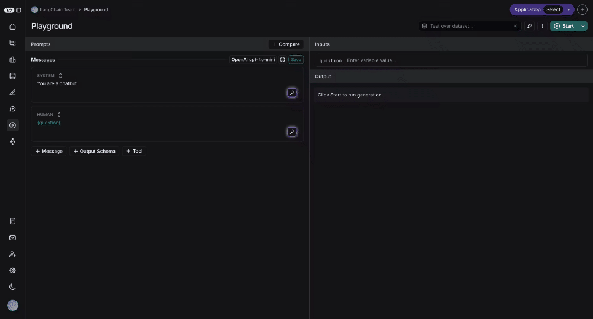
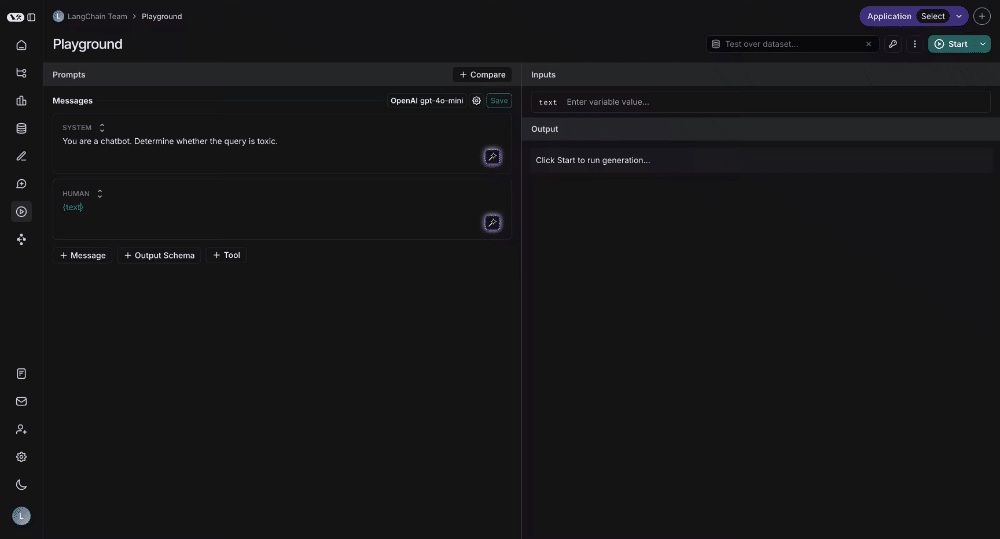

# Prompt engineering concepts

While traditional software applications are built by writing code, AI applications often derive their logic from prompts.

This guide will walk through the key concepts of prompt engineering in LangSmith.

## Why prompt engineering?

A prompt guides the model's behavior without changing its underlying capabilities. By providing instructions, examples, and context, prompts shape how the model responds to inputs.

Prompt engineering is important because it allows you to modify model behavior. While other approaches exist (such as fine-tuning), prompt engineering typically offers the lowest barrier to entry and often delivers the highest return on investment.

Prompt engineering is often a multi-disciplinary effort. The most effective prompt engineer may be a product manager, domain expert, or other non-technical team member rather than the software engineer building the application. Proper tooling and infrastructure are essential to support this cross-functional collaboration.

## Prompt types

There are two different types of prompt formats: `chat` style prompts and `completion` style prompts.

**Chat prompts** are a list of messages, each with a role (such as `system`, `user`, or `assistant`). This is the prompting style supported by most current model APIs and is the recommended format.

**Completion prompts** are a single string. This is an older prompting style maintained primarily for backward compatibility.

> [!NOTE]
>
> Unless you have a specific reason to use completion prompts, use chat prompts for new projects. Chat prompts provide better structure for multi-turn conversations and are better supported by modern LLMs.

## Prompts vs. prompt templates

While *prompt* and *prompt template* are often used interchangeably, understanding the distinction helps clarify how LangSmith manages and evaluates your AI application.

* **Prompts** refer to the messages that are passed into the language model.
* **Prompt templates** allow you to create reusable prompts with dynamic placeholders that get filled in at runtime. Instead of hardcoding values, you define variables that LangSmith replaces with different inputs each time you run your prompt. This makes prompts flexible, testable, and easier to iterate on.

Here's how templates work in practice:

1. **Define the template**: Create a prompt with variables (marked with curly braces) that will be replaced at runtime:

   ```
   You are a customer support agent. This is the refund policy:

   {refund_policy}

   Please respond to the user's question:

   {question}
   ```

2. **Provide input values**: Supply the actual values for each variable:

   ```json
   {
   "refund_policy": "no refunds under any circumstances",
   "question": "can I get a refund for this hat?"
   }
   ```

3. **Get the final prompt**: LangSmith replaces the variables with your inputs to create the prompt sent to the model:

   ```
   You are a customer support agent. This is the refund policy:

   no refunds under any circumstances

   Please respond to the user's question:

   Can I get a refund for this hat?
   ```

> [!TIP]
>
> Learn more about template variable syntax and formatting options in the [Prompt template format](Create%20and%20manage%20prompts/Create%20a%20prompt.md#template-format) guide.

## Prompts in LangSmith

You can store and version prompt templates in LangSmith. These templates can be tested in the Playground, versioned with commits and tags, and pulled into your application code.

Open the [Playground](https://smith.langchain.com/playground) to create and test your first prompt template. For a step-by-step, refer to [Create a prompt](Create%20and%20manage%20prompts/Create%20a%20prompt.md).

The following sections describe key aspects of prompt templates.

### F-string vs. mustache

You can format your prompt template with input variables using either [f-string](https://realpython.com/python-f-strings/) or [mustache](https://mustache.github.io/mustache.5.html) format.

For details on how to use these formats in the Playground, see [Template format](Create%20and%20manage%20prompts/Create%20a%20prompt.md#template-format).

> [!TIP]
>
> The [Playground](https://smith.langchain.com/playground) uses `f-string` as the default template format, but you can switch to `mustache` format in the prompt settings/template format section. `mustache` gives you more flexibility around conditional variables, loops, and nested keys. For conditional variables, you'll need to manually add json variables in the 'inputs' section. Read [the documentation](https://mustache.github.io/mustache.5.html)

### Tools

[Tools](Create%20and%20manage%20prompts/Use%20tools%20in%20a%20prompt.md) are interfaces the LLM can use to interact with the outside world. Tools consist of a name, description, and JSON schema of arguments used to call the tool.

### Structured output

Structured output is a feature of most state of the art LLMs, wherein instead of producing raw text as output they stick to a specified schema. This may or may not use [Tools](#tools) under the hood.

> [!TIP]
>
> Structured output is similar to tools, but different in a few key ways. With tools, the LLM choose which tool to call (or may choose not to call any); with structured output, the LLM **always** responds in this format. With tools, the LLM may select **multiple** tools; with structured output, only one response is generate.

### Model

Optionally, you can store a model configuration alongside a prompt template. This includes the name of the model and any other parameters (temperature, etc).

## Prompt versioning

Versioning is a key component of iterating on and collaborating with prompts.

### Commits

Every saved update to a prompt creates a new commit with a unique commit hash. This allows you to:

* View the full history of changes to a prompt.
* Review earlier versions.
* Revert to a previous state if needed.
* Reference specific versions in your code using the commit hash (e.g., `client.pull_prompt("prompt_name:commit_hash")`).

In the UI, you can compare a commit with its previous version by toggling **Diff** in the top-right corner of the [Prompt detail page](Create%20and%20manage%20prompts/Manage%20prompts.md#prompt-detail-page).

### Tags

Commit tags are human-readable labels that point to specific commits in your prompt's history. Unlike commit hashes, tags can be moved to point to different commits, allowing you to update which version your code references without changing the code itself.

Use cases for commit tags can include:

* **Environments**: The `staging` and `production` tags are reserved for the [Environments](Create%20and%20manage%20prompts/Manage%20prompts.md#environments) feature, which lets you promote commits between named deployment targets and switch versions without changing your code.
* **Version control**: Mark stable versions of your prompts, for example, `v1`, `v2`, which lets you reference specific versions in your code and track changes over time.
* **Collaboration**: Mark versions ready for review, which enables you to share specific versions with collaborators and get feedback.

> [!NOTE]
>
> **Not to be confused with resource tags**: Commit tags reference specific prompt versions. [Resource tags](../../../LangSmith%20setup/Govern/Organization/Workspace%20setup/Set%20up%20resource%20tags.md) are key-value pairs used to organize workspace resources.

For detailed information on creating and managing commit tags, see [Manage prompts](Create%20and%20manage%20prompts/Manage%20prompts.md#commit-tags).

## Playground

The Playground provides an interface for iterating on and testing prompts. You can access the Playground from the sidebar or directly from a saved prompt.

In the Playground you can:

* Change the model being used
* Change prompt template being used
* Change the output schema
* Change the tools available
* Enter the input variables to run through the prompt template
* Run the prompt through the model
* Observe the outputs

Use the **[Chat](../../../Test/Datasets%20%26%20Experiments/Analyze%20experiment%20results/LangSmith%20Chat.md)** in the Playground to optimize prompts, generate tools, and create output schemas with AI assistance.

## Testing multiple prompts

You can add multiple prompts to your Playground to compare outputs and evaluate performance:



## Testing over a dataset

To test over a dataset, select the dataset from the top right and click Start. You can configure whether results are streamed and the number of repetitions for the test.



Click the "View Experiment" button to view detailed test results.
