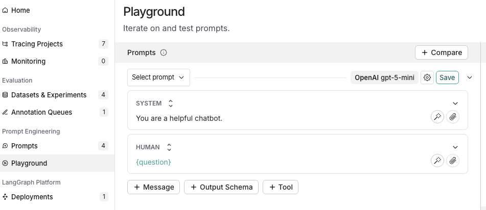
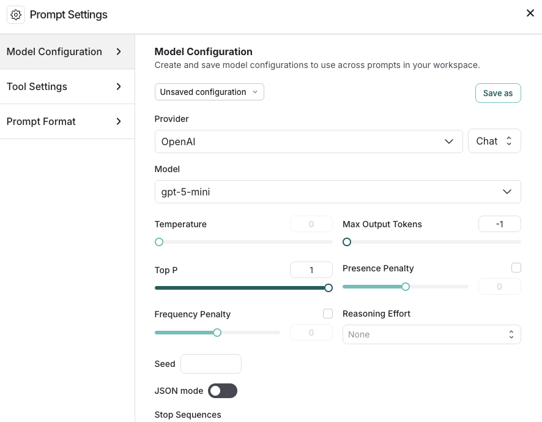
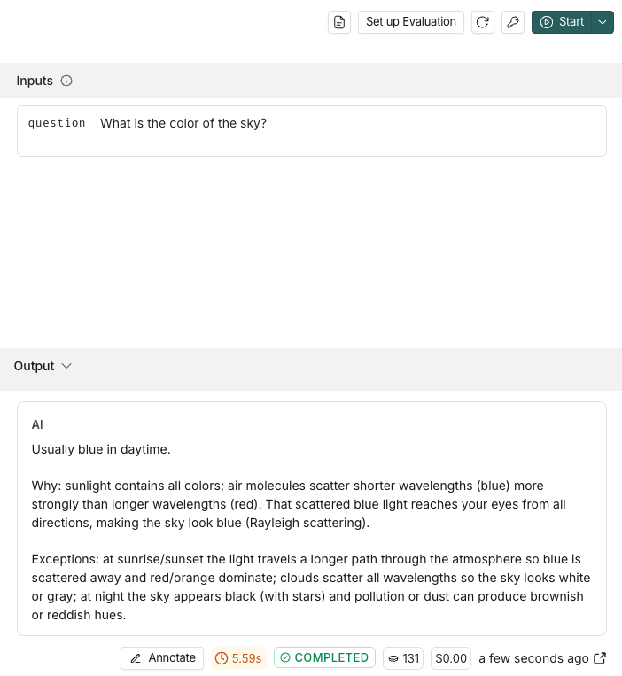

# Prompt engineering quickstart

Prompts guide the behavior of Large Language Models (LLM). [*Prompt engineering*](Prompt%20engineering%20concepts.md) is the process of crafting, testing, and refining the instructions you give to an LLM so it produces reliable and useful responses.

LangSmith provides tools to create, version, test, and collaborate on prompts. You’ll also encounter common concepts like [*prompt templates*](Prompt%20engineering%20concepts.md#prompts-vs-prompt-templates), which let you reuse structured prompts, and [*variables*](Prompt%20engineering%20concepts.md#f-string-vs-mustache), which allow you to dynamically insert values (such as a user’s question) into a prompt.

In this quickstart, you’ll create, test, and improve prompts using either the UI or the SDK. This quickstart will use OpenAI as the example LLM provider, but the same workflow applies across other providers.

## Prerequisites

Before you begin, make sure you have:

* **A LangSmith account**: Sign up or log in at [smith.langchain.com](https://smith.langchain.com?utm_source=docs&utm_medium=cta&utm_campaign=langsmith-signup&utm_content=langsmith-prompt-engineering-quickstart).
* **A LangSmith API key**: Follow the [Create an API key](../../../LangSmith%20setup/Account/Create%20an%20account%20and%20API%20key.md) guide.
* **An OpenAI API key**: Generate this from the [OpenAI dashboard](https://platform.openai.com/account/api-keys).

Select the tab for UI or SDK workflows:

> [tab] UI
>
> ## 1. Set workspace secret
>
> In the [LangSmith UI](https://smith.langchain.com?utm_source=docs&utm_medium=cta&utm_campaign=langsmith-signup&utm_content=snippets-langsmith-set-workspace-secrets), ensure that your API key is set as a [workspace secret](../../../LangSmith%20setup/Govern/Organization/Workspace%20setup/Set%20up%20hierarchy.md#configure-workspace-settings).
>
> Adding workspace secrets requires permission to manage secrets in the workspace. If you do not have it, ask a workspace admin to add the secret for you or to grant you access.
>
> To add a workspace secret:
>
> 1. Navigate to  **Settings** > **Integrations** > **Provider secrets**.
>
> 2. Select **+ Secret**.
>
> 3. Under **Provider**, select your model provider. LangSmith names the secret with the environment variable the provider expects, such as `OPENAI_API_KEY`. Enter your secret in that field.
>
>    If your provider is not listed, leave **Custom** as the provider. Enter the environment variable name your provider expects as the **Key** and your API key as the **Value**.
>
> 4. Select **Save**.
>
> > [!NOTE]
> >
> > If your provider authenticates with OAuth2 `client_credentials`, configure the credentials on the model configuration instead. Workspace secrets are not required in that case. See [OAuth client credentials](../../../LangSmith%20setup/Govern/Organization/Workspace%20setup/Manage%20model%20configurations.md#oauth-client-credentials).
>
> ## 2. Create a prompt
>
> 1. In the [LangSmith UI](https://smith.langchain.com?utm_source=docs&utm_medium=cta&utm_campaign=langsmith-signup&utm_content=langsmith-prompt-engineering-quickstart), navigate to the **Prompts** section in the left-hand menu.
> 2. Click on **+ Prompt** to create a prompt.
> 3. Modify the prompt by editing or adding prompts and input variables as needed.
>
> 
>
> ## 3. Test a prompt
>
> 1. Under the **Prompts** heading select the gear  icon next to the model name, which will launch the **Prompt Settings** window on the **Model Configuration** tab.
>
> 2. Set the [model configuration](Create%20and%20manage%20prompts/Configure%20prompt%20settings.md) you want to use. The **Provider** and **Model** you select will determine the parameters that are configurable on this configuration page. Once set, click **Save as**.
>
>    
>
> 3. Specify the input variables you would like to test in the **Inputs** box and then click  **Start**.
>
>    
>
>    To learn about more options for configuring your prompt in the Playground, refer to [Configure prompt settings](Create%20and%20manage%20prompts/Configure%20prompt%20settings.md).
>
> 4. After testing and refining your prompt, click **Save** to store it for future use.
>
> ## 4. Iterate on a prompt
>
> LangSmith allows for team-based prompt iteration. [Workspace](../../../LangSmith%20setup/Govern/Organization/Overview.md#workspaces) members can experiment with prompts in the Playground and save their changes as a new [*commit*](Prompt%20engineering%20concepts.md#commits) when ready.
>
> To improve your prompts:
>
> * Reference the documentation provided by your model provider for best practices in prompt creation, such as:
>   * [Best practices for prompt engineering with the OpenAI API](https://help.openai.com/en/articles/6654000-best-practices-for-prompt-engineering-with-the-openai-api)
>   * [Gemini's Introduction to prompt design](https://ai.google.dev/gemini-api/docs/prompting-intro)
> * Build and refine your prompts with the Prompt Canvas—an interactive tool in LangSmith. Learn more in the [Prompt Canvas guide](Write%20your%20prompt%20with%20AI.md).
> * Tag specific commits to mark important moments in your commit history.
>   1. To create a commit, navigate to the **Playground** and select **Commit**. Choose the prompt to commit changes to and then **Commit**.
>   2. Navigate to **Prompts** in the left-hand menu. Select the prompt. On the prompt detail page, select **Tag** on the top right to add a [commit tag](Create%20and%20manage%20prompts/Manage%20prompts.md#commit-tags).

> [tab] SDK
>
> ## 1. Set up your environment
>
> 1. In your terminal, prepare your environment:
>
>    ```bash Python theme={"theme":{"light":"catppuccin-latte","dark":"catppuccin-mocha"}}
>    mkdir ls-prompt-quickstart && cd ls-prompt-quickstart
>    python -m venv .venv
>    source .venv/bin/activate
>    pip install -qU langsmith openai langchain_core
>    ```
>
>    ```bash TypeScript theme={"theme":{"light":"catppuccin-latte","dark":"catppuccin-mocha"}}
>    mkdir ls-prompt-quickstart-ts && cd ls-prompt-quickstart-ts
>    npm init -y
>    npm install langsmith openai typescript ts-node
>    npx tsc --init
>    ```
>
> 2. Set your API keys:
>
>    ```bash theme={"theme":{"light":"catppuccin-latte","dark":"catppuccin-mocha"}}
>    export LANGSMITH_API_KEY='<API_KEY>'
>    export OPENAI_API_KEY='<API_KEY>'
>    ```
>
> ## 2. Create a prompt
>
> To create a prompt, you'll define a list of messages that you want in your prompt and then push to LangSmith.
>
> Use the language-specific constructor and push method:
>
> * Python: [`ChatPromptTemplate`](https://reference.langchain.com/python/langchain-core/prompts/chat/ChatPromptTemplate) → [`client.push_prompt(...)`](https://reference.langchain.com/python/langsmith/client/Client/push_prompt)
>
> * TypeScript: [`ChatPromptTemplate.fromMessages(...)`](https://reference.langchain.com/javascript/langchain-core/prompts/ChatPromptTemplate) → [`client.pushPrompt(...)`](https://reference.langchain.com/javascript/langsmith/client/Client/pushPrompt)
>
> 1. Add the following code to a `create_prompt` file:
>
>    ```python Python theme={"theme":{"light":"catppuccin-latte","dark":"catppuccin-mocha"}}
>    from langsmith import Client
>    from langchain_core.prompts import ChatPromptTemplate
>
>    client = Client()
>
>    prompt = ChatPromptTemplate([
>        ("system", "You are a helpful chatbot."),
>        ("user", "{question}"),
>    ])
>
>    client.push_prompt("prompt-quickstart", object=prompt)
>    ```
>
>    ```ts TypeScript theme={"theme":{"light":"catppuccin-latte","dark":"catppuccin-mocha"}}
>    import { Client } from "langsmith";
>    import { ChatPromptTemplate } from "@langchain/core/prompts";
>
>    const client = new Client();
>
>    const prompt = ChatPromptTemplate.fromMessages([
>    ["system", "You are a helpful chatbot."],
>    ["user", "{question}"],
>    ]);
>
>    await client.pushPrompt("prompt-quickstart", {
>    object: prompt,
>    });
>    ```
>
>    This creates an ordered list of messages, wraps them in `ChatPromptTemplate`, and then pushes the prompt by name to your [workspace](../../../LangSmith%20setup/Govern/Organization/Overview.md#workspaces) for versioning and reuse.
>
> 2. Run `create_prompt`:
>
>    ```python Python theme={"theme":{"light":"catppuccin-latte","dark":"catppuccin-mocha"}}
>    python create_prompt.py
>    ```
>
>    ```typescript TypeScript theme={"theme":{"light":"catppuccin-latte","dark":"catppuccin-mocha"}}
>    npx tsx create_prompt.ts
>    ```
>
> Follow the resulting link to view the newly created Prompt Hub prompt in the LangSmith UI.
>
> ## 3. Test a prompt
>
> In this step, you'll pull the prompt you created in [step 2](#2-create-a-prompt) by name (`"prompt-quickstart"`), format it with a test input, convert it to OpenAI’s chat format, and call the OpenAI Chat Completions API.
>
> Then, you'll iterate on the prompt by creating a new version. Members of your workspace can open an existing prompt, experiment with changes in the [UI](https://smith.langchain.com?utm_source=docs&utm_medium=cta&utm_campaign=langsmith-signup&utm_content=langsmith-prompt-engineering-quickstart), and save those changes as a new commit on the same prompt, which preserves history for the whole team.
>
> 1. Add the following to a `test_prompt` file:
>
>    ```python Python theme={"theme":{"light":"catppuccin-latte","dark":"catppuccin-mocha"}}
>    from langsmith import Client
>    from openai import OpenAI
>    from langchain_core.messages import convert_to_openai_messages
>
>    client = Client()
>    oai_client = OpenAI()
>
>    prompt = client.pull_prompt("prompt-quickstart")
>
>    # Since the prompt only has one variable you could also pass in the value directly
>    # Equivalent to formatted_prompt = prompt.invoke("What is the color of the sky?")
>    formatted_prompt = prompt.invoke({"question": "What is the color of the sky?"})
>
>    response = oai_client.chat.completions.create(
>        model="gpt-6.1-sol",
>        messages=convert_to_openai_messages(formatted_prompt.messages),
>    )
>    ```
>
>    ```ts TypeScript theme={"theme":{"light":"catppuccin-latte","dark":"catppuccin-mocha"}}
>    import { OpenAI } from "openai";
>    import { pull } from "langchain/hub"
>    import { convertPromptToOpenAI } from "@langchain/openai";
>
>    const oaiClient = new OpenAI();
>
>    const prompt = await pull("prompt-quickstart");
>
>    // Format the prompt with the question
>    const formattedPrompt = await prompt.invoke({ question: "What is the color of the sky?" });
>
>    const response = await oaiClient.chat.completions.create({
>        model: "gpt-6.1-sol",
>        messages: convertPromptToOpenAI(formattedPrompt).messages,
>    });
>    ```
>
>    This loads the prompt by name using `pull` for the latest committed version of the prompt that you're testing. You can also specify a specific commit by passing the commit hash `"<prompt-name>:<commit-hash>"`
>
> 2. Run `test_prompt` :
>
>    ```python Python theme={"theme":{"light":"catppuccin-latte","dark":"catppuccin-mocha"}}
>    python test_prompt.py
>    ```
>
>    ```typescript TypeScript theme={"theme":{"light":"catppuccin-latte","dark":"catppuccin-mocha"}}
>    npx tsx test_prompt.ts
>    ```
>
> 3. To create a new version of a prompt, call the same push method you used initially with the same prompt name and your updated template. LangSmith will record it as a new commit and preserve prior versions.
>
>    Copy the following code to an `iterate_prompt` file:
>
>    ```python Python theme={"theme":{"light":"catppuccin-latte","dark":"catppuccin-mocha"}}
>    from langsmith import Client
>    from langchain_core.prompts import ChatPromptTemplate
>
>    client = Client()
>
>    new_prompt = ChatPromptTemplate([
>        ("system", "You are a helpful chatbot. Respond in Spanish."),
>        ("user", "{question}"),
>    ])
>
>    client.push_prompt("prompt-quickstart", object=new_prompt)
>    ```
>
>    ```ts TypeScript theme={"theme":{"light":"catppuccin-latte","dark":"catppuccin-mocha"}}
>    import { Client } from "langsmith";
>    import { ChatPromptTemplate } from "@langchain/core/prompts";
>
>    const client = new Client();
>
>    const newPrompt = ChatPromptTemplate.fromMessages([
>        ["system", "You are a helpful chatbot. Speak in Spanish."],
>        ["user", "{question}"]
>    ]);
>
>    await client.pushPrompt("prompt-quickstart", {
>        object: newPrompt
>    });
>    ```
>
> 4. Run `iterate_prompt` :
>
>    ```python Python theme={"theme":{"light":"catppuccin-latte","dark":"catppuccin-mocha"}}
>    python iterate_prompt.py
>    ```
>
>    ```typescript TypeScript theme={"theme":{"light":"catppuccin-latte","dark":"catppuccin-mocha"}}
>    npx tsx iterate_prompt.ts
>    ```
>
>    Now your prompt will contain two commits.
>
> To improve your prompts:
>
> * Reference the documentation provided by your model provider for best practices in prompt creation, such as:
>   * [Best practices for prompt engineering with the OpenAI API](https://help.openai.com/en/articles/6654000-best-practices-for-prompt-engineering-with-the-openai-api)
>   * [Gemini's Introduction to prompt design](https://ai.google.dev/gemini-api/docs/prompting-intro)
> * Build and refine your prompts with the Prompt Canvas—an interactive tool in LangSmith. Learn more in the [Prompt Canvas guide](Write%20your%20prompt%20with%20AI.md).

## Next steps

* Learn more about how to store and manage prompts using the Prompt Hub in the [Create a prompt guide](Create%20and%20manage%20prompts/Create%20a%20prompt.md).
* Learn how to set up the Playground to [Test multi-turn conversations](../Tutorials/Test%20multi-turn%20conversations.md) in this tutorial.
* Learn how to test your prompt's performance over a dataset instead of individual examples, refer to [Run an evaluation from the Playground](../../../Test/Datasets%20%26%20Experiments/Run%20an%20evaluation/Run%20an%20evaluation%20from%20the%20Playground.md).

Use the **[Chat](../../../Test/Datasets%20%26%20Experiments/Analyze%20experiment%20results/LangSmith%20Chat.md)** in the Playground to help optimize your prompts, generate tools, and create output schemas.
