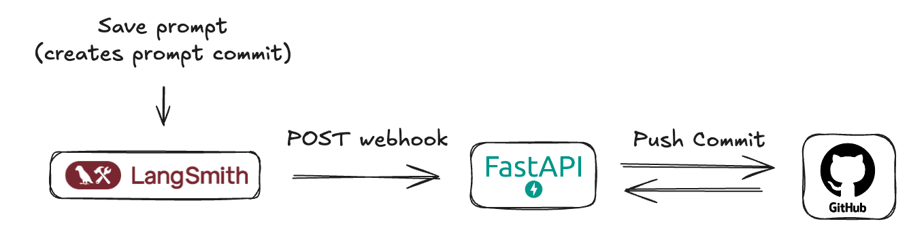
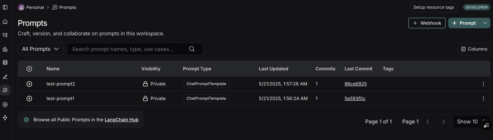
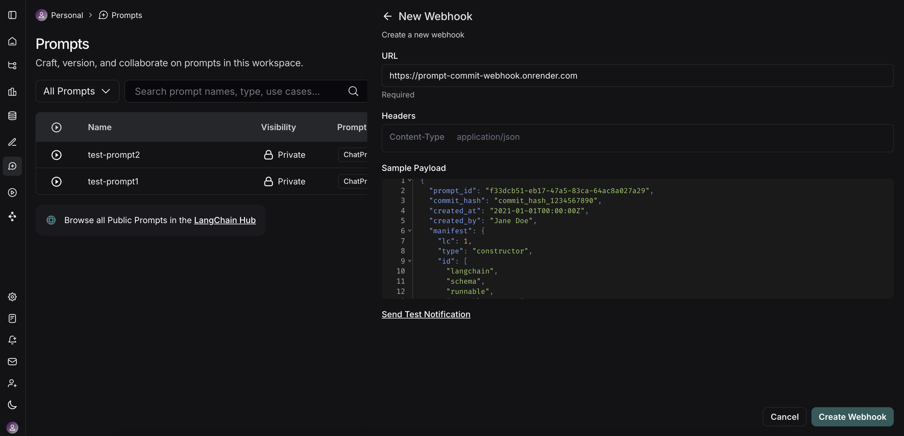
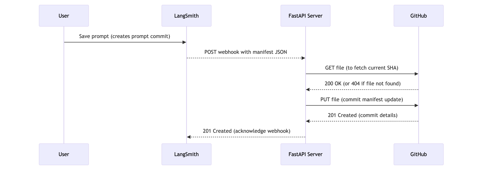
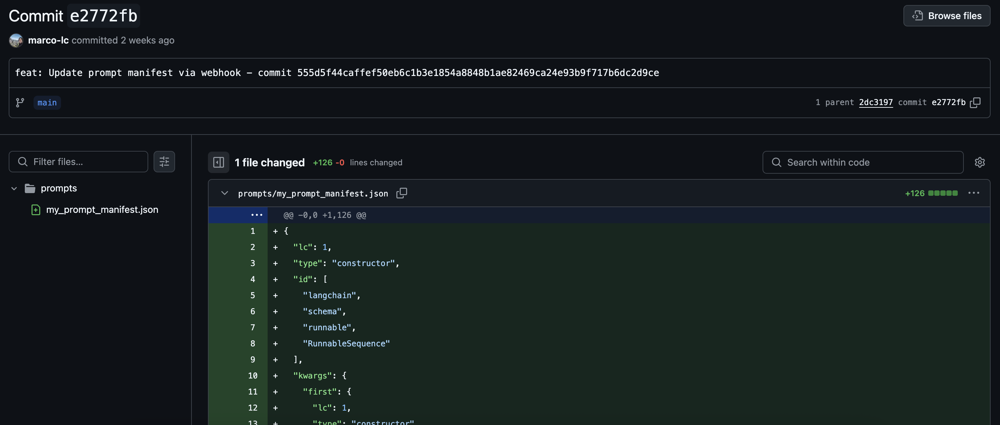

# How to sync prompts with GitHub

LangSmith provides a collaborative interface to create, test, and iterate on prompts.

While you can [dynamically fetch prompts](../Prompts/Create%20and%20manage%20prompts/Manage%20prompts%20programmatically.md#pull-a-prompt) from LangSmith into your application at runtime, you may prefer to sync prompts with your own database or version control system. To support this workflow, LangSmith allows you to receive notifications of prompt updates via webhooks.

**Why sync prompts with GitHub?**

* **Version Control:** Keep your prompts versioned alongside your application code in a familiar system.
* **CI/CD Integration:** Trigger automated staging or production deployments when critical prompts change.



## Prerequisites

Before we begin, ensure you have the following set up:

1. **GitHub Account:** A standard GitHub account.

2. **GitHub Repository:** Create a new (or choose an existing) repository where your LangSmith prompt manifests will be stored. This could be the same repository as your application code or a dedicated one for prompts.

3. **GitHub Personal Access Token (PAT):**

   * LangSmith webhooks don't directly interact with GitHub—they call an intermediary server that *you* create.
   * This server requires a GitHub PAT to authenticate and make commits to your repository.
   * Must include the `repo` scope (`public_repo` is sufficient for public repositories).
   * Go to **GitHub > Settings > Developer settings > Personal access tokens > Tokens (classic)**.
   * Click **Generate new token (classic)**.
   * Name it (e.g., "LangSmith Prompt Sync"), set an expiration, and select the required scopes.
   * Click **Generate token** and **copy it immediately** because it is not shown again.
   * Store the token securely and provide it as an environment variable to your server.

## Understanding LangSmith "Prompt commits" and webhooks

In LangSmith, when you save changes to a prompt, you're essentially creating a new version or a "Prompt Commit." These commits are what can trigger webhooks.

The webhook will send a JSON payload containing the new **prompt manifest**.

> [accordion] Sample Webhook Payload
>
> ```json theme={"theme":{"light":"catppuccin-latte","dark":"catppuccin-mocha"}}
> {
>   "prompt_id": "f33dcb51-eb17-47a5-83ca-64ac8a027a29",
>   "prompt_name": "My Prompt",
>   "commit_hash": "commit_hash_1234567890",
>   "created_at": "2021-01-01T00:00:00Z",
>   "created_by": "Jane Doe",
>   "manifest": {
>     "lc": 1,
>     "type": "constructor",
>     "id": ["langchain", "schema", "runnable", "RunnableSequence"],
>     "kwargs": {
>       "first": {
>         "lc": 1,
>         "type": "constructor",
>         "id": ["langchain", "prompts", "chat", "ChatPromptTemplate"],
>         "kwargs": {
>           "messages": [
>             {
>               "lc": 1,
>               "type": "constructor",
>               "id": [
>                 "langchain_core",
>                 "prompts",
>                 "chat",
>                 "SystemMessagePromptTemplate"
>               ],
>               "kwargs": {
>                 "prompt": {
>                   "lc": 1,
>                   "type": "constructor",
>                   "id": [
>                     "langchain_core",
>                     "prompts",
>                     "prompt",
>                     "PromptTemplate"
>                   ],
>                   "kwargs": {
>                     "input_variables": [],
>                     "template_format": "mustache",
>                     "template": "You are a chatbot."
>                   }
>                 }
>               }
>             },
>             {
>               "lc": 1,
>               "type": "constructor",
>               "id": [
>                 "langchain_core",
>                 "prompts",
>                 "chat",
>                 "HumanMessagePromptTemplate"
>               ],
>               "kwargs": {
>                 "prompt": {
>                   "lc": 1,
>                   "type": "constructor",
>                   "id": [
>                     "langchain_core",
>                     "prompts",
>                     "prompt",
>                     "PromptTemplate"
>                   ],
>                   "kwargs": {
>                     "input_variables": ["question"],
>                     "template_format": "mustache",
>                     "template": "{{question}}"
>                   }
>                 }
>               }
>             }
>           ],
>           "input_variables": ["question"]
>         }
>       },
>       "last": {
>         "lc": 1,
>         "type": "constructor",
>         "id": ["langchain", "schema", "runnable", "RunnableBinding"],
>         "kwargs": {
>           "bound": {
>             "lc": 1,
>             "type": "constructor",
>             "id": ["langchain", "chat_models", "openai", "ChatOpenAI"],
>             "kwargs": {
>               "temperature": 1,
>               "top_p": 1,
>               "presence_penalty": 0,
>               "frequency_penalty": 0,
>               "model": "gpt-5.4-mini",
>               "extra_headers": {},
>               "openai_api_key": {
>                 "id": ["OPENAI_API_KEY"],
>                 "lc": 1,
>                 "type": "secret"
>               }
>             }
>           },
>           "kwargs": {}
>         }
>       }
>     }
>   }
> }
> ```

> [!NOTE]
>
> It's important to understand that LangSmith webhooks for prompt commits are generally triggered at the **workspace level**. This means if *any* prompt within your LangSmith workspace is modified and a "prompt commit" is saved, the webhook will fire and send the updated manifest of the prompt. The payloads are identifiable by prompt id. Your receiving server should be designed with this in mind.

## Implementing a FastAPI server for webhook reception

To effectively process webhook notifications from LangSmith when prompts are updated, an intermediary server application is necessary. This server will act as the receiver for HTTP POST requests sent by LangSmith. For demonstration purposes in this guide, we will outline the creation of a simple FastAPI application to fulfill this role.

This publicly accessible server will be responsible for:

1. **Receiving Webhook Requests:** Listening for incoming HTTP POST requests.
2. **Parsing Payloads:** Extracting and interpreting the JSON-formatted prompt manifest from the request body.
3. **Committing to GitHub:** Programmatically creating a new commit in your specified GitHub repository, containing the updated prompt manifest. This ensures your prompts remain version-controlled and synchronized with changes made in LangSmith.

For deployment, platforms like [Render.com](https://render.com/) (offering a suitable free tier), Vercel, Fly.io, or other cloud providers (AWS, GCP, Azure) can be utilized to host the FastAPI application and obtain a public URL.

The server's core functionality will include an endpoint for webhook reception, logic for parsing the manifest, and integration with the GitHub API (using a Personal Access Token for authentication) to manage commits.

> [accordion] Minimal FastAPI Server Code ()
>
> `main.py`
>
> This server will listen for incoming webhooks from LangSmith and commit the received prompt manifest to your GitHub repository.
>
> ```python theme={"theme":{"light":"catppuccin-latte","dark":"catppuccin-mocha"}}
> import base64
> import json
> from typing import Any, Dict
> import httpx
> from fastapi import FastAPI, HTTPException, Body
> from pydantic import BaseModel, Field
> from pydantic_settings import BaseSettings, SettingsConfigDict
>
> # --- Configuration ---
> class AppConfig(BaseSettings):
>     """
>     Application configuration model.
>     Loads settings from environment variables.
>     """
>     GITHUB_TOKEN: str
>     GITHUB_REPO_OWNER: str
>     GITHUB_REPO_NAME: str
>     GITHUB_FILE_PATH: str = "prompt_manifest.json"
>     GITHUB_BRANCH: str = "main"
>     model_config = SettingsConfigDict(
>         env_file=".env",
>         env_file_encoding='utf-8',
>         extra='ignore'
>     )
>
> settings = AppConfig()
>
> # --- Pydantic Models ---
> class WebhookPayload(BaseModel):
>     """
>     Defines the expected structure of the incoming webhook payload.
>     """
>     prompt_id: UUID = Field(
>         ...,
>         description="The unique identifier for the prompt."
>     )
>     prompt_name: str = Field(
>         ...,
>         description="The name/title of the prompt."
>     )
>     commit_hash: str = Field(
>         ...,
>         description="An identifier for the commit event that triggered the webhook."
>     )
>     created_at: str = Field(
>         ...,
>         description="Timestamp indicating when the event was created (ISO format preferred)."
>     )
>     created_by: str = Field(
>         ...,
>         description="The name of the user who created the event."
>     )
>     manifest: Dict[str, Any] = Field(
>         ...,
>         description="The main content or configuration data to be committed to GitHub."
>     )
>
> # --- GitHub Helper Function ---
> async def commit_manifest_to_github(payload: WebhookPayload) -> Dict[str, Any]:
>     """
>     Helper function to commit the manifest directly to the configured branch.
>     """
>     github_api_base_url = "https://api.github.com"
>     repo_file_url = (
>         f"{github_api_base_url}/repos/{settings.GITHUB_REPO_OWNER}/"
>         f"{settings.GITHUB_REPO_NAME}/contents/{settings.GITHUB_FILE_PATH}"
>     )
>     headers = {
>         "Authorization": f"Bearer {settings.GITHUB_TOKEN}",
>         "Accept": "application/vnd.github.v3+json",
>         "X-GitHub-Api-Version": "2022-11-28",
>     }
>     manifest_json_string = json.dumps(payload.manifest, indent=2)
>     content_base64 = base64.b64encode(manifest_json_string.encode('utf-8')).decode('utf-8')
>     commit_message = f"feat: Update {settings.GITHUB_FILE_PATH} via webhook - commit {payload.commit_hash}"
>     data_to_commit = {
>         "message": commit_message,
>         "content": content_base64,
>         "branch": settings.GITHUB_BRANCH,
>     }
>     async with httpx.AsyncClient() as client:
>         current_file_sha = None
>         try:
>             params_get = {"ref": settings.GITHUB_BRANCH}
>             response_get = await client.get(repo_file_url, headers=headers, params=params_get)
>             if response_get.status_code == 200:
>                 current_file_sha = response_get.json().get("sha")
>             elif response_get.status_code != 404: # If not 404 (not found), it's an unexpected error
>                 response_get.raise_for_status()
>         except httpx.HTTPStatusError as e:
>             error_detail = f"GitHub API error (GET file SHA): {e.response.status_code} - {e.response.text}"
>             print(f"[ERROR] {error_detail}")
>             raise HTTPException(status_code=e.response.status_code, detail=error_detail)
>         except httpx.RequestError as e:
>             error_detail = f"Network error connecting to GitHub (GET file SHA): {str(e)}"
>             print(f"[ERROR] {error_detail}")
>             raise HTTPException(status_code=503, detail=error_detail)
>         if current_file_sha:
>             data_to_commit["sha"] = current_file_sha
>         try:
>             response_put = await client.put(repo_file_url, headers=headers, json=data_to_commit)
>             response_put.raise_for_status()
>             return response_put.json()
>         except httpx.HTTPStatusError as e:
>             error_detail = f"GitHub API error (PUT content): {e.response.status_code} - {e.response.text}"
>             if e.response.status_code == 409: # Conflict
>                 error_detail = (
>                     f"GitHub API conflict (PUT content): {e.response.text}. "
>                     "This might be due to an outdated SHA or branch protection rules."
>                 )
>             elif e.response.status_code == 422: # Unprocessable Entity
>                 error_detail = (
>                     f"GitHub API Unprocessable Entity (PUT content): {e.response.text}. "
>                     f"Ensure the branch '{settings.GITHUB_BRANCH}' exists and the payload is correctly formatted."
>                 )
>             print(f"[ERROR] {error_detail}")
>             raise HTTPException(status_code=e.response.status_code, detail=error_detail)
>         except httpx.RequestError as e:
>             error_detail = f"Network error connecting to GitHub (PUT content): {str(e)}"
>             print(f"[ERROR] {error_detail}")
>             raise HTTPException(status_code=503, detail=error_detail)
>
> # --- FastAPI Application ---
> app = FastAPI(
>     title="Minimal Webhook to GitHub Commit Service",
>     description="Receives a webhook and commits its 'manifest' part directly to a GitHub repository.",
>     version="0.1.0",
> )
>
> @app.post("/webhook/commit", status_code=201, tags=["GitHub Webhooks"])
> async def handle_webhook_direct_commit(payload: WebhookPayload = Body(...)):
>     """
>     Webhook endpoint to receive events and commit DIRECTLY to the configured branch.
>     """
>     try:
>         github_response = await commit_manifest_to_github(payload)
>         return {
>             "message": "Webhook received and manifest committed directly to GitHub successfully.",
>             "github_commit_details": github_response.get("commit", {}),
>             "github_content_details": github_response.get("content", {})
>         }
>     except HTTPException:
>         raise # Re-raise if it's an HTTPException from the helper
>     except Exception as e:
>         error_message = f"An unexpected error occurred: {str(e)}"
>         print(f"[ERROR] {error_message}")
>         raise HTTPException(status_code=500, detail="An internal server error occurred.")
>
> @app.get("/health", status_code=200, tags=["Health"])
> async def health_check():
>     """
>     A simple health check endpoint.
>     """
>     return {"status": "ok", "message": "Service is running."}
>
> # To run this server (save as main.py):
> # 1. Install dependencies: pip install fastapi uvicorn pydantic pydantic-settings httpx python-dotenv
> # 2. Create a .env file with your GitHub token and repo details.
> # 3. Run with Uvicorn: uvicorn main:app --reload
> # 4. Deploy to a public platform like Render.com.
> ```
>
> **Key aspects of this server:**
>
> * **Configuration (`.env`):** It expects a `.env` file with your `GITHUB_TOKEN`, `GITHUB_REPO_OWNER`, and `GITHUB_REPO_NAME`. You can also customize `GITHUB_FILE_PATH` (default: `LangSmith_prompt_manifest.json`) and `GITHUB_BRANCH` (default: `main`).
> * **GitHub Interaction:** The `commit_manifest_to_github` function handles the logic of fetching the current file's SHA (to update it) and then committing the new manifest content.
> * **Webhook Endpoint (`/webhook/commit`):** This is the URL path your LangSmith webhook will target.
> * **Error Handling:** Basic error handling for GitHub API interactions is included.
>
> **Deploy this server to your chosen platform (e.g., Render) and note down its public URL (e.g., `https://<your-render-service>.onrender.com`).**

## Configuring the webhook in LangSmith

Once your FastAPI server is deployed and you have its public URL, you can configure the webhook in LangSmith:

1. Navigate to your LangSmith workspace.

2. Go to the **Prompts** section. Here you'll see a list of your prompts.

   

3. On the top right of the Prompts page, click the **+ Webhook** button.

4. You'll be presented with a form to configure your webhook:

   

   * **Webhook URL:** Enter the full public URL of your deployed FastAPI server's endpoint. For our example server, this would be `https://<your-render-service>.onrender.com/webhook/commit`.
   * **Headers (Optional):**
     * You can add custom headers that LangSmith will send with each webhook request.

5. **Test the Webhook:** LangSmith provides a "Send Test Notification" button. Use this to send a sample payload to your server. Check your server logs (e.g., on Render) to ensure it receives the request and processes it successfully (or to debug any issues).

6. **Save** the webhook configuration.

## The workflow in action



Now, with everything set up, here's what happens:

1. **Prompt Modification:** A user (developer or non-technical team member) modifies a prompt in the LangSmith UI and saves it, creating a new "prompt commit."

2. **Webhook Trigger:** LangSmith detects this new prompt commit and triggers the configured webhook.

3. **HTTP Request:** LangSmith sends an HTTP POST request to the public URL of your FastAPI server (e.g., `https://<your-render-service>.onrender.com/webhook/commit`). The body of this request contains the JSON prompt manifest for the entire workspace.

4. **Server Receives Payload:** Your FastAPI server's endpoint receives the request.

5. **GitHub Commit:** The server parses the JSON manifest from the request body. It then uses the configured GitHub Personal Access Token, repository owner, repository name, file path, and branch to:

   * Check if the manifest file already exists in the repository on the specified branch to get its SHA (this is necessary for updating an existing file).
   * Create a new commit with the latest prompt manifest, either creating the file or updating it if it already exists. The commit message will indicate that it's an update from LangSmith.

6. **Confirmation:** You should see the new commit appear in your GitHub repository.

   

You've now successfully synced your LangSmith prompts with GitHub!

## Beyond a simple commit

Our example FastAPI server performs a direct commit of the entire prompt manifest. However, this is just the starting point. You can extend the server's functionality to perform more sophisticated actions:

* **Granular Commits:** Parse the manifest and commit changes to individual prompt files if you prefer a more granular structure in your repository.
* **Trigger CI/CD:** Instead of (or in addition to) committing, have the server trigger a CI/CD pipeline (e.g., Jenkins, GitHub Actions, GitLab CI) to deploy a staging environment, run tests, or build new application versions.
* **Update Databases/Caches:** If your application loads prompts from a database or cache, update these stores directly.
* **Notifications:** Send notifications to Slack, email, or other communication channels about prompt changes.
* **Selective Processing:** Based on metadata within the LangSmith payload (if available, e.g., which specific prompt changed or by whom), you could apply different logic.
