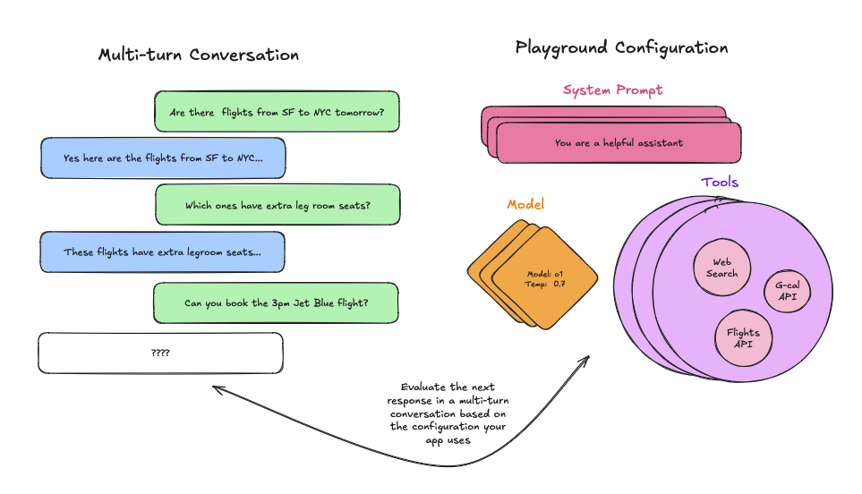
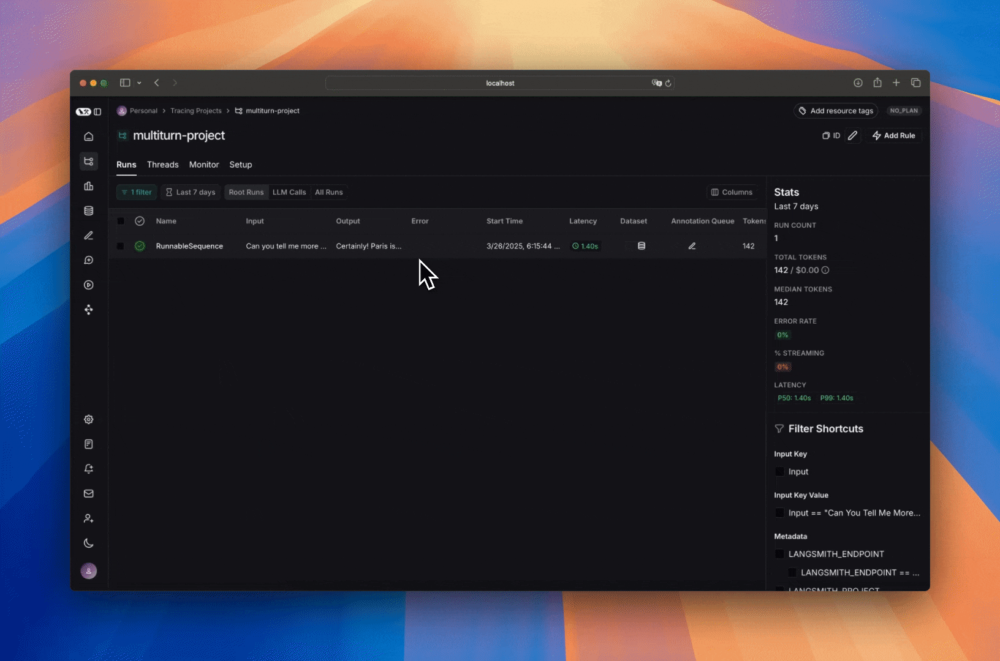
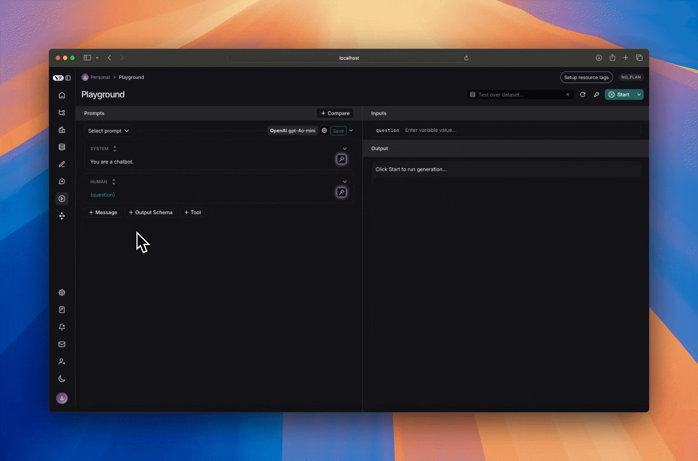

# Test multi-turn conversations

This how-to guide walks you through the various ways you can set up the Playground for multi-turn conversations, which will allow you to test different tool configurations and system prompts against longer threads of messages.

## From an existing run

First, ensure you have properly [traced](../../../Monitor/Overview/LangSmith%20Observability.md) a multi-turn conversation, and then navigate to your tracing project. Once you get to your tracing project simply open the run, select the LLM call, and open it in the Playground as follows:

You can then edit the system prompt, tweak the tools and/or output schema and observe how the output of the multi-turn conversation changes.

## From a dataset

Before starting, make sure you have [set up your dataset](../../../Test/Datasets%20%26%20Experiments/Datasets/Create%20a%20dataset/Create%20and%20manage%20datasets%20in%20the%20UI.md). Since you want to evaluate multi-turn conversations, make sure there is a key in your inputs that contains a list of messages.

Once you have created your dataset, head to the Playground and [load your dataset](../../../Test/Datasets%20%26%20Experiments/Datasets/Create%20a%20dataset/Create%20and%20manage%20datasets%20in%20the%20UI.md#from-the-playground) to evaluate.

Then, add a messages list variable to your prompt, making sure to name it the same as the key in your inputs that contains the list of messages:

When you run your prompt, the messages from each example will be added as a list in place of the 'Messages List' variable.

## Manually

There are two ways to manually create multi-turn conversations. The first way is by simply appending messages to the prompt:

This is helpful for quick iteration, but is rigid since the multi-turn conversation is hardcoded. Instead, if you want your prompt to work with any multi-turn conversation you can add a 'Messages List' variable and add your multi-turn conversation there:

This allows you to just tweak the system prompt or the tools, while allowing any multi-turn conversation to take the place of the `Messages List` variable, allowing you to reuse this prompt across various runs.

## Next steps

Now that you know how to set up the Playground for multi-turn interactions, you can either manually inspect and judge the outputs, or you can [add evaluators](../../../Test/Evaluators/Evaluator%20types/UI/How%20to%20define%20a%20code%20evaluator.md) to classify results.

You can also read [these how-to guides](../Prompts/Create%20and%20manage%20prompts/Create%20a%20prompt.md) to learn more about how to use the Playground to run evaluations.
