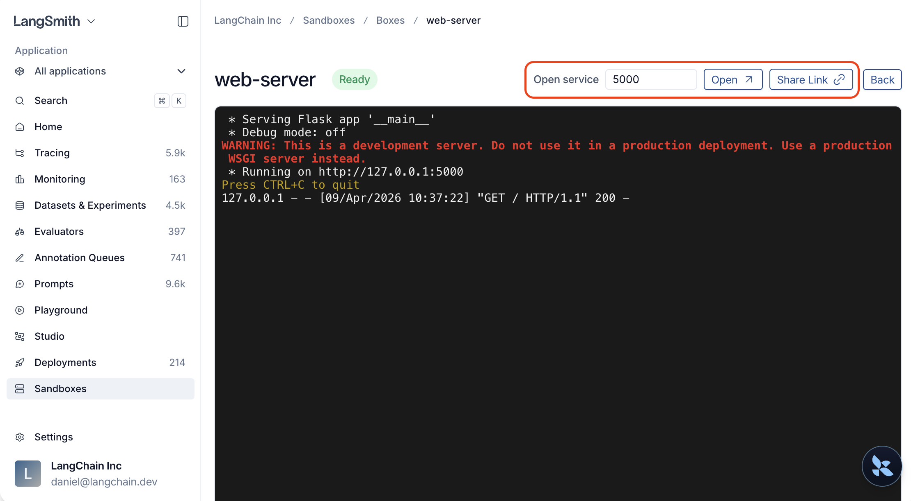

# Sandbox service URLs

> Access HTTP services running inside sandboxes via authenticated URLs, from a browser or programmatically.

Service URLs let you access an HTTP service running inside a sandbox (a REST API, a Streamlit app, a Jupyter notebook, API documentation) without tunnels, port forwarding, or CLI tools. Each sandbox + port combination gets its own URL that you can open in a browser, call from code, or share with a teammate.



## Quick start

Start an HTTP server inside a sandbox, then get a URL to access it:

```python
from langsmith.sandbox import SandboxClient

client = SandboxClient()

with client.sandbox() as sb:
    handle = sb.run("python -m http.server 8000", timeout=0, wait=False)

    svc = sb.service(port=8000)

    # Open in a browser
    print(svc.browser_url)

    # Or make requests programmatically
    resp = svc.get("/")
    print(resp.status_code)

    handle.kill()
```

## Use cases

| Scenario | How |
| - | - |
| Preview a web app (Streamlit, Jupyter, etc.) | `sb.service(port=<PORT>)` then open `browser_url` |
| Call an API from code or CI | `svc.get(...)` / `svc.post(...)` or `curl` with the service token |
| Share a live demo with a teammate | Click **Share Link** in the UI and send the URL |

## Open a service from the UI

1. Open the sandbox detail page.
2. Find the **Open service** widget.
3. Type a port number (e.g. `3000`).
4. Click **Open** to launch in a new tab, or **Share Link** to copy a URL you can send to a teammate.

Anyone with the link can access the service, even without a LangSmith account. After the token expires, generate a new link from the UI.

## Open a service from the SDK

### Get a service URL

Call `service()` on a sandbox instance or on the client directly:

```python
svc = sb.service(port=3000)

# Or from the client, by sandbox name
svc = client.service("my-sandbox", port=3000)

# Customize token lifetime (default: 10 minutes, max: 24 hours)
svc = sb.service(port=3000, expires_in_seconds=3600)
```

> [!NOTE]
>
> The service must be running and listening on the specified port before you request a service URL. The URL only routes traffic and does not start a service for you.

### Make requests

The returned `ServiceURL` object has built-in HTTP helpers that inject the auth header for you.

Tokens are short-lived (default 10 minutes, max 24 hours) and there is no server-side refresh mechanism. When a token expires, request a new one by calling `sb.service(port=...)` again.

```python
svc = sb.service(port=8000)

resp = svc.get("/api/items")
resp = svc.post("/api/items", json={"name": "widget"})
resp = svc.put("/api/items/1", json={"name": "updated"})
resp = svc.patch("/api/items/1", json={"status": "active"})
resp = svc.delete("/api/items/1")
```

### Use your own HTTP client

If you prefer a different HTTP client, use the raw URL and token:

```python
import httpx

svc = sb.service(port=8000)

resp = httpx.get(
    svc.service_url + "api/items",
    headers={"X-Langsmith-Sandbox-Service-Token": svc.token},
)
```

### Open in a browser

Use `browser_url` to open the service in a browser. It sets an authentication cookie automatically, so all subsequent page loads, images, and API calls are authenticated without tokens in the URL.

```python
svc = sb.service(port=8000)
print(svc.browser_url)
```

You can share this URL with teammates. No LangSmith login is required to access it.

### Generate a URL via the REST API

```bash
curl -X POST \
  "$LANGSMITH_ENDPOINT/api/v2/sandboxes/boxes/{sandbox_name}/service-url" \
  -H "x-api-key: $LANGSMITH_API_KEY" \
  -H "Content-Type: application/json" \
  -d '{"port": 3000, "expires_in_seconds": 3600}'
```

Response:

```json
{
  "browser_url": "https://{sandbox-id}--3000.smithbox.dev/_svc/auth?token=ey...",
  "service_url": "https://{sandbox-id}--3000.smithbox.dev/",
  "token": "ey...",
  "expires_at": "2026-04-08T15:30:00Z"
}
```

## Example: serve a FastAPI app

```python
from langsmith.sandbox import SandboxClient

client = SandboxClient()

with client.sandbox() as sb:
    sb.write("/app/main.py", """
from fastapi import FastAPI

app = FastAPI()
items = []

@app.get("/items")
def list_items():
    return items

@app.post("/items")
def create_item(item: dict):
    items.append(item)
    return item
""")

    sb.run("pip install fastapi uvicorn", timeout=120)
    handle = sb.run(
        "uvicorn main:app --host 0.0.0.0 --port 8000",
        timeout=0,
        wait=False,
        env={"PYTHONPATH": "/app"},
    )

    import time
    time.sleep(3)

    svc = sb.service(port=8000)

    svc.post("/items", json={"name": "widget", "price": 9.99})
    svc.post("/items", json={"name": "gadget", "price": 24.99})

    resp = svc.get("/items")
    print(resp.json())
    # [{"name": "widget", "price": 9.99}, {"name": "gadget", "price": 24.99}]

    # Open the auto-generated API docs in a browser
    print(svc.browser_url)

    handle.kill()
```

## Service URLs vs TCP tunnels

| | Service URLs | TCP tunnels |
| - | - | - |
| **Protocol** | HTTP | Any TCP (databases, Redis, SSH, HTTP) |
| **Setup** | Zero—just a URL | Requires SDK or CLI |
| **Access from** | Browser, scripts, CI, anywhere | Local machine only |
| **Sharing** | Copy the URL and send it | Not shareable |
| **Multi-page web apps** | Full support (subdomain routing) | Full support (local port) |
| **Non-HTTP services** | Not supported | Full support |

Use **service URLs** for HTTP services you want to access from a browser or share with others. Use **[TCP tunnels](Sandbox%20SDK%20usage.md#tcp-tunnels-python)** for non-HTTP protocols (like `psql` or `redis-cli`) or when you need local-only access.

To share a single file rather than a running service, use a **[download link](Sandbox%20download%20links.md)**.

## Troubleshoot

| Error | Cause | Fix |
| - | - | - |
| **"Service link has expired"** | Token lifetime exceeded | Open the service again from LangSmith or call `sb.service()` for a fresh URL |
| **"Service is not reachable"** | Nothing is listening on that port | Verify the server is running inside the sandbox |
| **"Authentication required"** | No token in header or cookie | Use `browser_url` for browser access or set the `X-Langsmith-Sandbox-Service-Token` header |
