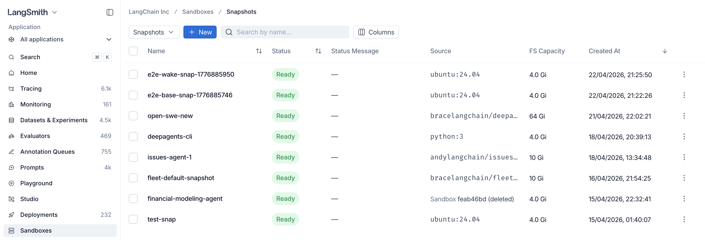

# Sandbox snapshots

> Build and capture reusable filesystem images for sandboxes.

A **snapshot** is a reusable sandbox filesystem. Build a custom snapshot from a container image when you want to boot sandboxes from a custom filesystem image.

You can also capture a snapshot from a running sandbox. Install packages, write data files, or configure state. Then snapshot the result, and reuse it as a new starting point.



## Understand system snapshots

When you create a sandbox without selecting a snapshot, LangSmith uses the built-in `system/default:latest` snapshot. The current default starts from the `ubuntu:26.04` container image and includes the tools listed below. Older self-hosted releases can contain a different Ubuntu version and package set.

### Inspect the default tools

The default filesystem includes the following tools. This list summarizes installed capabilities, not a complete software bill of materials (SBOM).

| Category | Included tools |
| - | - |
| Languages and package managers | Python 3 with pip and venv, uv and uvx, Node.js 24 with npm, pnpm, Yarn, Go, and Ruby. |
| Source control | Git, GitHub CLI (`gh`), and the `gh stack` extension. |
| Build and container tools | `build-essential`, CMake, pkg-config, Docker, Docker Buildx, Docker Compose, and BuildKit. |
| Shell and file utilities | Bash, Zsh, tmux, ttyd, ripgrep, fd, jq, bat, tree, zip, unzip, rsync, and common Linux utilities. |
| Networking and data tools | curl, wget, OpenSSH client and server, DNS and network diagnostics, SQLite, and the PostgreSQL client. |
| Browser automation | Chrome for Testing and `agent-browser`. |
| Document processing | `python-docx`, `python-pptx`, `openpyxl` with `defusedxml`, and `anydoc`. See [Fleet document dependencies](../../No-code%20agents/Fleet/Configure/Computer%20use.md#prepare-a-custom-image-for-fleet). |
| LangSmith tools | LangSmith CLI and the Custom Apps development server. |

Package versions can change between LangSmith releases. For an audit of the exact installed packages and transitive dependencies, inspect the filesystem from your deployed image as described in [Inspect the default snapshot filesystem in self-hosted deployments](#inspect-the-default-snapshot-filesystem-in-self-hosted-deployments).

### Choose a system snapshot

System snapshots are LangSmith-maintained, read-only starting filesystems shared across workspaces. Use `system/default:latest` for general workloads, or [build a custom snapshot](#build-a-snapshot-from-a-container-image) from your own container image. The other system snapshots back specific LangSmith features, which select them automatically. They are listed here so you can audit their contents.

References use the form `system/<name>:<tag>`. Omitting the tag selects `latest`. The `system/` namespace is reserved: you cannot build, capture, retag, or delete snapshots in it. A snapshot captured from a sandbox that uses a system snapshot belongs to your workspace.

| Snapshot reference | Used by | Base and additional contents |
| - | - | - |
| `system/default:latest` | General development and [Fleet computers](../../No-code%20agents/Fleet/Configure/Computer%20use.md) | Ubuntu 26.04 with the [default tools](#inspect-the-default-tools). |
| `system/custom-apps:latest` | [Custom apps](../../Monitor/Observe/Monitoring%20%26%20alerting/Custom%20Apps.md) | The default filesystem plus a prepared app starter and installed dependencies in `/workspace/app`. |
| `system/code-evaluators:latest` | Python and JavaScript [code evaluators](../../Test/Evaluators/Evaluator%20types/UI/How%20to%20define%20a%20code%20evaluator.md) | The default filesystem plus NumPy, pandas, jsonschema, SciPy, scikit-learn, and the LangSmith Python and JavaScript SDKs. |
| `system/prebuilt-voice-evaluator:latest` | Managed [voice metrics evaluation](../../Test/Evaluators/Manage%20evaluators.md#voice-evaluation) | The default filesystem plus NumPy in `/opt/venv`, `ffmpeg`, `ffprobe`, and voice evaluation modules in `/opt/langsmith_eval`. |
| `system/taskset-runner:latest` | Taskset execution | The default filesystem plus Harbor and `smith-harbor` in a Python 3.12 environment at `/opt/smith-harbor/.venv`, with `langgraph-cli` cached for offline use. |

The available catalog depends on your LangSmith version. On self-hosted deployments, it comes from the `sandbox-host` image in your LangSmith release; see the [self-hosted changelog](../../LangSmith%20setup/Self-hosted/Reference/Self-hosted%20LangSmith%20changelog.md).

LangSmith can update the contents behind `latest`; existing sandboxes retain their original snapshot ID. Use a snapshot ID instead of a mutable tag when you need to reuse a specific version.

### Inspect the default snapshot filesystem in self-hosted deployments

In a self-hosted deployment, LangSmith creates the default snapshot from a filesystem embedded in the sandbox runtime container image, `sandbox-host`:

1. During the `sandbox-host` image build, LangSmith starts with `ubuntu:26.04` and installs the default tools.
2. LangSmith packages that filesystem as a compressed 16 GiB ext4 file at `/opt/sandbox-host/bin/builder-base.ext4.gz`.
3. When `sandbox-host` starts, LangSmith registers the embedded filesystems as system snapshots.

Current host images also contain `/opt/sandbox-host/bin/system-snapshots.json`. This manifest records each snapshot's name, tag, payload path, filesystem checksum, capacity, architecture, and run configuration. Named variants have compressed files under `/opt/sandbox-host/bin/system-snapshots/`. To audit a variant, copy the file at its manifest `payload_path` instead of the default payload. Save the copy locally as `builder-base.ext4.gz` to reuse the decompression and extraction commands below.

The compressed ext4 file, rather than a separately pulled container image, is the source of the default snapshot filesystem.

Scanning the `sandbox-host` container image alone does not inspect the files inside this compressed artifact. To verify the default snapshot, extract and scan the embedded filesystem separately.

> [!NOTE]
>
> This procedure verifies the default snapshot filesystem. LangSmith supplies other required runtime components separately when the sandbox starts; they are not part of the snapshot.

To independently inspect the default snapshot, use the exact `sandbox-host` container image configured by your Helm release. If you mirror images, use the reference in `images.sandboxHostImage` from your private registry.

You need:

* Access to the deployed `sandbox-host` image.
* Docker, `gzip`, GNU `dd`, and `debugfs` from the `e2fsprogs` package on a Linux system.
* A local filesystem that supports sparse files, plus enough space for the compressed artifact and the extracted files. The ext4 image has a 16 GiB logical size, but sparse decompression avoids allocating its zero-filled free space.

Extract the files into a temporary directory and scan the resulting directory with your preferred filesystem or software bill of materials (SBOM) scanner.

Set the exact image reference used by your deployment and create a temporary working directory:

```bash
export SANDBOX_HOST_IMAGE="<sandbox-host-image-reference>"
export SNAPSHOT_WORKDIR="$(mktemp -d)"

docker pull "$SANDBOX_HOST_IMAGE"
```

Extract the compressed ext4 file without starting the `sandbox-host` process:

```bash
SANDBOX_HOST_CONTAINER="$(docker create "$SANDBOX_HOST_IMAGE")"
docker cp \
  "${SANDBOX_HOST_CONTAINER}:/opt/sandbox-host/bin/builder-base.ext4.gz" \
  "$SNAPSHOT_WORKDIR/"
docker rm "$SANDBOX_HOST_CONTAINER"
```

Decompress the filesystem as a sparse file:

```bash
gzip -dc "$SNAPSHOT_WORKDIR/builder-base.ext4.gz" | \
  dd of="$SNAPSHOT_WORKDIR/builder-base.ext4" \
    bs=1M conv=sparse status=progress
```

Extract the ext4 contents with `debugfs`. `debugfs` opens the filesystem read-only unless you pass `-w`:

```bash
mkdir -p "$SNAPSHOT_WORKDIR/rootfs"
debugfs \
  -R "rdump / $SNAPSHOT_WORKDIR/rootfs" \
  "$SNAPSHOT_WORKDIR/builder-base.ext4"
```

Point your filesystem or SBOM scanner at `$SNAPSHOT_WORKDIR/rootfs`. The scanner reads the package databases and files from the same root filesystem that LangSmith uses for the default snapshot.

## Build a snapshot from a container image

Build a snapshot by pointing at any container image. The call blocks until the snapshot is ready (default timeout is 60 seconds; bump it for large images).

```python Python
from langsmith.sandbox import SandboxClient

client = SandboxClient()

snapshot = client.create_snapshot(
    "python",
    docker_image="python:3.12-slim",
    fs_capacity_bytes=1 * 1024**3,  # 1 GiB
)

print(snapshot.id)
```

```ts TypeScript
import { SandboxClient } from "langsmith/sandbox";

const client = new SandboxClient();

const snapshot = await client.createSnapshot(
  "python",
  "python:3.12-slim",
  1_073_741_824, // 1 GiB
);

console.log(snapshot.id);
```

### Verify a snapshot built from a container image

LangSmith builds a custom snapshot from the filesystem in the container image you provide. To independently verify those contents:

1. Resolve the source container image to an immutable reference, such as `registry.example.com/example/image@sha256:<digest>`.
2. Inspect and scan that exact image.
3. Use the same digest-qualified reference as `docker_image` when you create the snapshot.

LangSmith supplies its required runtime tools separately when the sandbox starts. They are not added to the container image you provide or included in the custom snapshot.

### Private registries

To pull from a private registry, create a registry once with its credentials, then reference it by ID when building a snapshot. Registries persist, so reuse one across snapshots.

#### Find repositories and tags

In the LangSmith UI, the **Container Image URI** field suggests repositories and tags from Docker Hub or the selected private registry. Search behavior depends on the registry provider and authentication method:

| Source | Repository discovery | Tag discovery |
| - | - | - |
| Docker Hub, without a saved registry | Searches Docker Official Images for a bare image name or a specified Docker Hub namespace | Searches tags after you select or enter a repository |
| Docker Registry | Searches the registry catalog when the registry supports it | Searches tags after you select or enter a repository |
| Harbor | Searches the accessible catalog | Searches tags after you select or enter a repository |
| GitHub Container Registry (GHCR) | Searches within a specified GitHub owner | Searches tags after you select or enter a repository |
| Google Artifact Registry (GAR) | Searches repositories within a project and location, then searches packages within the selected repository | Searches tags after you select or enter an image repository |
| Amazon Elastic Container Registry (ECR), with username and password | Requires you to enter a complete repository | Searches tags after you enter a repository |
| Amazon ECR, with an AWS IAM role | Searches repositories across the configured AWS account | Searches tags after you select or enter a repository |

Repository and tag discovery is advisory and bounded. You can always enter a known repository, tag, or digest manually, including when a provider does not support search or returns no matches. Use a digest-qualified image URI when you need an immutable snapshot source.

#### Authenticate with username and password

Username and password authentication works with all supported private registry providers. For ECR, the password is an ECR authorization token and expires after 12 hours. Update the saved registry credentials when the token expires.

```python Python
import os

registry = client.registries.create(
    name="internal",
    url="registry.example.com",
    username="me",
    password=os.environ["REGISTRY_PASSWORD"],
)

snapshot = client.create_snapshot(
    "internal-python",
    docker_image="registry.example.com/internal/python:3.12",
    fs_capacity_bytes=2 * 1024**3,
    registry_id=registry.id,
    timeout=600,
)
```

```ts TypeScript
const registry = await client.registries.create({
  name: "internal",
  url: "registry.example.com",
  username: "me",
  password: process.env.REGISTRY_PASSWORD,
});

const snapshot = await client.createSnapshot(
  "internal-python",
  "registry.example.com/internal/python:3.12",
  2_147_483_648,
  {
    registryId: registry.id,
    timeout: 600,
  },
);
```

List, inspect, update, and delete registries with `client.registries.list()`, `client.registries.retrieve(name)`, `client.registries.update(name, ...)`, and `client.registries.delete(name)`.

#### Authenticate to ECR with an AWS IAM role

AWS IAM role authentication avoids storing an expiring ECR authorization token in LangSmith. It supports private ECR registries in the commercial AWS partition. Public ECR, AWS GovCloud, AWS China, and custom ECR-compatible domains continue to use username and password authentication.

> [!NOTE]
>
> The **AWS IAM role** authentication method appears only when your LangSmith deployment supports it. If the option is unavailable, use username and password authentication.

> [!NOTE]
>
> **BYOC deployments:** AWS IAM role authentication works on [BYOC](../../LangSmith%20setup/BYOC/Bring%20Your%20Own%20Cloud%20%28BYOC%29.md) AWS data planes with no extra setup. Follow the steps below. If your data plane uses [bring your own IAM](../../LangSmith%20setup/BYOC/AWS/Bring%20your%20own%20IAM%20roles%20%28AWS%29.md), apply the latest version of the [`byoiam` Terraform module](https://github.com/langchain-ai/terraform/tree/main/modules/byoc/aws/byoiam) first. It grants the workload role permission to assume your ECR role.

To register an ECR role:

1. In LangSmith, open **Sandboxes > Registries**, select **Register Private Registry**, and enter your registry URL in the form `<aws-account-id>.dkr.ecr.<aws-region>.amazonaws.com`.
2. Select **AWS IAM role** under **Authentication method**. Copy the AWS principal ARN and workspace ID that LangSmith displays. LangSmith uses the workspace ID as `sts:ExternalId`.
3. In AWS, create an IAM role or update an existing role with a trust policy that uses the exact values shown in LangSmith:

```json
{
  "Version": "2012-10-17",
  "Statement": [
    {
      "Effect": "Allow",
      "Principal": {
        "AWS": "<principal-arn-shown-in-langsmith>"
      },
      "Action": "sts:AssumeRole",
      "Condition": {
        "StringEquals": {
          "sts:ExternalId": "<workspace-id-shown-in-langsmith>"
        }
      }
    }
  ]
}
```

> [!NOTE]
>
> **BYOC deployments:** BYOC data planes pass session tags when they assume the role, so the trust policy must also allow `sts:TagSession`. Add it as a separate statement without the `sts:ExternalId` condition. Otherwise AWS denies the role assumption:
>
> ```json theme={"theme":{"light":"catppuccin-latte","dark":"catppuccin-mocha"}}
> {
>   "Effect": "Allow",
>   "Principal": {
>     "AWS": "<principal-arn-shown-in-langsmith>"
>   },
>   "Action": "sts:TagSession"
> }
> ```

4. Give the role permission to discover and pull the required ECR images. The following policy grants access to every repository in one AWS account and region. Replace the placeholders, or narrow the repository resource to the repositories LangSmith can use:

```json
{
  "Version": "2012-10-17",
  "Statement": [
    {
      "Sid": "GetAuthorizationToken",
      "Effect": "Allow",
      "Action": "ecr:GetAuthorizationToken",
      "Resource": "*"
    },
    {
      "Sid": "DiscoverAndPullImages",
      "Effect": "Allow",
      "Action": [
        "ecr:DescribeRepositories",
        "ecr:ListImages",
        "ecr:BatchCheckLayerAvailability",
        "ecr:BatchGetImage",
        "ecr:GetDownloadUrlForLayer"
      ],
      "Resource": "arn:aws:ecr:<aws-region>:<aws-account-id>:repository/*"
    }
  ]
}
```

5. For hosted LangSmith and BYOC, add the `LangSmithSandboxECR=true` tag to the IAM role.
6. Return to LangSmith, enter the role ARN in **AWS role ARN**, then register the private registry.

LangSmith assumes the role separately for repository discovery, tag discovery, and each snapshot build attempt. It obtains a fresh ECR authorization token for delayed jobs and retries, and does not persist temporary AWS credentials or generated ECR tokens.

For self-hosted deployments, administrators must set `SANDBOX_ECR_AWS_ROLE_PRINCIPAL_ARN` and provide the platform backend and snapshot workers with a compatible AWS SDK credential source. Leaving the setting unset hides AWS IAM role authentication and preserves username and password authentication.

## Build a snapshot from a Dockerfile

When you have a local `Dockerfile` but don't want to publish the image to a registry first, build a snapshot directly from the `Dockerfile` and its build context. LangSmith spins up a temporary builder sandbox, uploads the context, runs the build inside it with [BuildKit](https://docs.docker.com/build/buildkit/), and captures the resulting image as a snapshot. The builder sandbox is torn down automatically once the build finishes.

The call blocks until the snapshot is ready (default timeout is 60 seconds; raise it for large or slow builds). `fs_capacity_bytes` must be large enough to hold the build context, the intermediate layers, and the final image.

```python Python
from langsmith.sandbox import SandboxClient

client = SandboxClient()

snapshot = client.create_snapshot_from_dockerfile(
    "my-app",
    dockerfile="Dockerfile",
    fs_capacity_bytes=2 * 1024**3,  # 2 GiB
    context=".",  # build context directory (default: current directory)
)

print(snapshot.id)
```

```ts TypeScript
import { SandboxClient } from "langsmith/sandbox";

const client = new SandboxClient();

const snapshot = await client.createSnapshotFromDockerfile(
  "my-app",
  "Dockerfile",
  2_147_483_648, // 2 GiB
  { context: "." },
);

console.log(snapshot.id);
```

> [!NOTE]
>
> `dockerfile` is resolved relative to `context` unless you pass an absolute path, and it must live inside the context directory. The `.git` directory is excluded from the uploaded context automatically.

### Build args and target stage

Pass `build_args` / `buildArgs` to set Docker `ARG` values, and `target` to stop at a specific stage of a multi-stage build.

```python Python
snapshot = client.create_snapshot_from_dockerfile(
    "my-app",
    dockerfile="Dockerfile",
    fs_capacity_bytes=2 * 1024**3,
    build_args={"PYTHON_VERSION": "3.12", "ENV": "prod"},
    target="runtime",
)
```

```ts TypeScript
const snapshot = await client.createSnapshotFromDockerfile(
  "my-app",
  "Dockerfile",
  2_147_483_648,
  {
    buildArgs: { PYTHON_VERSION: "3.12", ENV: "prod" },
    target: "runtime",
  },
);
```

### Stream build logs

Pass a callback to `on_build_log` / `onBuildLog` to receive the build's stdout and stderr as it runs, which is useful for surfacing progress or debugging a failing build.

```python Python
snapshot = client.create_snapshot_from_dockerfile(
    "my-app",
    dockerfile="Dockerfile",
    fs_capacity_bytes=2 * 1024**3,
    on_build_log=lambda line: print(line, end=""),
)
```

```ts TypeScript
const snapshot = await client.createSnapshotFromDockerfile(
  "my-app",
  "Dockerfile",
  2_147_483_648,
  { onBuildLog: (line) => process.stdout.write(line) },
);
```

### Speed up cold builds

`vcpus` / `vCpus` and `mem_bytes` / `memBytes` size the temporary builder sandbox. The build runs BuildKit plus the native snapshotter's layer copies inside it, which contend for the builder's default 0.5 vCPU, so giving the builder more CPU can cut a cold build's wall time substantially. Memory is tied to CPU at 4 GiB per vCPU and must stay within 50% of that target, so a 2-vCPU builder accepts 4 to 12 GiB. Omit memory and it follows the ratio.

```python Python
snapshot = client.create_snapshot_from_dockerfile(
    "my-app",
    dockerfile="Dockerfile",
    fs_capacity_bytes=2 * 1024**3,
    vcpus=2,
    mem_bytes=8 * 1024**3,  # 8 GiB
    timeout=600,
)
```

```ts TypeScript
const snapshot = await client.createSnapshotFromDockerfile(
  "my-app",
  "Dockerfile",
  2_147_483_648,
  {
    vCpus: 2,
    memBytes: 8_589_934_592, // 8 GiB
    timeout: 600,
  },
);
```

> [!TIP]
>
> Both the sync `SandboxClient` and the `AsyncSandboxClient` expose this method with the same arguments—`await client.create_snapshot_from_dockerfile(...)` on the async client.

## Capture a snapshot from a running sandbox

Start a sandbox from an existing snapshot, install packages or prepare data, then capture the result as a new snapshot. The returned snapshot has its `source_sandbox_id` set to the sandbox it was captured from, and can be used as the `snapshot_id` for any later `create_sandbox` call.

```python Python
sb = client.create_sandbox(snapshot_id=base_snapshot_id, name="setup-box")
sb.run("pip install numpy pandas scikit-learn", timeout=180)
sb.write("/opt/config.yaml", "model: gpt-5\n")

# Capture the current filesystem as a new snapshot
snapshot = sb.capture_snapshot("ml-ready")
print(snapshot.id, snapshot.source_sandbox_id)

sb.delete()

# Boot fresh sandboxes pre-loaded with those dependencies
with client.sandbox(snapshot_id=snapshot.id) as sb:
    sb.run("python -c 'import numpy; print(numpy.__version__)'")
    assert sb.read("/opt/config.yaml") == b"model: gpt-5\n"
```

```ts TypeScript
const running = await client.createSandbox(baseSnapshotId, { name: "setup-box" });
await running.run("pip install numpy pandas scikit-learn", { timeout: 180 });
await running.write("/opt/config.yaml", "model: gpt-5\n");

const snapshot = await running.captureSnapshot("ml-ready");
console.log(snapshot.id, snapshot.source_sandbox_id);

await running.delete();

const sandbox = await client.createSandbox(snapshot.id);
try {
  await sandbox.run("python -c 'import numpy; print(numpy.__version__)'");
  const cfg = await sandbox.read("/opt/config.yaml");
  console.log(new TextDecoder().decode(cfg));
} finally {
  await sandbox.delete();
}
```

> [!NOTE]
>
> By default, capture preserves the **filesystem only**. Installed packages (under `/usr/local`, `/root`, `/opt`, the home directory, etc.) and files you wrote to those locations are kept, as is `/tmp`. Only `/dev/shm` is a tmpfs, so everything else lives on the sandbox's disk. Running processes, open sockets, and in-memory state are **not** carried over: boot the new sandbox and start the processes you need again, or [capture memory too](#resume-from-memory).

> [!TIP]
>
> You can boot a sandbox from a snapshot by **name** instead of ID — handy when you know the human-readable label you captured with:
>
> ```python Python theme={"theme":{"light":"catppuccin-latte","dark":"catppuccin-mocha"}}
> sb = client.create_sandbox(snapshot_name="ml-ready")
> ```
>
> ```ts TypeScript theme={"theme":{"light":"catppuccin-latte","dark":"catppuccin-mocha"}}
> const sb = await client.createSandbox({ snapshotName: "ml-ready" });
> ```
>
> Pass at most one of `snapshot_id` / `snapshot_name` (or `snapshotId` / `snapshotName` in TypeScript). Omit both to use `system/default:latest`.

### Tune capture timing

`capture_snapshot` blocks until the new snapshot is ready. Raise the `timeout` kwarg (default 60s) if your filesystem is large or your storage backend is slow.

```python Python
snapshot = sb.capture_snapshot("ml-ready-v2", timeout=600)
```

```ts TypeScript
const snapshot = await sb.captureSnapshot("ml-ready-v2", { timeout: 600 });
```

### Resume from memory

A snapshot can carry the sandbox's RAM alongside its filesystem. Boot from one and the sandbox resumes where it left off, with its processes still running, instead of cold-booting. Use this for environments that are slow to warm up, such as a loaded model or a started database.

> [!NOTE]
>
> Memory snapshots are available over the REST API only. The `langsmith.sandbox` Python and TypeScript clients do not expose these fields yet.

Capture memory by setting `include_memory` on a capture:

```bash
curl -X POST \
  "$LANGSMITH_ENDPOINT/api/v2/sandboxes/boxes/my-vm/snapshot" \
  -H "x-api-key: $LANGSMITH_API_KEY" \
  -H "Content-Type: application/json" \
  -d '{"name": "warm-model", "include_memory": true}'
```

The response reports `memory_snapshot_size_bytes` when memory was captured. `include_memory` requires a sandbox that is running or stopped, and it cannot be combined with `checkpoint` or `docker_image`.

Some sandboxes run on an overlay filesystem runtime that cannot carry a memory image. Capturing one returns `include_memory is not supported for overlay-rootfs sandboxes`. LangSmith assigns that runtime, so it is not something you select per sandbox.

Two fields on create control the other half:

| Field | What it does |
| - | - |
| `restore_memory` | Omit it to resume from memory when the snapshot has it and cold-boot when it does not. `true` requires memory and fails the request if the snapshot has none. `false` always cold-boots. |
| `preserve_memory_on_stop` | `true` suspends RAM on a voluntary stop (idle timeout or explicit stop) so the sandbox resumes where it left off when it next wakes, rather than cold-booting. Defaults to `false`, which keeps only the filesystem. Restarts triggered by infrastructure maintenance preserve memory either way. |

```bash
curl -X POST "$LANGSMITH_ENDPOINT/api/v2/sandboxes/boxes" \
  -H "x-api-key: $LANGSMITH_API_KEY" \
  -H "Content-Type: application/json" \
  -d '{
    "name": "warm-vm",
    "snapshot": "warm-model",
    "restore_memory": true,
    "preserve_memory_on_stop": true
  }'
```

Capturing memory from a **stopped** sandbox only works when that sandbox was created with `preserve_memory_on_stop`. Without it, the stop discards RAM and there is nothing to capture.

## List, fetch, and delete snapshots

```python Python
# List all snapshots in the workspace
snapshots = client.list_snapshots()
for s in snapshots:
    print(s.id, s.name, s.status)

# Fetch a single snapshot by ID
snapshot = client.get_snapshot("550e8400-e29b-41d4-a716-446655440000")

# Delete a snapshot (fails if any sandbox still references it)
client.delete_snapshot(snapshot.id)
```

```ts TypeScript
const snapshots = await client.listSnapshots();
for (const s of snapshots) {
  console.log(s.id, s.name, s.status);
}

const snapshot = await client.getSnapshot("550e8400-e29b-41d4-a716-446655440000");

await client.deleteSnapshot(snapshot.id);
```

> [!NOTE]
>
> `list_snapshots` / `listSnapshots` paginates server-side (default page size 50, max 500) and accepts optional filters: `name_contains` / `nameContains` (case-insensitive substring on name), `limit` (1–500), and `offset` (≥ 0). Page through results by advancing `offset`.
>
> ```python Python theme={"theme":{"light":"catppuccin-latte","dark":"catppuccin-mocha"}}
> page = client.list_snapshots(name_contains="ml", limit=100)
> ```
>
> ```ts TypeScript theme={"theme":{"light":"catppuccin-latte","dark":"catppuccin-mocha"}}
> const page = await client.listSnapshots({ nameContains: "ml", limit: 100 });
> ```

## Stopped sandboxes

A stopped sandbox keeps its filesystem, and the next request wakes it automatically. You do not need to start it yourself: send the command you wanted to run and the sandbox comes back up to serve it.

```python Python
sb = client.create_sandbox(snapshot_id=snapshot.id, name="my-vm")
sb.run("echo 'hello' > /tmp/state.txt")

# Stop early to release resources. The idle timeout does this for you.
sb.stop()

# No start call: this wakes the sandbox and runs once it is up.
result = sb.run("cat /tmp/state.txt")
assert result.stdout.strip() == "hello"
```

```ts TypeScript
const sb = await client.createSandbox(snapshot.id, { name: "my-vm" });
await sb.run("echo 'hello' > /tmp/state.txt");

await sb.stop();

const result = await sb.run("cat /tmp/state.txt");
console.log(result.stdout.trim()); // "hello"
```

The first request after a stop pays the boot cost, so it is slower than the ones that follow. Create the sandbox with `preserve_memory_on_stop` to [resume from memory](#resume-from-memory) instead of cold-booting.

## Next steps

* [Create sandboxes from snapshots with the SDK](Sandbox%20SDK%20usage.md)
* [Expose HTTP services with Service URLs](Sandbox%20service%20URLs.md)
* [Inject credentials via the Auth proxy](Sandbox%20auth%20proxy.md)
