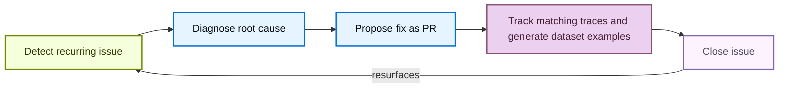

# LangSmith Engine

> LangSmith Engine is the agent for agent engineering, turning production traces into tracked issues, fixes, and datasets across the development lifecycle.

LangSmith Engine is the LangSmith agent for agent engineering. Working from your production traces, it surfaces recurring issues, diagnoses their root cause, and proposes fixes, so you can ship more reliable agents without searching through traces by hand. To start, [set up Engine](Set%20up%20LangSmith%20Engine.md) for a tracing project.

## Engine across the lifecycle

For each issue, Engine surfaces the contributing traces, proposes a fix, keeps the issue current by attaching new traces that match the same failure pattern, and creates ground truth dataset examples from the production trace inputs.

> [card] [Build: Open a pull request](Find%20and%20fix%20your%20agent%27s%20issues%20with%20LangSmith%20Engine.md#open-a-pull-request)
>
> Apply the proposed fix by opening a pull request in your connected repository. Engine can propose code changes to agents built with Deep Agents, LangChain, and LangGraph.

> [card] [Test: Generate datasets](Find%20and%20fix%20your%20agent%27s%20issues%20with%20LangSmith%20Engine.md#add-offline-examples)
>
> Create ground truth dataset examples from production traces for offline evaluation, so you can verify a fix before it ships.

> [card] [Monitor: Track recurring issues](Find%20and%20fix%20your%20agent%27s%20issues%20with%20LangSmith%20Engine.md#filter-and-sort-issues)
>
> Scan your tracing projects on a schedule to surface, prioritize, and diagnose recurring issues, and add new matching traces to each issue as they appear.

## How Engine differs from Insights

Engine and [Insights](../Monitor/Observe/Monitoring%20%26%20alerting/Discover%20errors%20and%20usage%20patterns%20with%20Insights.md) both analyze your traces, but they answer different questions:

* **Insights** is an analytics tool. It groups traces into categories, which it generates automatically or which you define, and reports metrics for each category so you can see usage patterns and how they shift.
* **Engine** looks for concrete problems to fix. Each issue it opens comes with a diagnosis, the traces that support it, and a proposed fix.

Use Insights to understand how people use your agent. Use Engine to find out what is going wrong and what to change.

## How Engine works

Engine scans each connected tracing project on a dynamic schedule tuned to balance cost and performance, and clusters and prioritizes the issues it finds by severity.

### The issue lifecycle

Each issue moves through a closed loop in which Engine:

1. Detects a recurring issue in your traces.
2. Diagnoses the root cause against your traces and connected source code.
3. Proposes a fix as a pull request.
4. Tracks the issue over time, automatically adding new traces that match the same pattern, and generates ground truth [dataset examples](../Test/Datasets%20%26%20Experiments/Datasets/Manage%20datasets.md) so you can verify a fix. See [Find and fix issues](Find%20and%20fix%20your%20agent%27s%20issues%20with%20LangSmith%20Engine.md).
5. Reopens the issue automatically if it resurfaces after being closed.

### How Engine selects traces

Engine draws on several signals to decide which traces to review. It looks for traces that raise errors, traces that behave unusually, and problems in traces that look normal, such as a wrong answer that raises no error. It also uses other curated signals.

Trace feedback is another signal Engine uses. It includes scores from online evaluators and annotation queues, ratings from your users, and traces you [flag for Engine](Find%20and%20fix%20your%20agent%27s%20issues%20with%20LangSmith%20Engine.md#flag-a-trace-for-engine). Feedback added after a trace ran still counts, such as a score a reviewer leaves in an annotation queue a week later.

Engine uses trace feedback from any source automatically, so you do not need to set anything up.

When trace feedback leads Engine to an issue, the issue lists the feedback Engine used, so you can see which scores or ratings surfaced the problem. For more information, see [Review evidence](Find%20and%20fix%20your%20agent%27s%20issues%20with%20LangSmith%20Engine.md#review-evidence).

### How Engine learns from your actions on issues

Engine gets more accurate as you work through issues. On each scheduled scan, it reviews the actions you took on issues since the last scan and turns each one into a general rule in the **User Preferences** section of the project's [agent overview](Set%20up%20LangSmith%20Engine.md#give-context-on-your-agent). Later scans use those rules to decide what to flag and how to prioritize it.

Engine learns from these actions, including any reason you give with them:

* **Closing an issue** or marking it **Incorrectly Flagged**: Engine treats that kind of issue as lower priority.
* **Changing an issue's priority**: Engine records how severe that category of issue is for your agent.
* **Opening a pull request**: Engine records that the category is real and worth a proposed fix.

For example, suppose your agent processes payments, and Engine flags a trace that contains a full credit card number as unredacted personally identifiable information (PII). Your agent handles card numbers by design, so you mark the issue **Incorrectly Flagged** with the reason "This agent processes card numbers as part of checkout." Engine records that card numbers in the payment flow are expected. If you keep dismissing issues in the same category, Engine lowers that category's severity one level at a time. It does not go below low, so the pattern stays visible without crowding out urgent issues.

Engine does not learn from changes that come from automation, such as a pull request merging, or from actions taken through [LangSmith Chat](../Test/Datasets%20%26%20Experiments/Analyze%20experiment%20results/LangSmith%20Chat.md#engine). To review or correct what Engine has learned, edit the **User Preferences** section of the agent overview.

## Why connect a repository

Connecting a GitHub repository or GitLab project is optional, but Engine finds more issues, and more useful ones, when it can read your source code. With source access, Engine locates the code path behind a failing trace and grounds its diagnosis and proposed fix in your actual implementation. That holds even if you never merge an Engine pull request: you can apply the fix yourself or copy the fix context into your coding assistant.

Engine's GitHub access is fixed. Through the GitHub App, Engine can:

* **Read** the repositories you select when you install the app.
* **Open pull requests** from fix branches it creates.

On GitLab, Engine acts as the account whose access token a workspace admin connects, usually a dedicated service account. Engine reads the projects that account belongs to, pushes fix branches, and opens merge requests, within the permissions of the account's role.

Engine never merges a pull or merge request. Every change it proposes goes through your review and branch protection rules. You can revoke access at any time by uninstalling the GitHub App or disconnecting GitLab. For token lifetimes, sandboxing, and retention, see the [GitHub](LangSmith%20Engine%20security.md#github-integration) and [GitLab](LangSmith%20Engine%20security.md#gitlab-integration) sections of Engine security. To connect a repository, see [Connect Engine to your repository](Connect%20Engine%20to%20your%20repository.md).

## Manage Engine costs

### Understand LSU costs

> [!NOTE]
>
> LangSmith Cloud uses LangChain-managed inference. Self-hosted deployments can also use [their own model providers](Self-hosted%20and%20BYOC/Configure%20model%20providers%20for%20Engine%20on%20self-hosted%20and%20BYOC.md), with API keys or cloud identity. [BYOC](Self-hosted%20and%20BYOC/LangSmith%20Engine%20on%20Self-hosted%20and%20BYOC.md#engine-on-byoc) deployments use only their own model providers. With your own providers, you pay them for model calls and LangChain charges a lower LSU rate for Engine usage.

Engine charges in **LangChain Standard Units (LSUs)**, a normalized unit of work covering compute, storage, and memory, plus model inference when LangChain provides it. LSU consumption scales with the number of traces analyzed, the number and complexity of the LLM calls Engine makes to diagnose and fix issues, and the size of any connected repository. LSUs cost **\$1 USD each**. For an estimate of your expected LSU usage, see the [LangSmith Usage Calculator](https://www.langchain.com/pricing#pricing-calc).

On initialization, Engine audits past traces, clusters and prioritizes issues by severity, and proposes fixes to your prompts or code (if a repository is connected). Recurring scans run on a dynamic schedule tuned to balance cost and performance, whether or not new issues are found, and surface new issues not previously detected.

### Set the analysis level

The analysis level controls how many of your project's traces Engine analyzes, and so how many LSUs it uses. Choose it when you [turn on Engine for a project](Set%20up%20LangSmith%20Engine.md#turn-on-engine-for-a-tracing-project), and change it later under **Analysis level** in the [**Engine settings**](Set%20up%20LangSmith%20Engine.md#configure-engine) panel:

* **Reduced**: Monitors fewer traces at a lower cost.
* **Standard** (default): Analyzes more of your eligible traces for fuller coverage.
* **Expanded**: Maximum coverage for high-volume projects. Available only for projects with enough tracing volume.

The setup dialog shows an estimated monthly cost range that updates with the level you choose.

### Set spend limits and monitor usage

Organization Admins can set spend limits at two levels:

* **Org-wide limit**: Open **Settings** and select **Engine** under **Engine**. On the month-to-date spend card, click the limit chip and set a limit in the popover.
* **Project or environment limit**: Open the **Engine** tab in a tracing project or agent environment and click the **Configure Engine**  icon. Under **Spend limit**, click the limit chip (the chip reads **None** when no limit is set) and set a limit in the popover.

You can enter limits in LSU or USD. When a limit is reached, LangSmith pauses new Engine runs until the limit is raised or the next monthly billing period begins.

The two levels default differently:

* **Org-wide limit**: Choose **Default**, **No limit**, or a custom cap. Until an admin chooses, the default applies (750 LSU per month, \$750), so Engine spend is capped even though no one has set a limit. The **Engine** settings page names the enforced limit and its source.
* **Project or environment limit**: Leave the popover's field blank for no limit. Use **Remove limit** to clear a cap you set earlier.

To stop Engine for a project or for the whole organization, see [Pause Engine or delete its issues](Set%20up%20LangSmith%20Engine.md#pause-engine-or-delete-its-issues).

To monitor usage, you can view your organization's monthly LSU spend on the **Engine** page in **Settings**, or view the spend for a tracing project or agent environment in its [**Engine settings**](Set%20up%20LangSmith%20Engine.md#configure-engine) panel.

For offline self-hosted deployments, spend reporting and limit enforcement differ. See [Air-gapped installations](Self-hosted%20and%20BYOC/LangSmith%20Engine%20on%20Self-hosted%20and%20BYOC.md#air-gapped-installations).

## Get started

> [card] [Set up Engine](Set%20up%20LangSmith%20Engine.md)
>
> Enable Engine for your organization and turn it on for a tracing project or agent environment.

> [card] [Find and fix issues](Find%20and%20fix%20your%20agent%27s%20issues%20with%20LangSmith%20Engine.md)
>
> Review the issues Engine detects, open pull requests, and create dataset examples.

> [card] [Connect Engine to your repository](Connect%20Engine%20to%20your%20repository.md)
>
> Let Engine read your source code and open pull requests with proposed fixes.

> [card] [Engine notifications](LangSmith%20Engine%20notifications.md)
>
> Send detected issues to Slack, Jira, or your incident-management and paging tools.

## See also

* [Validate fixes automatically](Validate%20fixes%20automatically.md): Replay an issue's traces to confirm it reproduces and that Engine's fix resolves it (beta, LangSmith Cloud only).
* [Proactively identify issues with Red Teaming](Proactively%20identify%20issues%20with%20Red%20Teaming.md): Probe a deployed agent with synthetic requests before failures reach production (beta, LangSmith Cloud only).
* [Engine security](LangSmith%20Engine%20security.md): How Engine handles your data, and its GitHub and model subprocessor controls.
* [Engine on self-hosted and BYOC](Self-hosted%20and%20BYOC/LangSmith%20Engine%20on%20Self-hosted%20and%20BYOC.md): Install and run Engine on a self-hosted LangSmith instance or a BYOC data plane.
