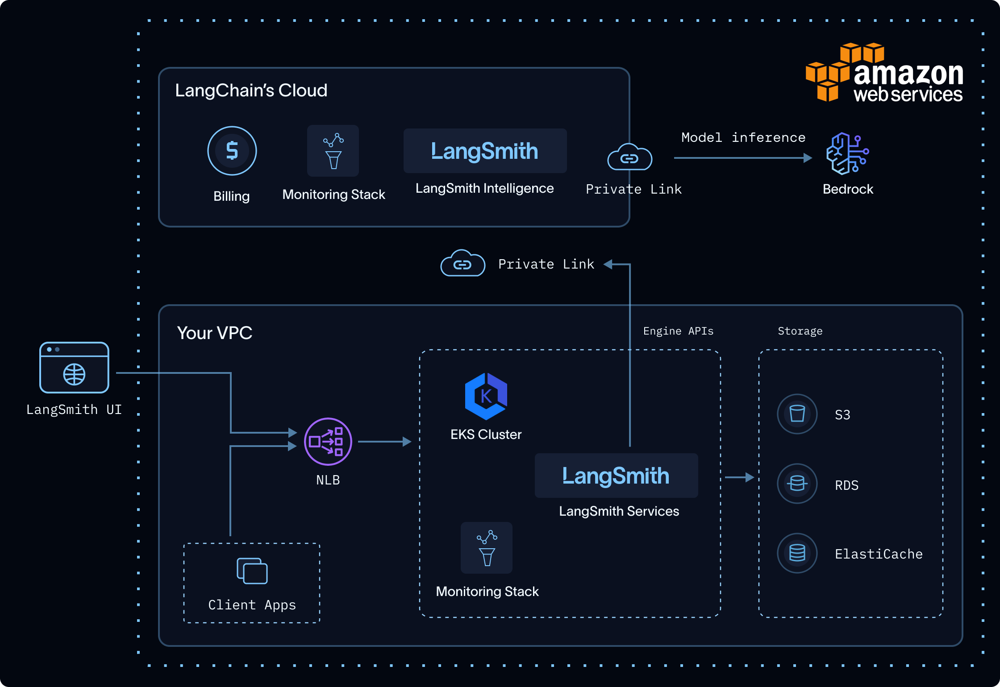
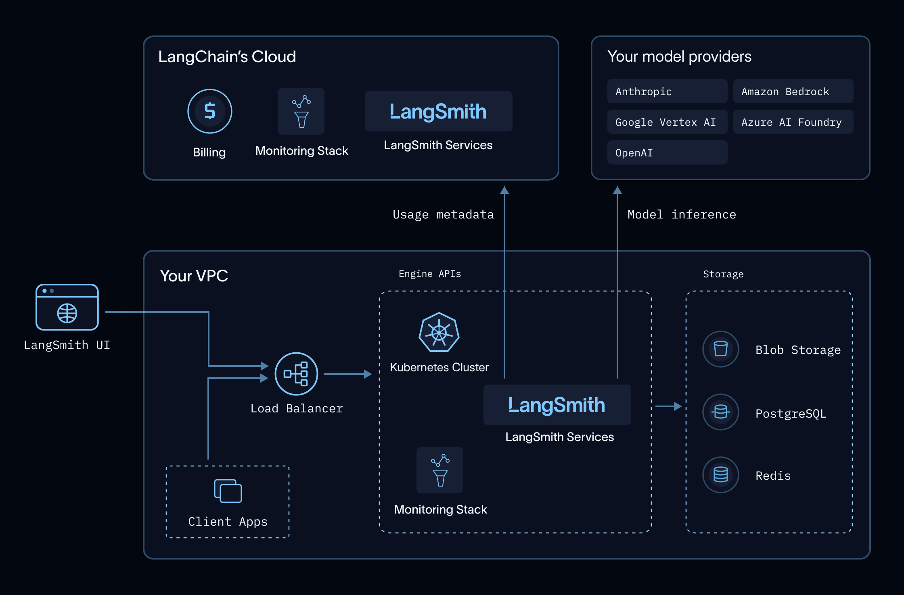

# LangSmith Engine on Self-hosted and BYOC

> Set up LangSmith Engine on a self-hosted LangSmith instance or a BYOC data plane, including model provider options and external network requirements.

> [!NOTE]
>
> Self-hosted Engine requires LangSmith Helm chart `0.16.0` or later and a license that includes the Engine entitlement. It is not available on earlier chart versions. [Contact our sales team](https://www.langchain.com/contact-sales) to have the entitlement added to your order.
>
> Running Engine on [your own model providers](Configure%20model%20providers%20for%20Engine%20on%20self-hosted%20and%20BYOC.md) and [air-gapped installations](#air-gapped-installations) require LangSmith Helm chart `0.17.0` or later. Earlier chart versions run Engine only on [LangSmith Intelligence](#langsmith-intelligence).

In self-hosted LangSmith, [LangSmith Engine](../LangSmith%20Engine.md)'s analysis and fix workflow runs in your environment. Engine sends the trace content and code it needs to its models, which run either on LangSmith Intelligence (LSI) or on your own model providers. It reports usage metadata to LSI for billing, unless your installation is [air-gapped](#air-gapped-installations).

This page covers how to [choose how Engine runs its models](#choose-how-engine-runs-its-models), where Engine processes data, and how to [install Engine](#install-engine). To configure your own model providers, see [Configure model providers for Engine on self-hosted](Configure%20model%20providers%20for%20Engine%20on%20self-hosted%20and%20BYOC.md). To give Engine access to source code, also [configure a GitHub App](Configure%20GitHub%20for%20Engine%20on%20self-hosted%20and%20BYOC.md). GitHub is optional for trace analysis.

Engine also runs on [BYOC](../../LangSmith%20setup/BYOC/Bring%20Your%20Own%20Cloud%20%28BYOC%29.md) data planes, where LangChain installs and operates it for you. See [Engine on BYOC](#engine-on-byoc) for what differs.

> [!NOTE]
>
> Red teaming and automatic issue validation are unavailable on self-hosted LangSmith and BYOC. You can investigate issues, generate fixes, and open PRs without those features.

## Engine on BYOC

On a BYOC data plane, LangChain installs Engine and generates its keys, and you do not need to edit Helm values. To enable Engine on your data plane, contact your LangChain account team.

Engine on BYOC differs from self-hosted LangSmith in the following ways:

* **Model providers**: Engine runs only on [your own model providers](Configure%20model%20providers%20for%20Engine%20on%20self-hosted%20and%20BYOC.md). LangSmith Intelligence is not available. Amazon Bedrock can use your data plane's cloud identity instead of saved credentials. Enable access to the required models in the AWS account that hosts the data plane.
* **GitHub**: An Organization Admin registers a GitHub App and saves its credentials from an Engine project in the LangSmith UI. See [Connect Engine to GitHub on BYOC](Configure%20GitHub%20for%20Engine%20on%20self-hosted%20and%20BYOC.md#configure-the-app-on-byoc).
* **Slack**: An Organization Admin configures a Slack app for the organization under **Settings** > **General Settings** > **Slack**. See [Create your Slack app on BYOC](../../LangSmith%20setup/Self-hosted/Connect%20external%20services/Connect%20self-hosted%20and%20BYOC%20LangSmith%20to%20Slack.md#create-your-slack-app-on-byoc).

To set up Engine after LangChain enables it on your data plane:

1. An Organization Admin goes to **Settings** > **Engine**, selects the data plane, and turns on Engine. This setting applies to all workspaces on the data plane. Other data planes and LangSmith Cloud are unaffected.
2. An Organization Admin [chooses model providers](Configure%20model%20providers%20for%20Engine%20on%20self-hosted%20and%20BYOC.md#choose-model-providers) under **Settings** > **Engine** > **Model providers**. Saving credentials requires the `organization:manage-model-secrets` permission.
3. A user whose [role](../../LangSmith%20setup/Govern/Users%20%26%20access%20control/Role-based%20access%20control.md) can update tracing projects turns on Engine for a tracing project. See [Set up Engine](../Set%20up%20LangSmith%20Engine.md#turn-on-engine-for-a-tracing-project).
4. (Optional) An Organization Admin [configures the GitHub App](Configure%20GitHub%20for%20Engine%20on%20self-hosted%20and%20BYOC.md#configure-the-app-on-byoc), and workspace users connect repositories.
5. (Optional) An Organization Admin [configures the Slack app](../../LangSmith%20setup/Self-hosted/Connect%20external%20services/Connect%20self-hosted%20and%20BYOC%20LangSmith%20to%20Slack.md#create-your-slack-app-on-byoc) and adds [notification destinations](../LangSmith%20Engine%20notifications.md).

To move Engine issues from LangSmith Cloud or self-hosted LangSmith to a data plane, see [Migrate to BYOC](../../LangSmith%20setup/BYOC/Migrate%20to%20BYOC.md#complete-the-engine-manual-steps).

## Choose how Engine runs its models

Each organization chooses how Engine runs its models under **Settings > Engine > Model providers**.

| | **LangSmith Intelligence** | **Your own model providers** |
| - | - | - |
| **Who runs the models** | LangChain, with the providers it selects | Your provider accounts |
| **Credentials** | None. Engine authenticates with your LangSmith license. | API keys or cloud identity you provide, or your own [model gateway](Configure%20model%20providers%20for%20Engine%20on%20self-hosted%20and%20BYOC.md#use-a-model-gateway) |
| **Model selection** | Managed and tuned by LangChain | Managed by LangChain, within the model families your providers offer |
| **Data processing agreement** | LangChain's, with ZDR for every provider | Yours, with each provider you use |
| **Billing** | LangChain bills Engine's usage in LSUs. | Your provider bills you for model calls. LangChain bills Engine's usage in LSUs, at a lower rate than LangSmith Intelligence. |
| **Availability** | AWS US | Any cloud, with supported models and endpoints your cluster can reach |

For LangSmith Intelligence in other clouds or regions, [contact our sales team](https://www.langchain.com/contact-sales).



LangSmith Intelligence: Engine runs in your VPC; LSI and Bedrock run in LangChain's AWS environment.



Your own model providers: Engine runs in your VPC and calls your providers directly, and only usage metadata goes to LangChain.

### LangSmith Intelligence

LSI is a LangChain-managed service that runs Engine's models. Engine sends its model requests to `https://beacon.aws.langchain.com/intelligence`, authenticated with your LangSmith license, so you do not provide model-provider credentials. Each request carries the trace content, code, and intermediate outputs Engine needs to do its work.

Engine uses different models, each tuned for its role, to cluster issues, diagnose root causes against your code, generate fixes, and write evaluators that verify them. LangChain tunes these models for quality and token efficiency, and updates them as better models become available.

Your cluster must allow outbound HTTPS to that gateway. The connection can use public egress or private connectivity. To keep Engine traffic on private networking, follow [Connect with AWS PrivateLink](Configure%20model%20providers%20for%20Engine%20on%20self-hosted%20and%20BYOC.md#connect-with-aws-privatelink).

If the connection to LSI is unavailable, Engine stops and returns an error. The rest of your LangSmith deployment is unaffected, and Engine tries again on its next scheduled scan.

### Your own model providers

Engine calls Anthropic, OpenAI, Amazon Bedrock, Google Vertex AI, or Azure AI Foundry directly from your cluster, with credentials or cloud identity you control. Prompts and responses go only to your provider. To select providers and add credentials, see [Configure model providers for Engine on self-hosted](Configure%20model%20providers%20for%20Engine%20on%20self-hosted%20and%20BYOC.md).

## Where Engine processes and stores data

In a self-hosted deployment, Engine separates data handling between your environment and LangChain's:

* **Your environment:** Engine orchestration and LangSmith-stored traces remain in your self-hosted environment.
* **LangChain's environment, with LangSmith Intelligence:** LSI and the model provider process content that Engine sends. LSI retains only [usage metadata](#what-langsmith-intelligence-retains).
* **Your model providers, with your own providers:** Your providers process content that Engine sends, under your agreements with them. LangChain receives only [usage metadata](#what-langsmith-intelligence-retains).

If you enable external notifications, Engine also sends notification content to your configured Slack channels or webhook endpoints. For Slack app setup and the content sent to Slack, see [Connect self-hosted LangSmith to Slack](../../LangSmith%20setup/Self-hosted/Connect%20external%20services/Connect%20self-hosted%20and%20BYOC%20LangSmith%20to%20Slack.md).

### What LangSmith Intelligence retains

LSI does not persist the content of prompts or model responses. It retains the following metadata for usage attribution and billing:

* Account, workspace, and project identifiers used to attribute usage.
* Model and token-usage metadata used for billing.

When Engine runs on your own model providers, this metadata is all LSI receives. Your self-hosted LangSmith records Engine's usage and reports it to the endpoint in [`engine.intelligenceBaseUrl`](#allow-egress-to-langsmith-intelligence) every hour, authenticated with your license.

For LangChain-managed inference, the model-provider retention and training commitments are described in [Engine security](../LangSmith%20Engine%20security.md#model-subprocessors). When you use your own providers, their retention and training policies depend on your agreements with them.

## Install Engine

This section applies to self-hosted LangSmith. On BYOC, LangChain installs Engine. See [Engine on BYOC](#engine-on-byoc).

Engine is disabled by default. It requires [Sandboxes](../../LangSmith%20setup/Self-hosted/Install%20an%20instance/Additional%20features/Enable%20Sandboxes/Enable%20Sandboxes%20on%20self-hosted%20LangSmith.md), a connection to [LangSmith Intelligence](#allow-egress-to-langsmith-intelligence) unless your installation is [air-gapped](#air-gapped-installations), an externally reachable [`config.hostname`](#verify-your-hostname-is-externally-reachable), and [Engine's keys](#generate-engines-keys). Complete the prerequisites before enabling Engine.

Engine and [Insights](../../LangSmith%20setup/Self-hosted/Install%20an%20instance/Configure%20Insights%20and%20Chat%20on%20self-hosted%20LangSmith.md) run from the same image and share one deployment. Insights is not required for Engine. If your installation already runs Insights, enabling Engine adds configuration rather than new pods.

### Components

Enabling Engine provisions or reuses:

* `standalone-insights-api-server`: serves both the `engine` and `insights` graphs.
* `standalone-insights-queue`: background run processing for Engine and Insights.
* A dedicated PostgreSQL and Redis instance for the shared deployment, each replaceable with an external instance.
* The sandbox components described under [Enable Sandboxes](../../LangSmith%20setup/Self-hosted/Install%20an%20instance/Additional%20features/Enable%20Sandboxes/Enable%20Sandboxes%20on%20self-hosted%20LangSmith.md).

Engine also adds configuration to `platform-backend` and `ingest-queue`, which dispatch and schedule its runs.

### Prerequisites

**1. Enable Sandboxes**

Complete [Enable Sandboxes](../../LangSmith%20setup/Self-hosted/Install%20an%20instance/Additional%20features/Enable%20Sandboxes/Enable%20Sandboxes%20on%20self-hosted%20LangSmith.md) first, including the KVM-capable node pool and JuiceFS storage.

Engine's sandboxes are associated with one workspace. An install with Engine must have a [shared organization](../../LangSmith%20setup/Govern/Organization/Overview.md#organizations). When the install has one shared organization, LangSmith uses its oldest active workspace by default, even if the organization has multiple workspaces. To use a dedicated workspace instead, create the workspace and set `engine.sandboxTenantId` to its ID. If the install has multiple shared organizations, you must set `engine.sandboxTenantId` because LangSmith does not choose between organizations automatically.

> [!WARNING]
>
> Use a workspace reserved for Engine:
>
> * Engine's sandboxes are not billed on the Sandboxes product because Engine meters its own usage in LSUs.
> * Engine's sandboxes use the same concurrent sandbox, CPU, and memory quotas as other sandboxes in the workspace. If the workspace is near its limits, Engine runs can fail or leave less capacity for interactive sandboxes.
> * Engine's sandboxes are listed in that workspace and can be stopped by anyone with access to it.
> * Each sandbox runs agent-generated code.
> * Repository credentials remain in the sandbox auth proxy and are not available to code running inside the sandbox.

**2. Confirm the license entitlement**

Engine is licensed separately, in the same way as Sandboxes. Your license must carry the Engine entitlement. LangSmith validates your license key against `https://beacon.langchain.com` at startup and periodically thereafter, so the entitlement takes effect without you changing any configuration once it is added to your order.

**3. Allow egress to LangSmith Intelligence and your model providers**

Set `engine.intelligenceBaseUrl` for how Engine runs its models, and allow outbound HTTPS from the cluster to that URL:

| **Engine runs its models on** | **`engine.intelligenceBaseUrl`** |
| - | - |
| LangSmith Intelligence | `https://beacon.aws.langchain.com/intelligence` |
| Your own model providers | `https://beacon.langchain.com/intelligence` (the default) |
| Your own model providers, air-gapped | `""` (see [Air-gapped installations](#air-gapped-installations)) |

The AWS URL also records usage, so it works for organizations on either option. The default URL only records usage, on the same host self-hosted LangSmith already uses for license verification and billing telemetry, so it adds a path rather than a new egress destination.

On chart 0.16, `engine.intelligenceBaseUrl` has no default and Engine runs only on LangSmith Intelligence, so set it to `https://beacon.aws.langchain.com/intelligence`.

If Engine runs on your own model providers, also allow outbound HTTPS from the `standalone-insights` pods to each provider's API endpoint. To keep that traffic on private networking, see [Connect to your providers privately](Configure%20model%20providers%20for%20Engine%20on%20self-hosted%20and%20BYOC.md#connect-to-your-providers-privately).

Add each destination as a specific allowlist entry rather than opening general egress. To keep traffic to LangSmith Intelligence on private networking, [connect with AWS PrivateLink](Configure%20model%20providers%20for%20Engine%20on%20self-hosted%20and%20BYOC.md#connect-with-aws-privatelink). Requests to LangSmith Intelligence use a short-lived license JWT obtained during LangSmith license verification. Engine's traffic is separate from the billing and operational telemetry described in [Configure egress](../../LangSmith%20setup/Self-hosted/Configure%20an%20instance/Egress%20for%20billing%20and%20operational%20telemetry.md), even where it shares a host.

**4. Verify your hostname is externally reachable**

Engine's sandboxes call your LangSmith install using the `langsmith` CLI, so `config.hostname` must be reachable from the sandbox network. Helm validation rejects `localhost` and in-cluster `*.svc` addresses.

Serve that hostname through your ingress with TLS, as described in [Set up an ingress](../../LangSmith%20setup/Self-hosted/Configure%20an%20instance/Create%20an%20Ingress%20for%20installations%20%28Kubernetes%29.md). Engine's sandbox network policy permits access to your LangSmith hostname, the configured GitHub hosts, and the public PyPI and npm registries. A proxy outside the sandbox injects per-run credentials, so they are not readable inside it.

When Engine generates a code fix, it installs dependencies from `pypi.org`, `files.pythonhosted.org`, and `registry.npmjs.org`. The registry hosts are not configurable, so Engine cannot use an internal PyPI or npm mirror, and dependency installs fail if your network blocks the public registries. Sandboxes cannot reach Go module proxies such as `proxy.golang.org`, so Engine uses your connected code repository's `vendor/` directory when it is present.

For GitHub connections, also allow the [outbound requests and inbound webhooks](Configure%20GitHub%20for%20Engine%20on%20self-hosted%20and%20BYOC.md#allow-network-access) required by your GitHub environment. Browser access to LangSmith alone does not establish webhook connectivity from GitHub.

**5. Generate Engine's keys**

Engine needs two keys of its own:

* **Encryption key** (`engine_encryption_key`): a Fernet key that encrypts the run payloads LangSmith passes to Engine, which carry short-lived credentials.

  ```bash
  python -c "from cryptography.fernet import Fernet; print(Fernet.generate_key().decode())"
  ```

* **Usage signing secret** (`engine_usage_signing_secret`): signs the usage reports Engine sends to LangSmith. Use at least 32 random characters.

  ```bash
  openssl rand -hex 32
  ```

On chart 0.16, Engine uses only the encryption key. The usage signing secret is new in chart 0.17, and the 0.17 chart rejects an Engine install without it.

Store both in your predefined Kubernetes Secret before installing or upgrading the chart. See [Use an existing secret](../../LangSmith%20setup/Self-hosted/Platform%20auth%20%26%20access%20control/Use%20an%20existing%20secret%20for%20your%20installation%20%28Kubernetes%29.md#parameters). When Helm can read the existing Secret from the cluster, the chart checks for both keys and names any that are missing. `helm template` and GitOps renders skip that lookup, so verify the keys are present separately.

To rotate the encryption key, copy the current value to `engine_encryption_key_previous` and set the new key as `engine_encryption_key`. The previous key is accepted for decryption only, so runs encrypted just before the swap still complete.

When introducing or rotating the usage signing secret, pause new Engine work and wait for running scans to finish. Update `platform-backend`, `ingest-queue`, and the shared Engine and Insights API server and queue to use the same signing secret. After all four components are healthy, resume Engine and [verify an analysis and Engine usage](#verify-the-installation). The previous encryption key does not provide a fallback for usage signatures.

### Enable with Helm

Add the following to your [`langsmith_config.yaml`](../../LangSmith%20setup/Self-hosted/Install%20an%20instance/Self-host%20LangSmith%20on%20Kubernetes.md#configure-your-helm-charts), alongside the complete Sandboxes values from [Enable Sandboxes](../../LangSmith%20setup/Self-hosted/Install%20an%20instance/Additional%20features/Enable%20Sandboxes/Enable%20Sandboxes%20on%20self-hosted%20LangSmith.md). These examples show only the Engine-specific values and the `sandboxes.enabled` flag.

> [tab] Using Kubernetes secrets (recommended)
>
> Reference your existing Secret by name. The chart reads `engine_encryption_key` and `engine_usage_signing_secret` from it.
>
> ```yaml theme={"theme":{"light":"catppuccin-latte","dark":"catppuccin-mocha"}}
> config:
>   existingSecretName: "<your-secret-name>"
>   # Must be reachable from the sandbox network.
>   hostname: "https://langsmith.example.com"
>
> engine:
>   enabled: true
>   intelligenceBaseUrl: "https://beacon.aws.langchain.com/intelligence"
>
> sandboxes:
>   enabled: true
> ```

> [tab] Using inline values
>
> Set Engine's keys directly in your config file.
>
> > [!WARNING]
> >
> > This puts live credentials in your config file. Do not commit it to version control. Prefer the Kubernetes Secret.
>
> ```yaml theme={"theme":{"light":"catppuccin-latte","dark":"catppuccin-mocha"}}
> config:
>   hostname: "https://langsmith.example.com"
>
> engine:
>   enabled: true
>   intelligenceBaseUrl: "https://beacon.aws.langchain.com/intelligence"
>   encryptionKey: "<engine-encryption-key>"
>   usageSigningSecret: "<SECRET>"
>
> sandboxes:
>   enabled: true
> ```

> [!NOTE]
>
> To use a workspace other than the oldest active workspace, or if your install has multiple shared organizations, set the workspace that owns Engine's sandboxes:

```yaml
engine:
  sandboxTenantId: "<workspace-id>"
```

To authenticate Amazon Bedrock, Google Vertex AI, or Azure AI Foundry with the cloud identity of Engine's pods, add the values in [Use cloud identity for your model providers](Configure%20model%20providers%20for%20Engine%20on%20self-hosted%20and%20BYOC.md#use-cloud-identity-for-your-model-providers).

> [!WARNING]
>
> Upgrades from older Insights image pins require one extra check: if your values pin `images.engineInsightsAgentImage.repository` to the retired `langsmith-clio` image, remove or update that pin. Engine and Insights now run on `langsmith-insights-engine`, and the chart rejects `langsmith-clio`. For more information, see [Mirror images for your LangSmith installation](../../LangSmith%20setup/Self-hosted/Configure%20an%20instance/Mirror%20images%20for%20your%20LangSmith%20installation.md#additional-images-for-engine).

Validate the updated chart before applying it:

```bash
helm template langsmith langchain/langsmith \
  --values langsmith_config.yaml \
  --version <version> \
  --namespace <namespace>
```

The chart validates Engine values at render time and names missing values. This command does not check keys in an existing Kubernetes Secret, so verify those before applying the chart.

Apply the updated chart:

```bash
helm upgrade -i langsmith langchain/langsmith \
  --values langsmith_config.yaml \
  --version <version> \
  --namespace <namespace> \
  --wait
```

### Verify the installation

Confirm the shared Engine and Insights deployment is running:

```bash
kubectl get pods -n <namespace> | grep standalone-insights
```

Both the API server and queue pods should be `Running`. Then, confirm `platform-backend` is healthy, since it dispatches Engine runs:

```bash
kubectl rollout status deployment/langsmith-platform-backend -n <namespace>
```

If Engine does not appear in the LangSmith UI after this, the most common causes are a license without the Engine entitlement and the organization-level toggle described in [Turn on Engine in LangSmith](#turn-on-engine-in-langsmith).

After [enabling and configuring Engine](#turn-on-engine-in-langsmith) in the LangSmith UI, [test each selected provider](Configure%20model%20providers%20for%20Engine%20on%20self-hosted%20and%20BYOC.md#test-a-provider), then start an Engine analysis and confirm that results appear for the tracing project. This verifies the complete path through Engine, Sandboxes, and your model providers or LangSmith Intelligence. Running pods alone does not verify that path.

Check Engine usage under **Settings > Engine** for aggregate spend by workspace and project. Usage reporting and billing updates are asynchronous, so spend may appear later than the analysis results. For an air-gapped installation, verify the recorded usage through [Usage export](#air-gapped-installations).

If the analysis does not complete, check that Engine pods are running, the sandbox workspace has quota available, and the cluster can reach your model providers or the LangSmith Intelligence gateway URL configured in `engine.intelligenceBaseUrl`.

### Turn on Engine in LangSmith

Enabling Engine in Helm makes the feature available, but it does not start any scans. After enabling the chart values, finish setup in LangSmith:

1. An [Organization Admin](../../LangSmith%20setup/Govern/Users%20%26%20access%20control/Role-based%20access%20control.md#organization-admin) turns Engine on for the organization under **Settings > Engine**. For more information, see [Enable Engine for your organization](../Set%20up%20LangSmith%20Engine.md#enable-engine-for-your-organization).
2. An Organization Admin [chooses how Engine runs its models](Configure%20model%20providers%20for%20Engine%20on%20self-hosted%20and%20BYOC.md#choose-model-providers) under **Settings > Engine > Model providers**. Engine does not start any runs until this is saved.
3. A user whose [role](../../LangSmith%20setup/Govern/Users%20%26%20access%20control/Role-based%20access%20control.md) can update tracing projects turns on Engine for a tracing project from its **Engine** tab. For more information, see [Set up Engine](../Set%20up%20LangSmith%20Engine.md#turn-on-engine-for-a-tracing-project).

To read source code and open pull requests, Engine also needs a GitHub connection. An operator [configures the GitHub App](Configure%20GitHub%20for%20Engine%20on%20self-hosted%20and%20BYOC.md), then workspace users [connect repositories](../Connect%20Engine%20to%20your%20repository.md#connect-repositories).

### Disable Engine

Set `engine.enabled` to `false` and re-apply:

```yaml
engine:
  enabled: false
```

Engine stops dispatching runs. Insights shares the same deployment, so the `standalone-insights` pods keep running when `insights.enabled` is `true`.

## Air-gapped installations

Installations with an offline license and no connection to LangSmith Intelligence can run Engine on their own model providers:

* Set `engine.intelligenceBaseUrl` to `""`.
* [Choose your own model providers](Configure%20model%20providers%20for%20Engine%20on%20self-hosted%20and%20BYOC.md#choose-model-providers) under **Settings > Engine > Model providers**. LangSmith Intelligence is not available.
* Allow outbound HTTPS from the `standalone-insights` pods to your model providers, or route it through your own network path to them.

Engine records its usage in your installation. An Organization Admin downloads it with the rest of your usage from **Settings > Usage export** and sends it to your LangChain account team on the schedule in your agreement.

Air-gapped installations do not show Engine spend, and spend limits other than `0` are not enforced. Set a limit of `0` to pause Engine for an organization or a project.

## See also

* [LangSmith Engine](../LangSmith%20Engine.md)
* [Set up Engine](../Set%20up%20LangSmith%20Engine.md)
* [Configure model providers for Engine on self-hosted](Configure%20model%20providers%20for%20Engine%20on%20self-hosted%20and%20BYOC.md)
* [Configure GitHub for Engine on self-hosted](Configure%20GitHub%20for%20Engine%20on%20self-hosted%20and%20BYOC.md)
* [Connect Engine to your repository](../Connect%20Engine%20to%20your%20repository.md)
* [Engine security](../LangSmith%20Engine%20security.md)
* [Engine notifications](../LangSmith%20Engine%20notifications.md)
* [Connect self-hosted and BYOC LangSmith to Slack](../../LangSmith%20setup/Self-hosted/Connect%20external%20services/Connect%20self-hosted%20and%20BYOC%20LangSmith%20to%20Slack.md)
* [BYOC](../../LangSmith%20setup/BYOC/Bring%20Your%20Own%20Cloud%20%28BYOC%29.md)
* [Enable additional LangSmith features](../../LangSmith%20setup/Self-hosted/Install%20an%20instance/Additional%20features/Configure%20additional%20self-hosted%20features.md)
