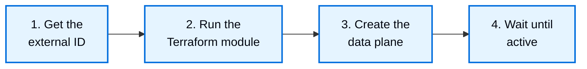

# BYOC onboarding on GCP

> Set up a LangSmith BYOC data plane in your GCP project, from the provisioner service account to creating, changing, and deleting the data plane with the API.

BYOC on GCP runs the LangSmith data plane in your GCP project, on the LangSmith US control plane at [smith.langchain.com](https://smith.langchain.com?utm_source=docs&utm_medium=cta&utm_campaign=langsmith-signup&utm_content=langsmith-byoc-onboarding-gcp). You create the service account LangSmith provisions as, then create the data plane with the LangSmith API. For BYOC on AWS, see [BYOC onboarding](../AWS/BYOC%20onboarding.md).

> [!NOTE]
>
> BYOC on GCP is in [beta](../../Cloud/Reference/Release%20stages.md). Inputs and behavior can change between releases.

For what LangSmith deploys in your project and the access it gets, see [BYOC architecture on GCP](BYOC%20architecture%20on%20GCP.md).

## Before you start

You need the following:

* **BYOC enabled on your organization**: Create an organization in LangSmith at [smith.langchain.com](https://smith.langchain.com?utm_source=docs&utm_medium=cta&utm_campaign=langsmith-signup&utm_content=langsmith-byoc-onboarding-gcp), or reuse an existing one, and send its organization ID to the LangChain team to enable BYOC.
* **An organization admin**: Creating a data plane requires the organization admin role, and an API key for that user.
* **A GCP project for the data planes**: Use a project that holds only LangSmith resources. Most of the provisioner's permissions apply only to resources whose names start with `langsmith-`, but some cover the whole project. If the project also holds other resources, set `byo_iam = true` in [Step 2](#step-2-run-the-terraform-module). The project must not already have a `managed_by` tag key, and must hold only one copy of the Terraform module. For details, see [What LangChain can and cannot access](BYOC%20architecture%20on%20GCP.md#what-langchain-can-and-cannot-access).
* **Permissions in that project**: Permission to create service accounts, grant project IAM roles, enable APIs, and create tags. The tags need Tag Administrator (`roles/resourcemanager.tagAdmin`) on the project.
* **Terraform**: Terraform 1.11.0 or later, with Google provider 6.0 or later, before 9.0.
* **A GCP region**: BYOC on GCP can run in any GCP region. If the region you need is not enabled yet, contact the LangChain team to add it.
* **Resource location policies**: If your GCP organization restricts resource locations, allow the data plane region and `us-central1`. The data plane creates its Private Service Connect endpoint to LangSmith in `us-central1`.

## Set up a data plane



### Step 1. Get the external ID

Navigate to **Settings > Data Planes** in LangSmith and use the copy button next to the **Data Planes** header to copy the external ID. Do not make up your own value.

### Step 2. Run the Terraform module

Apply the [`langsmith-byoc-service-account` Terraform module](https://github.com/langchain-ai/terraform/tree/main/modules/byoc/gcp/langsmith-byoc-service-account) in your project. The module:

* Enables the APIs that data planes use. Set `enable_apis = false` if you manage the project's APIs elsewhere.
* Creates the provisioner service account `langsmith-byoc-provisioner`, with its description set to your external ID.
* Grants it custom roles with only the permissions that provisioning and teardown use. Most of them apply only to resources whose names start with `langsmith-`.
* Creates the tag `managed_by: langsmith` in the project, and grants the LangSmith control plane service account `roles/container.admin` only on GKE clusters with that tag. LangSmith tags the data plane GKE clusters and Cloud SQL instances it creates, and the Postgres setup account's Cloud SQL permissions apply only to tagged instances.
* Lets the LangSmith control plane service account, `byoc-crossplane@langchain-prod.iam.gserviceaccount.com`, impersonate it through the Service Account Token Creator role. The module trusts no other LangSmith identity.

```hcl
provider "google" {
  project = "<project-id>"
}

module "langsmith_byoc_service_account" {
  source = "github.com/langchain-ai/terraform//modules/byoc/gcp/langsmith-byoc-service-account?ref=v0.17.80"

  project_id                 = "<project-id>"
  crossplane_service_account = "byoc-crossplane@langchain-prod.iam.gserviceaccount.com"
  external_id                = "<external-id-from-langsmith>"
}

output "provisioner_service_account" {
  value = module.langsmith_byoc_service_account.provisioner_service_account
}
```

LangSmith requires release v0.17.80 or later of the module. If you applied an earlier release, re-apply the module at v0.17.80 or later.

To create the data plane service accounts and their project roles yourself, set `byo_iam = true` before you create data planes in the project. The provisioner then cannot create service accounts or change the project IAM policy. Set it if the project holds resources that are not LangSmith's. Create the data plane with `byoiam_enabled` set to `true`. For more information, see [Bring your own IAM](BYOC%20architecture%20on%20GCP.md#bring-your-own-iam).

### Step 3. Create the data plane

LangSmith automatically adds your project to the Private Service Connect accept list during provisioning. You do not need to send your project number to LangChain or wait for manual approval before creating the data plane.

Create the data plane with the LangSmith API, using an organization admin's API key:

```bash
curl -X POST https://api.smith.langchain.com/orgs/current/data-planes \
  -H "X-API-Key: $LANGSMITH_API_KEY" \
  -H "X-Organization-Id: <organization-id>" \
  -H "Content-Type: application/json" \
  -d '{
    "name": "prod",
    "region": "<gcp-region>",
    "gcp_project_id": "<project-id>",
    "provisioner_service_account": "langsmith-byoc-provisioner@<project-id>.iam.gserviceaccount.com",
    "vpc_cidr": "10.80.0.0/16",
    "public_load_balancer": false
  }'
```

The request takes the following fields:

| Field | Rule |
| - | - |
| `name` | Up to 21 characters: lowercase letters, digits, and hyphens. Must start with a letter, end with a letter or digit, and not start with `internal`. Must be unique in your organization. |
| `region` | The GCP region of the data plane. BYOC on GCP can run in any GCP region. If the region you need is not enabled yet, contact the LangChain team to add it. |
| `gcp_project_id` | The project from [Step 2](#step-2-run-the-terraform-module). |
| `provisioner_service_account` | The `provisioner_service_account` Terraform output. It must be in the project. |
| `vpc_cidr` | The range of the VPC that LangSmith creates. A private RFC 1918 range from `/16` to `/18`. It must not overlap `192.168.0.0/17`, which GKE pods and services use. |
| `public_load_balancer` | `true` for a public endpoint. `false` (default) for an internal endpoint. See [Choose a public or internal endpoint](#choose-a-public-or-internal-endpoint). |
| `byoiam_enabled` | Optional. `true` if you applied the module with `byo_iam = true`. |
| `sandboxes_enabled` | Optional. `true` to deploy [LangSmith sandboxes](../../../Deploy/Sandboxes/LangSmith%20Sandboxes.md) in the data plane. Defaults to `false`. |

The API returns `202` with the data plane's `id`, `api_url`, and `status`. Before it accepts the request, LangSmith checks that it can impersonate the provisioner, and that the provisioner is in the project and carries your external ID. If a check fails, the response names the problem. See [Troubleshoot create errors](#troubleshoot-create-errors).

### Step 4. Wait until active

LangSmith provisions the infrastructure in your project. The data plane status moves from `requested` to `provisioning` to `active`. Track it in **Settings > Data Planes**, or with `GET /orgs/current/data-planes/<id>`.

> [!NOTE]
>
> Provisioning can take up to 3 hours. After 3 hours, the status changes to `provisioning_failed`. If that happens, contact the LangChain team.

After the data plane is active, a workspace named `dp-<data_plane_name>` is available in it, and you can create more workspaces. See the **Create workspaces** step in [BYOC onboarding](../AWS/BYOC%20onboarding.md).

## Use your data plane

### Find the data plane URL

The data plane URL is the `api_url` of the data plane: `https://<first 8 characters of the data plane ID>.gcp.langchain-byoc.com`. You can also find it in **Settings > Data Planes**.

To point applications and API clients at the data plane, see [BYOC usage](../BYOC%20usage.md).

### Choose a public or internal endpoint

You pick the endpoint type when you create the data plane:

* **Public**: Users reach the data plane from the internet.
* **Internal** (default): The ingress is on an internal load balancer, and the hostname resolves only inside the data plane VPC. Connect your network to that VPC, for example with VPC peering or Cloud VPN, and make the hostname resolve from your network.

Outbound traffic from the data plane leaves through Cloud NAT with a static IP address, so you can allowlist the data plane.

### Change data plane settings

On GCP, you can change the maintenance window. Blob TTL, Fleet OIDC, and network firewall settings are not available.

The maintenance window is two hours in UTC, on whole hours, for example `sun:07:00-sun:09:00`. It applies to Cloud SQL and Memorystore, whose windows last one hour, so LangSmith uses only the start. When it is unset, Google picks the window.

```bash
curl -X PATCH https://api.smith.langchain.com/orgs/current/data-planes/<id> \
  -H "X-API-Key: $LANGSMITH_API_KEY" \
  -H "X-Organization-Id: <organization-id>" \
  -H "Content-Type: application/json" \
  -d '{"maintenance_window": "sun:07:00-sun:09:00"}'
```

GKE nodes upgrade automatically on the GKE `REGULAR` release channel.

## Troubleshoot create errors

The create request returns these error codes:

| Code | HTTP | Cause | Fix |
| - | - | - | - |
| `gcp_permissions` | 403 | LangSmith cannot impersonate the provisioner, or the provisioner lacks a permission. | Apply the Terraform module, and check `crossplane_service_account`. |
| `gcp_api_disabled` | 400 | A required API is disabled in the project. | Enable the API named in the message, or keep `enable_apis = true`. |
| `gcp_project_not_found` | 400 | The project does not exist, or the provisioner cannot see it. | Check `gcp_project_id`. |
| `gcp_service_account_not_found` | 400 | The provisioner service account does not exist in the project. | Check `provisioner_service_account` and `gcp_project_id`. |
| `gcp_provisioner_project_mismatch` | 400 | The provisioner is in a different project. | Use the provisioner the module created in the data plane project. |
| `gcp_provisioner_not_owned` | 403 | The provisioner's description is not your external ID. | Reapply the module with the external ID from **Settings > Data Planes**. |
| `byoiam_validation` | 400 | `byoiam_enabled` is `true`, but the project lacks the LangSmith service accounts. | Apply the module with `byo_iam = true`. |
| `gcp_policy_denied` | 403 | An organization policy denied a request, for example a resource location constraint. | Allow the data plane region and `us-central1` in the policy. |
| `gcp_throttled` | 429 | GCP rate limited the requests. | Try again after a minute. |
| `gcp_unavailable` | 502 | GCP returned an error. | Try again after a minute. |
| `organization_admin_required` | 403 | The API key's user is not an organization admin. | Use an organization admin's API key. |
| `organization_external_id_missing` | 409 | BYOC is not set up for your organization. | Contact the LangChain team. |
| `data_plane_name_taken` | 409 | Your organization already has a data plane with this name. | Choose another `name`. |

A request that fails field validation, such as a region that is not enabled or a `vpc_cidr` that overlaps the GKE ranges, returns `400` with the field and the reason.

## Delete a data plane

> [!WARNING]
>
> Do not destroy the Terraform module before you delete the data plane in LangSmith. LangSmith needs the provisioner to delete the data plane resources.

To delete a data plane:

1. Delete the data plane with `DELETE /orgs/current/data-planes/<id>`. You can delete it while it is `active`, `provisioning`, or `provisioning_failed`. LangSmith deletes the resources it created in the project, except the data: the Cloud Storage bucket stays with its objects, and the Cloud SQL backups outlive the instance. See [What teardown keeps](#what-teardown-keeps).
2. Wait until the data plane is gone from **Settings > Data Planes**.
3. If no other data planes use the project, run `terraform destroy`.

### What teardown keeps

Teardown keeps the data plane's data in your project:

* **Cloud Storage bucket**: The bucket and its objects stay. Its labels include the data plane ID.
* **Final Cloud SQL backup**: Cloud SQL takes a final backup when it deletes the instance, and keeps it for 365 days.
* **Automated Cloud SQL backups**: The instance's automated backups stay, and expire one a day.

LangSmith does not delete them later, and neither does `terraform destroy`. Delete them yourself when you no longer need them.

## Get help

When something does not work, [contact LangChain support](https://support.langchain.com) with:

* Your organization ID and data plane name.
* What you did, and what happened.
* Error messages, screenshots, and timestamps.
* For provisioning problems: your GCP project ID, project number, and region.

## See also

* [BYOC architecture on GCP](BYOC%20architecture%20on%20GCP.md)
* [BYOC overview](../Bring%20Your%20Own%20Cloud%20%28BYOC%29.md)
* [BYOC usage](../BYOC%20usage.md)
