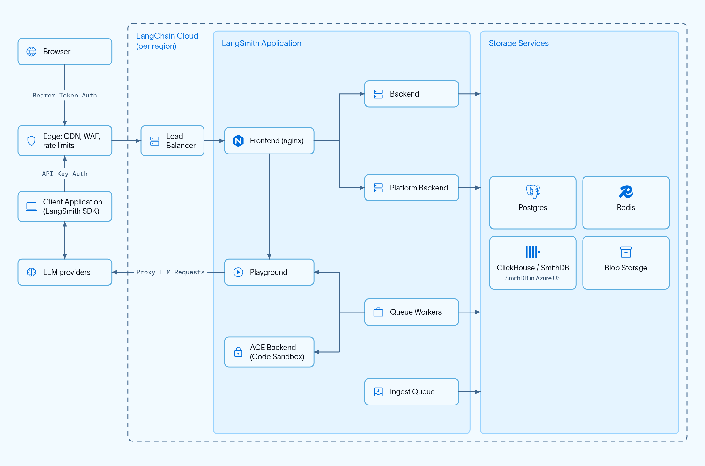

# Cloud (SaaS)

> Learn how LangChain hosts and operates LangSmith Cloud, including its regions, data storage locations, architecture, IP allowlists, private connectivity, and API rate limits.

The **Cloud** hosting option is a fully managed model where LangChain hosts and operates all LangSmith infrastructure and services:

* **Fully managed infrastructure**: LangChain handles all infrastructure, updates, scaling, and maintenance.
* [**LangSmith UI**](https://smith.langchain.com?utm_source=docs&utm_medium=cta&utm_campaign=langsmith-signup&utm_content=langsmith-cloud): Full access to [observability](../../Monitor/Overview/LangSmith%20Observability.md), [evaluation](../../Test/Get%20started/LangSmith%20Evaluation.md), [agent deployment management](../../Deploy/Get%20started/LangSmith%20Agent%20Server.md), and [Studio](../../Test/Test%20from%20Studio/LangSmith%20Studio.md).
* **Deploy Agent Servers from GitHub**: Connect your repositories and deploy [Agent Servers](../../Deploy/Get%20started/LangSmith%20Agent%20Server.md) to the Cloud with a few clicks.
* **Automated CI/CD for Agent Servers**: The build and deployment process for your [Agent Servers](../../Deploy/Get%20started/LangSmith%20Agent%20Server.md) is handled automatically by the platform.

LangChain manages the LangSmith platform (UI, APIs, and datastores), your Agent Servers, and CI/CD for your apps. All of them run in LangChain's cloud on AWS, Azure, or GCP, depending on your [region](#regions).

If you're ready to deploy your app to LangSmith Cloud, follow the [Cloud deployment quickstart](../../Deploy/Get%20started/Deploy%20your%20app%20to%20cloud.md) or the [full setup guide](../../Deploy/Deploy%20to%20Cloud/Deployment%20guide/Create%20an%20Agent%20Server.md). This page explains the Cloud managed architecture for reference.

## Cloud architecture and scalability

> [!NOTE]
>
> This section is only relevant for cloud-managed LangSmith in the [regions listed below](#regions). For information on the Self-hosted LangSmith solution, refer to the [Self-hosted documentation](../Self-hosted/Self-hosted%20LangSmith.md).

LangSmith Cloud runs in five regions on Google Cloud Platform (GCP), Amazon Web Services (AWS), and Microsoft Azure. The platform is designed to be highly scalable. Many customers run production workloads on LangSmith for LLM application observability, evaluation, and agent deployment.

### Regions

Each region has its own URLs. Your organization's data is stored in the region where you signed up, with the exceptions listed in [Regional storage](#regional-storage).

| Region | URL | API URL |
| - | - | - |
| GCP US (default) | [https://smith.langchain.com](https://smith.langchain.com?utm_source=docs&utm_medium=cta&utm_campaign=langsmith-signup&utm_content=langsmith-cloud) | `https://api.smith.langchain.com` |
| GCP EU | [https://eu.smith.langchain.com](https://eu.smith.langchain.com) | `https://eu.api.smith.langchain.com` |
| GCP APAC | [https://apac.smith.langchain.com](https://apac.smith.langchain.com) | `https://apac.api.smith.langchain.com` |
| AWS US | [https://aws.smith.langchain.com](https://aws.smith.langchain.com) | `https://aws.api.smith.langchain.com` |
| Azure US | [https://azure.smith.langchain.com](https://azure.smith.langchain.com) | `https://azure.api.smith.langchain.com` |

### Regional storage

Cloud-managed LangSmith stores trace and application data in the cloud location of the region where sign-up occurred. Each region uses a regional trace datastore for trace ingestion and analytics. Two kinds of data are stored elsewhere:

* **Authentication data**: [Supabase](https://supabase.com) hosts authentication and authorization data on AWS, in the location listed in the Supabase column. This location can differ from the region's cloud location. For example, the Azure US region runs in Azure `centralus` (Iowa), while its authentication data is in AWS `us-east-1` (N. Virginia).
* **Billing data**: Payment and billing information is stored in the US, as described in [Region-independent storage](#region-independent-storage).

| Region | Cloud location | Supabase | Trace datastore | [LangSmith Agent Server](../../Deploy/Get%20started/LangSmith%20Agent%20Server.md) domain |
| - | - | - | - | - |
| GCP US | GCP us-central1 (Iowa) | AWS us-east-1 (N. Virginia) | [ClickHouse Cloud](https://clickhouse.com/cloud), us-central1 (Iowa) | `*.us.langgraph.app` |
| GCP EU | GCP europe-west4 (Netherlands) | AWS eu-central-1 (Germany) | ClickHouse Cloud, europe-west4 (Netherlands) | `*.eu.langgraph.app` |
| GCP APAC | GCP australia-southeast1 (Sydney) | AWS ap-southeast-2 (Sydney) | ClickHouse Cloud, australia-southeast1 (Sydney) | `*.apac.langgraph.app` |
| AWS US | AWS us-east-2 (Ohio) | AWS us-east-2 (Ohio) | ClickHouse Cloud, us-east-2 (Ohio) | `*.aws.us.langgraph.app` |
| Azure US | Azure centralus (Iowa) | AWS us-east-1 (N. Virginia) | SmithDB, centralus (Iowa) | `*.azure.us.langgraph.app` |

Agent Servers on LangSmith run in the same cloud location as the rest of the region.

> [!TIP]
>
> See the [Regions FAQ](../Govern/Additional%20resources/FAQ/Regions%20FAQ.md) for more information.

### Region-independent storage

Data listed here is stored exclusively in the US:

* Payment and billing information with Stripe and Metronome

### Architecture

Every region runs the same LangSmith components. The following sections list the cloud services that host them in each region.



### GCP services

The following applies to the **US, EU, and APAC** SaaS regions on GCP.

LangSmith is composed of the following services, all hosted on Google Kubernetes Engine (GKE):

* LangSmith Frontend: serves the LangSmith UI.
* LangSmith Backend: serves the LangSmith API.
* LangSmith Platform Backend: handles authentication and other high-volume tasks. (Internal service)
* LangSmith Playground: handles forwarding requests to various LLM providers for the Playground feature.
* LangSmith Queue: handles processing of asynchronous tasks. (Internal service)
* LangSmith ACE Backend: runs custom code evaluators in an isolated runtime. (Internal service)
* LangSmith Ingest Queue: processes incoming traces. (Internal service)

LangSmith uses the following GCP storage services:

* Google Cloud Storage (GCS) for runs inputs and outputs.
* Google Cloud SQL PostgreSQL for transactional workloads.
* Google Cloud Memorystore for Redis for queuing and caching.
* Clickhouse Cloud on GCP for trace ingestion and analytics. Our services connect to Clickhouse Cloud, which is hosted in the same GCP region, via a private endpoint.

Some additional GCP services we use include:

* Google Cloud Load Balancer for routing traffic to the LangSmith services.
* Google Cloud CDN for caching static assets.
* Google Cloud Armor for security and rate limits. For more information on rate limits we enforce, please refer to [Rate limits](../../Monitor/Trace/Configuration%20%26%20troubleshooting/Usage%20and%20billing.md#rate-limits).

### AWS services

The following applies to the **AWS US** SaaS region in `us-east-2` (Ohio). The same logical LangSmith components run on **Amazon EKS** instead of GKE.

LangSmith is composed of the following services, all hosted on Amazon EKS:

* LangSmith Frontend: serves the LangSmith UI.
* LangSmith Backend: serves the LangSmith API.
* LangSmith Platform Backend: handles authentication and other high-volume tasks. (Internal service)
* LangSmith Playground: handles forwarding requests to various LLM providers for the Playground feature.
* LangSmith Queue: handles processing of asynchronous tasks. (Internal service)
* LangSmith ACE Backend: runs custom code evaluators in an isolated runtime. (Internal service)
* LangSmith Ingest Queue: processes incoming traces. (Internal service)

LangSmith uses the following AWS storage and data services:

* Amazon S3 for runs inputs and outputs.
* Amazon RDS for PostgreSQL for transactional workloads.
* Amazon ElastiCache for Redis for queuing and caching.
* ClickHouse Cloud over AWS PrivateLink in `us-east-2` for trace ingestion and analytics, consistent with the [regional storage](#regional-storage) table above.

Some additional AWS services we use include:

* Elastic Load Balancing (Network Load Balancers) and Istio ingress for routing traffic to the LangSmith services. Documented API rate limits are enforced at the Istio ingress gateway. For details, see [Rate limits](../../Monitor/Trace/Configuration%20%26%20troubleshooting/Usage%20and%20billing.md#rate-limits).
* Amazon CloudFront for caching static assets (including the web UI hostname `aws.smith.langchain.com`).
* AWS WAF on CloudFront for managed rule groups at the edge (for example, AWS Managed Rules common protections and Bot Control).

### Azure services

The following applies to the **Azure US** SaaS region in `centralus` (Iowa). The same logical LangSmith components run on **Azure Kubernetes Service (AKS)** instead of GKE. Authentication data is the exception: Supabase hosts it separately, in AWS `us-east-1` (N. Virginia).

LangSmith is composed of the following services, all hosted on AKS:

* LangSmith Frontend: serves the LangSmith UI.
* LangSmith Backend: serves the LangSmith API.
* LangSmith Platform Backend: handles authentication and other high-volume tasks. (Internal service)
* LangSmith Playground: handles forwarding requests to various LLM providers for the Playground feature.
* LangSmith Queue: handles processing of asynchronous tasks. (Internal service)
* LangSmith ACE Backend: runs custom code evaluators in an isolated runtime. (Internal service)
* LangSmith Ingest Queue: processes incoming traces. (Internal service)

LangSmith uses the following Azure storage and data services:

* Azure Blob Storage for runs inputs and outputs.
* Azure Database for PostgreSQL flexible server for transactional workloads.
* Azure Managed Redis for queuing and caching.
* SmithDB for trace ingestion and analytics, storing its data in Azure Blob Storage in `centralus`. This region does not use ClickHouse Cloud.

LangSmith also uses an Istio ingress gateway on AKS to route traffic to the LangSmith services.

## Allowlisting IP addresses

### Egress from LangChain SaaS

Internet-bound traffic leaving LangSmith services is routed through a NAT gateway and originates from the following IP addresses. Vertex AI requests can use a different path, as described in [Allow Vertex AI access](#allow-vertex-ai-access).

> [!NOTE]
>
> Agents on [LangSmith Agent Server](../../Deploy/Get%20started/LangSmith%20Agent%20Server.md) egress from a [separate IP list](../../Deploy/Deploy%20to%20Cloud/Cloud%20platform%20features.md#allowlist-ip-addresses).

| GCP US | GCP EU | GCP APAC | AWS US | AZURE US |
| - | - | - | - | - |
| 34.59.65.97 | 34.13.192.67 | 34.151.89.217 | 18.188.147.158 | 9.234.98.209 |
| 34.67.51.221 | 34.147.105.64 | 34.116.97.4 | 18.219.86.202 | |
| 34.46.212.37 | 34.90.22.166 | 34.151.162.199 | 3.21.57.192 | |
| 34.132.150.88 | 34.147.36.213 | 34.116.66.129 | | |
| 35.188.222.201 | 34.32.137.113 | 35.189.8.125 | | |
| 34.58.194.127 | 34.91.238.184 | 35.201.9.237 | | |
| 34.59.97.173 | 35.204.101.241 | 35.189.57.29 | | |
| 104.198.162.55 | 35.204.48.32 | 34.40.198.11 | | |

It may be helpful to allowlist these IP addresses if connecting to your own AzureOpenAI service or other endpoints that may be required by the Playground or Online Evaluation.

#### Allow Vertex AI access

For Vertex AI connections from LangSmith SaaS on GCP, public egress IP allowlisting alone might not satisfy VPC Service Controls. Private Google Access keeps Google API traffic within Google's network instead of using the NAT gateway's public IP addresses. See Google's [source IP access guidance](https://docs.cloud.google.com/vpc-service-controls/docs/access-level-design#granting_access_based_on_source_ip).

Configure a VPC Service Controls ingress rule for the source project corresponding to your LangSmith SaaS region:

| LangSmith SaaS region | Source GCP project ID | Source project number for ingress rules |
| - | - | - |
| US (`smith.langchain.com`) | `langchain-prod` | `projects/83409505503` |
| EU (`eu.smith.langchain.com`) | `langchain-prod` | `projects/83409505503` |
| APAC (`apac.smith.langchain.com`) | `langchain-apac-prod` | `projects/774533884377` |

These source projects are specifically for Vertex AI connections from the US, EU, and APAC GCP SaaS regions. Use the numeric `projects/PROJECT_NUMBER` value in the ingress rule, not the project ID. Restrict the rule to the calling identity, your destination projects, and the required Vertex AI operations. The connection still requires the appropriate IAM permissions. See Google's [ingress rule configuration](https://docs.cloud.google.com/vpc-service-controls/docs/ingress-egress-rules).

Select the source project by your LangSmith SaaS region, not the Vertex AI model's region. Pod or node scaling does not change the source project number. Moving the source workload or VPC network to another project can change the required allowlist.

### Egress IP inventory

Fetch the [egress IP inventory (JSON)](https://docs.langchain.com/langsmith/egress-ip-addresses.json) to automate allowlist updates.

Filter `addresses` by:

* `service`: `langsmith` or `langsmith-deployment` (deployed agents).
* `cloud`: `gcp`, `aws`, or `azure`.
* `region`: `us`, `eu`, or `apac`.

Allowlist every matching `cidr`. Listed addresses may be used now or in the future. Poll periodically and compare `version` to detect changes. Review additions and removals before updating firewall rules.

### Ingress into LangChain SaaS

The LangChain endpoints map to the following static IP addresses. Traffic terminates on the **GCP load balancers** (US/EU/APAC), the **Azure** ingress in `centralus`, or, for **AWS US**, the **Network Load Balancer** in `us-east-2` (API and gateway hostnames):

| GCP US | GCP EU | GCP APAC | AWS US | Azure |
| - | - | - | - | - |
| 34.8.121.39 | 34.95.92.214 | 34.149.149.213 | 3.129.27.169 | 20.106.1.6 |
| 34.107.251.234 | 34.13.73.122 | | 13.58.107.119 | |
| | | | 16.59.151.49 | |
| | | | 16.59.98.147 | |
| | | | 3.134.146.243 | |
| | | | 3.150.87.246 | |
| 34.56.47.75 (new) | 34.32.254.168 (new) | 34.151.160.163 (new) | | |

Allowlist every address in the column for your region so your private network can reach LangSmith Cloud (`api.smith.langchain.com`, `smith.langchain.com`, `beacon.langchain.com`, `eu.api.smith.langchain.com`, `eu.smith.langchain.com`, `eu.beacon.langchain.com`, `apac.api.smith.langchain.com`, `apac.smith.langchain.com`, `apac.beacon.langchain.com`, `azure.smith.langchain.com`, `azure.api.smith.langchain.com`, `beacon.azure.langchain.com`, `aws.api.smith.langchain.com`, `aws.smith.langchain.com`).

GCP US, EU, and APAC are moving to the additional addresses in the last row (`34.56.47.75`, `34.32.254.168`, and `34.151.160.163`). Add those addresses now. The current GCP addresses keep serving these hostnames until February 10, 2027. After that date, the hostnames use only the additional addresses. Remove a current GCP address from your allowlist only after the hostname no longer resolves to it. The AWS US and Azure addresses are not changing.

This list is only for LangSmith Cloud. A BYOC or self-hosted deployment uses the load balancer in your own environment. If your private network reaches Cloud over the public internet, including through a BYOC control plane connection, allowlist the Cloud addresses for your region. AWS PrivateLink, GCP Private Service Connect, and Azure Private Link do not use these addresses.

## Private connectivity (Enterprise)

[**Enterprise only.**](https://docs.langchain.com/langsmith/pricing-plans.md) Private connectivity is available exclusively for Enterprise customers. Contact your account representative or [sales@langchain.dev](mailto:sales@langchain.dev) to enable this feature.

Enterprise customers can connect to LangSmith without exposing traffic to the public internet using **AWS PrivateLink**, **GCP Private Service Connect (PSC)**, or **Azure Private Link**.

### AWS PrivateLink

Customers on **AWS** can connect to LangSmith via [AWS PrivateLink](https://docs.aws.amazon.com/vpc/latest/privatelink/), providing private connectivity from any VPC. Cross-region connectivity is supported natively.

#### Endpoint service name

| Region | Service Name |
| - | - |
| US (`us-east-2`) | `com.amazonaws.vpce.us-east-2.vpce-svc-054f37092752bff6b` |

#### Setup

**1. Request access:** Contact your account representative or [sales@langchain.dev](mailto:sales@langchain.dev) with your AWS account ID. LangChain will add your account to the endpoint service's allowed principals list.

**2. Create an Interface VPC Endpoint** in your AWS account. Attach a security group that allows **TCP 443 inbound** from your VPC CIDR (or from the instances that need to reach LangSmith):

```bash AWS CLI
aws ec2 create-vpc-endpoint \
  --vpc-id <YOUR_VPC_ID> \
  --service-name <SERVICE_NAME_FROM_TABLE_ABOVE> \
  --vpc-endpoint-type Interface \
  --subnet-ids <YOUR_SUBNET_IDS> \
  --security-group-ids <YOUR_SECURITY_GROUP_ID> \
  --region <YOUR_REGION>
```

```hcl Terraform
resource "aws_vpc_endpoint" "langsmith" {
  vpc_id              = "<YOUR_VPC_ID>"
  service_name        = "<SERVICE_NAME_FROM_TABLE_ABOVE>"
  vpc_endpoint_type   = "Interface"
  subnet_ids          = ["<YOUR_SUBNET_IDS>"]
  security_group_ids  = ["<YOUR_SECURITY_GROUP_ID>"]
}
```

**3. Wait for acceptance.** LangChain will accept the connection. The endpoint status will change from `pendingAcceptance` to `available`. Allow a few minutes after acceptance for the change to fully propagate before testing connectivity.

#### Configure DNS

Configure DNS so that `aws.api.smith.langchain.com` resolves to your VPC endpoint's private DNS name within your VPC. You can use any private DNS solution: Route 53 Private Hosted Zones, a corporate DNS resolver, or any DNS server reachable from your VPC.

First, get your endpoint's DNS name:

```bash
aws ec2 describe-vpc-endpoints \
  --vpc-endpoint-ids <YOUR_ENDPOINT_ID> \
  --query 'VpcEndpoints[0].DnsEntries[0].DnsName' \
  --output text --region <YOUR_REGION>
```

Then, create a CNAME record for `aws.api.smith.langchain.com` pointing to that DNS name. Here's an example using Route 53:

```bash AWS CLI
aws route53 create-hosted-zone \
  --name aws.api.smith.langchain.com \
  --vpc VPCRegion=<YOUR_REGION>,VPCId=<YOUR_VPC_ID> \
  --caller-reference langsmith-privatelink-$(date +%s) \
  --hosted-zone-config PrivateZone=true

aws route53 change-resource-record-sets \
  --hosted-zone-id <HOSTED_ZONE_ID> \
  --change-batch '{
    "Changes": [{
      "Action": "CREATE",
      "ResourceRecordSet": {
        "Name": "aws.api.smith.langchain.com",
        "Type": "CNAME",
        "TTL": 300,
        "ResourceRecords": [{"Value": "<ENDPOINT_DNS_NAME>"}]
      }
    }]
  }'
```

```hcl Terraform
resource "aws_route53_zone" "langsmith_privatelink" {
  name = "aws.api.smith.langchain.com"

  vpc {
    vpc_id = "<YOUR_VPC_ID>"
  }
}

resource "aws_route53_record" "langsmith_privatelink" {
  zone_id = aws_route53_zone.langsmith_privatelink.zone_id
  name    = "aws.api.smith.langchain.com"
  type    = "CNAME"
  ttl     = 300
  records = [aws_vpc_endpoint.langsmith.dns_entry[0]["dns_name"]]
}
```

#### Verify connectivity

From an EC2 instance or container in your VPC:

```bash
curl https://aws.api.smith.langchain.com/ok
```

### GCP Private Service Connect

Enterprise customers on **GCP** can connect to LangSmith via [Private Service Connect (PSC)](https://cloud.google.com/vpc/docs/private-service-connect), providing private connectivity without exposing traffic to the public internet.

#### Service attachment URIs

Use the following service attachment URIs to create a PSC endpoint in your VPC:

| Region | Service Attachment URI |
| - | - |
| US (`us-central1`) | `projects/langchain-prod/regions/us-central1/serviceAttachments/gateway-psc-publish` |
| EU (`europe-west4`) | `projects/langchain-prod/regions/europe-west4/serviceAttachments/gateway-psc-publish` |
| APAC (`australia-southeast1`) | `projects/langchain-apac-prod/regions/australia-southeast1/serviceAttachments/gateway-psc-publish` |

#### PSC domains

After setup, use the following domains to connect to LangSmith over your PSC connection:

| Region | Domain |
| - | - |
| US | `us-central1.p.api.smith.langchain.com` |
| EU | `europe-west4.p.api.smith.langchain.com` |
| APAC | `australia-southeast1.p.api.smith.langchain.com` |

#### Setup

**Request access:** Contact your account representative or [sales@langchain.dev](mailto:sales@langchain.dev) with your GCP project ID. LangChain will add your project to the service attachment's allowed consumer list.

After access is granted, create a PSC endpoint and configure DNS using either the gcloud CLI or Terraform.

#### Create a PSC endpoint

Create a forwarding rule in your VPC targeting the service attachment:

```bash gcloud CLI
# Create the PSC endpoint
gcloud compute forwarding-rules create langsmith-psc-endpoint \
  --region=<REGION> \
  --network=<YOUR_VPC_NETWORK> \
  --subnet=<YOUR_SUBNET> \
  --target-service-attachment=projects/langchain-prod/regions/<REGION>/serviceAttachments/gateway-psc-publish \
  --load-balancing-scheme=""

# Get the assigned IP address
gcloud compute forwarding-rules describe langsmith-psc-endpoint \
  --region=<REGION> \
  --format="value(IPAddress)"
```

```hcl Terraform
resource "google_compute_forwarding_rule" "langsmith_psc" {
  name                  = "langsmith-psc-endpoint"
  project               = "<YOUR_PROJECT_ID>"
  region                = "<REGION>"
  network               = "<YOUR_VPC_NETWORK>"
  subnetwork            = "<YOUR_SUBNET>"
  target                = "projects/langchain-prod/regions/<REGION>/serviceAttachments/gateway-psc-publish"
  load_balancing_scheme = ""
}
```

#### Configure DNS

Create a private DNS zone in your VPC and add an A record pointing to the PSC endpoint IP:

```bash gcloud CLI
# Create a private DNS zone
gcloud dns managed-zones create langsmith-psc \
  --dns-name="<REGION>.p.api.smith.langchain.com." \
  --visibility=private \
  --networks=<YOUR_VPC_NETWORK>

# Add an A record pointing to the PSC endpoint IP
gcloud dns record-sets create "<REGION>.p.api.smith.langchain.com." \
  --zone=langsmith-psc \
  --type=A \
  --rrdatas=<PSC_ENDPOINT_IP>
```

```hcl Terraform
resource "google_dns_managed_zone" "langsmith_psc" {
  name        = "langsmith-psc"
  project     = "<YOUR_PROJECT_ID>"
  dns_name    = "<REGION>.p.api.smith.langchain.com."
  visibility  = "private"

  private_visibility_config {
    networks {
      network_url = "<YOUR_VPC_NETWORK_SELF_LINK>"
    }
  }
}

resource "google_dns_record_set" "langsmith_psc" {
  name         = "<REGION>.p.api.smith.langchain.com."
  project      = "<YOUR_PROJECT_ID>"
  managed_zone = google_dns_managed_zone.langsmith_psc.name
  type         = "A"
  ttl          = 300
  rrdatas      = [google_compute_forwarding_rule.langsmith_psc.ip_address]
}
```

#### Verify connectivity

From a VM in your VPC:

```bash
curl https://<REGION>.p.api.smith.langchain.com/ok
```

### Azure Private Link

Customers on **Azure** can connect to the LangSmith Azure SaaS API through [Azure Private Link](https://learn.microsoft.com/en-us/azure/private-link/private-link-overview). A private endpoint in your virtual network (VNet) connects to the LangSmith Private Link service.

#### Request access

Contact your account representative or [sales@langchain.dev](mailto:sales@langchain.dev) with your Azure subscription ID and desired endpoint region. LangChain adds your subscription to the Private Link service auto-approval list. LangChain also provides the service resource ID.

Wait for LangChain to confirm that subscription access is enabled before creating your private endpoint. New connections from an allowlisted subscription are approved automatically. Connections from other subscriptions require manual approval.

#### Create a private endpoint

Use an existing subnet in your VNet. Set the endpoint location to the subnet's region. Replace the placeholders with your Azure resource details and the service resource ID provided by LangChain.

The following Terraform example uses the [AzureRM provider](https://registry.terraform.io/providers/hashicorp/azurerm/latest/docs/resources/private_endpoint):

```hcl Terraform
resource "azurerm_private_endpoint" "langsmith" {
  name                = "langsmith-private-endpoint"
  location            = "<YOUR_SUBNET_REGION>"
  resource_group_name = "<YOUR_RESOURCE_GROUP>"
  subnet_id           = "<YOUR_SUBNET_ID>"

  private_service_connection {
    name                           = "langsmith"
    private_connection_resource_id = "<LANGSMITH_PRIVATE_LINK_SERVICE_RESOURCE_ID>"
    is_manual_connection           = false
  }
}

output "langsmith_private_endpoint_id" {
  value = azurerm_private_endpoint.langsmith.id
}
```

Apply the configuration and wait until the connection status is `Approved` before testing connectivity. If the connection remains `Pending`, send the private endpoint ID to LangChain to confirm subscription access and resolve the pending request.

#### Configure DNS

Configure private DNS so that `azure.api.smith.langchain.com` resolves to your private endpoint's IP address inside your VNet. Add the following resources to the same Terraform configuration:

```hcl Terraform
resource "azurerm_private_dns_zone" "langsmith" {
  name                = "azure.api.smith.langchain.com"
  resource_group_name = "<YOUR_RESOURCE_GROUP>"
}

resource "azurerm_private_dns_a_record" "langsmith" {
  name                = "@"
  zone_name           = azurerm_private_dns_zone.langsmith.name
  resource_group_name = "<YOUR_RESOURCE_GROUP>"
  ttl                 = 60
  records             = [azurerm_private_endpoint.langsmith.private_service_connection[0].private_ip_address]
}

resource "azurerm_private_dns_zone_virtual_network_link" "langsmith" {
  name                  = "langsmith-api"
  resource_group_name   = "<YOUR_RESOURCE_GROUP>"
  private_dns_zone_name = azurerm_private_dns_zone.langsmith.name
  virtual_network_id    = "<YOUR_VNET_ID>"
  registration_enabled  = false

  depends_on = [azurerm_private_dns_a_record.langsmith]
}
```

If you use custom DNS servers, configure them to resolve `azure.api.smith.langchain.com` to the private endpoint IP. Linking an Azure private DNS zone alone does not configure your custom resolver.

This example configures private access to the API hostname only. For private access to the LangSmith UI or other services, contact LangChain for additional hostnames.

#### Verify connectivity

From a VM or container in your VNet, confirm that DNS returns the private endpoint IP and HTTPS succeeds:

```bash
nslookup azure.api.smith.langchain.com
curl --fail --show-error https://azure.api.smith.langchain.com/ok
```

Keep using `https://azure.api.smith.langchain.com` as your LangSmith API endpoint. API keys and workspace permissions still apply.

## API rate limits

LangSmith enforces rate limits on API endpoints to ensure service stability and fair usage. The following table shows the rate limits for different endpoints in the GCP US and GCP EU regions. GCP APAC and AWS US enforce comparable service-specific limits; contact support if you need exact limits for your organization. Note that:

* Rate limits are expressed as `count / interval` where count is the number of requests allowed within the interval (in seconds). For example, `2000 / 10` means 2000 requests per 10 seconds.
* When no HTTP method is specified in the endpoint column, the rate limit applies to all HTTP methods for that endpoint.
* When a specific method is listed (e.g., `POST`, `GET`), the rate limit applies only to that method.

| Match / Endpoint (method) | Identity key | US prod limit | EU prod limit | Category |
| - | - | - | - | - |
| OPTIONS, `/info`, `*/v1/metadata/submit` | IP | 2000 / 10 | 2000 / 10 | [High throughput](#rate-limit-categories) |
| `/auth` | `x-api-key` | 2000 / 10 | 2000 / 10 | [High throughput](#rate-limit-categories) |
| `/auth` | `x-user-id` + IP | 2000 / 10 | 2000 / 10 | [High throughput](#rate-limit-categories) |
| `/v1/beacon` | IP | 2000 / 10 | 2000 / 10 | [High throughput](#rate-limit-categories) |
| `/repos` | `x-api-key` | 100 / 60 | 100 / 60 | [Repository](#rate-limit-categories) |
| `/repos` | `x-user-id` + IP | 100 / 60 | 100 / 60 | [Repository](#rate-limit-categories) |
| `POST /runs/batch` | `x-api-key` | 2000 / 10 | 2000 / 10 | [High throughput](#rate-limit-categories) |
| `POST /otel/v1/traces` | `x-api-key` | 2000 / 10 | 2000 / 10 | [Run ingest](#rate-limit-categories) |
| `POST` containing `/charts` | `x-api-key` | 750 / 600 | 750 / 600 | [Charts](#rate-limit-categories) |
| `POST` containing `/charts` | `x-user-id` + IP | 750 / 600 | 750 / 600 | [Charts](#rate-limit-categories) |
| `POST /runs/multipart` | `x-api-key` | 6000 / 10 | 6000 / 10 | [Multipart ingest](#rate-limit-categories) |
| `POST /runs/query` | `x-api-key` | 15 / 10 | 15 / 10 | [Run query (API)](#rate-limit-categories) |
| `POST /runs/query` | `x-user-id` + IP | 300 / 10 | 300 / 10 | [Run query (User)](#rate-limit-categories) |
| `/generate` | `x-api-key` | 30 / 3600 | 30 / 3600 | [Generation](#rate-limit-categories) |
| `/generate` | `x-user-id` + IP | 30 / 3600 | 30 / 3600 | [Generation](#rate-limit-categories) |
| `/commits` | `x-api-key` | 10000 / 60 | 2000 / 60 | [Commits](#rate-limit-categories) |
| `/commits` | `x-user-id` + IP | 10000 / 60 | 2000 / 60 | [Commits](#rate-limit-categories) |
| `DELETE /sessions` or `*/trigger` | `x-api-key` | 10 / 60 | 10 / 60 | [Deletion](#rate-limit-categories) |
| `DELETE /sessions` or `*/trigger` | `x-user-id` + IP | 30 / 60 | 30 / 60 | [Deletion](#rate-limit-categories) |
| `POST /runs` (single run ingest) | `x-api-key` | 2000 / 10 | 2000 / 10 | [Run ingest](#rate-limit-categories) |
| `PATCH` containing `/runs` | `x-api-key` | 2000 / 10 | 2000 / 10 | [Run ingest](#rate-limit-categories) |
| `POST /feedback` | `x-api-key` | 2000 / 10 | 2000 / 10 | [High throughput](#rate-limit-categories) |
| `GET /runs/{uuid}` or `/api/v1/runs/{uuid}` | `x-api-key` | 30 / 60 | 30 / 60 | [Run lookup](#rate-limit-categories) |
| `GET` containing `/examples` | `x-api-key` | 5000 / 60 | 5000 / 60 | [Examples](#rate-limit-categories) |
| Any request with `x-api-key` | `x-api-key` | 1000 / 10 | 1000 / 10 | [Default (API key)](#rate-limit-categories) |
| Any request with `x-user-id` | `x-user-id` + IP | 1000 / 10 | 1000 / 10 | [Default (User)](#rate-limit-categories) |
| `/public/download` | IP | 5000 / 60 | 5000 / 60 | [Public download](#rate-limit-categories) |
| `/runs/stats` | `x-api-key` | 1 / 10 | 20 / 10 | [Stats](#rate-limit-categories) |
| All other IPs (catch-all) | IP | 100 / 60 | 100 / 60 | [Public (catch-all)](#rate-limit-categories) |

### Rate limit categories

* **High throughput**: General high-volume endpoints for core operations like authentication, metadata, and feedback.
* **Repository**: Repository and prompt management operations.
* **Run ingest**: Individual trace/run ingestion endpoints for observability.
* **Charts**: Chart generation and visualization endpoints.
* **Multipart ingest**: Bulk run ingestion via multipart upload for high-volume tracing.
* **Run query (API)**: API key-based run query operations with stricter limits for complex queries.
* **Run query (User)**: User-based run query operations with higher limits for interactive use.
* **Generation**: AI-powered code and content generation endpoints (limited to prevent abuse).
* **Commits**: Prompt versioning and commit operations.
* **Deletion**: Session deletion and workflow trigger operations.
* **Run lookup**: Retrieving specific runs by UUID.
* **Examples**: Fetching dataset examples for few-shot prompting.
* **Default (API key)**: Fallback rate limit for authenticated API requests not matching specific patterns.
* **Default (User)**: Fallback rate limit for authenticated user requests not matching specific patterns.
* **Public download**: High-volume public download endpoints for shared resources.
* **Stats**: Run statistics and analytics endpoints (region-specific limits apply).
* **Public (catch-all)**: Default rate limit for unauthenticated public access.

For more information on rate limits and other service limits, refer to the [Administration overview](../../Monitor/Trace/Configuration%20%26%20troubleshooting/Usage%20and%20billing.md#rate-limits).
