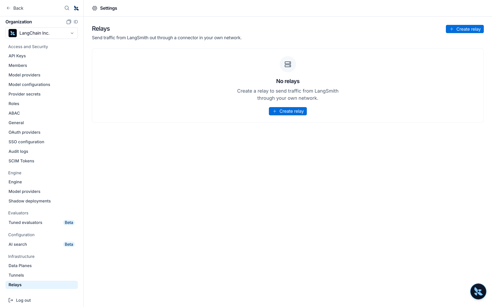
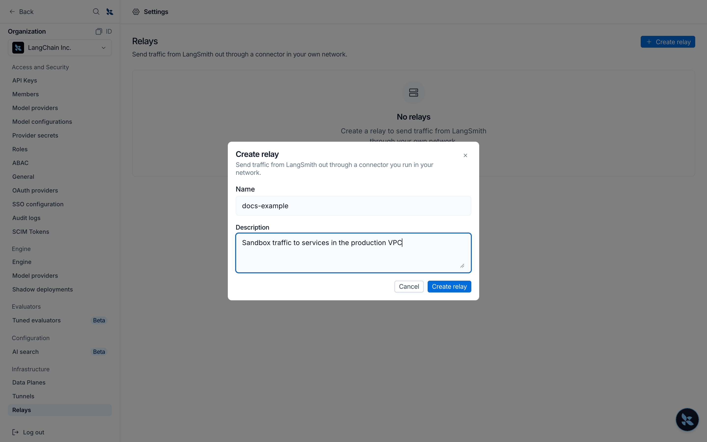
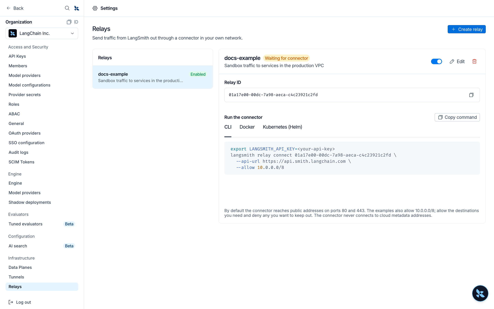
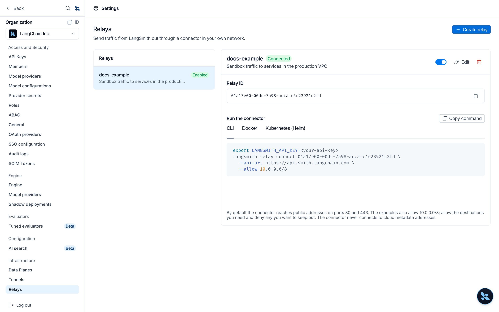

# Relays

> Send a sandbox's outbound connections to hosts you choose through a connector in your network, so they reach private services and leave from your network's IP address.

> [!NOTE]
>
> Relays are in [alpha](../../Cloud/Reference/Release%20stages.md). To request access for your organization, [contact our sales team](https://www.langchain.com/contact-sales).

A relay sends some of a [sandbox's](../../../Deploy/Sandboxes/LangSmith%20Sandboxes.md) outbound connections through your own network. You run the LangSmith connector inside your network and add a relay rule to the sandbox's proxy configuration. When the sandbox connects to a host that the rule matches, the connection leaves from the connector instead of from LangSmith. Use a relay to reach a service that is only reachable inside your network, such as an internal database or API, or to make requests from your network's IP address.

A relay works in the opposite direction from a [tunnel](Tunnels.md), which lets LangSmith call a service on your private network. Both use the same connector, and one connector serves either a tunnel or a relay.

Relays are available on [LangSmith Cloud](../../Cloud/Cloud%20%28SaaS%29.md) in every region. They are not available for self-hosted or hybrid deployments.

## How relays work

1. An organization admin creates a relay in LangSmith.
2. You run the connector inside your network with the relay's ID and an API key. The connector connects outbound to LangSmith over HTTPS (port 443). Nothing connects in to your network, and the connector exposes no ports.
3. You add a relay rule to a sandbox's `proxy_config`. The rule lists the hostnames, IP addresses, or CIDR blocks to send through the relay.
4. When the sandbox opens a connection to a matching destination, LangSmith carries it to the connector, and the connector opens the connection from your network.
5. The connector checks every destination against its own policy before it connects. By default it reaches only public addresses on ports 80 and 443. You widen that with allow rules and narrow it with deny rules.

## Set up a relay

To create a relay, you need the [Organization Admin or Organization Operator](../Users%20%26%20access%20control/Role-based%20access%20control.md#organization-roles) role. You also need a place inside your network to run the connector, such as a Kubernetes cluster, a Docker host, or a machine with the [LangSmith CLI](../Tools/LangSmith%20CLI.md). It must reach the destinations you relay and make outbound HTTPS connections.

**1. Create an API key**

In **Settings** > **API Keys**, [create an organization-scoped service key](../../Account/Create%20an%20account%20and%20API%20key.md) with the Organization Admin or Organization Operator role. The connector uses it to connect to LangSmith. Store it where your connector can read it, and do not commit it to source control.

**2. Create the relay**

In LangSmith, go to **Settings**, then select **Relays** under **Infrastructure**.



Select **Create relay**, enter a name and an optional description, then select **Create relay**. Names are unique across your organization's tunnels and relays.



The new relay shows **Waiting for connector** until a connector connects to it.

To create a relay with the API instead, send `POST /v1/connections` with `{"name": "corp-network", "kind": "relay"}`. A connection's kind cannot change after you create it.

**3. Run the connector**

Run the connector inside your network in relay mode. The relay's page in **Settings** > **Relays** shows a command for the CLI, Docker, and Kubernetes (Helm) with the relay ID and your region's endpoint filled in. Copy one and replace `<your-api-key>`.



To write the configuration yourself, use your region's API URL if your organization is not in the GCP US region:

<table>
  <thead>
    <tr>
      <th>Region</th>

      <th>
        URL
      </th>
    </tr>
  </thead>

  <tbody>
    <tr>
      <td>GCP US</td>

      <td>
        `https://api.smith.langchain.com`
      </td>
    </tr>

    <tr>
      <td>GCP EU</td>

      <td>
        `https://eu.api.smith.langchain.com`
      </td>
    </tr>

    <tr>
      <td>GCP APAC</td>

      <td>
        `https://apac.api.smith.langchain.com`
      </td>
    </tr>

    <tr>
      <td>AWS US</td>

      <td>
        `https://aws.api.smith.langchain.com`
      </td>
    </tr>
  </tbody>
</table>

The examples allow the relay to reach `10.0.0.0/8` and `db.corp.internal:5432` in addition to its default; see [Connector policy](#connector-policy).

> [tab] Kubernetes (Helm)
>
> Store the API key in a Secret, then install the [`langsmith-connector` chart](https://github.com/langchain-ai/helm/tree/main/charts/langsmith-connector), version 0.3.0 or later:
>
> ```bash theme={"theme":{"light":"catppuccin-latte","dark":"catppuccin-mocha"}}
> kubectl create namespace langsmith-connector
> kubectl -n langsmith-connector create secret generic langsmith-connector-key \
>   --from-literal=langsmith_api_key=<api key>
>
> helm repo add langchain https://langchain-ai.github.io/helm/
> helm repo update
> helm install langsmith-relay langchain/langsmith-connector \
>   --namespace langsmith-connector \
>   --set config.connectionId=<relay id> \
>   --set config.existingSecretName=langsmith-connector-key \
>   --set config.relay.enabled=true \
>   --set 'config.relay.allow={10.0.0.0/8,db.corp.internal:5432}'
> ```
>
> Add `--set config.endpoint=<endpoint>` for a region other than GCP US, and `config.relay.deny` for deny rules. Pass rules as a list, as in the example. A relay takes no `config.targets`.
>
> Run a single replica. One connector already keeps two redundant connections to LangSmith.

> [tab] Docker
>
> ```bash theme={"theme":{"light":"catppuccin-latte","dark":"catppuccin-mocha"}}
> docker run -d --name langsmith-relay --restart unless-stopped \
>   -e LANGSMITH_CONNECTION_ID=<relay id> \
>   -e LANGSMITH_API_KEY=<api key> \
>   -e LANGSMITH_CONNECTOR_RELAY_MODE=true \
>   -e LANGSMITH_CONNECTOR_RELAY_ALLOW="10.0.0.0/8,db.corp.internal:5432" \
>   langchain/langsmith-connector:0.3.0
> ```
>
> Add `-e LANGSMITH_ENDPOINT=<endpoint>` for a region other than GCP US, and `LANGSMITH_CONNECTOR_RELAY_DENY` for deny rules. Both rule variables take a comma-separated list. To read the key from a file instead, set `LANGSMITH_API_KEY_FILE` to its path.

> [tab] LangSmith CLI
>
> ```bash theme={"theme":{"light":"catppuccin-latte","dark":"catppuccin-mocha"}}
> export LANGSMITH_API_KEY=<api key>
> langsmith relay connect <relay id> --allow 10.0.0.0/8 --allow db.corp.internal:5432
> ```
>
> The `relay connect` command needs LangSmith CLI 0.3.5 or later. It runs until you stop it. Set `LANGSMITH_ENDPOINT` for a region other than GCP US, and pass `--deny` for deny rules. The connector authenticates with an API key, so a profile that signs in with OAuth does not work.

The connector honors `HTTPS_PROXY` if your network requires an outbound proxy. It logs `connector registered with LangSmith` when it connects. Set `LOG_LEVEL=debug` for more detail. With Helm, set it through `connector.deployment.extraEnv`.

**4. Add a relay rule to a sandbox**

Add a rule with `"type": "relay"` to the sandbox's `proxy_config` when you create the sandbox, or update the `proxy_config` of an existing sandbox:

```json
{
  "rules": [
    {
      "name": "corp-network",
      "type": "relay",
      "relay_id": "<relay id>",
      "match_hosts": ["10.0.0.0/8", "db.corp.internal"]
    }
  ]
}
```

With the CLI, save the configuration as `proxy.json` and pass it when you create the sandbox:

```bash
langsmith sandboxes create my-sandbox --proxy-config @proxy.json
```

See [Relay rules](#relay-rules) for the fields and how relay rules combine with other proxy settings.

**5. Check that the relay works**

Within a few seconds of the connector starting, the relay shows **Connected** in **Settings** > **Relays**.



From the sandbox, connect to a destination that the relay rule matches and the connector's policy allows:

```bash
langsmith sandboxes exec my-sandbox -- curl -sS http://<host>:<port>/
```

The response comes from the service in your network, and the connector logs `connector opened relay flow` with the destination. If the connector's policy refuses the destination, the connector logs `relay policy denied destination` and the sandbox's connection fails; add an allow rule for it.

A connection to a matched destination fails while no connector is connected to the relay. It never falls back to a direct connection.

## Relay rules

A relay rule is a rule in the sandbox's `proxy_config` (see [Configure auth proxy rules](../../../Deploy/Sandboxes/Sandbox%20auth%20proxy.md#configure-auth-proxy-rules)) with these fields:

| Field | Description |
| - | - |
| `name` | Required. Identifier for the rule |
| `type` | `relay` |
| `relay_id` | Required. The ID of the relay that carries matching connections |
| `match_hosts` | Required. Hostnames and `*.` wildcards, as for header rules, plus IP addresses and CIDR blocks (`10.0.0.0/8`, `2001:db8::/32`), which match connections the sandbox makes to an IP address |
| `enabled` | Defaults to `true` |
| `description` | Optional, up to 1024 characters. What this rule lets the sandbox reach |

A relay rule matches hosts only, so it does not accept `match_paths`, `headers`, `env_vars`, `aws`, `gcp`, or `azure`.

* The first enabled relay rule that matches a destination carries it. Header rules for the same host still apply.
* [Access control](../../../Deploy/Sandboxes/Sandbox%20auth%20proxy.md#egress-and-network-access-control) applies first, so a destination that access control blocks is not relayed.
* A relay rule can match private addresses that the sandbox would otherwise refuse to connect to. The connector's policy decides whether it reaches them.
* A sandbox can use only relays in its own organization.

## Connector policy

The connector decides which destinations a relay can reach, whatever the sandbox's rules match:

* By default, it reaches public addresses on ports 80 and 443.
* Allow rules add destinations, and deny rules remove them. A deny rule wins over an allow rule.
* It never connects to cloud metadata addresses.

Each rule is a CIDR block (`10.0.0.0/8`), an IP address, a hostname (`db.corp.internal`), or a wildcard (`*.corp.internal`), optionally followed by `:PORT`. An IPv6 address or range takes a port only in brackets (`[2001:db8::1]:443`).

The connector resolves hostnames with your network's DNS. When an allow rule names a hostname, the connector connects to the addresses that hostname resolves to unless a deny rule matches them.

To change the policy, update the connector's configuration and restart it, for example with `helm upgrade`.

## Security

### Outbound-only connection

The connector makes an outbound WebSocket connection over TLS to your region's LangSmith API endpoint on port 443. You do not open inbound ports or change firewall rules for LangSmith, and the connector exposes no ports.

### Authentication and authorization

* **Connector**: The connector authenticates with an organization API key that has permission to connect tunnels and relays. LangSmith accepts the connector only while the relay is enabled.
* **Each connection**: Before LangSmith carries a sandbox's connection to the connector, it checks that the relay belongs to the sandbox's organization and is enabled.

### What your network exposes

* A sandbox reaches only destinations that both its relay rule matches and your connector's policy allows. The connector's policy is configured inside your network, and LangSmith cannot change it.
* The connector does not connect to cloud metadata addresses.
* Relayed connections reach your network from the connector's address, so your services see the connector as the client.

### Logging

The connector does not log the contents of relayed connections. At the default `info` level, it logs each relayed connection's destination and each destination its policy refuses.

### Revoke access

To stop sandboxes from using your network, disable or delete the relay in **Settings** > **Relays**. You can also stop the connector or revoke its API key.
