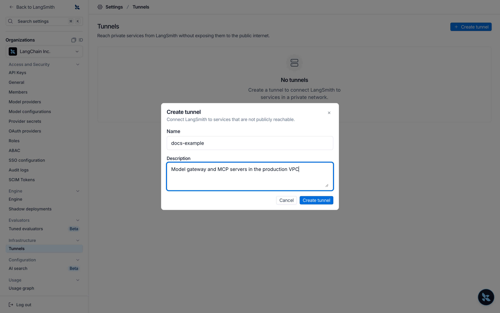
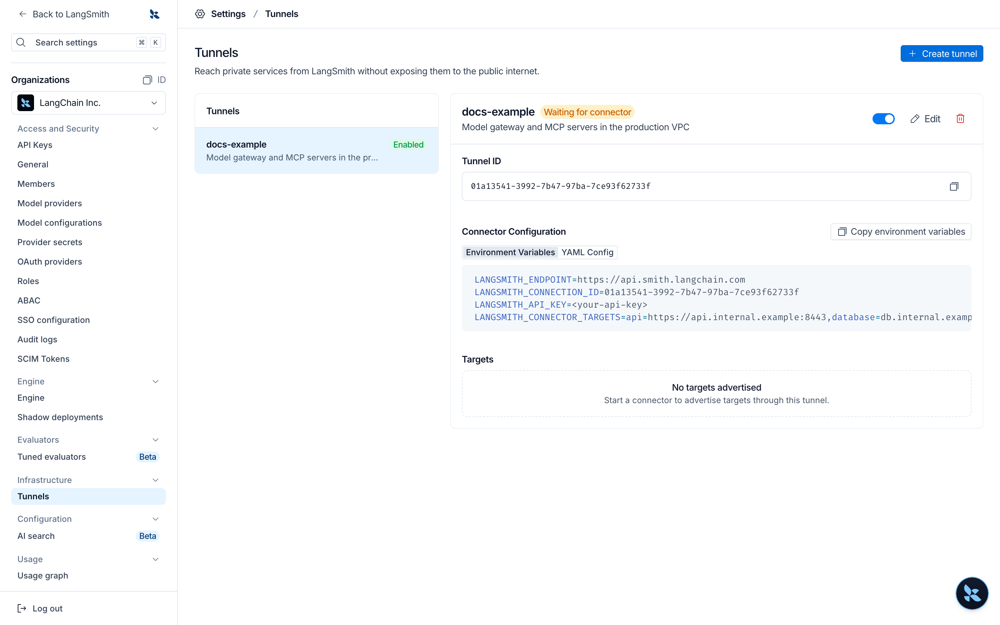
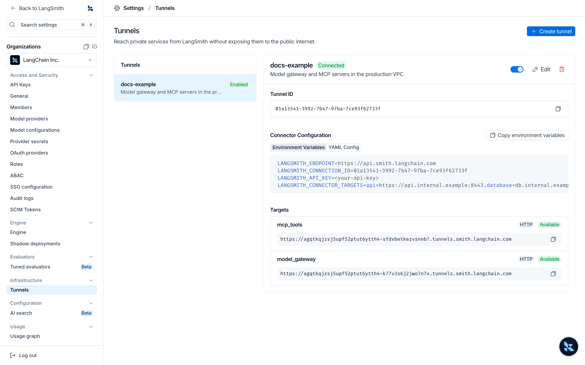

# Tunnels

> Reach services on your private network from LangSmith through an outbound-only connector, without exposing them to the public internet.

> [!NOTE]
>
> Tunnels are in [alpha](../../Cloud/Reference/Release%20stages.md). To request access for your organization, [contact our sales team](https://www.langchain.com/contact-sales).

A tunnel lets LangSmith reach a service that runs on your private network, such as a model endpoint or an MCP server, without opening that service to the internet. You run a small connector inside your network. The connector opens an outbound connection to LangSmith, and LangSmith sends requests for your service over that connection. To send a sandbox's outbound connections through your network instead, use a [relay](Relays.md).

Tunnels are available on [LangSmith Cloud](../../Cloud/Cloud%20%28SaaS%29.md) in every region. They are not available for self-hosted or hybrid deployments, or in personal organizations.

## How tunnels work

1. An organization admin creates a tunnel in LangSmith.
2. You run the connector inside your network and configure it with the tunnel's ID, an API key, and one or more **targets**. A target is a name mapped to a private address, for example `litellm` mapped to `http://litellm.internal:4000`.
3. The connector connects outbound to LangSmith over HTTPS (port 443). Nothing connects in to your network, and the connector exposes no ports.
4. Each HTTP target gets a **tunnel URL**. You use that URL in LangSmith wherever you would use the service's address.
5. When a request reaches a tunnel URL, LangSmith checks that the caller belongs to the tunnel's organization. LangSmith then sends the request to the connector, which forwards it to the target.

## Set up a tunnel

To create a tunnel, you need the [Organization Admin or Organization Operator](../Users%20%26%20access%20control/Role-based%20access%20control.md#organization-roles) role. You also need a place inside your network to run the connector: a Kubernetes cluster or a Docker host that can reach your services and make outbound HTTPS connections.

**1. Open Tunnels settings**

In LangSmith, go to **Settings**, then select **Tunnels** under **Infrastructure**.

**2. Create the tunnel**

Select **Create tunnel**. Enter a name and an optional description, then select **Create tunnel**.



**3. Copy the connector configuration**

The new tunnel shows **Waiting for connector**. Its **Connector Configuration** section shows the tunnel ID and the settings the connector needs, as environment variables or as a YAML file. Copy them, and replace the example targets with your own (see [Targets](#targets)).



**4. Create an API key for the connector**

In **Settings** > **API Keys**, [create an organization-scoped service key](../../Account/Create%20an%20account%20and%20API%20key.md) with the Organization Admin or Organization Operator role. The connector uses this key to connect to LangSmith. Store it where your connector can read it, and do not commit it to source control.

**5. Run the connector**

Run the connector inside your network. If your organization is not in the GCP US region, set the endpoint to your region's API URL:

<table>
  <thead>
    <tr>
      <th>Region</th>

      <th>
        URL
      </th>
    </tr>
  </thead>

  <tbody>
    <tr>
      <td>GCP US</td>

      <td>
        `https://api.smith.langchain.com`
      </td>
    </tr>

    <tr>
      <td>GCP EU</td>

      <td>
        `https://eu.api.smith.langchain.com`
      </td>
    </tr>

    <tr>
      <td>GCP APAC</td>

      <td>
        `https://apac.api.smith.langchain.com`
      </td>
    </tr>

    <tr>
      <td>AWS US</td>

      <td>
        `https://aws.api.smith.langchain.com`
      </td>
    </tr>
  </tbody>
</table>

> [tab] Kubernetes (Helm)
>
> Store the API key in a Secret, then install the [`langsmith-connector` chart](https://github.com/langchain-ai/helm/tree/main/charts/langsmith-connector):
>
> ```bash theme={"theme":{"light":"catppuccin-latte","dark":"catppuccin-mocha"}}
> kubectl create namespace langsmith-connector
> kubectl -n langsmith-connector create secret generic langsmith-connector-key \
>   --from-literal=langsmith_api_key=<api key>
>
> helm repo add langchain https://langchain-ai.github.io/helm/
> helm repo update
> helm install langsmith-connector langchain/langsmith-connector \
>   --namespace langsmith-connector \
>   --set config.connectionId=<tunnel id> \
>   --set config.existingSecretName=langsmith-connector-key \
>   --set config.targets.litellm=http://litellm.internal:4000
> ```
>
> Add `--set config.endpoint=<endpoint>` for a region other than GCP US. The chart mounts the key as a file and the connector reads it again on every reconnect, so you can rotate the key in the Secret without restarting the connector.
>
> Run a single replica. One connector already keeps two redundant connections to LangSmith.

> [tab] Docker
>
> ```bash theme={"theme":{"light":"catppuccin-latte","dark":"catppuccin-mocha"}}
> docker run -d --name langsmith-connector --restart unless-stopped \
>   -e LANGSMITH_CONNECTION_ID=<tunnel id> \
>   -e LANGSMITH_API_KEY=<api key> \
>   -e LANGSMITH_CONNECTOR_TARGETS="litellm=http://litellm.internal:4000" \
>   langchain/langsmith-connector:0.3.0
> ```
>
> Add `-e LANGSMITH_ENDPOINT=<endpoint>` for a region other than GCP US. To read the key from a file instead, set `LANGSMITH_API_KEY_FILE` to its path.

The connector honors `HTTPS_PROXY` if your network requires an outbound proxy. Set `LOG_LEVEL=debug` to log every request it forwards. With Helm, set it through `connector.deployment.extraEnv`.

**6. Check that the tunnel is connected**

Within a few seconds of the connector starting, the tunnel shows **Connected** and lists each target the connector serves, with its tunnel URL.



To check a target from your own machine, send a request to its tunnel URL with an API key for the organization:

```bash
curl -H "X-Api-Key: $LANGSMITH_API_KEY" https://<handle>.tunnels.smith.langchain.com/
```

The response comes from your service. A request without a valid API key returns `403` with `connection access denied`.

If the tunnel stays at **Waiting for connector**, check the connector's logs. Each time the connector fails to connect, it logs a warning with the reason and retries. Common causes are an API key without the Organization Admin or Organization Operator role, a wrong tunnel ID, or a disabled tunnel.

### Targets

Each target is a name and an address:

* **Name**: 1 to 63 characters. It starts with a lowercase letter and contains only lowercase letters, digits, and underscores.
* **Address**: `http://host:port` or `https://host:port`, with no path. LangSmith can reach only HTTP and HTTPS targets.

A connector can serve up to 256 targets. To add or change targets, update the connector's configuration and restart it, for example with `helm upgrade`.

## Use a tunnel URL

Select **Copy tunnel URL** next to a target to copy its URL. Tunnel URLs look like `https://<handle>.tunnels.smith.langchain.com`, with the region in the domain for other regions (for example, `tunnels.eu.smith.langchain.com`). You can also list a tunnel's targets and URLs with `GET /v1/connections/{tunnel_id}/targets`.

You can use a tunnel URL in place of a service address in:

* [Model configurations](Workspace%20setup/Manage%20model%20configurations.md) and [custom model endpoints](../../../Deploy/Prompt%20%26%20Context%20Hub/Prompts/Connect%20to%20models/Connect%20to%20a%20custom%20model.md), as the base URL. This covers the Playground, experiments, and online evaluators that use the model.
* [LangSmith Fleet](../../../Additional%20documentation/No-code%20agents%20with%20LangSmith%20Fleet.md), as a model's base URL or an MCP server URL.
* MCP servers that use OAuth, for the token endpoint. The authorization endpoint must stay reachable from the browser, so it cannot be a tunnel URL.
* [Agent Servers](../../../Deploy/Deploy%20to%20Cloud/Deployment%20guide/Create%20an%20Agent%20Server.md) on LangSmith Cloud, from your agent's own code. See [Call a tunnel from an Agent Server](#call-a-tunnel-from-an-agent-server).

Keep the following in mind:

* Tunnel URLs use HTTPS only.
* Requests through a tunnel do not follow redirects.
* A model reached through a tunnel needs its own API key in its configuration. LLM auth proxy credentials are not sent through a tunnel.
* Your target must start responding within 30 seconds. A single request can stream for up to 1 hour, and request bodies can be up to 32 MiB.

## Call a tunnel from an Agent Server

An agent running on an Agent Server on LangSmith Cloud can call a tunnel URL from its own code. Any Agent Server in the tunnel's organization can call the tunnel, whatever its workspace. Send the Agent Server's LangSmith API key in the `X-Api-Key` header. You do not need to create a key: the control plane sets `LANGSMITH_API_KEY` on every Agent Server it creates. For more information, see [LangSmith integration](../../../Deploy/Get%20started/Deployment%20components/LangSmith%20control%20plane.md#langsmith-integration).

```python
import os

import httpx

TUNNEL_URL = "https://<handle>.tunnels.smith.langchain.com"

response = httpx.get(
    TUNNEL_URL,
    headers={"X-Api-Key": os.environ["LANGSMITH_API_KEY"]},
)
```

LangSmith checks the key, removes it, and forwards the request to your service. A request without the key returns `403` with `connection access denied`.

An `Authorization` header passes through unchanged. If your service expects its own `X-Api-Key` or `Cookie` header instead, send it as `X-Tunnel-Origin-X-Api-Key` or `X-Tunnel-Origin-Cookie`. LangSmith renames it back before the request reaches your service:

```python
headers = {
    "X-Api-Key": os.environ["LANGSMITH_API_KEY"],
    "X-Tunnel-Origin-X-Api-Key": os.environ["MY_SERVICE_API_KEY"],
}
```

## Security

### Outbound-only connection

The connector makes an outbound WebSocket connection over TLS to your region's LangSmith API endpoint on port 443. You do not open inbound ports or change firewall rules for LangSmith, and the connector pod exposes no ports.

### Authentication and authorization

* **Connector**: The connector authenticates with an organization API key that has permission to connect tunnels. LangSmith accepts the connector only while the tunnel is enabled.
* **Each request**: LangSmith authorizes every request to a tunnel URL. The caller must be a LangSmith service acting for a member of the tunnel's organization, or must present an API key for that organization. The tunnel must be enabled. A tunnel URL is not a secret and grants no access by itself.

### What your network exposes

* LangSmith sends the connector only a target name. The connector looks the name up in its own configuration and refuses names it does not have, so LangSmith can reach only the targets you configure.
* The connector does not connect to cloud metadata addresses.
* For HTTP targets, the target's host and port are shared with LangSmith so requests carry the right `Host` header.

### Headers

LangSmith removes its own credentials and identity headers before a request reaches your service: `X-Service-Key`, `X-Api-Key`, `X-Tenant-Id`, `X-Organization-Id`, `X-User-Id`, `X-Data-Plane-Auth`, `Cookie`, and any header that starts with `X-Langsmith-` or `X-Langchain-`. `Authorization` passes through, so a service that authenticates with a bearer token works without changes.

If your service authenticates with its own `X-Api-Key` or `Cookie` header, LangSmith features deliver the header you configure to your service. From your own code, send the header with the `X-Tunnel-Origin-` prefix, as described in [Call a tunnel from an Agent Server](#call-a-tunnel-from-an-agent-server). Headers named after LangSmith's identity headers, such as `X-Tenant-Id`, never reach your service.

### Encryption

* Traffic between LangSmith and the connector travels inside the TLS-encrypted WebSocket connection.
* LangSmith terminates TLS for tunnel URLs and handles each request in memory to route it to your connector.
* Between the connector and your service, use an `https://` target to encrypt traffic. The connector verifies the service's certificate against the system certificate authorities. To trust a private certificate authority, set `SSL_CERT_FILE` on the connector. Traffic to `http://` targets is not encrypted inside your network.

### Logging and data storage

LangSmith does not log request or response bodies sent through a tunnel. For failed requests, LangSmith logs the tunnel, organization, target, status, and error. LangSmith stores only the routing information needed to reach your connector.

The connector does not log request or response bodies either. By default it logs only failures, such as a target it cannot reach. At debug level, it also logs each request's target, address, duration, and size.

### Revoke access

To stop LangSmith from reaching your services, disable or delete the tunnel in **Settings** > **Tunnels**. LangSmith then rejects requests to its tunnel URLs and refuses new connector connections. You can also stop the connector, or revoke its API key.
