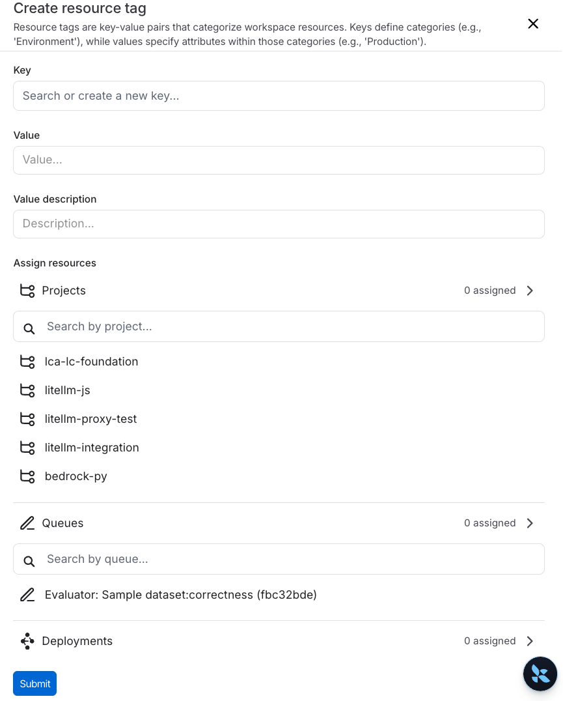

# Set up resource tags

> Create and manage resource tags to organize projects, datasets, prompts, and other resources within a LangSmith workspace.

> [!NOTE]
>
> Resource tags are available for [Plus and Enterprise plans](https://docs.langchain.com/langsmith/pricing-plans.md).

While [workspaces](../Overview.md#workspaces) help separate trust boundaries and access control, tags help you organize resources within a workspace. Tags are key-value pairs that you can attach to resources.

> [!NOTE]
>
> **Not to be confused with commit tags**: Resource tags are key-value pairs used to organize and filter workspace resources (projects, datasets, prompts, etc.). [Commit tags](../../../../Deploy/Prompt%20%26%20Context%20Hub/Prompts/Create%20and%20manage%20prompts/Manage%20prompts.md#commit-tags) are labels that reference specific versions in a prompt's commit history. While both types of tags can use similar terminology (like `prod` or `staging`), resource tags help you *organize resources* across your workspace, while commit tags control *which version* of a prompt is used in your code.

You can manage resource tags through the [LangSmith UI](https://smith.langchain.com?utm_source=docs&utm_medium=cta&utm_campaign=langsmith-signup&utm_content=langsmith-set-up-resource-tags) or programmatically via the [REST API](../../../../Monitor/Reference/LangSmith%20REST%20API/LangSmith%20API%20reference.md):

> [tab] UI
>
> ## Create a tag
>
> > [!NOTE]
> >
> > To create resource tags, you must have the [`workspaces:manage` permission](../../Users%20%26%20access%20control/Organization%20and%20workspace%20operations%20reference.md) (granted to the [workspace admin](../../Users%20%26%20access%20control/Role-based%20access%20control.md#workspace-admin) role by default). Editors can apply **Application** tags to resources they have update access to, but creating tag keys or applying other tag types requires this permission. For more on applying tags to resources, refer to the workspace operations [Tags section](../../Users%20%26%20access%20control/Organization%20and%20workspace%20operations%20reference.md#tags).
>
> To create a tag:
>
> 1. Navigate to the workspace **Settings** page and click on **Resource tags** in the left-hand sidebar.
> 2. Here, you'll find the existing tag values, grouped by key. LangSmith creates the **Application** and **Environment** keys by default.
> 3. Select  **New Tag** at the top of the page. You'll be prompted to enter a key and a value for the tag. Note that you can use an existing key or create a new one.
>
>    
>
> ## Assign a tag to a resource
>
> Within the same side panel for creating a new tag, you can also assign resources to tags. Search for corresponding resources in the **Assign resources** section and select the resources you want to tag.
>
> > [!NOTE]
> >
> > You can only tag workspace-scoped resources with resource tags. This includes Tracing Projects, Annotation Queues, Deployments, Experiments, Datasets, and Prompts. In an [agent-based workspace](../../../Overview/Agent-based%20workspaces/Agent%20Registry.md), a tracing project is one [environment](../../../Overview/Agent-based%20workspaces/Agent%20environments.md) of an agent, so tagging one tags a single environment rather than the agent.
>
> To un-assign a tag from a resource, click the  trash icon next to the tag, both in the tag panel and the resource tag panel.
>
> ## Delete a tag
>
> You can delete either a key or a value of a tag from the [**Settings** page > **Resource tags** page](https://smith.langchain.com/settings/workspaces/resource_tags). To delete a key, click the  trash icon next to the key. To delete a value, click the  trash icon next to the value.
>
> If you delete a key, LangSmith will delete all values associated with that key. When you delete a value, you will lose all associations between that value and resources.

> [tab] API
>
> ## Manage tags via API
>
> You can create, assign, and query resource tags programmatically using the LangSmith REST API. All tag endpoints live under `/api/v1/workspaces/current/` and require an [API key](../../../Account/Create%20an%20account%20and%20API%20key.md).
>
> ### Set up
>
> Import the `requests` library and configure your API key and headers. All the following examples assume these variables are in scope:
>
> ```python theme={"theme":{"light":"catppuccin-latte","dark":"catppuccin-mocha"}}
> import os
> import requests
>
> LANGSMITH_API_URL = "https://api.smith.langchain.com"
> LANGSMITH_API_KEY = os.environ["LANGSMITH_API_KEY"]
> headers = {"x-api-key": LANGSMITH_API_KEY, "Content-Type": "application/json"}
> ```
>
> ### Create a tag key
>
> > [!NOTE]
> >
> > Creating tag keys requires the [`workspaces:manage`](../../Users%20%26%20access%20control/Organization%20and%20workspace%20operations%20reference.md) permission.
> > If you want to apply the default **Application** key, skip this step and list existing keys instead.
>
> ```python theme={"theme":{"light":"catppuccin-latte","dark":"catppuccin-mocha"}}
> response = requests.post(
>     f"{LANGSMITH_API_URL}/api/v1/workspaces/current/tag-keys",
>     headers=headers,
>     json={"key": "Environment", "description": "Deployment environment"},
> )
> response.raise_for_status()
> tag_key = response.json()
> tag_key_id = tag_key["id"]
> ```
>
> ### Create a tag value
>
> ```python theme={"theme":{"light":"catppuccin-latte","dark":"catppuccin-mocha"}}
> response = requests.post(
>     f"{LANGSMITH_API_URL}/api/v1/workspaces/current/tag-keys/{tag_key_id}/tag-values",
>     headers=headers,
>     json={"value": "production"},
> )
> response.raise_for_status()
> tag_value = response.json()
> tag_value_id = tag_value["id"]
> ```
>
> ### Assign a tag to a resource
>
> ```python theme={"theme":{"light":"catppuccin-latte","dark":"catppuccin-mocha"}}
> response = requests.post(
>     f"{LANGSMITH_API_URL}/api/v1/workspaces/current/taggings",
>     headers=headers,
>     json={
>         "tag_value_id": tag_value_id,
>         "resource_type": "project",
>         "resource_id": "<project-uuid>",
>     },
> )
> response.raise_for_status()
> tagging_id = response.json()["id"]
> ```
>
> Valid `resource_type` values: `project`, `dataset`, `prompt`, `experiment`, `queue`,
> `deployment`, `dashboard`, `evaluator`, `mcp_server`, `fleet_integration`.
>
> > [!NOTE]
> >
> > **Permissions**: Assigning the **Application** tag only requires update access to the target resource,
> > so editors can do this without `workspaces:manage`. Assigning any other tag key requires `workspaces:manage`.
>
> **Applying existing tags**: If the key and value already exist (for example, the default **Application** key), retrieve their IDs first and go straight to the assign step:
>
> ```python theme={"theme":{"light":"catppuccin-latte","dark":"catppuccin-mocha"}}
> tags = requests.get(
>     f"{LANGSMITH_API_URL}/api/v1/workspaces/current/tags",
>     headers=headers,
> ).json()
> # tags is a list of {id, key, values: [{id, value}, ...]}
> ```
>
> ### Tag a resource at creation time
>
> You can supply `tag_value_ids` when creating a project, dataset, or prompt (including fork and clone operations). The tags are applied atomically in the same transaction as resource creation, so the resource is never briefly untagged — important when [ABAC policies](../../Users%20%26%20access%20control/Attribute-based%20access%20control.md) are enforced.
>
> The tag values must already exist. Pass their UUIDs as a list (maximum 100):
>
> ```python theme={"theme":{"light":"catppuccin-latte","dark":"catppuccin-mocha"}}
> # Look up the tag value IDs you want to apply
> tags = requests.get(
>     f"{LANGSMITH_API_URL}/api/v1/workspaces/current/tags",
>     headers=headers,
> ).json()
> # tags is a list of {id, key, values: [{id, value}, ...]}
> env_tag_value_id = next(
>     v["id"]
>     for t in tags if t["key"] == "Environment"
>     for v in t["values"] if v["value"] == "production"
> )
>
> # Create a project and tag it immediately
> response = requests.post(
>     f"{LANGSMITH_API_URL}/api/v1/sessions",
>     headers=headers,
>     json={
>         "name": "my-project",
>         "tag_value_ids": [env_tag_value_id],
>     },
> )
> response.raise_for_status()
> project = response.json()
> ```
>
> The same `tag_value_ids` field is accepted by:
>
> | Endpoint | Description |
> | - | - |
> | `POST /api/v1/sessions` | Create a tracing project |
> | `POST /api/v1/datasets` | Create a dataset (also accepted on CSV upload and experiment upload variants) |
> | `POST /api/v1/datasets/{dataset_id}/clone` | Clone a dataset |
> | `POST /api/v1/repos` | Create a prompt |
> | `POST /api/v1/repos/{repo_id}/fork` | Fork a prompt |
>
> > [!NOTE]
> >
> > **Permissions**: Applying the **Application** tag at creation time requires only update access to the resource type. Applying any other tag key requires the [`workspaces:manage`](../../Users%20%26%20access%20control/Organization%20and%20workspace%20operations%20reference.md) permission.
>
> > [!TIP]
> >
> > If you are using LangSmith SDK tracing and the project is auto-created during trace ingestion, the `tag_value_ids` parameter is not available on that auto-create path. To ensure ABAC policies are enforced from the start, pre-create the project via `POST /api/v1/sessions` with the desired `tag_value_ids` before starting the trace session.
>
> ### Query tags
>
> ```python theme={"theme":{"light":"catppuccin-latte","dark":"catppuccin-mocha"}}
> # All tag keys and values in the workspace
> tags = requests.get(
>     f"{LANGSMITH_API_URL}/api/v1/workspaces/current/tags",
>     headers=headers,
> ).json()
>
> # Tags on a specific resource
> resource_tags = requests.get(
>     f"{LANGSMITH_API_URL}/api/v1/workspaces/current/tags/resource",
>     headers=headers,
>     params={"resource_type": "project", "resource_id": "<project-uuid>"},
> ).json()
>
> # All resources tagged with a specific value
> taggings = requests.get(
>     f"{LANGSMITH_API_URL}/api/v1/workspaces/current/taggings",
>     headers=headers,
>     params={"tag_value_id": tag_value_id},
> ).json()
> ```
>
> ### Remove a tag from a resource
>
> ```python theme={"theme":{"light":"catppuccin-latte","dark":"catppuccin-mocha"}}
> requests.delete(
>     f"{LANGSMITH_API_URL}/api/v1/workspaces/current/taggings/{tagging_id}",
>     headers=headers,
> )
> ```
>
> ### Delete a tag key or value
>
> ```python theme={"theme":{"light":"catppuccin-latte","dark":"catppuccin-mocha"}}
> # Delete a value (removes all resource assignments for that value)
> requests.delete(
>     f"{LANGSMITH_API_URL}/api/v1/workspaces/current/tag-keys/{tag_key_id}/tag-values/{tag_value_id}",
>     headers=headers,
> )
>
> # Delete a key (also deletes all its values)
> requests.delete(
>     f"{LANGSMITH_API_URL}/api/v1/workspaces/current/tag-keys/{tag_key_id}",
>     headers=headers,
> )
> ```
>
> For a full list of request/response fields, refer to the [API reference](../../../../Monitor/Reference/LangSmith%20REST%20API/LangSmith%20API%20reference.md).
