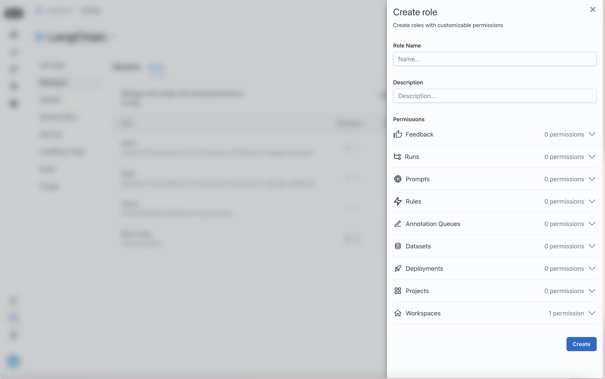
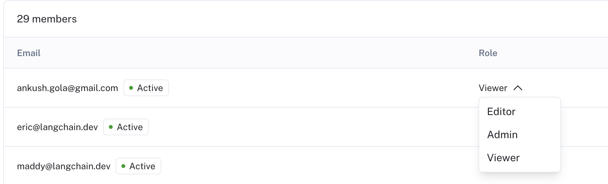
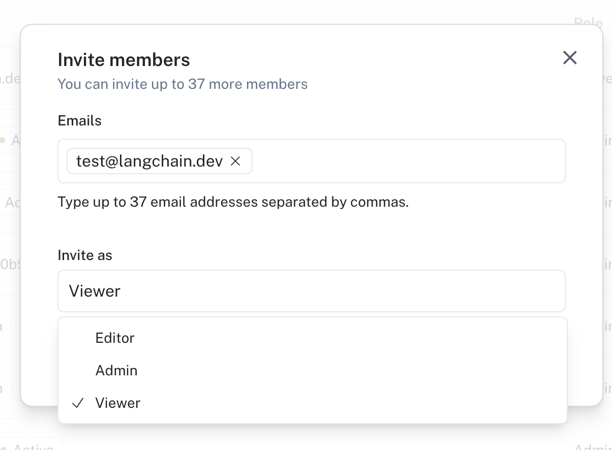
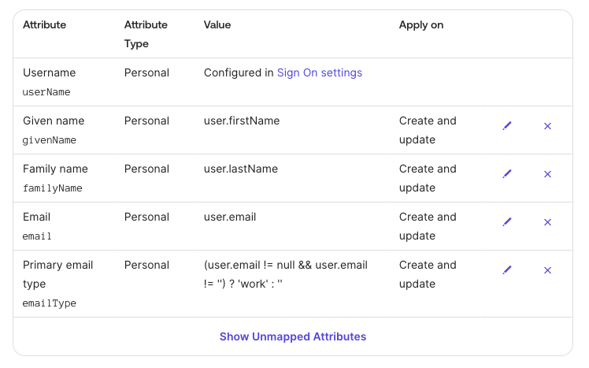

# User management

> Configure role-based access control, SAML SSO, and SCIM user provisioning for your LangSmith organization.

Organization Admins control who can sign in to a LangSmith organization and what each user can do in its workspaces. This page covers three independent features, all available on the Enterprise plan:

* [Access control](#set-up-access-control): Create custom roles and assign roles to workspace members. Without it, every user has the `Admin` role.
* [SAML SSO](#set-up-saml-sso-for-your-organization): Let users sign in through your identity provider (IdP) on LangSmith Cloud. Self-hosted deployments use [OAuth2.0 and OIDC](../../Self-hosted/Platform%20auth%20%26%20access%20control/Set%20up%20SSO%20with%20OAuth2.0%20and%20OIDC.md) instead.
* [SCIM provisioning](#set-up-scim-for-your-organization): Add, update, and remove users and their roles automatically from your IdP.

To use all three, set them up in the order listed. SCIM group names reference role names. On cloud, SCIM requires SAML SSO.

## Set up access control

> [!NOTE]
>
> RBAC (Role-Based Access Control) is a feature that is only available to Enterprise customers. If you are interested in this feature, [contact our sales team](https://www.langchain.com/contact-sales). Other plans default to using the [`Admin` role](../Organization/Overview.md) for all users.

> [!TIP]
>
> You may find it helpful to read the [Administration overview](../Organization/Overview.md) page before setting up access control.

LangSmith relies on RBAC to manage user permissions within a [workspace](../Organization/Overview.md#workspaces). This allows you to control who can access your LangSmith workspace and what they can do within it. Users with the `workspaces:manage` permission can manage workspace settings, and users with the `workspaces:manage-members` permission can add, remove, and update workspace members. The built-in Workspace Admin role includes both permissions.

For a complete reference of workspace roles and their permissions, refer to the [Role-based access control](Role-based%20access%20control.md#workspace-roles) guide. For specific operations each role can perform, refer to the [Organization and workspace operations reference](Organization%20and%20workspace%20operations%20reference.md).

### Create a role

By default, LangSmith comes with a set of system roles:

* `Admin`: has full access to all resources within the workspace.
* `Viewer`: has read-only access to all resources within the workspace.
* `Editor`: has full permissions except for workspace management (adding/removing users, changing roles, configuring service keys).

If these do not fit your access model, `Organization Admins` can create custom roles to suit your needs.

To create a role, go to **Settings** > **Roles**. Note that new roles that you create will be usable across all workspaces within your organization.

Click on the **Create Role** button to create a new role. A **Create role** form will open.



Assign permissions for the different LangSmith resources that you want to control access to.

### Assign a role to a user

Once you have your roles set up, you can assign them to users. To assign a role to a user, navigate to the `Workspace members` tab in the `Workspaces` section of the [Organization settings page](https://smith.langchain.com/settings)

Each user will have a **Role** dropdown that you can use to assign a role to them.



You can also invite new users with a given role.



## Set up SAML SSO for your organization

Single Sign-On (SSO) functionality is **available for Enterprise Cloud** customers to access LangSmith through a single authentication source. This allows administrators to centrally manage user access and keeps information more secure.

LangSmith's SSO configuration is built using the SAML (Security Assertion Markup Language) 2.0 standard. SAML 2.0 enables connecting an Identity Provider (IdP) to your organization for an easier, more secure login experience.

SSO services permit a user to use one set of credentials (for example, a name or email address and password) to access multiple applications. The service authenticates the end user only once for all the applications the user has been given rights to and eliminates further prompts when the user switches applications during the same session. The benefits of SSO include:

* Streamlines user management across systems for organization owners.
* Enables organizations to enforce their own security policies (e.g., MFA).
* Removes the need for end users to remember and manage multiple passwords. Simplifies the end-user experience, by allowing sign in at one single access point across multiple applications.

### Just-in-time (JIT) provisioning

LangSmith supports Just-in-time provisioning when using SAML SSO. This allows someone signing in via SAML SSO to join the organization and selected workspaces automatically as a member. For detailed information on managing JIT provisioning and user invites, refer to [Manage user access in SSO organizations](Manage%20user%20access%20in%20SSO%20organizations.md).

> [!NOTE]
>
> JIT provisioning only runs for new users, that is, users who do not already have access to the organization with the same email address via a [different login method](Authentication%20methods.md#cloud).

### Login methods and access

Once you have completed your configuration of SAML SSO for your organization, users will be able to log in via SAML SSO in addition to [other login methods](Authentication%20methods.md#cloud), such as username/password or Google Authentication:

* When logged in via SAML SSO, users can only access the corresponding organization with SAML SSO configured.
* Users with SAML SSO as their only login method do not have [personal organizations](../Organization/Overview.md#organizations).
* When logged in via any other method, users can access the organization with SAML SSO configured along with any other organizations they are a part of.

### Enforce SAML SSO only

> [!NOTE]
>
> User invites are not supported in organizations enforcing SAML SSO only. Initial workspace membership and role is determined by [JIT provisioning](Manage%20user%20access%20in%20SSO%20organizations.md#jit-provisioning), and changes afterwards can be managed in the UI.
> For additional flexibility in automated user management, LangSmith supports SCIM.

To ensure users can only access the organization when logged in using SAML SSO and no other method, check the **Allow Invites** checkbox. Once this happens, users accessing the organization that are logged-in via a non-SSO login method are required to log back in using SAML SSO. This setting can be switched back to allow all login methods by unselecting the checkbox.

> [!NOTE]
>
> You must be logged in via SAML SSO in order to update this setting to `Only SAML SSO`. This is to ensure the SAML settings are valid and avoid locking users out of your organization.

For troubleshooting, refer to the [SAML SSO FAQs](../Additional%20resources/FAQ/Frequently%20asked%20questions.md#saml-sso-faqs). If you have issues setting up SAML SSO, contact the LangChain support team via [support.langchain.com](https://support.langchain.com).

### Prerequisites

> [!NOTE]
>
> SAML SSO is available for organizations on the [Enterprise plan](https://www.langchain.com/pricing-langsmith). [Contact our sales team](https://www.langchain.com/contact-sales) to learn more.

* Your organization must be on an Enterprise plan.
* Your Identity Provider (IdP) must support the SAML 2.0 standard.
* Only [`Organization Admins`](Organization%20and%20workspace%20operations%20reference.md#sso-and-authentication) can configure SAML SSO.

For instructions on using SCIM along with SAML for user provisioning and deprovisioning, refer to the [SCIM setup](#set-up-scim-for-your-organization).

### Initial configuration

> [!NOTE]
>
> For IdP-specific configuration steps, refer to one of the following:
>
> * [Entra ID](#entra-id-azure)
> * [Google](#google)
> * [Okta](#okta)

1. In your IdP: Configure a SAML application with the following details, then copy the metadata URL or XML for step 3.

   > [!NOTE]
   >
   > The following URLs depend on whether your organization is on the GCP US, GCP EU, GCP APAC, AWS US, or Azure US cloud region. Ensure you select the correct link.

   1. Single sign-on URL (or ACS URL):

      <table>
        <thead>
          <tr>
            <th>Region</th>

            <th>
              URL
            </th>
          </tr>
        </thead>

        <tbody>
          <tr>
            <td>GCP US</td>

            <td>
              `https://auth.langchain.com/auth/v1/sso/saml/acs`
            </td>
          </tr>

          <tr>
            <td>GCP EU</td>

            <td>
              `https://eu.auth.langchain.com/auth/v1/sso/saml/acs`
            </td>
          </tr>

          <tr>
            <td>GCP APAC</td>

            <td>
              `https://apac.auth.langchain.com/auth/v1/sso/saml/acs`
            </td>
          </tr>

          <tr>
            <td>AWS US</td>

            <td>
              `https://aws.auth.langchain.com/auth/v1/sso/saml/acs`
            </td>
          </tr>

          <tr><td>Azure US</td>
          <td>`https://azure.auth.langchain.com/auth/v1/sso/saml/acs`</td></tr>
        </tbody>
      </table>

   2. Audience URI (or SP Entity ID):

      <table>
        <thead>
          <tr>
            <th>Region</th>

            <th>
              URL
            </th>
          </tr>
        </thead>

        <tbody>
          <tr>
            <td>GCP US</td>

            <td>
              `https://auth.langchain.com/auth/v1/sso/saml/metadata`
            </td>
          </tr>

          <tr>
            <td>GCP EU</td>

            <td>
              `https://eu.auth.langchain.com/auth/v1/sso/saml/metadata`
            </td>
          </tr>

          <tr>
            <td>GCP APAC</td>

            <td>
              `https://apac.auth.langchain.com/auth/v1/sso/saml/metadata`
            </td>
          </tr>

          <tr>
            <td>AWS US</td>

            <td>
              `https://aws.auth.langchain.com/auth/v1/sso/saml/metadata`
            </td>
          </tr>

          <tr><td>Azure US</td>
          <td>`https://azure.auth.langchain.com/auth/v1/sso/saml/metadata`</td></tr>
        </tbody>
      </table>

   3. Name ID format: email address.

   4. Application username: email address.

   5. Required claims: `sub` and `email`.

2. In LangSmith: Go to **Settings** > **SSO Configuration**. Fill in the required information and submit to activate SSO login:

   1. Fill in either the `SAML metadata URL` or `SAML metadata XML`.
   2. Select the `Default workspace role` and `Default workspaces`. New users logging in via SSO will be added to the specified workspaces with the selected role.

      * `Default workspace role` and `Default workspaces` are editable. The updated settings will apply to new users only, not existing users.
      * `SAML metadata URL` and `SAML metadata XML` are editable without deleting and recreating the SSO configuration. The new metadata must have the same entity ID as the current configuration. Edit them when cryptographic keys are rotated or expire, or when the metadata URL changes but the IdP stays the same.

### SAML Attribute Mapping

> [!NOTE]
>
> SAML Attribute Mapping is a [cloud-only](../../Cloud/Cloud%20%28SaaS%29.md) feature. [Self-hosted](../../Self-hosted/Self-hosted%20LangSmith.md) deployments configure SAML/OIDC attributes directly with the IdP—see [Set up SSO with OAuth2.0 and OIDC](../../Self-hosted/Platform%20auth%20%26%20access%20control/Set%20up%20SSO%20with%20OAuth2.0%20and%20OIDC.md).

LangSmith cloud passes a small set of standard SAML attributes (such as `email` and `sub`) onto the user's JWT automatically. Any additional, non-standard SAML attribute your IdP emits (for example, `groups` for [SSO Groups Sync](#sso-groups-sync-alternative)) must be explicitly listed in the SAML Attribute Mapping table before LangSmith can read it.

**Attribute flow (1:1):**

1. **IdP**: emits a SAML attribute with the configured name (e.g., `groups`).
2. **SAML Attribute Mapping**: forwards the attribute onto the user's JWT only if the attribute name appears in the **SAML Attribute Mapping** table on the SSO provider. Standard attributes are forwarded automatically; non-standard attributes are dropped unless explicitly listed.
3. **LangSmith**: reads the JWT claim by name (e.g., the value of [SSO Groups Sync](#sso-groups-sync-alternative)'s **Groups claim field**).

The attribute name is preserved end-to-end: the IdP attribute name, the SAML Attribute Mapping entry, and the downstream LangSmith setting all use the same string.

#### Configuration

In **Settings** > **SSO Configuration**, scroll to the **SAML Attribute Mapping** section and add one row per non-standard attribute you want to forward:

| Column | Description |
| - | - |
| **Attribute name** | The SAML attribute name as emitted by your IdP. Must match the JWT claim name LangSmith expects downstream (for SSO Groups Sync, this matches the **Groups claim field** value). |
| **Array** | Check this if the attribute is multi-valued (a list of strings). Leave unchecked for scalar (single-value) attributes. Example: check this for `groups`; leave unchecked for `full_name`. |

Click **Add row** for each additional attribute, then **Save**. An empty mapping table means no non-standard attributes flow through to the JWT.

### Entra ID (Azure)

For additional information, see Microsoft's [documentation](https://learn.microsoft.com/en-us/entra/identity/enterprise-apps/add-application-portal-setup-sso).

**Step 1: Create a new Entra ID application integration**

1. Log in to the [Azure portal](https://portal.azure.com/#home) with a privileged role (e.g., `Global Administrator`). On the left navigation pane, select the `Entra ID` service.

2. Navigate to **Enterprise Applications** and then select **All Applications**.

3. Click **Create your own application**.

4. In the **Create your own application** window:

   1. Enter a name for your application (e.g., `LangSmith`).
   2. Select **Integrate any other application you don't find in the gallery (Non-gallery)**.

5. Click **Create**.

**Step 2: Configure the Entra ID application and obtain the SAML Metadata**

1. Open the enterprise application that you created.

2. In the left-side navigation, select **Manage** > **Single sign-on**.

3. On the Single sign-on page, click **SAML**.

4. Update the **Basic SAML Configuration**:

   1. `Identifier (Entity ID)`:

      <table>
        <thead>
          <tr>
            <th>Region</th>

            <th>
              URL
            </th>
          </tr>
        </thead>

        <tbody>
          <tr>
            <td>GCP US</td>

            <td>
              `https://auth.langchain.com/auth/v1/sso/saml/metadata`
            </td>
          </tr>

          <tr>
            <td>GCP EU</td>

            <td>
              `https://eu.auth.langchain.com/auth/v1/sso/saml/metadata`
            </td>
          </tr>

          <tr>
            <td>GCP APAC</td>

            <td>
              `https://apac.auth.langchain.com/auth/v1/sso/saml/metadata`
            </td>
          </tr>

          <tr>
            <td>AWS US</td>

            <td>
              `https://aws.auth.langchain.com/auth/v1/sso/saml/metadata`
            </td>
          </tr>

          <tr><td>Azure US</td>
          <td>`https://azure.auth.langchain.com/auth/v1/sso/saml/metadata`</td></tr>
        </tbody>
      </table>

   2. `Reply URL (Assertion Consumer Service URL)`:

      <table>
        <thead>
          <tr>
            <th>Region</th>

            <th>
              URL
            </th>
          </tr>
        </thead>

        <tbody>
          <tr>
            <td>GCP US</td>

            <td>
              `https://auth.langchain.com/auth/v1/sso/saml/acs`
            </td>
          </tr>

          <tr>
            <td>GCP EU</td>

            <td>
              `https://eu.auth.langchain.com/auth/v1/sso/saml/acs`
            </td>
          </tr>

          <tr>
            <td>GCP APAC</td>

            <td>
              `https://apac.auth.langchain.com/auth/v1/sso/saml/acs`
            </td>
          </tr>

          <tr>
            <td>AWS US</td>

            <td>
              `https://aws.auth.langchain.com/auth/v1/sso/saml/acs`
            </td>
          </tr>

          <tr><td>Azure US</td>
          <td>`https://azure.auth.langchain.com/auth/v1/sso/saml/acs`</td></tr>
        </tbody>
      </table>

   3. Leave `Relay State`, `Logout Url`, and `Sign on URL` empty.

   4. Click **Save**.

5. Ensure required claims are present with **Namespace**: `http://schemas.xmlsoap.org/ws/2005/05/identity/claims`:

   1. `sub`: `user.objectid`.
   2. `emailaddress`: `user.userprincipalname` or `user.mail` (if using the latter, ensure all users have the `Email` field filled in under `Contact Information`).
   3. (Optional) For SCIM, see the [setup documentation](User%20management.md) for specific instructions about `Unique User Identifier (Name ID)`.

6. On the SAML-based Sign-on page, under **SAML Certificates**, copy the **App Federation Metadata URL**.

**Step 3: Set up LangSmith SSO configuration**

Follow the instructions under [initial configuration](#initial-configuration) in the `Fill in required information` step, using the metadata URL from the previous step.

**Step 4: Verify the SSO setup**

1. Assign the application to users/groups in Entra ID:

   1. Select **Manage** > **Users and groups**.

   2. Click **Add user/group**.

   3. In the **Add Assignment** window:

      1. Under **Users**, click **None Selected**.
      2. Search for the user you want to assign to the enterprise application, and then click **Select**.
      3. Verify that the user is selected, and click **Assign**.

2. Have the user sign in via the unique login URL from the **SSO configuration** page, or go to **Manage** > **Single sign-on** and select **Test single sign-on with (application name)**.

### Google

For additional information, see Google's [documentation](https://support.google.com/a/answer/6087519).

**Step 1: Create and configure the Google Workspace SAML application**

1. Make sure you're signed into an administrator account with the appropriate permissions.

2. In the Admin console, go to **Menu** -> **Apps** -> **Web and mobile apps**.

3. Click **Add App** and then **Add custom SAML app**.

4. Enter the app name and, optionally, upload an icon. Click **Continue**.

5. On the Google Identity Provider details page, download the **IDP metadata** and save it for Step 2. Click **Continue**.

6. In the `Service Provider Details` window, enter:

   1. `ACS URL`:

      <table>
        <thead>
          <tr>
            <th>Region</th>

            <th>
              URL
            </th>
          </tr>
        </thead>

        <tbody>
          <tr>
            <td>GCP US</td>

            <td>
              `https://auth.langchain.com/auth/v1/sso/saml/acs`
            </td>
          </tr>

          <tr>
            <td>GCP EU</td>

            <td>
              `https://eu.auth.langchain.com/auth/v1/sso/saml/acs`
            </td>
          </tr>

          <tr>
            <td>GCP APAC</td>

            <td>
              `https://apac.auth.langchain.com/auth/v1/sso/saml/acs`
            </td>
          </tr>

          <tr>
            <td>AWS US</td>

            <td>
              `https://aws.auth.langchain.com/auth/v1/sso/saml/acs`
            </td>
          </tr>

          <tr><td>Azure US</td>
          <td>`https://azure.auth.langchain.com/auth/v1/sso/saml/acs`</td></tr>
        </tbody>
      </table>

   2. `Entity ID`:

      <table>
        <thead>
          <tr>
            <th>Region</th>

            <th>
              URL
            </th>
          </tr>
        </thead>

        <tbody>
          <tr>
            <td>GCP US</td>

            <td>
              `https://auth.langchain.com/auth/v1/sso/saml/metadata`
            </td>
          </tr>

          <tr>
            <td>GCP EU</td>

            <td>
              `https://eu.auth.langchain.com/auth/v1/sso/saml/metadata`
            </td>
          </tr>

          <tr>
            <td>GCP APAC</td>

            <td>
              `https://apac.auth.langchain.com/auth/v1/sso/saml/metadata`
            </td>
          </tr>

          <tr>
            <td>AWS US</td>

            <td>
              `https://aws.auth.langchain.com/auth/v1/sso/saml/metadata`
            </td>
          </tr>

          <tr><td>Azure US</td>
          <td>`https://azure.auth.langchain.com/auth/v1/sso/saml/metadata`</td></tr>
        </tbody>
      </table>

   3. Leave `Start URL` and the `Signed response` box empty.

   4. Set `Name ID` format to `EMAIL` and leave `Name ID` as the default (`Basic Information > Primary email`).

   5. Click `Continue`.

7. Use `Add mapping` to ensure required claims are present:
   1. `Basic Information > Primary email` -> `email`

**Step 2: Set up LangSmith SSO configuration**

Follow the instructions under [initial configuration](#initial-configuration) in the `Fill in required information` step, using the `IDP metadata` from the previous step as the metadata XML.

**Step 3: Turn on the SAML app in Google**

1. Select the SAML app under `Menu -> Apps -> Web and mobile apps`

2. Click `User access`.

3. Turn on the service:

   1. To turn the service on for everyone in your organization, click `On for everyone`, and then click `Save`.

   2. To turn the service on for an organizational unit:

      1. At the left, select the organizational unit then `On`.
      2. If the Service status is set to `Inherited` and you want to keep the updated setting, even if the parent setting changes, click `Override`.
      3. If the Service status is set to `Overridden`, either click `Inherit` to revert to the same setting as its parent, or click `Save` to keep the new setting, even if the parent setting changes.

   3. To turn on a service for a set of users across or within organizational units, select an access group. For details, go to [Use groups to customize service access](https://support.google.com/a/answer/9050643).

4. Ensure that the email addresses your users use to sign in to LangSmith match the email addresses they use to sign in to your Google domain.

**Step 4: Verify the SSO setup**

Have a user with access sign in via the unique login URL from the **SSO configuration** page, or go to the SAML application page in Google and click **TEST SAML LOGIN**.

### Okta

#### Supported features

* IdP-initiated SSO (Single Sign-On)
* SP-initiated SSO
* Just-In-Time provisioning
* Enforce SSO only

#### Configuration steps

For additional information, see Okta's [documentation](https://help.okta.com/en-us/content/topics/apps/apps_app_integration_wizard_saml.htm).

**Step 1: Create and configure the Okta SAML application**

**Via Okta Integration Network (recommended)**

1. Sign in to [Okta](https://login.okta.com/).

2. In the upper-right corner, select Admin. The button is not visible from the Admin area.

3. Select `Browse App Integration Catalog`.

4. Find and select the LangSmith application.

5. On the application overview page, select Add Integration.

6. Leave `ApiUrlBase` empty.

7. Fill in `AuthHost`:

   <table>
     <thead>
       <tr>
         <th>Region</th>

         <th>
           Host
         </th>
       </tr>
     </thead>

     <tbody>
       <tr>
         <td>GCP US</td>

         <td>
           `auth.langchain.com`
         </td>
       </tr>

       <tr>
         <td>GCP EU</td>

         <td>
           `eu.auth.langchain.com`
         </td>
       </tr>

       <tr>
         <td>GCP APAC</td>

         <td>
           `apac.auth.langchain.com`
         </td>
       </tr>

       <tr>
         <td>AWS US</td>

         <td>
           `aws.auth.langchain.com`
         </td>
       </tr>

       <tr><td>Azure US</td>
       <td>`azure.auth.langchain.com`</td></tr>
     </tbody>
   </table>

8. (Optional, if planning to use [SCIM](#set-up-scim-for-your-organization) as well) Fill in `LangSmithUrl`:

   <table>
     <thead>
       <tr>
         <th>Region</th>

         <th>
           Host
         </th>
       </tr>
     </thead>

     <tbody>
       <tr>
         <td>GCP US</td>

         <td>
           `api.smith.langchain.com`
         </td>
       </tr>

       <tr>
         <td>GCP EU</td>

         <td>
           `eu.api.smith.langchain.com`
         </td>
       </tr>

       <tr>
         <td>GCP APAC</td>

         <td>
           `apac.api.smith.langchain.com`
         </td>
       </tr>

       <tr>
         <td>AWS US</td>

         <td>
           `aws.api.smith.langchain.com`
         </td>
       </tr>

       <tr><td>Azure US</td>
       <td>`azure.api.smith.langchain.com`</td></tr>
     </tbody>
   </table>

9. Under Application Visibility, keep the box unchecked.

10. Select Next.

11. Select `SAML 2.0`.

12. Fill in `Sign-On Options`:
    * `Application username format`: `Email`
    * `Update application username on`: `Create and update`

13. Copy the **Metadata URL** from the **Sign On Options** page to use in the next step.

**Via Custom App Integration**

> [!NOTE]
>
> SCIM works with a custom app integration, though the [Okta Integration Network app](#via-okta-integration-network) is recommended. For the SCIM setup, see [Configure SCIM with a custom SAML app](#scim-custom-saml-app).

1. Log in to Okta as an administrator, and go to the **Okta Admin console**.

2. Under **Applications** > **Applications** click **Create App Integration**.

3. Select **SAML 2.0**.

4. Enter an `App name` (e.g., `LangSmith`) and optionally an **App logo**, then click **Next**.

5. Enter the following information in the **Configure SAML** page:

   1. `Single sign-on URL` (`ACS URL`). Keep `Use this for Recipient URL and Destination URL` checked:

      <table>
        <thead>
          <tr>
            <th>Region</th>

            <th>
              URL
            </th>
          </tr>
        </thead>

        <tbody>
          <tr>
            <td>GCP US</td>

            <td>
              `https://auth.langchain.com/auth/v1/sso/saml/acs`
            </td>
          </tr>

          <tr>
            <td>GCP EU</td>

            <td>
              `https://eu.auth.langchain.com/auth/v1/sso/saml/acs`
            </td>
          </tr>

          <tr>
            <td>GCP APAC</td>

            <td>
              `https://apac.auth.langchain.com/auth/v1/sso/saml/acs`
            </td>
          </tr>

          <tr>
            <td>AWS US</td>

            <td>
              `https://aws.auth.langchain.com/auth/v1/sso/saml/acs`
            </td>
          </tr>

          <tr><td>Azure US</td>
          <td>`https://azure.auth.langchain.com/auth/v1/sso/saml/acs`</td></tr>
        </tbody>
      </table>

   2. `Audience URI (SP Entity ID)`:

      <table>
        <thead>
          <tr>
            <th>Region</th>

            <th>
              URL
            </th>
          </tr>
        </thead>

        <tbody>
          <tr>
            <td>GCP US</td>

            <td>
              `https://auth.langchain.com/auth/v1/sso/saml/metadata`
            </td>
          </tr>

          <tr>
            <td>GCP EU</td>

            <td>
              `https://eu.auth.langchain.com/auth/v1/sso/saml/metadata`
            </td>
          </tr>

          <tr>
            <td>GCP APAC</td>

            <td>
              `https://apac.auth.langchain.com/auth/v1/sso/saml/metadata`
            </td>
          </tr>

          <tr>
            <td>AWS US</td>

            <td>
              `https://aws.auth.langchain.com/auth/v1/sso/saml/metadata`
            </td>
          </tr>

          <tr><td>Azure US</td>
          <td>`https://azure.auth.langchain.com/auth/v1/sso/saml/metadata`</td></tr>
        </tbody>
      </table>

   3. `Name ID format`: **Persistent**.

   4. `Application username`: `email`.

   5. Leave the rest of the fields empty or set to their default.

   6. Click **Next**.

6. Click **Finish**.

7. Copy the **Metadata URL** from the **Sign On** page to use in the next step.

**Step 2: Set up LangSmith SSO configuration**

Follow the instructions under [initial configuration](#initial-configuration) in the **Fill in required information** step, using the metadata URL from the previous step.

**Step 3: Assign users to LangSmith in Okta**

1. Under **Applications** > **Applications**, select the SAML application created in Step 1.
2. Under the **Assignments** tab, click **Assign** then either **Assign to People** or **Assign to Groups**.
3. Make the desired selection(s), then **Assign** and **Done**.

**Step 4: Verify the SSO setup**

Have a user with access sign in via the unique login URL from the `SSO configuration` page, or have a user select the application from their Okta dashboard.

#### SP-initiated SSO

Once service-provider-initiated SSO is configured, users can sign in using a unique login URL. You can find this in the LangSmith UI in **Settings** > **SSO configuration**.

To send a user to a specific page after sign-in, add a URL-encoded `redirect_to` path to the login URL:

```text
https://smith.langchain.com/sso/login/<slug>?redirect_to=%2Fo%2F<organization-id>%2Fprojects%2Fp%2F<project-id>%2Fr%2F<run-id>
```

The value must decode to a path on the same host, starting with `/`. In the example above it decodes to `/o/<organization-id>/projects/p/<project-id>/r/<run-id>`, so the user lands on that run. A value pointing at another host is rejected, and the user lands on the LangSmith home page instead.

Encode the path. An unencoded path that contains its own query string or fragment is truncated at the first `&` or `#`, which sends the user to an incomplete destination.

> [!NOTE]
>
> Most links do not need this parameter. Opening a LangSmith URL directly, then signing in through **SSO** with a work email, already returns the user to that page. Use `redirect_to` when the link must start SAML sign-in itself, such as a link generated by a script or shared with users who all sign in through the same identity provider.

## Set up SCIM for your organization

> [!NOTE]
>
> [SSO Groups Sync](#sso-groups-sync-alternative) is an alternative to SCIM that does not require your IdP to push groups. It reads group memberships from the SSO token at each sign-in and uses the same group naming convention.

System for Cross-domain Identity Management (SCIM) is an open standard that allows for the automation of user provisioning. Using SCIM, you can automatically provision and de-provision users in your LangSmith [organization and workspaces](../Organization/Overview.md), keeping user access synchronized with your organization's identity provider.

> [!NOTE]
>
> SCIM is available for organizations on the [Enterprise plan](https://www.langchain.com/pricing). [Contact our sales team](https://www.langchain.com/contact-sales) to learn more.
>
> SCIM is available on Helm chart versions 0.10.41 (application version 0.10.108) and later.
>
> SCIM support is API-only (see instructions below).

SCIM eliminates the need for manual user management and ensures that user access is always up-to-date with your organization's identity system. This allows for:

* **Automated user management**: Users are automatically added, updated, and removed from LangSmith based on their status in your IdP.
* **Reduced administrative overhead**: No need to manage user access manually across multiple systems.
* **Improved security**: Users who leave your organization are automatically deprovisioned from LangSmith.
* **Consistent access control**: User attributes and group memberships are synchronized between systems.
* **Scaling team access control**: Efficiently manage large teams with many workspaces and custom roles.
* **Role assignment**: Select specific [Organization Roles](Role-based%20access%20control.md#organization-roles) and [Workspace Roles](Role-based%20access%20control.md#workspace-roles) for groups of users.

### Prerequisites

* Your organization must be on an Enterprise plan.
* Your Identity Provider (IdP) must support SCIM 2.0.
* Only [Organization Admins](../Organization/Overview.md#organization-roles) can configure SCIM.
* For cloud customers: [SAML SSO](#set-up-saml-sso-for-your-organization) must be configurable for your organization.
* For self-hosted customers: [OAuth with Client Secret](../../Self-hosted/Platform%20auth%20%26%20access%20control/Set%20up%20SSO%20with%20OAuth2.0%20and%20OIDC.md#with-client-secret-recommended) authentication mode must be enabled.
* For self-hosted customers, network traffic must be allowed from the identity provider to LangSmith:
  * Microsoft Entra ID supports allowlisting IP ranges or an agent-based solution to provide connectivity.
    ([details](https://learn.microsoft.com/en-us/entra/identity/app-provisioning/use-scim-to-provision-users-and-groups#ip-ranges)).
  * Okta supports allow-listing IPs or domains ([details](https://help.okta.com/en-us/content/topics/security/ip-address-allow-listing.htm))
    or an agent-based solution ([details](https://help.okta.com/en-us/content/topics/provisioning/opp/opp-main.htm)) to provide connectivity.

> [!NOTE]
>
> SCIM connections typically require HTTP/1.1 or later. If your client uses HTTP/1.0, you may encounter a `426 Upgrade Required` error.

### Attributes and mapping

LangSmith maps a group to access by its name:

* **Naming convention**: The group name encodes an organization role and, optionally, a workspace and workspace role. Refer to [Group naming convention](#group-naming-convention).
* **Team**: The group name matches a [team's](Teams.md#sync-team-members-from-your-identity-provider) IdP group and does not need to follow the naming convention. The group's members become the team's members. Refer to [Sync behavior](Teams.md#sync-behavior).

#### Group naming convention

> [!WARNING]
>
> Renaming groups is **not** supported via SCIM. Group names are persistent because they must match role names and/or workspace names in LangSmith.

A group name tells LangSmith which organization role to grant and, optionally, which workspace role to grant in which workspace. Each group name takes one of two forms:

| Group type | Format | Grants |
| - | - | - |
| Organization Admin | `<prefix>Organization Admin` or `<prefix>Organization Admins` | `Organization Admin`, plus `Admin` in every workspace |
| Workspace | `<prefix><org_role><separator><workspace><separator><workspace_role>` | The organization role, plus the workspace role in the named workspace |

Each part of the format works as follows:

* **`<prefix>`** (optional): Any text before the organization role name, such as `LS:` or `Groups-`.
* **`<org_role>`**: An organization role name, such as `Organization User`. You can omit the spaces in this part, so `OrganizationUser` matches `Organization User`. This helps with IdPs that disallow spaces in group names.
* **`<separator>`**: A colon (`:`) by default. You can [configure a custom separator](#configure-custom-separator) for your organization.
* **`<workspace>`**: The workspace name as it appears in LangSmith. Spaces are literal characters here, so `ProdTeam` does not match `Prod Team`. If the workspace name contains the separator, such as `my-team` with separator `-`, LangSmith tries every possible split to find a valid workspace and role.
* **`<workspace_role>`**: A workspace role name: `Admin`, `Editor`, `Viewer`, or the name of a [custom role](Role-based%20access%20control.md#custom-roles). Matching ignores case, but spaces are literal characters here too. The full UI label, such as `Workspace Editor`, does not match. With SCIM, LangSmith rejects a group whose role name does not match, and your IdP reports a provisioning error for that group. With [SSO Groups Sync](#sso-groups-sync-alternative), LangSmith skips the group and reports no error.

> [!TIP]
>
> Use the [group name generator](https://enterprise-hub.langchain.com/tools/role-provisioning) to build correctly formatted group names for your workspaces and roles.

The following examples use the default colon separator unless noted:

| Group name | Result |
| - | - |
| `LS:Organization Admins` | Organization Admin |
| `LS:OrganizationAdmins` | Organization Admin, with spaces omitted |
| `Groups-Organization Admins` | Organization Admin, with a `Groups-` prefix |
| `Organization Admin` | Organization Admin, with no prefix |
| `LS:Organization User:Production:Admin` | `Admin` in the `Production` workspace |
| `LS:OrganizationUser:Production:Editor` | `Editor` in `Production`, with spaces omitted from the organization role |
| `LS:Organization User:Engineering:Viewer` | `Viewer` in the `Engineering` workspace |
| `LS:Organization User:Production:Annotators` | Custom role `Annotators` in `Production` |
| `LS-Organization User-Production-Admin` | `Admin` in `Production`, with the separator set to `-` |
| `Organization User-Engineering-Viewer` | `Viewer` in `Engineering`, with the separator set to `-` and no prefix |

#### Configure custom separator

To change the SCIM group name separator for your organization, use the `PATCH /api/v1/orgs/current/info` [endpoint](../../../Monitor/Reference/LangSmith%20REST%20API/Administration/Update%20current%20organization%20info.md). For regional SaaS deployments, send the request to the same path on the regional host (`eu.api.smith.langchain.com`, `apac.api.smith.langchain.com`, or `aws.api.smith.langchain.com`):

```bash
curl -X PATCH $LANGCHAIN_ENDPOINT/api/v1/orgs/current/info \
  -H "X-Api-Key: $LANGCHAIN_API_KEY" \
  -H "Content-Type: application/json" \
  -d '{"scim_group_name_separator": "-"}'
```

The separator must be a single character and one of: `:` (colon), `-` (hyphen), `_` (underscore), ` ` (space), or `&` (ampersand). The default is `:` (colon).

> [!NOTE]
>
> Changing the separator does not rename existing SCIM groups. If you change the separator, you must also update your group names in your identity provider to use the new separator.

### Mapping

While specific instructions depending on the identity provider may vary, these mappings show what is supported by the LangSmith SCIM integration:

#### User attributes

| **LangSmith App Attribute** | **Identity Provider Attribute** | **Matching Precedence** |
| - | - | - |
| `userName`<sup>1</sup> | email address | |
| `active` | `!deactivated` | |
| `emails[type eq "work"].value` | email address<sup>2</sup> | |
| `name.formatted` | `displayName` OR `givenName + familyName`<sup>3</sup> | |
| `givenName` | `givenName` | |
| `familyName` | `familyName` | |
| `externalId` | `sub`<sup>4</sup> | 1 |

1. `userName` is not required by LangSmith
2. Email address is required
3. Use the computed expression if your `displayName` does not match the format of `Firstname Lastname`
4. To avoid inconsistency, this should match the SAML `NameID` assertion for cloud customers, or the `sub` OAuth2.0 claim for self-hosted.

#### Group attributes

| **LangSmith App Attribute** | **Identity Provider Attribute** | **Matching Precedence** |
| - | - | - |
| `displayName` | `displayName`<sup>1</sup> | 1 |
| `externalId` | `objectId` | |
| `members` | `members` | |

1. Groups must follow the naming convention described in the [Group Naming Convention](#group-naming-convention) section.
   If your company has a group naming policy, you should instead map from the `description` identity provider attribute and
   set the description based on the [Group Naming Convention](#group-naming-convention) section.

### Provisioning behavior

Once SCIM is running, LangSmith applies the following rules: Role precedence decides which role a user holds when their groups conflict. Email verification covers how new users on cloud activate their accounts.

#### Role precedence

When a user belongs to multiple groups for the same workspace, the following precedence applies:

1. **Organization Admin groups** take highest precedence. Users in these groups will be `Admin` in all workspaces.
2. **Most recently created workspace-specific group** takes precedence over other workspace groups.

> [!NOTE]
>
> When a group is deleted or a user is removed from a group, their access is updated according to their remaining group membership, following the precedence rules.
>
> SCIM group membership overrides manually assigned roles or roles assigned via Just-in-time (JIT) provisioning. We recommend disabling JIT provisioning to avoid conflicts. For more details, refer to [Manage user access in SSO organizations](Manage%20user%20access%20in%20SSO%20organizations.md#scim-integration).

#### Email verification

In cloud only, creating a new user with SCIM triggers an email to the user.
They must verify their email address by clicking the link in this email.
The link expires in 24 hours, and can be resent if needed by removing and re-adding the user via SCIM.

### Step 1 - configure SAML SSO (Cloud only)

There are two scenarios for [SAML SSO](#set-up-saml-sso-for-your-organization) configuration:

1. If SAML SSO is already configured for your organization, you should skip the steps to initially add the application ([Add application from Okta Integration Network](#add-application-okta-oin) or [Create a new Entra ID application integration](#create-application-entra-id)), as you already have an application configured and just need to enable provisioning.
2. If you are configuring SAML SSO for the first time alongside SCIM, first follow the instructions to [set up SAML SSO](#set-up-saml-sso-for-your-organization), *then* follow the instructions here to enable SCIM.

#### NameID format

LangSmith uses the SAML NameID to identify users. The NameID is a required field in the SAML response and is case-insensitive.

The NameID must:

1. Be unique to each user.
2. Be a persistent value that never changes, such as a randomly generated unique user ID.
3. Match exactly on each sign-in attempt. It should not rely on user input.

The NameID should not be an email address or username because email addresses and usernames are more likely to change over time and can be case-sensitive.

The NameID format must be `Persistent`, unless you are using a field, like email, that requires a different format.

### Step 2 - disable JIT provisioning

Before enabling SCIM, disable [Just-in-time (JIT) provisioning](Manage%20user%20access%20in%20SSO%20organizations.md#jit-provisioning) to prevent conflicts between automatic and manual user provisioning.

#### Disabling JIT for cloud

Use the `PATCH /orgs/current/info` [endpoint](../../../Monitor/Reference/LangSmith%20REST%20API/Administration/Update%20current%20organization%20info.md). For regional SaaS deployments, send the request to the same path on the regional host (`eu.api.smith.langchain.com`, `apac.api.smith.langchain.com`, or `aws.api.smith.langchain.com`):

```bash
curl -X PATCH $LANGCHAIN_ENDPOINT/orgs/current/info \
  -H "X-Api-Key: $LANGCHAIN_API_KEY" \
  -H "Content-Type: application/json" \
  -d '{"jit_provisioning_enabled": false}'
```

#### Disabling JIT for Self-Hosted

As of LangSmith chart version **0.11.14**, you can disable JIT provisioning for your self-hosted organization using SSO. To disable, set the following values:

```yaml
commonEnv:
  - name: SELF_HOSTED_JIT_PROVISIONING_ENABLED
    value: "false"
```

### Step 3 - generate SCIM bearer token

> [!NOTE]
>
> In self-hosted environments, the full URL below may look like `https://langsmith.yourdomain.com/api/v1/platform/orgs/current/scim/tokens` (without a subdomain, note the `/api/v1` path prefix) or `https://langsmith.yourdomain.com/subdomain/api/v1/platform/orgs/current/scim/tokens` (with a subdomain) - see the [ingress docs](../../Self-hosted/Configure%20an%20instance/Create%20an%20Ingress%20for%20installations%20%28Kubernetes%29.md) for more details.

Generate a SCIM Bearer Token for your organization. This token will be used by your IdP to authenticate SCIM API requests. Ensure env vars are set appropriately, for example:

```bash
curl -X POST $LANGCHAIN_ENDPOINT/v1/platform/orgs/current/scim/tokens \
  -H "X-Api-Key: $LANGCHAIN_API_KEY" \
  -H "Content-Type: application/json" \
  -d '{"description": "Your description here"}'
```

Note that the SCIM Bearer Token value is not available outside of the response to this request. These additional endpoints are present:

* `GET /v1/platform/orgs/current/scim/tokens`
* `GET /v1/platform/orgs/current/scim/tokens/{scim_token_id}`
* `PATCH /v1/platform/orgs/current/scim/tokens/{scim_token_id}` (only the `description` field is supported)
* `DELETE /v1/platform/orgs/current/scim/tokens/{scim_token_id}`

### Step 4 - configure your identity provider

> [!NOTE]
>
> If you use Azure Entra ID (formerly Azure AD) or Okta, there are specific instructions for identity provider setup (refer to [Azure Entra ID](#azure-entra-id-configuration-steps), [Okta](#okta)). The requirements and steps above are applicable for all identity providers.

#### Azure entra ID configuration steps

For additional information, see Microsoft's [documentation](https://learn.microsoft.com/en-us/entra/identity/app-provisioning/user-provisioning).

> [!NOTE]
>
> In self-hosted installations, the `oid` JWT claim is used as the `sub`.
> See [this Microsoft Learn link](https://learn.microsoft.com/en-us/answers/questions/5546297/how-to-link-oidc-users-with-scim)
> and [the related configuration instructions](../../Self-hosted/Platform%20auth%20%26%20access%20control/Set%20up%20SSO%20with%20OAuth2.0%20and%20OIDC.md#override-sub-claim) for additional details.

**Step 1: Configure SCIM in your Enterprise Application**

1. Log in to the [Azure portal](https://portal.azure.com/#home) with a privileged role (e.g., `Global Administrator`).
2. Navigate to your existing LangSmith Enterprise Application.
3. In the left-side navigation, select **Manage** > **Provisioning**.
4. Click **Get started**.

**Step 2: Configure Admin credentials**

1. Under **Admin Credentials**:

   * **Tenant URL**:

     <table>
       <thead>
         <tr>
           <th>Region</th>

           <th>
             URL
           </th>
         </tr>
       </thead>

       <tbody>
         <tr>
           <td>GCP US</td>

           <td>
             `https://api.smith.langchain.com/scim/v2`
           </td>
         </tr>

         <tr>
           <td>GCP EU</td>

           <td>
             `https://eu.api.smith.langchain.com/scim/v2`
           </td>
         </tr>

         <tr>
           <td>GCP APAC</td>

           <td>
             `https://apac.api.smith.langchain.com/scim/v2`
           </td>
         </tr>

         <tr>
           <td>AWS US</td>

           <td>
             `https://aws.api.smith.langchain.com/scim/v2`
           </td>
         </tr>

         <tr><td>Azure US</td>
         <td>`https://azure.api.smith.langchain.com/scim/v2`</td></tr>
       </tbody>
     </table>

     * Self-hosted: `<langsmith_url>/scim/v2`

   * **Secret Token**: Enter the SCIM Bearer Token generated in Step 3.

2. Click **Test Connection** to verify the configuration.

3. Click **Save**.

**Step 3: Configure Attribute Mappings**

Configure the following attribute mappings under `Mappings`:

**User Attributes**

Set **Target Object Actions** to `Create` and `Update` (start with `Delete` disabled for safety):

| **LangSmith App Attribute** | **Microsoft Entra ID Attribute** | **Matching Precedence** |
| :-: | :-: | :-: |
| `userName` | `userPrincipalName` | |
| `active` | `Not([IsSoftDeleted])` | |
| `emails[type eq "work"].value` | `mail`1 | |
| `name.formatted` | `displayName` OR `Join(" ", [givenName], [surname])`2 | |
| `externalId` | `objectId`3 | 1 |

1. User's email address must be present in Entra ID.
2. Use the `Join` expression if your `displayName` does not match the format of `Firstname Lastname`.
3. To avoid inconsistency, this should match the SAML NameID assertion and the `sub` OAuth2.0 claim. For SAML SSO in cloud, the `Unique User Identifier (Name ID)` required claim should be `user.objectID` and the `Name identifier format` should be `persistent`.

**Group Attributes**

Set **Target Object Actions** to `Create` and `Update` only (start with `Delete` disabled for safety):

| **LangSmith App Attribute** | **Microsoft Entra ID Attribute** | **Matching Precedence** |
| :-: | :-: | :-: |
| `displayName` | `displayName`1 | 1 |
| `externalId` | `objectId` | |
| `members` | `members` | |

1. Groups must follow the naming convention described in the [Group Naming Convention](#group-naming-convention) section.
   If your company has a group naming policy, you should instead map from the `description` Microsoft Entra ID Attribute and
   set the description based on the [Group Naming Convention](#group-naming-convention) section.

**Step 4: Assign Users and Groups**

1. Under **Applications** > **Applications**, select your LangSmith Enterprise Application.
2. Under the **Assignments** tab, click **Assign** then either **Assign to People** or **Assign to Groups**.
3. Make the desired selection(s), then **Assign** and **Done**.

**Step 5: Enable Provisioning**

1. Set **Provisioning Status** to `On` under **Provisioning**.
2. Monitor the initial sync to ensure users and groups are provisioned correctly.
3. Once verified, enable `Delete` actions for both User and Group mappings.

For troubleshooting, refer to the [SAML SSO FAQs](../Additional%20resources/FAQ/Frequently%20asked%20questions.md#saml-sso-faqs). If you have issues setting up SCIM, contact the LangChain support team via [support.langchain.com](https://support.langchain.com).

#### Okta configuration steps

> [!NOTE]
>
> You must use the [Okta Lifecycle Management](https://www.okta.com/products/lifecycle-management/) product. This product tier is required to use SCIM on Okta.

**Supported features**

* Create users
* Update user attributes
* Deactivate users
* Group push (**without group renaming**)
* Import users
* Import groups

**Step 1: Add application from Okta Integration Network**

> [!NOTE]
>
> If you have already configured SSO login via SAML (cloud) or OAuth2.0 with OIDC (self-hosted), skip this step.

See [SAML SSO setup](#okta) for cloud or [OAuth2.0 setup](../../Self-hosted/Platform%20auth%20%26%20access%20control/Set%20up%20SSO%20with%20OAuth2.0%20and%20OIDC.md#okta-idp-setup) for self-hosted.

**Step 2: Configure API Integration**

1. In the General tab, ensure the `LangSmithUrl` is filled in according to the instructions from [Step 1](#add-application-okta-oin)
2. In the Provisioning tab, select `Integration`.
3. Select `Edit` then `Enable API integration`.
4. For API Token, paste the SCIM token you [generated above](#step-3-generate-scim-bearer-token).
5. Keep `Import Groups` checked.
6. To verify the configuration, select Test API Credentials.
7. Select Save.
8. After saving the API integration details, new settings tabs appear on the left. Select `To App`.
9. Select Edit.
10. Select the Enable checkbox for Create Users, Update Users, and Deactivate Users.
11. Select Save.
12. Assign users and/or groups in the Assignments tab. Assigned users are created and managed in your LangSmith group.

**Step 3: Configure User Provisioning Settings**

1. Configure provisioning: under `Provisioning > To App > Provisioning to App`, click `Edit`, then check `Create Users`, `Update User Attributes`, and `Deactivate Users`.
2. Under `<application_name> Attribute Mappings`, set the user attribute mappings as shown below, and delete the rest:



**Step 4: Push Groups**

> [!NOTE]
>
> Okta does not support group attributes besides the group name itself, so group name *must* follow the naming convention described in the [Group Naming Convention](#group-naming-convention) section.

Follow Okta's [Enable Group Push](https://help.okta.com/en-us/content/topics/users-groups-profiles/usgp-enable-group-push.htm) instructions to configure groups to push by name or by rule.

**Configure SCIM with a custom SAML app**

If you already sign in through a custom SAML app, you have two options.

**Add the Okta Integration Network app for SCIM only (recommended).** Add the LangSmith app from the Okta Integration Network, then follow Steps 2 through 4 above. Step 1 says to skip it once SSO is configured, but SCIM needs the app, so add it anyway. Leave its SAML settings alone: your custom app continues to handle sign-in. Under **Application Visibility**, check **Do not display application icon to users**, so users are not shown a tile that cannot sign them in.

**Enable SCIM on your custom app.** Under **General** > **App Settings**, set **Provisioning** to `SCIM`. Then under **Provisioning** > **Integration**, configure:

* **SCIM connector base URL**:

  <table>
    <thead>
      <tr>
        <th>Region</th>

        <th>
          URL
        </th>
      </tr>
    </thead>

    <tbody>
      <tr>
        <td>GCP US</td>

        <td>
          `https://api.smith.langchain.com/scim/v2`
        </td>
      </tr>

      <tr>
        <td>GCP EU</td>

        <td>
          `https://eu.api.smith.langchain.com/scim/v2`
        </td>
      </tr>

      <tr>
        <td>GCP APAC</td>

        <td>
          `https://apac.api.smith.langchain.com/scim/v2`
        </td>
      </tr>

      <tr>
        <td>AWS US</td>

        <td>
          `https://aws.api.smith.langchain.com/scim/v2`
        </td>
      </tr>

      <tr><td>Azure US</td>
      <td>`https://azure.api.smith.langchain.com/scim/v2`</td></tr>
    </tbody>
  </table>
* **Unique identifier field for users**: `userName`
* **Supported provisioning actions**: `Push New Users`, `Push Profile Updates`, `Push Groups`, `Import Groups`
* **Authentication Mode**: `HTTP Header`, using the SCIM token you [generated above](#step-3-generate-scim-bearer-token)

These settings replace Step 2's API integration. Continue from the **To App** settings in that step: enable Create Users, Update Users, and Deactivate Users, then assign your users and groups. Steps 3 and 4 cover the attribute mappings and group push.

> [!NOTE]
>
> If **Provisioning** does not appear in your app's settings, check that your organization has Okta Lifecycle Management, which Okta requires for SCIM provisioning. If you have it and the option is still missing, contact Okta to enable it.

#### Other identity providers

Other identity providers have not been tested but may function depending on their SCIM implementation.

### SSO Groups Sync (alternative)

> [!NOTE]
>
> SSO Groups Sync is available for organizations on the [Enterprise plan](https://docs.langchain.com/langsmith/pricing-plans.md) with SAML SSO (cloud) or OIDC (self-hosted) configured. [Contact our sales team](https://www.langchain.com/contact-sales) to learn more.

SSO Groups Sync is a simpler alternative to [SCIM](#set-up-scim-for-your-organization) for organizations that can't or prefer not to configure SCIM group push. Instead of pushing groups from your IdP to LangSmith on a separate sync interval, LangSmith reads group memberships directly from a configurable claim in the SSO token at login time and applies org-level and workspace-level role assignments using the same [naming convention](#group-naming-convention) as SCIM.

#### When to use SSO Groups Sync vs. SCIM

SSO Groups Sync and SCIM can technically coexist (each only manages identities tagged with its own provisioning method), but we recommend choosing **one mechanism per organization**, not both, to avoid confusing precedence behavior.

| | SSO Groups Sync | SCIM |
| - | - | - |
| **Sync trigger** | At each SSO login | Proactive push from IdP (\~1 hour cadence) |
| **IdP admin involvement** | Minimal, just include groups in the SSO token | Required, configure SCIM provisioning app |
| **Deprovisioning** | Lags until next login | Near real-time via IdP push |
| **Naming convention** | Reuses [SCIM convention](#group-naming-convention) | [SCIM convention](#group-naming-convention) |
| **Custom separator** | Reuses org-level [`scim_group_name_separator`](#configure-custom-separator) | [`scim_group_name_separator`](#configure-custom-separator) |

Choose **SSO Groups Sync** when IdP admin involvement is minimal and reactive (login-time) sync is acceptable. Choose **SCIM** when proactive provisioning/deprovisioning and near real-time group membership updates are required.

#### Configuration

1. In your IdP: add the user's group memberships to the SSO token claim (default claim name: `groups`). Group names must follow the [SCIM naming convention](#group-naming-convention).
2. In LangSmith: go to **Settings** > **SSO Configuration** > **SSO Groups Sync** and configure the following:

   | Setting | Description |
   | - | - |
   | **Enable SSO Groups Sync** | Automatically assign workspace roles based on group memberships in the SSO token. |
   | **Groups claim field** (default `groups`) | The claim name in the SSO token that contains group memberships. |
   | **Sync workspace/role assignments** | Update workspace memberships and roles from group names on each SSO login. |
   | **Require matching group to sign in** | Block login if the SSO token contains no groups matching the naming convention. |

You can also configure these settings via the API by sending a `PATCH` to the SSO settings endpoint:

```bash
curl -X PATCH $LANGCHAIN_ENDPOINT/api/v1/orgs/current/sso-settings/$SSO_PROVIDER_ID \
  -H "X-Api-Key: $LANGCHAIN_API_KEY" \
  -H "Content-Type: application/json" \
  -d '{
    "sso_groups_enabled": true,
    "sso_groups_claim_field": "groups",
    "sso_groups_role_sync_enabled": true,
    "sso_groups_required": false
  }'
```

> [!WARNING]
>
> Disabling SSO Groups Sync does not remove existing access. Users provisioned by SSO groups will retain their current access until their next login.

#### Configure your IdP to emit a groups SAML attribute (cloud)

> [!NOTE]
>
> This section applies to **enterprise cloud** only. Self-hosted customers configure groups directly in their OIDC IdP, see [SSO Groups Sync on self-hosted](../../Self-hosted/Platform%20auth%20%26%20access%20control/Set%20up%20SSO%20with%20OAuth2.0%20and%20OIDC.md#sso-groups-sync).

To make a user's group memberships visible to LangSmith at login, you need to do two things:

1. Configure your IdP's SAML application to emit a multi-valued group attribute.
2. Add a matching entry to [SAML Attribute Mapping](#saml-attribute-mapping) so the attribute flows through to the JWT (with **Array** checked).

**Requirements:**

* The IdP attribute name (e.g., `groups`) must match both the **SAML Attribute Mapping** entry and the **Groups claim field** value (default `groups`).
* The attribute must be **multi-valued** (a list of strings), not a single delimited string. If your IdP only supports single-valued attributes, you'll need to emit one attribute statement per group.
* Each value must be a group name following the [SCIM naming convention](#group-naming-convention).
* Only groups whose names match the convention are processed. LangSmith ignores groups that don't match its naming convention, such as org-wide directory groups or app assignment groups. You don't need to filter these out on the IdP side—emit all groups and LangSmith will skip the irrelevant ones.

**Per-IdP setup:**

> [tab] Okta
>
> In the LangSmith SAML application:
>
> 1. Go to **Directory** > **Profile Editor**, then select the LangSmith application's user profile.
> 2. Add a custom attribute named `groups` with **Type** `string array`.
> 3. On **Sign On**, edit the SAML settings and add an attribute statement:
>    * **Name**: `groups`
>    * **Name format**: `Unspecified` (or `Basic`)
>    * **Filter**: `Matches regex` with `.*` to send all groups, or use a more restrictive regex (e.g., `^LS:.*`) to limit to LangSmith-prefixed groups.

> [tab] Entra ID (Azure)
>
> In the LangSmith Enterprise Application:
>
> 1. **Single sign-on** > **Attributes & Claims** > **Add a group claim**.
> 2. Choose which groups to emit (typically **Groups assigned to the application**).
> 3. Set **Source attribute** to `Cloud-only group display names` so the group name (which must match the [naming convention](#group-naming-convention)) is sent rather than the object ID.
> 4. Set the claim **Name** to `groups` (or your configured **Groups claim field** value), with no namespace.

> [tab] Google Workspace
>
> Google's SAML SSO does not natively emit Google Group memberships as a SAML attribute. To use SSO Groups Sync with Google Workspace, you must either:
>
> * Manage group membership through a directory sync tool that exposes groups as a SAML attribute, or
> * Use [SCIM](#set-up-scim-for-your-organization) instead, which supports group push from Google Workspace.

#### Group naming examples

Group names follow the [SCIM naming convention](#group-naming-convention). The `<workspace_role>` segment accepts both built-in roles and [custom workspace roles](Role-based%20access%20control.md#custom-roles) by name.

| Intent | Example group name |
| - | - |
| Org admin (grants workspace admin in all workspaces) | `LS:Organization Admins` |
| Workspace admin in `Production` | `LS:Organization User:Production:Admin` |
| Workspace editor in `Engineering` | `LS:Organization User:Engineering:Editor` |
| Workspace viewer in `Marketing` | `LS:Organization User:Marketing:Viewer` |
| Custom role `Annotators` in `Production` | `LS:Organization User:Production:Annotators` |

#### Behavior

* **Naming convention**: Group names follow the same format as SCIM (e.g., `LS:Organization Admins` for org admins, `LS:Organization User:Production:Editor` for workspace-scoped). See [Group naming convention](#group-naming-convention) for the full format. The separator is configured per-org via [`scim_group_name_separator`](#configure-custom-separator) and is shared with SCIM.
* **Malformed group names**: Group names that do not match the convention are skipped silently (logged) and do not block login for valid groups. A group that matches a [synced team](Teams.md#sync-team-members-from-your-identity-provider) is not skipped. It sets the user's team membership.
* **Login gate**: When **Require matching group to sign in** is enabled and the SSO token contains zero matching groups, login is blocked. A group that matches a synced team counts as a matching group.
* **Precedence**: SSO Groups Sync does not modify SCIM-sourced, manually assigned, or JIT-provisioned memberships. It is fully authoritative for its own assignments and replaces them on each login based on the token's group membership.
* **Org admin propagation**: If a user receives an org admin role from their groups, they are granted workspace admin in all workspaces (same as SCIM behavior).

#### Things to note

* **Deprovisioning lag**: Unlike SCIM (proactive push), SSO Groups Sync only updates on login. A user removed from a group in the IdP retains their existing workspace access until their next LangSmith login. The **Require matching group to sign in** gate mitigates this by blocking the user entirely on next login.
* **No retroactive sync**: Changing role mappings or enabling the feature does not update existing users until they log in again.
* **Naming convention required**: Customers must name their IdP groups following the SCIM convention. If your IdP groups follow a different naming policy, SCIM with `description`-based mapping (see [Group attributes](#group-attributes)) may be a better fit.
