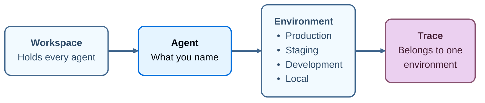

# Agent Registry

> What LangSmith Agent Registry is, what an agent is, how environments divide an agent's traces, and how an identifier differs from a display name.

As an organization builds more agents, it gets harder to know which ones exist and where they run. LangSmith Agent Registry offers a centralized location for registering an agent, providing one place to govern every agent your organization runs, wherever it is hosted. Agent Registry is available on [LangSmith Cloud](../../Cloud/Cloud%20%28SaaS%29.md). Creating an agent registers it, and you can create one in four ways:

* [Build it in LangSmith Studio](../../../No-code%20agents/Studio/Build%20an%20agent%20with%20LangSmith%20Studio.md).
* [Create it](Create%20an%20agent.md#name-an-agent-traced-from-outside-langsmith) from the **Connect an agent** dialog, for an agent that runs outside LangSmith.
* [Create it with an SDK call or API request](Create%20an%20agent.md#create-an-agent-programmatically).
* [Deploy it](Deploy%20to%20an%20agent%20environment.md) through LangSmith.

Once an agent exists, you can [send traces](../../../Monitor/Trace/Configuration%20%26%20troubleshooting/Agent%20%26%20environment%20settings/Log%20traces%20to%20an%20agent.md) from anywhere it runs, from any framework that can send traces to LangSmith.

Each agent receives a unique [identifier](#identifiers-and-display-names) that LangSmith uses to address its traces.

The rest of LangSmith attaches to these agents. Datasets, evaluators, deployments, traces, and alerts each attach to an agent in Agent Registry:

LangSmith

> [card] [Build](https://docs.langchain.com/build-overview.md)

> [card] [Test](../../../Test/Get%20started/LangSmith%20Evaluation.md)

> [card] [Deploy](../../../Deploy/Get%20started/LangSmith%20Agent%20Server.md)

> [card] [Monitor](../../../Monitor/Overview/LangSmith%20Observability.md)

> [card] [Agent Registry](#agent)

> [!NOTE]
>
> Agent-based workspaces are available on [LangSmith Cloud](../../Cloud/Cloud%20%28SaaS%29.md). They are not available on [self-hosted](../../Self-hosted/Self-hosted%20LangSmith.md) LangSmith. To check whether your workspace is agent-based, look at the control at the top left. In an agent-based workspace, it is a workspace switcher that names your workspace. In a [project-based](../../../Monitor/Trace/Observability%20concepts.md#tracing-projects) workspace, it shows the LangSmith logo.

## Agent

An *agent* is an AI system that completes tasks end to end using tools, skills, and subagents. In LangSmith, an agent is also the unit a workspace is organized around. Name it once, and LangSmith records what that agent does under that name, divided across four [environments](Agent%20environments.md): Production, Staging, Development, and Local. A trace, an alert, an evaluator, and a prebuilt dashboard each belong to one environment of one agent. A [dataset](../../../Test/Get%20started/Evaluation%20concepts.md#datasets) and a custom dashboard are the exceptions. A dataset attaches to one or more agents and to no environment, and a custom dashboard attaches to an agent rather than to an environment.

Every trace carries its agent and one of that agent's environments, so what produced a trace and where it ran are recorded as it arrives. LangSmith can then act on that context: an alert watches production and stays quiet about local runs, each environment gets its own prebuilt dashboard, and an [Insights](../../../Monitor/Observe/Monitoring%20%26%20alerting/Discover%20errors%20and%20usage%20patterns%20with%20Insights.md) report covers the traffic of the environment you run it on.

### Environments

An *environment* records where an agent was running when it produced a trace. The names are fixed: Production, Staging, Development, and Local.

For more information, see [Agent environments](Agent%20environments.md).

### Identifiers and display names

Every agent has two names, and they do different work:

* **Identifier**: Set when the agent is created, and not editable afterwards. Whether you supply it or LangSmith generates it depends on [how the agent was created](Create%20an%20agent.md). LangSmith uses it to address traces, so it stays stable even when the display name changes.
* **Display name**: Shown wherever the agent appears in the UI. For an agent [built in LangSmith Studio](../../../No-code%20agents/Studio/Build%20an%20agent%20with%20LangSmith%20Studio.md), rename it from the **Name** field in its configuration. Renaming does not move existing traces or change where new traces land.

Use the identifier for tracing, not the UUID copied by the **ID** badge on the agent's Overview. If the header shows **Identifier**, open it to copy the identifier for the intended environment.

## Find and govern agents

Once agents are registered, find them and track changes to them from these pages:

* **Find an agent**: The agent switcher moves between the agent list (**All agents**) and a single agent. See [Navigate agents](Navigate%20agents.md).
* **Audit changes**: [Audit logs](../../Govern/Auditing/Audit%20logs.md) record when an agent is created, updated, or deleted, and when an environment is added to it.

## Next steps

> [card] [Environments](Agent%20environments.md)
>
> The four environments an agent's traces divide into, and how to switch between them.

> [card] [Navigate agents](Navigate%20agents.md)
>
> The agent switcher, the agent list, and the agent Overview.

> [card] [Log traces to an agent](../../../Monitor/Trace/Configuration%20%26%20troubleshooting/Agent%20%26%20environment%20settings/Log%20traces%20to%20an%20agent.md)
>
> How agent addressing sends traces to an agent and an environment, and how to remove conflicting destination settings.

> [card] [Create an agent](Create%20an%20agent.md)
>
> Register an agent before tracing, choose an identifier, and configure its environment.
