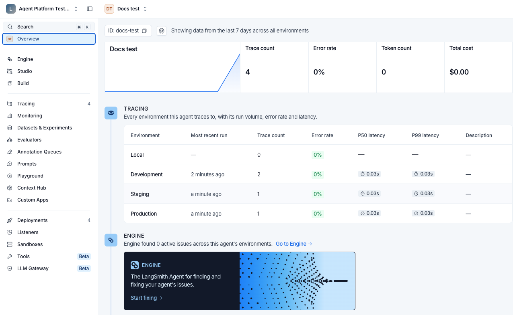
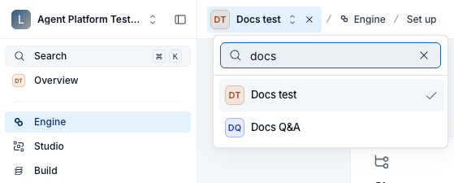

# Navigate agents

> How the agent switcher moves between the agent list and a single agent, which sections need an agent, and what the agent Overview shows.

To move between the [agents](Agent%20Registry.md#agent) in your workspace, use the agent switcher in the top bar. Select an agent to see counts, charts, and trace lists for that agent only.

> [!NOTE]
>
> Agent-based workspaces are available on [LangSmith Cloud](../../Cloud/Cloud%20%28SaaS%29.md). They are not available on [self-hosted](../../Self-hosted/Self-hosted%20LangSmith.md) LangSmith. To check whether your workspace is agent-based, look at the control at the top left. In an agent-based workspace, it is a workspace switcher that names your workspace. In a [project-based](../../../Monitor/Trace/Observability%20concepts.md#tracing-projects) workspace, it shows the LangSmith logo.

## Switch between agents

The agent switcher sits at the left of the top bar, after the workspace switcher and the panel collapse toggle. It reads either **All agents** or the name of the agent you are in. In a section other than the Overview, a breadcrumb follows it and names that section.

The address behind it is `/o/<workspaceId>/a/<agentIdentifier>/...`. The workspace slot takes a UUID, and the agent slot takes the agent's [identifier](Agent%20Registry.md#identifiers-and-display-names). A hyphen in the agent slot means all agents, so `/a/-` is the **All agents** view and `/a/<agentIdentifier>` is a single agent. Either state can be set from the address bar, which is how to link directly to one of the two views.

## All agents and single-agent views

The switcher moves between two views:

* **All agents**: The agent list, with one card for each agent in the workspace. In an empty workspace it shows a get-started screen instead, which offers ways to build or connect a first agent. For the options, see the [new agent menu](Create%20an%20agent.md#start-from-the-new-agent-menu).
* **A single agent**: That agent's Overview.

The left navigation lists the same items in both views, though its first row reads **All agents** on the agent list and **Overview** inside an agent. Two things differ:

* **Badge counts**: Hidden on the agent list, except on Agent Servers. When you select an agent, the counts appear and cover only that agent.
* **Section availability**: Some sections ask you to pick an agent first. See [Sections that require an agent](#sections-that-require-an-agent).

## Sections that require an agent

Most sections work with **All agents** selected, including the agent list, which lists every agent in the workspace, and Agent Servers, which lists every Agent Server in the workspace. Engine, Studio, Tracing, and Monitoring need you to select an agent. If you open these sections with **All agents** selected, what you see depends on whether your workspace has any agents yet.

If your workspace has agents, the section shows a searchable list of agents to pick from, headed **Pick an agent to view**. The top bar stays in place, so you can also pick from the switcher. Tracing shows **Connect an agent** below the list to users with the `projects:create` permission. The list includes every agent in the workspace.

Studio opens on its own page, headed **Agent Studio**, with three choices:

* **Build a new agent**: Starts [building an agent in Studio](../../../No-code%20agents/Studio/Build%20an%20agent%20with%20LangSmith%20Studio.md).
* **Connect a local server**: Runs and debugs an agent from your machine.
* **Select existing agent**: Shows the agent list, with **Connect agent server** below it.

With no agents in the workspace, the agent list in Engine, Studio, Tracing, and Monitoring is empty, reading **No agents available**. Agent Servers shows its own page, which offers ways to create a first Agent Server when the workspace has none.

After you pick an agent, LangSmith keeps it selected as you move between these sections. To see the agent list for **All agents**, hover over the selected agent's name in the switcher and select the **X** that appears beside it.

## Open Settings

Settings opens in its own layout: the agent switcher is gone, the navigation splits into Organizations and Workspace sections, and a **Back to LangSmith** link returns to the agent views.

## Read the agent Overview

When you select an agent, LangSmith opens its Overview.

For agents other than coding agents, the header shows the agent's name and resource navigation. For a deployed agent, select **Agent Server** to inspect its Agent Servers and environments. When active revisions are available, the header shows revision information by environment. This link is disabled for agents built in Studio, which use a Studio runtime instead. See [Compare the four routes](Create%20an%20agent.md#compare-the-four-routes).

Use the agent's identifier, not its display name or the UUID copied by the **ID** badge, for [agent addressing](../../../Monitor/Trace/Configuration%20%26%20troubleshooting/Agent%20%26%20environment%20settings/Log%20traces%20to%20an%20agent.md). If the header shows **Identifier**, open it to copy the identifier for the intended environment. See [Identifiers and display names](Agent%20Registry.md#identifiers-and-display-names).

The Overview profile includes [Engine](../../../Engine/LangSmith%20Engine.md), agent activity, **Models**, **Tools**, feedback activity, and Engine issues. Coding agents use a separate usage and pull request outcomes view. Use the left navigation when a resource link is absent from the header.

## See also

* [Agent Registry](Agent%20Registry.md)
* [Create an agent](Create%20an%20agent.md)
* [Agent environments](Agent%20environments.md)
* [Deploy to an agent environment](Deploy%20to%20an%20agent%20environment.md)
* [Tracing quickstart](../../../Monitor/Trace/Tracing%20quickstart.md)
