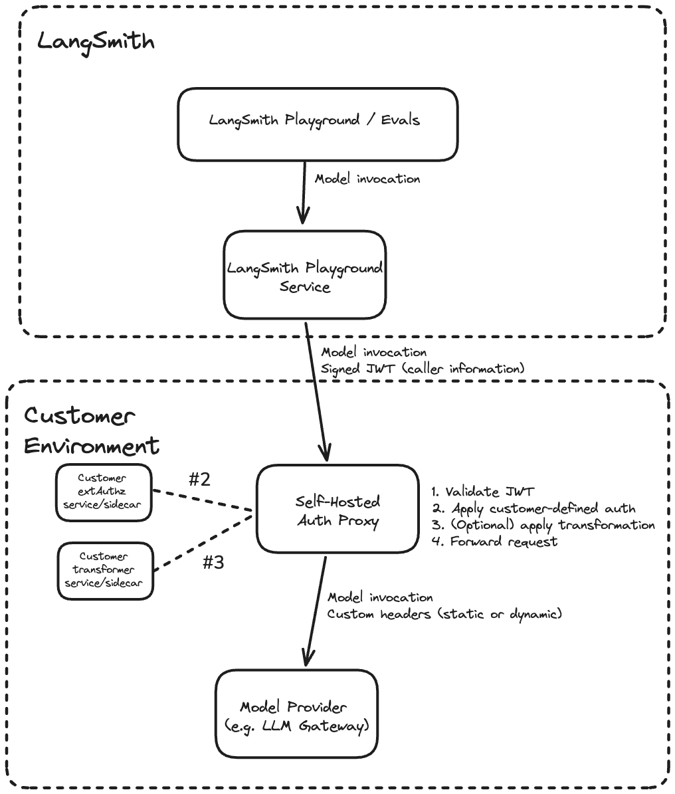
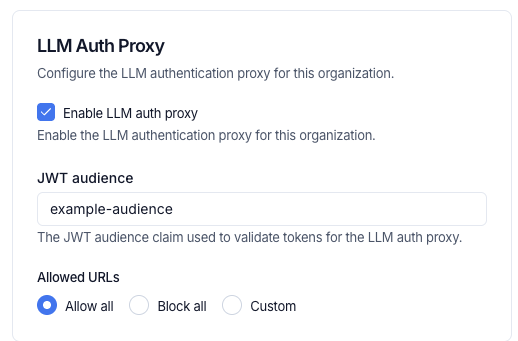

# Set up the LLM auth proxy

> Deploy an Envoy-based auth proxy that validates LangSmith-signed JWTs and routes LLM requests to your upstream provider or gateway.

The LLM auth proxy lets your organization enforce its own authentication flows for all model invocations from LangSmith so that provider credentials are never exposed to end users and every request is traceable back to a specific actor.

The LLM auth proxy is an [Envoy](https://www.envoyproxy.io/)-based component that runs in your environment and sits between LangSmith and your upstream LLM provider or gateway (such as OpenAI, Anthropic, or an internal LLM gateway like LiteLLM). LangSmith signs every request with a short-lived JWT (JSON Web Token). The proxy validates the JWT, optionally injects provider credentials or transforms request and response bodies, then forwards the request upstream. It is available to both [SaaS](../../Cloud/Cloud%20%28SaaS%29.md) and [self-hosted](../Self-hosted%20LangSmith.md) LangSmith customers.

> [!NOTE]
>
> The LLM auth proxy requires a LangSmith Enterprise plan. For more details, refer to [Pricing](https://www.langchain.com/pricing) or [contact our sales team](https://www.langchain.com/contact-sales).

Use the LLM auth proxy when you need to:

* Authenticate [Playground](../../../Deploy/Prompt%20%26%20Context%20Hub/Prompts/Connect%20to%20models/Connect%20to%20a%20custom%20model.md#use-the-model-in-the-playground) or [LLM-as-judge evaluation](../../../Test/Get%20started/LangSmith%20Evaluation.md) requests against your own provider gateway.
* Inject provider-specific API keys or auth headers without exposing them to end users.
* Transform request or response bodies (for example, converting between OpenAI format and a custom gateway format).

For OAuth2 `client_credentials` specifically, [OAuth client credentials on a model configuration](../../Govern/Organization/Workspace%20setup/Manage%20model%20configurations.md#oauth-client-credentials) is a per-configuration self-service alternative that workspace admins can set up without standing up the auth proxy. Routing is mutually exclusive at the configuration level—a configuration with OAuth enabled does not pass through the auth proxy.

## How it works

Each request from LangSmith passes through the following steps in the proxy:

1. Validate the JWT (signature, issuer, audience)
2. Call your [`ext_authz`](https://www.envoyproxy.io/docs/envoy/latest/intro/arch_overview/security/ext_authz_filter) service, which receives the validated JWT and returns the provider credentials to inject as headers
3. Optionally call your [`ext_proc`](https://www.envoyproxy.io/docs/envoy/latest/configuration/http/http_filters/ext_proc_filter) transformer, which can rewrite request and response bodies (for example, converting between OpenAI format and a custom gateway format)
4. Forward the request with custom headers (static or dynamic) to the upstream provider

Both the `ext_authz` service and the transformer are customer-deployed components that run alongside the proxy in your environment. Either or both can be enabled [depending on your use case](#when-to-use-ext_proc-vs-ext_authz).



## Prerequisites

* LangSmith Enterprise plan (SaaS or self-hosted on version 0.13.33+)
* Kubernetes cluster with Helm 3
* Envoy v1.37 or later (the Helm chart defaults to `envoyproxy/envoy:v1.37-latest`)
* The URL of your upstream LLM provider or gateway (the destination the proxy will forward requests to)

> [!NOTE]
>
> The auth proxy currently supports the [Playground](../../../Deploy/Prompt%20%26%20Context%20Hub/Prompts/Prompt%20engineering%20concepts.md), [Evals](../../../Test/Get%20started/LangSmith%20Evaluation.md), [Fleet](../../../Additional%20documentation/No-code%20agents%20with%20LangSmith%20Fleet.md), [Chat](../../../Test/Datasets%20%26%20Experiments/Analyze%20experiment%20results/LangSmith%20Chat.md), and [Insights](../../../Monitor/Observe/Monitoring%20%26%20alerting/Discover%20errors%20and%20usage%20patterns%20with%20Insights.md) features.
> Playground and Evals are available in v0.13.33+. Chat and Insights are available in v0.13.39+.

## 1. Configure JWT signing (self-hosted LangSmith only)

Skip this step for LangSmith SaaS. JWT signing is already configured.

Follow [Configure a signing JWKS](../Install%20an%20instance/Self-host%20LangSmith%20on%20Kubernetes.md#configure-a-signing-jwks) to generate the shared Ed25519 key and provide it to the LangSmith Helm chart. The private key signs each request, while the auth proxy fetches only the public key from LangSmith.

Set the issuer for LLM auth proxy tokens in your LangSmith `values.yaml`:

```yaml
config:
  llmAuthProxyIssuer: "langsmith"
```

`config.llmAuthProxyIssuer` sets the `iss` claim in signed JWTs. Use `langsmith` to match the SaaS default, or a custom identifier like `langsmith:self-hosted:<short_identifier>` to distinguish your installation. The value must match `jwtIssuer` in the auth proxy chart in [Step 4](#4-install-the-auth-proxy-helm-chart).

## 2. Enable LLM Auth Proxy for your organization

> [tab] Self-hosted
>
> **Option A:** Enable for a specific organization:
>
> In the LangSmith UI, navigate to the **Settings** page, copy the organization ID at the top left next to **Organizations**.
>
> Run the following against your LangSmith PostgreSQL database:
>
> ```sql theme={"theme":{"light":"catppuccin-latte","dark":"catppuccin-mocha"}}
> UPDATE organizations
> SET config = config || '{"can_use_llm_auth_proxy": true}'
> WHERE id = '<organization_id>';
> ```
>
> **Option B:** Enable for all organizations in an installation:
>
> Add the following to `commonEnv` in your [LangSmith `values.yaml`](https://github.com/langchain-ai/helm/blob/main/charts/langsmith/values.yaml):
>
> ```yaml theme={"theme":{"light":"catppuccin-latte","dark":"catppuccin-mocha"}}
> commonEnv:
>   - name: DEFAULT_ORG_FEATURE_CAN_USE_LLM_AUTH_PROXY
>     value: "true"
> ```
>
> > [!NOTE]
> >
> > This setting has no effect on Personal organizations.

> [tab] SaaS
>
> Contact technical support via the [Support Portal](https://support.langchain.com) to enable LLM Auth Proxy for your organization.

## 3. Configure organization settings in LangSmith

In the LangSmith UI, navigate to **Settings** > **General**, configure the following:

1. **JWT audience:** the `aud` claim value the proxy will validate (for example, `example-audience`). This must match `jwtAudiences` in the auth proxy chart in [Step 4](#4-install-the-auth-proxy-helm-chart).
2. **Enable LLM auth proxy:** toggle on for your organization.
3. **Allowed URLs:** control which hosts LangSmith sends JWTs to. This prevents credential forwarding to unintended hosts. Choose one of three options:

   * **Allow all** (default): permits JWT forwarding to any upstream URL. Equivalent to no restriction.
   * **Block all:** blocks JWT forwarding to all URLs.
   * **Custom:** list the hostnames LangSmith may send JWTs to, such as `llm-proxy.example.com` or `*.example.com`. A `*.` pattern matches the domain and all of its subdomains. Enter hostnames only, without a scheme, port, or path: an entry such as `https://llm-proxy.example.com:10000` matches nothing. Empty strings and bare `*` are not accepted. The control is disabled when the LLM auth proxy toggle is off.

   

## 4. Install the auth proxy Helm chart

Add the LangChain Helm repository:

```bash
helm repo add langchain https://langchain-ai.github.io/helm/
helm repo update
```

Create a `values.yaml` with the upstream URL and JWT validation settings. There are two options for JWKS configuration:

* **`jwksUri` (recommended):** Point to your LangSmith instance's `/.well-known/jwks.json` endpoint. Envoy fetches and caches the public keys automatically, supporting seamless key rotation.
* **`jwksJson` (inline):** Paste the JWKS JSON directly into `values.yaml`. Use this for testing or air-gapped environments where the auth proxy has no outbound network access to LangSmith. Requires a chart update to rotate keys. Include only the public key components; omit the `d` field (the private key).

If both are set, `jwksUri` takes precedence.

```yaml
authProxy:
  upstream: "https://gateway.example.com"
  jwtIssuer: "langsmith" # must match config.llmAuthProxyIssuer in LangSmith values.yaml
  jwtAudiences:
    - "example-audience" # must match the org setting in LangSmith

  # Option A: remote JWKS (recommended for production)
  # Envoy fetches and caches public keys from LangSmith's /.well-known/jwks.json.
  jwksUri: "https://langsmith.example.com/.well-known/jwks.json"       # self-hosted
  # jwksUri: "https://api.smith.langchain.com/.well-known/jwks.json"   # SaaS
  jwksCacheDurationSeconds: 300

  # Option B: inline JWKS (testing or air-gapped environments only)
  # Omit the "d" field (private key); include public key components only.
  # jwksJson: '{"keys": [{"kty": "OKP", "crv": "Ed25519", "x": "<base64url-public-key>", "use": "sig", "alg": "EdDSA"}]}'
```

Install the chart:

```bash
helm install langsmith-auth-proxy langchain/langsmith-auth-proxy \
  --namespace <your-namespace> \
  -f values.yaml
```

## Write an `ext_authz` service

Use `ext_authz` when you need to add, remove, or edit authorization headers, for example, to inject a provider API key based on the identity in the JWT. Your service receives the validated JWT and optionally the request body, and returns the headers to inject upstream. This uses Envoy's [HTTP `ext_authz` filter](https://www.envoyproxy.io/docs/envoy/latest/configuration/http/http_filters/ext_authz_filter) (not gRPC).

Enable it in `values.yaml`:

```yaml
authProxy:
  extAuthz:
    enabled: true
    serviceUrl: "http://my-auth-service:8080"
    timeout: "10s"
```

### How it works

Before forwarding each request, Envoy calls your service at `<serviceUrl>/check<original_path>` using the same HTTP method as the original request. Your service receives the validated JWT in the `x-langsmith-llm-auth` header.

Your service returns a plain HTTP response:

* **`2xx`:** allow the request. Any headers matching `allowedUpstreamHeaders` patterns (default: `authorization` and `x-*`) are injected into the upstream request. To strip the JWT before forwarding, include `x-envoy-auth-headers-to-remove: x-langsmith-llm-auth` in your response.
* **Non-`2xx`:** deny the request. The status code and any headers matching `allowedClientHeaders` patterns (default: `www-authenticate` and `x-*`) are returned to the client.

### Deployment options

Your `ext_authz` service can run in two ways:

* **Sidecar:** run the service in the same pod as the proxy. Add the container under `authProxy.deployment.sidecars` and any required volumes under `authProxy.deployment.volumes` in `values.yaml`. Use a `localhost` URL, for example `http://localhost:10002`.
* **Separate deployment:** deploy the service independently and point `extAuthz.serviceUrl` at it. Use the in-cluster DNS name, for example `http://my-auth-service.my-namespace.svc.cluster.local:8080`, or an external HTTPS URL if the service has its own ingress.

### Sample deployment

The example below is a minimal Python `ext_authz` service that performs an OAuth2 client credentials token exchange. On each request, it returns a cached `Authorization` header with a fresh access token, refreshing it from the configured token endpoint before it expires. See [e2e/oauth/](https://github.com/langchain-ai/helm/tree/main/charts/langsmith-auth-proxy/e2e/oauth) in the chart repository for the full example.

> [accordion] ext-authz-oauth.py
>
> ```python theme={"theme":{"light":"catppuccin-latte","dark":"catppuccin-mocha"}}
> """ext_authz service that performs an OAuth2 client-credentials token exchange.
>
> Runs as a sidecar (or standalone service) alongside the main auth-proxy component.
> On each ext_authz check request it returns a cached OAuth access token,
> refreshing it from the configured token endpoint when expired.
>
> Environment variables:
>   OAUTH_TOKEN_URL    – Token endpoint (e.g. https://login.example.com/oauth/token)
>   OAUTH_CLIENT_ID    – Client ID for the credentials grant
>   OAUTH_CLIENT_SECRET– Client secret for the credentials grant
>   OAUTH_SCOPE        – (optional) Space-separated scopes to request
>   LISTEN_PORT        – (optional) Port to listen on, default 10002
> """
>
> from http.server import HTTPServer, BaseHTTPRequestHandler
> import json
> import os
> import sys
> import threading
> import time
> import urllib.request
> import urllib.parse
>
> # ---------------------------------------------------------------------------
> # Configuration
> # ---------------------------------------------------------------------------
> TOKEN_URL = os.environ["OAUTH_TOKEN_URL"]
> CLIENT_ID = os.environ["OAUTH_CLIENT_ID"]
> CLIENT_SECRET = os.environ["OAUTH_CLIENT_SECRET"]
> SCOPE = os.environ.get("OAUTH_SCOPE", "")
> LISTEN_PORT = int(os.environ.get("LISTEN_PORT", "10002"))
>
> # Refresh the token this many seconds before it actually expires.
> EXPIRY_BUFFER_SECONDS = 30
>
> # ---------------------------------------------------------------------------
> # Token cache (thread-safe)
> # ---------------------------------------------------------------------------
> _lock = threading.Lock()
> _cached_token: str | None = None
> _token_expiry: float = 0  # epoch seconds
>
>
> def _fetch_token() -> tuple[str, float]:
>     """Perform a client_credentials grant and return (access_token, expiry_epoch)."""
>     data = urllib.parse.urlencode({
>         "grant_type": "client_credentials",
>         "client_id": CLIENT_ID,
>         "client_secret": CLIENT_SECRET,
>         **({"scope": SCOPE} if SCOPE else {}),
>     }).encode()
>
>     req = urllib.request.Request(
>         TOKEN_URL,
>         data=data,
>         headers={"Content-Type": "application/x-www-form-urlencoded"},
>         method="POST",
>     )
>     with urllib.request.urlopen(req, timeout=10) as resp:
>         body = json.loads(resp.read())
>
>     access_token = body["access_token"]
>     expires_in = int(body.get("expires_in", 3600))
>     expiry = time.time() + expires_in - EXPIRY_BUFFER_SECONDS
>     return access_token, expiry
>
>
> def get_token() -> str:
>     """Return a valid access token, refreshing if necessary."""
>     global _cached_token, _token_expiry
>     with _lock:
>         if _cached_token and time.time() < _token_expiry:
>             return _cached_token
>     # Fetch outside the lock so other requests aren't blocked on I/O.
>     token, expiry = _fetch_token()
>     with _lock:
>         _cached_token = token
>         _token_expiry = expiry
>     print(f"Refreshed OAuth token (expires in {int(expiry - time.time())}s)", flush=True)
>     return token
>
>
> # ---------------------------------------------------------------------------
> # ext_authz HTTP handler
> # ---------------------------------------------------------------------------
> class Handler(BaseHTTPRequestHandler):
>     def do_any(self):
>         try:
>             token = get_token()
>         except Exception as exc:
>             print(f"OAuth token fetch failed: {exc}", flush=True)
>             self.send_response(500)
>             self.send_header("Content-Type", "text/plain")
>             self.end_headers()
>             self.wfile.write(b"OAuth token exchange failed")
>             return
>
>         self.send_response(200)
>         # Replace the header name as needed - this header will be forwarded to the upstream LLM provider / gateway.
>         self.send_header("Authorization", f"Bearer {token}")
>         self.end_headers()
>
>     # Handle every method Envoy might send for ext_authz checks.
>     do_GET = do_POST = do_PUT = do_DELETE = do_PATCH = do_HEAD = do_OPTIONS = do_any
>
>     def log_message(self, format, *args):
>         # Quieter logs — only print errors.
>         pass
>
>
> if __name__ == "__main__":
>     server = HTTPServer(("0.0.0.0", LISTEN_PORT), Handler)
>     print(f"ext-authz-oauth listening on :{LISTEN_PORT}", flush=True)
>     print(f"  token_url={TOKEN_URL} client_id=<redacted>", flush=True)
>     server.serve_forever()
> ```

For the full list of `extAuthz` parameters, see the [Helm chart README](https://github.com/langchain-ai/helm/tree/main/charts/langsmith-auth-proxy#readme).

## Write an `ext_proc` transformer

Use `ext_proc` when you need to rewrite request or response bodies, for example, to convert between OpenAI format and a custom gateway format, or to inject additional fields into the request payload. This uses Envoy's [`ext_proc` filter](https://www.envoyproxy.io/docs/envoy/latest/configuration/http/http_filters/ext_proc_filter).

Unlike `ext_authz` (HTTP), `ext_proc` uses a bidirectional gRPC stream. Envoy sends your transformer service one message per processing phase (request headers, request body, response headers, response body), and your service replies with mutations for each phase. Your transformer must implement the `envoy.service.ext_proc.v3.ExternalProcessor` gRPC service. See [e2e/transformer/](https://github.com/langchain-ai/helm/tree/main/charts/langsmith-auth-proxy/e2e/transformer) in the chart repository for a sample Go implementation.

### When to use `ext_proc` vs `ext_authz`

| Capability | `ext_authz` | `ext_proc` |
| - | - | - |
| Modify request headers | Yes | Yes |
| Modify response headers | No | Yes |
| Modify request body | No | Yes |
| Modify response body | No | Yes |
| Protocol | HTTP | gRPC |

Use `ext_authz` if you only need to inject auth headers, for example, for API keys. Use `ext_proc` if you need to rewrite bodies. Both can be enabled simultaneously.

Enable `ext_proc` in `values.yaml`:

```yaml
authProxy:
  transformer:
    enabled: true
    serviceUrl: "grpc://my-transformer:50051"
    timeout: "10s"
    failureModeAllow: false
    processingMode:
      requestHeaderMode: "SEND"
      requestBodyMode: "BUFFERED"
      responseHeaderMode: "SKIP"
      responseBodyMode: "NONE"
```

Set `failureModeAllow: true` to allow requests through if the transformer is unavailable. The default (`false`) rejects the request.

### Processing modes

Control which phases are sent to your transformer via `processingMode`. Only enable the phases you need, as disabling unused phases reduces latency.

| Field | Options | Description |
| - | - | - |
| `requestHeaderMode` | `SEND`, `SKIP`, `DEFAULT` | Whether to forward request headers. |
| `responseHeaderMode` | `SEND`, `SKIP`, `DEFAULT` | Whether to forward response headers. |
| `requestBodyMode` | `NONE`, `BUFFERED`, `STREAMED`, `BUFFERED_PARTIAL` | How to send the request body. |
| `responseBodyMode` | `NONE`, `BUFFERED`, `STREAMED`, `BUFFERED_PARTIAL` | How to send the response body. |
| `requestTrailerMode` | `SEND`, `SKIP` | Whether to forward request trailers. |
| `responseTrailerMode` | `SEND`, `SKIP` | Whether to forward response trailers. |

* Use `BUFFERED` for request body rewriting: buffers the full body before sending, simplest for JSON rewriting.
* Use `STREAMED` for streaming LLM response body rewriting: sends chunks as they arrive, lower latency but more complex to implement.
* Use `NONE` to skip a phase entirely.

> [!WARNING]
>
> When mutating the body, your `ext_proc` service must also update the `content-length` header to match the new body size via `HeaderMutation`. Envoy rejects responses where `content-length` does not match the mutated body.

### Request flow

Example with `ext_proc` enabled for header injection and body rewriting:

```
curl -H "X-LangSmith-LLM-Auth: <JWT>" -d '{"model":"gpt-6.1-sol",...}'
  -> Envoy(:10000)
  -> built-in Envoy JWT filter (validate sig, iss, aud)
  -> `ext_proc` filter -> transformer:50051 (gRPC)
    <- phase 1: request_headers -> mutate headers (inject Authorization)
    <- phase 2: request_body   -> mutate body (rewrite JSON) + update content-length
  -> upstream LLM provider or gateway
```

### Sample deployment

The example below deploys a minimal Go transformer as a Kubernetes Deployment. It reads the JWT from request headers, injects an `Authorization` header, and rewrites the request body from OpenAI format to a custom format.

> [accordion] transformer-configmap.yaml
>
> ```yaml theme={"theme":{"light":"catppuccin-latte","dark":"catppuccin-mocha"}}
> apiVersion: v1
> kind: ConfigMap
> metadata:
>   name: transformer-source
> data:
>   main.go: |
>     package main
>
>     import (
>         "encoding/json"
>         "fmt"
>         "io"
>         "log"
>         "net"
>         "strings"
>
>         core "github.com/envoyproxy/go-control-plane/envoy/config/core/v3"
>         ext_proc "github.com/envoyproxy/go-control-plane/envoy/service/ext_proc/v3"
>         "google.golang.org/grpc"
>     )
>
>     type server struct {
>         ext_proc.UnimplementedExternalProcessorServer
>     }
>
>     func (s *server) Process(stream ext_proc.ExternalProcessor_ProcessServer) error {
>         for {
>             req, err := stream.Recv()
>             if err == io.EOF {
>                 return nil
>             }
>             if err != nil {
>                 return err
>             }
>
>             var resp *ext_proc.ProcessingResponse
>             switch v := req.Request.(type) {
>             case *ext_proc.ProcessingRequest_RequestHeaders:
>                 resp = handleRequestHeaders(v.RequestHeaders)
>             case *ext_proc.ProcessingRequest_RequestBody:
>                 resp = handleRequestBody(v.RequestBody)
>             default:
>                 resp = &ext_proc.ProcessingResponse{}
>             }
>
>             if err := stream.Send(resp); err != nil {
>                 return err
>             }
>         }
>     }
>
>     func handleRequestHeaders(headers *ext_proc.HttpHeaders) *ext_proc.ProcessingResponse {
>         var jwtValue string
>         for _, h := range headers.Headers.Headers {
>             if strings.EqualFold(h.Key, "x-langsmith-llm-auth") {
>                 if len(h.RawValue) > 0 {
>                     jwtValue = string(h.RawValue)
>                 } else {
>                     jwtValue = h.Value
>                 }
>                 break
>             }
>         }
>
>         resp := &ext_proc.ProcessingResponse{
>             Response: &ext_proc.ProcessingResponse_RequestHeaders{
>                 RequestHeaders: &ext_proc.HeadersResponse{},
>             },
>         }
>
>         if jwtValue != "" {
>             // TODO: Replace with your auth logic, e.g. exchange JWT for a
>             // provider-specific token, call a secrets manager, etc.
>             providerKey := "Bearer your-provider-key"
>
>             headerResp := resp.GetRequestHeaders()
>             headerResp.Response = &ext_proc.CommonResponse{
>                 HeaderMutation: &ext_proc.HeaderMutation{
>                     SetHeaders: []*core.HeaderValueOption{
>                         {
>                             Header: &core.HeaderValue{
>                                 Key:      "Authorization",
>                                 RawValue: []byte(providerKey),
>                             },
>                         },
>                     },
>                 },
>             }
>         }
>         return resp
>     }
>
>     func handleRequestBody(body *ext_proc.HttpBody) *ext_proc.ProcessingResponse {
>         resp := &ext_proc.ProcessingResponse{
>             Response: &ext_proc.ProcessingResponse_RequestBody{
>                 RequestBody: &ext_proc.BodyResponse{},
>             },
>         }
>
>         var original map[string]interface{}
>         if err := json.Unmarshal(body.Body, &original); err != nil {
>             log.Printf("Body parse failed, passing through: %v", err)
>             return resp
>         }
>
>         // TODO: Replace with your transformation logic.
>         // This example wraps the OpenAI-format body in a custom envelope.
>         transformed := map[string]interface{}{
>             "custom_model":    original["model"],
>             "custom_messages": original["messages"],
>             "metadata":        map[string]string{"source": "langsmith"},
>         }
>
>         newBody, err := json.Marshal(transformed)
>         if err != nil {
>             log.Printf("Body marshal failed, passing through: %v", err)
>             return resp
>         }
>
>         // IMPORTANT: update content-length to match the new body size.
>         bodyResp := resp.GetRequestBody()
>         bodyResp.Response = &ext_proc.CommonResponse{
>             Status: ext_proc.CommonResponse_CONTINUE_AND_REPLACE,
>             HeaderMutation: &ext_proc.HeaderMutation{
>                 SetHeaders: []*core.HeaderValueOption{
>                     {
>                         Header: &core.HeaderValue{
>                             Key:      "content-length",
>                             RawValue: []byte(fmt.Sprintf("%d", len(newBody))),
>                         },
>                     },
>                 },
>             },
>             BodyMutation: &ext_proc.BodyMutation{
>                 Mutation: &ext_proc.BodyMutation_Body{
>                     Body: newBody,
>                 },
>             },
>         }
>         return resp
>     }
>
>     func main() {
>         lis, err := net.Listen("tcp", ":50051")
>         if err != nil {
>             log.Fatalf("failed to listen: %v", err)
>         }
>         s := grpc.NewServer()
>         ext_proc.RegisterExternalProcessorServer(s, &server{})
>         log.Println("transformer listening on :50051")
>         if err := s.Serve(lis); err != nil {
>             log.Fatalf("failed to serve: %v", err)
>         }
>     }
>   go.mod: |
>     module transformer
>
>     go 1.23
>
>     require (
>         github.com/envoyproxy/go-control-plane/envoy v1.32.4
>         google.golang.org/grpc v1.72.1
>     )
> ```

> [accordion] transformer-deployment.yaml
>
> ```yaml theme={"theme":{"light":"catppuccin-latte","dark":"catppuccin-mocha"}}
> apiVersion: apps/v1
> kind: Deployment
> metadata:
>   name: transformer
>   labels:
>     app: transformer
> spec:
>   replicas: 1
>   selector:
>     matchLabels:
>       app: transformer
>   template:
>     metadata:
>       labels:
>         app: transformer
>     spec:
>       initContainers:
>         - name: build
>           image: golang:1.23
>           command: ["sh", "-c"]
>           args:
>             - |
>               cp /src/main.go /src/go.mod /build/ &&
>               cd /build &&
>               go mod tidy &&
>               CGO_ENABLED=0 go build -o /build/transformer ./main.go
>           volumeMounts:
>             - name: source
>               mountPath: /src
>               readOnly: true
>             - name: binary
>               mountPath: /build
>       containers:
>         - name: transformer
>           image: gcr.io/distroless/static-debian12:nonroot
>           command: ["/app/transformer"]
>           ports:
>             - containerPort: 50051
>           volumeMounts:
>             - name: binary
>               mountPath: /app
>               readOnly: true
>       volumes:
>         - name: source
>           configMap:
>             name: transformer-source
>         - name: binary
>           emptyDir: {}
> ---
> apiVersion: v1
> kind: Service
> metadata:
>   name: transformer
>   labels:
>     app: transformer
> spec:
>   selector:
>     app: transformer
>   ports:
>     - port: 50051
>       targetPort: 50051
>       protocol: TCP
> ```

> [!NOTE]
>
> For production, pre-build a container image instead of compiling in an init container. See `e2e/transformer/Dockerfile` in the [Helm chart repository](https://github.com/langchain-ai/helm/tree/main/charts/langsmith-auth-proxy) for an example multi-stage build.

## Additional configuration

### HTTP proxy

Envoy does not respect `HTTP_PROXY`, `HTTPS_PROXY`, or `NO_PROXY` environment variables. Configure an HTTP proxy explicitly:

```yaml
authProxy:
  httpProxy:
    enabled: true
    host: "proxy.example.com"
    port: 3128
    noProxy:
      - "internal.corp"
      - ".internal.corp"
```

### Deploy without a public ingress

When the auth proxy does not have a public ingress and is only reachable through internal Kubernetes networking, LangSmith services must be configured to allow outbound requests to private IP addresses. Without these settings, the built-in SSRF protection blocks requests to private IPs.

Add the following environment variables to your [LangSmith `values.yaml`](https://github.com/langchain-ai/helm/blob/main/charts/langsmith/values.yaml):

* **`SSRF_ALLOW_K8S_INTERNAL`** — required on all services that make LLM calls. Add this to `commonEnv` for services that support it or to each service's `extraEnv` for services that do not support `commonEnv`.
* **`SSRF_ALLOW_PRIVATE_IPS_PLAYGROUND`** — required on the `playground` service only. Add this to `playground.deployment.extraEnv`.

```yaml
# Allow all LLM-calling services to reach the auth proxy on private IPs
commonEnv:
  - name: SSRF_ALLOW_K8S_INTERNAL
    value: "true"

# Allow the playground service to reach the auth proxy on private IPs
playground:
  deployment:
    extraEnv:
      - name: SSRF_ALLOW_K8S_INTERNAL
        value: "true"
      - name: SSRF_ALLOW_PRIVATE_IPS_PLAYGROUND
        value: "true"
```

If `commonEnv` does not apply to all required services in your deployment, set `SSRF_ALLOW_K8S_INTERNAL` individually via `extraEnv` on each service that makes LLM calls.

### Other options

For ingress, autoscaling, resource limits, and other configuration options, see the [Helm chart README](https://github.com/langchain-ai/helm/tree/main/charts/langsmith-auth-proxy#readme).

> [!TIP]
>
> For production reliability, set `authProxy.autoscaling.hpa.minReplicas` to at least `3`.

## Full configuration example

```yaml
authProxy:
  upstream: "https://gateway.example.com"   # your LLM gateway or provider
  jwtIssuer: "langsmith"                    # must match config.llmAuthProxyIssuer on LangSmith
  jwtAudiences:
    - "example-audience"                    # must match org setting in LangSmith

  # Option A: remote JWKS (recommended for production)
  # Envoy fetches and caches public keys from LangSmith's /.well-known/jwks.json endpoint.
  jwksUri: "https://langsmith.example.com/.well-known/jwks.json"   # self-hosted
  # jwksUri: "https://api.smith.langchain.com/.well-known/jwks.json"  # SaaS
  jwksCacheDurationSeconds: 300             # how long Envoy caches the JWKS (default 5 min)

  # Option B: inline JWKS (testing or air-gapped environments only)
  # jwksJson: '{"keys": [...]}'

  # ext_authz: header-only auth logic (include only if needed)
  # Use this to inject, remove, or modify authorization headers.
  # Your service receives an HTTP request at /check with the validated JWT
  # in the x-langsmith-llm-auth header and responds with headers to inject upstream.
  extAuthz:
    enabled: true
    serviceUrl: "http://localhost:10002"    # sidecar URL
    # serviceUrl: "http://ext-authz.<namespace>.svc.cluster.local:10002"  # separate deployment
    sendBody: false                         # set true to include request body

  # transformer: request/response body transformation (include only if needed)
  # Use this when you need to rewrite request or response bodies (e.g. OpenAI -> custom format).
  # Can be enabled alongside ext_authz.
  transformer:
    enabled: true
    serviceUrl: "grpc://transformer.<namespace>.svc.cluster.local:50051"
    timeout: "10s"
    failureModeAllow: false                 # reject if transformer is unavailable
    processingMode:
      requestHeaderMode: "SEND"             # forward request headers (read JWT, inject auth)
      responseHeaderMode: "SKIP"            # skip response headers
      requestBodyMode: "BUFFERED"           # buffer full body for JSON rewriting
      responseBodyMode: "NONE"              # skip response body
      requestTrailerMode: "SKIP"
      responseTrailerMode: "SKIP"
```

## JWT claims reference

LangSmith signs JWTs using **Ed25519 (EdDSA)**. Public keys are served at `/.well-known/jwks.json` and fetched automatically by the proxy. The auth proxy validates signatures using these public keys.

| Claim | Description |
| - | - |
| `iat`, `exp`, `jti`, `nbf` | Standard JWT claims (issued-at, expiry, JWT ID, not-before) |
| `iss` | Issuer. `langsmith` for SaaS; set via `config.llmAuthProxyIssuer` for self-hosted |
| `aud` | Audience. Matches the JWT audience in LangSmith organization settings |
| `sub` | Actor identifier (user ID, evaluator ID, assistant ID, or API key ID) |
| `actor_type` | One of: `user`, `evaluator`, `agent-builder`, `insights`, `polly`, `api_key:pat` (personal access token), or `api_key:service` (service account key) |
| `workspace_id` | Workspace ID |
| `workspace_name` | Workspace Name |
| `organization_id` | Organization ID |
| `organization_name` | Organization Name |
| `request_id` | Request correlation ID |
| `ls_user_id` | LangSmith user ID (present whenever the request has an associated user) |

> [!WARNING]
>
> Use `ls_user_id` to identify the end user. On agent runs, `sub` is the assistant's ID and `actor_type` is `agent-builder`, so neither identifies the person.

The JWT is passed to your `ext_authz` or transformer service in the `x-langsmith-llm-auth` request header.

## FAQ

> [accordion] Does the auth proxy support corporate proxies?
>
> Yes. Configure an HTTP proxy via the `httpProxy` section in `values.yaml`. See [HTTP proxy](#http-proxy) for details.

> [accordion] Does the auth proxy support custom certificates?
>
> Yes, via `customCa` for custom CA certificates and `mtls` for mutual TLS.

> [accordion] Can a single auth proxy route to multiple upstream LLM gateways?
>
> No. The auth proxy has a single `upstream` field.

> [accordion] Can the auth proxy serve multiple organizations?
>
> Yes. Multiple organizations can point to the same auth proxy instance via their model configuration in LangSmith.

> [accordion] Can the LangSmith to auth proxy connection use HTTP instead of HTTPS?
>
> Yes, but only in self-hosted, and we generally recommend placing the auth proxy behind a dedicated ingress so communication uses HTTPS. To allow HTTP, add `LLM_AUTH_PROXY_ACCEPT_HTTP` to `commonEnv` and `playground.deployment.extraEnv` in your [LangSmith `values.yaml`](https://github.com/langchain-ai/helm/blob/main/charts/langsmith/values.yaml).
> To enable HTTP traffic to the auth proxy for [Chat and Insights](../Install%20an%20instance/Configure%20Insights%20and%20Chat%20on%20self-hosted%20LangSmith.md), set this environment variable in the respective `extraEnv` sections: `config.polly.agent.extraEnv` (for Chat, which was formerly called Polly) and `config.insights.agent.extraEnv`.

> [accordion] Does the auth proxy work without a public ingress?
>
> Yes. When the auth proxy is only reachable through internal Kubernetes networking (no public ingress), add `SSRF_ALLOW_K8S_INTERNAL` to all services that make LLM calls and both `SSRF_ALLOW_K8S_INTERNAL` and `SSRF_ALLOW_PRIVATE_IPS_PLAYGROUND` to the `playground` service. See [Deploy without a public ingress](#deploy-without-a-public-ingress) for configuration details.

> [accordion] When should I use the LLM auth proxy versus OAuth client credentials on a model configuration?
>
> Use the LLM auth proxy when authentication needs custom logic beyond OAuth2 `client_credentials`. For example, exchanging the LangSmith JWT for a provider-specific token, injecting GCP or AWS identity, or rewriting request and response bodies. Use [OAuth client credentials on a model configuration](../../Govern/Organization/Workspace%20setup/Manage%20model%20configurations.md#oauth-client-credentials) when each workspace or team needs self-service control over its own OAuth2 `client_credentials` against a custom gateway. Both can coexist within the same organization; routing is per-configuration.

## Helm chart reference

For the full list of configurable values, see the [Helm chart README](https://github.com/langchain-ai/helm/tree/main/charts/langsmith-auth-proxy).
