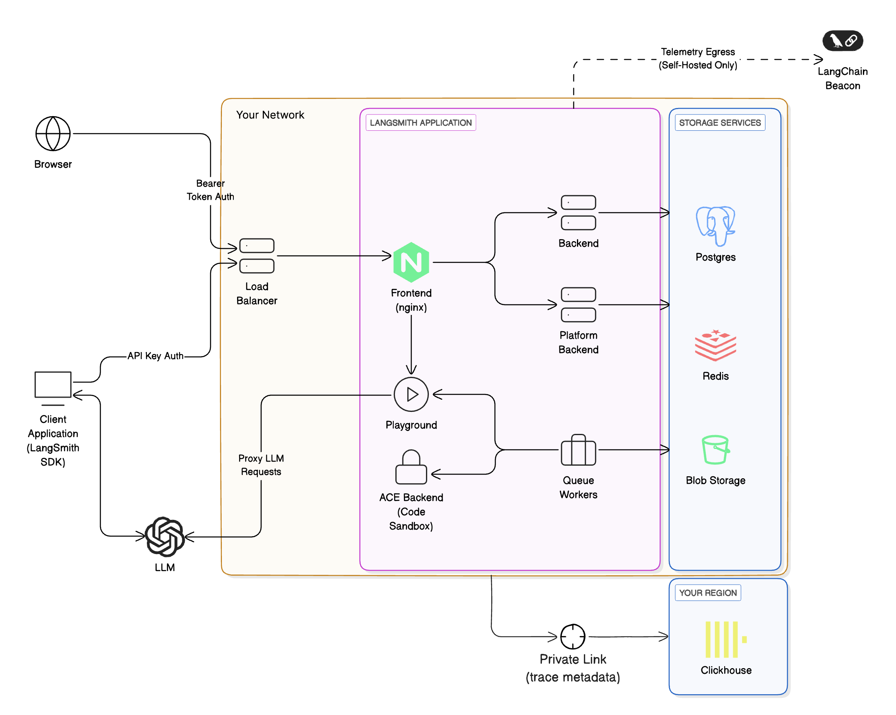

# LangSmith-managed ClickHouse

> [!TIP]
>
> Please read the [LangSmith architectural overview](../Self-hosted%20LangSmith.md) and [guide on connecting to external ClickHouse](Connect%20to%20an%20external%20ClickHouse%20database.md) before proceeding with this guide.

LangSmith uses ClickHouse as the primary storage engine for **traces** and **feedback**. For easier management and scaling, it is recommended to connect a self-hosted LangSmith instance to an external ClickHouse instance. LangSmith-managed ClickHouse is an option that allows you to use a fully managed ClickHouse instance that is monitored and maintained by the LangSmith team.

## Architecture overview

The architecture of using LangSmith-managed ClickHouse with your self-hosted LangSmith instance is similar to using a fully self-hosted ClickHouse instance, with a few key differences:

* You will need to set up a private network connection between your LangSmith instance and the LangSmith-managed ClickHouse instance. This is to ensure that your data is secure and that you can connect to the ClickHouse instance from your self-hosted LangSmith instance.
* With this option, sensitive information (inputs and outputs) of your traces will be stored in cloud object storage (S3 or GCS) within your cloud instead of ClickHouse to ensure that sensitive information doesn't leave your VPC. For more details on where particular data fields are stored, refer to [Data storage](#data-storage).
* The LangSmith team will monitor your ClickHouse instance and ensure that it is running smoothly. This allows us to track metrics like run-ingestion delay and query performance.

The overall architecture looks like this:

## Requirements

* **You must use a supported blob storage option.** Read the [blob storage guide](Enable%20blob%20storage.md) for more information.
* To use private endpoints, ensure that your VPC is in a ClickHouse Cloud supported [region](https://clickhouse.com/docs/en/cloud/reference/supported-regions). Otherwise, you will need to use a public endpoint we will secure with firewall rules. Your VPC will need to have a NAT gateway to allow us to allowlist your traffic.
* You must have a VPC that can connect to the LangSmith-managed ClickHouse service. You will need to work with our team to set up the necessary networking.
* You must have a LangSmith self-hosted instance running. You can use our managed ClickHouse service with [Kubernetes](../Install%20an%20instance/Self-host%20LangSmith%20on%20Kubernetes.md) installations.

## TLS certificates

LangSmith-managed ClickHouse serves a certificate issued by Let's Encrypt. The chain is the server certificate, a Let's Encrypt intermediate, and the ISRG Root X1 root.

If your LangSmith pods trust the system CA store, nothing to do. ISRG Root X1 is already in it.

If you mount your own CA bundle with `config.customCa`, add ISRG Root X1 to that bundle. Trust the root, not the server certificate: the server certificate is reissued about every 90 days and the intermediate changes from time to time, while the root is valid until 2035. A bundle with only the server certificate or the intermediate stops working at the next rotation, and the first thing to fail is the ClickHouse migrations job during an upgrade. See [Configure custom TLS certificates](../Platform%20auth%20%26%20access%20control/Configure%20custom%20TLS%20certificates.md#mount-internal-cas-for-tls).

## Data storage

ClickHouse stores **runs** and **feedback** data, specifically:

* All feedback data fields.
* Some run data fields.

For a list of fields, refer to [Stored run data fields](#stored-run-data-fields) and [Stored feedback data fields](#stored-feedback-data-fields).

LangChain defines sensitive application data as `inputs`, `outputs`, `errors`, `manifests`, `extras`, and `events` of a run, since these fields may contain LLM prompts and completions. With LangSmith-managed ClickHouse, these sensitive fields are stored in cloud object storage (S3 or GCS) within your cloud, while the rest of the run data is stored in ClickHouse, ensuring sensitive information never leaves your VPC.

### Stored feedback data fields

> [!NOTE]
>
> Because all feedback data is stored in ClickHouse, do not send sensitive information in feedback (scores and annotations/comments) or in any other run fields that are mentioned in [Stored run data fields](#stored-run-data-fields).

Using a LangSmith-managed ClickHouse setup, **all feedback data fields are stored in ClickHouse**:

| Field Name | Type | Description |
| - | - | - |
| `id` | UUID | Unique identifier for the record itself |
| `created_at` | datetime | Timestamp when the record was created |
| `modified_at` | datetime | Timestamp when the record was last modified |
| `session_id` | UUID | Unique identifier for the experiment or tracing project the run was a part of. Required when creating feedback for a run. |
| `run_id` | UUID | Unique identifier for a specific run within a session |
| `start_time` | datetime | Start time of the run the feedback is for. Optional, but providing it lets LangSmith process the feedback quicker. |
| `key` | string | A key describing the criteria of the feedback, e.g. `'correctness'` |
| `score` | number | Numerical score associated with the feedback key |
| `value` | string | Reserved for storing a value associated with the score. Useful for categorical feedback. |
| `comment` | string | Any comment or annotation associated with the record. This can be a justification for the score given. |
| `correction` | object | Reserved for storing correction details, if any |
| `feedback_source` | object | Object containing information about the feedback source |
| `feedback_source.type` | string | The type of source where the feedback originated, e.g. `'api'`, `'app'`, `'evaluator'` |
| `feedback_source.metadata` | object | Reserved for additional metadata, currently |
| `feedback_source.user_id` | UUID | Unique identifier for the user providing feedback |

This [reference doc](../../../Monitor/Debug/Data%20type%20reference/Feedback%20data%20format.md) explains the stored feedback format, which is the LangSmith's way of representing evaluation scores and annotations on runs.

### Stored run data fields

Run data fields are split between the managed ClickHouse database and your cloud object storage (e.g., S3 or GCS).

> [!NOTE]
>
> For run fields stored in object storage, only a reference or pointer is kept in ClickHouse. For example, `inputs` and `outputs` content are offloaded to S3/GCS, with the ClickHouse record storing corresponding S3 URLs in the `inputs_s3_urls` and `outputs_s3_urls` fields.

The table details each run field and where it is stored:

| Field | Storage Location |
| - | - |
| `id` | ClickHouse |
| `name` | ClickHouse |
| `inputs` | **Object Storage** |
| `run_type` | ClickHouse |
| `start_time` | ClickHouse |
| `end_time` | ClickHouse |
| `extra` | **Object Storage** |
| `error` | **Object Storage** |
| `outputs` | **Object Storage** |
| `events` | **Object Storage** |
| `tags` | ClickHouse |
| `trace_id` | ClickHouse |
| `dotted_order` | ClickHouse |
| `status` | ClickHouse |
| `child_run_ids` | ClickHouse |
| `direct_child_run_ids` | ClickHouse |
| `parent_run_ids` | ClickHouse |
| `feedback_stats` | ClickHouse |
| `reference_example_id` | ClickHouse |
| `total_tokens` | ClickHouse |
| `prompt_tokens` | ClickHouse |
| `completion_tokens` | ClickHouse |
| `total_cost` | ClickHouse |
| `prompt_cost` | ClickHouse |
| `completion_cost` | ClickHouse |
| `first_token_time` | ClickHouse |
| `session_id` | ClickHouse |
| `in_dataset` | ClickHouse |
| `parent_run_id` | ClickHouse |
| `execution_order` (deprecated) | ClickHouse |
| `serialized` | ClickHouse |
| `manifest_id` (deprecated) | ClickHouse |
| `manifest_s3_id` | ClickHouse |
| `inputs_s3_urls` | ClickHouse |
| `outputs_s3_urls` | ClickHouse |
| `price_model_id` | ClickHouse |
| `app_path` | ClickHouse |
| `last_queued_at` | ClickHouse |
| `share_token` | ClickHouse |

This [reference doc](../../../Monitor/Debug/Data%20type%20reference/Run%20%28span%29%20data%20format.md) explains the format of stored runs (spans), which are the building blocks of traces.
