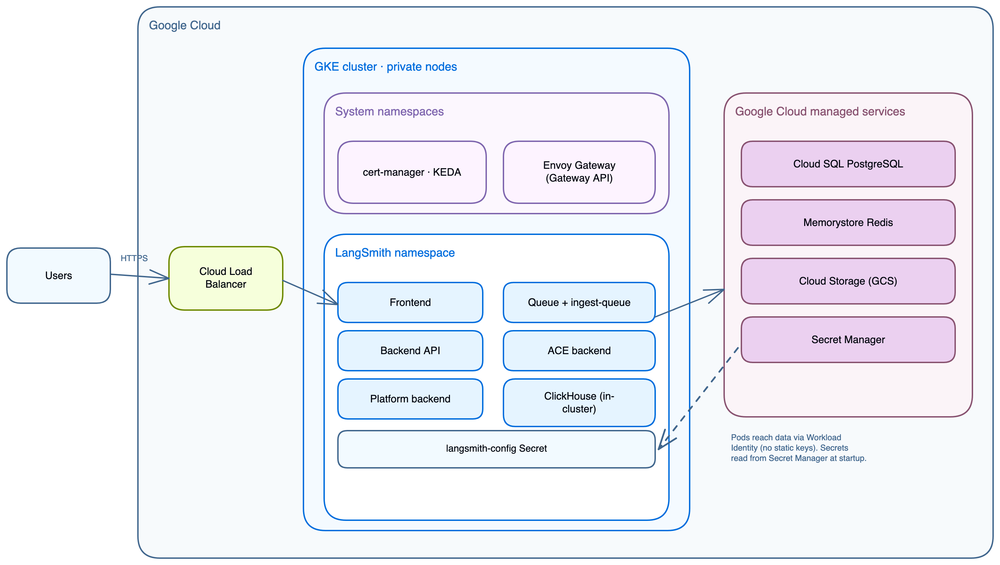

# GCP Terraform architecture

> Platform layers, services, Workload Identity, networking, and module dependencies for LangSmith self-hosted on GKE.

Understand what the [GCP Terraform modules](https://github.com/langchain-ai/terraform/tree/main/modules/gcp) provision and how the pieces fit together, so you can size, secure, and customize your LangSmith deployment before running `make apply`.

Use this page as a reference while planning a rollout or troubleshooting an existing one. It covers:

* Platform layers and deployment tiers (light versus production).
* Module descriptions and dependencies.
* Networking, Workload Identity, and traffic flow.
* Add-ons: Agent Server hosting, Fleet, Insights, Polly, SmithDB, and Sandboxes.
* GCP managed services and Secret Manager integration.

If you are ready to install, start with the [deployment walkthrough](Deploy%20LangSmith%20on%20GCP%20with%20Terraform.md).

## Platform layers

LangSmith on GCP deploys in up to five stages. Each stage adds a capability layer on top of the previous. All layers share the same GKE cluster and `langsmith` namespace.



| Stage | Layer | What it adds |
| - | - | - |
| 1 | GCP infrastructure | VPC, GKE, Cloud SQL, Memorystore, GCS, K8s bootstrap, cert-manager, KEDA, Envoy Gateway |
| 2 | LangSmith base | frontend, backend, platform-backend, queue, ace-backend, clickhouse, playground |
| 3 | Agent Server hosting | host-backend, listener, operator + per-deployment pods |
| 4 | Fleet | standalone-fleet-api-server, standalone-fleet-queue, fleet-tool-server, fleet-trigger-server |
| 5 | Insights + Polly | Insights analytics (ClickHouse-backed), Polly eval agent |

SmithDB (`enable_smithdb`) and Sandboxes (`enable_sandboxes`) are optional add-ons outside these stages. Each adds its own node pools and managed services to the same cluster and namespace.

> [!NOTE]
>
> Fleet is the current form of the feature formerly called Agent Builder. Enable it with `enable_fleet`. Unlike the deprecated `enable_agent_builder` path, it does not require the Agent Server hosting layer. The two flags are mutually exclusive and share the same encryption key. See [Enable add-ons](Deploy%20LangSmith%20on%20GCP%20with%20Terraform.md#enable-add-ons) in the deployment guide.

## Module descriptions

| Module | Path | Purpose |
| - | - | - |
| `networking` | `infra/modules/networking/` | VPC, subnet with secondary ranges, Cloud Router, Cloud NAT, private service connection for Cloud SQL and Memorystore |
| `k8s-cluster` | `infra/modules/k8s-cluster/` | GKE Standard or Autopilot cluster, private nodes, node pool with autoscaling, Workload Identity enabled |
| `postgres` | `infra/modules/postgres/` | Cloud SQL PostgreSQL instance, regional HA standby, private IP, deletion protection |
| `redis` | `infra/modules/redis/` | Memorystore Redis STANDARD\_HA tier, private IP within VPC |
| `storage` | `infra/modules/storage/` | GCS bucket with versioning and lifecycle rules for `ttl_s/` (14 days) and `ttl_l/` (400 days) prefixes |
| `k8s-bootstrap` | `infra/modules/k8s-bootstrap/` | `langsmith` namespace and `langsmith-ksa` ServiceAccount, Kubernetes Secrets for Postgres, Redis, the license key, ClickHouse, and TLS, resource quotas and network policies, cert-manager and KEDA Helm releases |
| `ingress` | `infra/modules/ingress/` | Envoy Gateway Helm release, Gateway API CRDs, GatewayClass, and Gateway (HTTP and optional HTTPS listeners) |
| `iam` | `infra/modules/iam/` | GCP service account and Workload Identity bindings for GCS access (wired by default) |
| `dns` | `infra/modules/dns/` | Cloud DNS managed zone and managed cert (optional, enable with `enable_dns_module`) |
| `secrets` | `infra/modules/secrets/` | Secret Manager secret bundle (optional, enable with `enable_secret_manager_module`) |
| `smithdb` | `infra/modules/smithdb/` | SmithDB Cloud SQL metastore, GCS object-store bucket, and Workload Identity service account (optional, enable with `enable_smithdb`) |
| `smithdb-nodes` | `infra/modules/smithdb-nodes/` | Cache and compute node pools for SmithDB (GKE Standard only, none for `smithdb_sizing = "minimal"`). The cache pool uses Local SSD or, with `smithdb_cache_storage = "network-disk"`, C3 nodes with Hyperdisk volumes. On chart 0.16, the cache pool always uses Local SSD. |

When `enable_sandboxes = true`, Terraform also reuses the `redis` module for a dedicated Memorystore instance that holds JuiceFS metadata, and the `k8s-cluster` module adds a sandbox-host node pool with nested virtualization.

## Deployment tiers

### Light deploy (all in-cluster)

```txt
VPC
└── subnet (10.0.0.0/20, GKE nodes only)
    No Cloud SQL or Memorystore; chart pods handle both

GKE Cluster
├── langsmith namespace
│   ├── frontend, backend, platform-backend, queue, ace-backend, playground
│   ├── clickhouse (in-cluster)
│   ├── postgres   (in-cluster)
│   └── redis      (in-cluster)
├── cert-manager
├── keda
└── envoy-gateway-system

GCS Bucket (trace payloads, always external)
```

Set in `terraform.tfvars`:

```hcl
postgres_source   = "in-cluster"
redis_source      = "in-cluster"
clickhouse_source = "in-cluster"
```

### Production (external managed services)

```txt
VPC
├── subnet (10.0.0.0/20, GKE nodes, pods, services)
│   └── Secondary ranges: pods 10.4.0.0/14, services 10.8.0.0/20
└── Private service connection (VPC peering to Google managed network)
    ├── Cloud SQL PostgreSQL  (private IP, regional standby)
    └── Memorystore Redis     (private IP, STANDARD_HA tier)

GKE Cluster
├── langsmith namespace
│   ├── frontend, backend, platform-backend, queue, ace-backend, playground
│   └── clickhouse (in-cluster; use LangChain Managed for production scale)
├── cert-manager
├── keda
└── envoy-gateway-system

GCS Bucket (Workload Identity, no static keys)
```

## Application core services

| Service | Purpose | Port | HPA | Workload Identity | Depends on |
| - | - | - | - | - | - |
| `langsmith-frontend` | React UI | 3000 | 1 to 10 | No | `backend`, `platform-backend` |
| `langsmith-backend` | Main API (traces, runs, projects, API keys, feedback) | 1984 | 3 to 10 | Yes (GCS) | Postgres, Redis, ClickHouse, GCS |
| `langsmith-platform-backend` | Org and user management, auth, billing, settings | 1986 | 1 to 10 | Yes (GCS) | Postgres, Redis, GCS |
| `langsmith-playground` | LLM prompt playground UI | 3001 | 1 to 10 | No | `backend` |
| `langsmith-queue` | Trace ingestion worker (Redis to ClickHouse + GCS) | — | 3 to 10 + KEDA | Yes | Redis, ClickHouse, GCS |
| `langsmith-ingest-queue` | Dedicated high-throughput ingestion worker | — | 3 to 10 + KEDA | Yes | Redis, GCS |
| `langsmith-ace-backend` | Async compute (dataset runs, evaluations, background jobs) | — | 1 to 5 | No | Postgres, Redis |
| `langsmith-clickhouse` | Columnar store (trace spans, run metadata, eval results) | — | StatefulSet, single replica | No | 500Gi `premium-rwo` PVC |

> [!WARNING]
>
> In-cluster ClickHouse is dev/POC only (single pod, no replication, no backups). For production, use [LangChain Managed ClickHouse](../../Connect%20external%20services/LangSmith-managed%20ClickHouse.md) or a self-managed external cluster.

> [!NOTE]
>
> [SmithDB](https://www.langchain.com/blog/introducing-smithdb?utm_source=docs) is LangSmith's purpose-built observability backend, available for Self-hosted starting with self-hosted version 0.16.0 (see [self-hosted support](../../../../Monitor/Reference/SmithDB%20API%20migration/Migrate%20to%20SmithDB-backed%20APIs.md#about-self-hosted)). Set `enable_smithdb = true` to provision its metastore, object-store bucket, and node pools. SmithDB runs alongside ClickHouse, so the ClickHouse guidance in the previous sections still applies. Refer to [SmithDB](Deploy%20LangSmith%20on%20GCP%20with%20Terraform.md#smithdb) in the deployment guide for the staged rollout.

### One-time jobs

| Job | Purpose |
| - | - |
| `langsmith-backend-migrations` | PostgreSQL schema migrations |
| `langsmith-backend-ch-migrations` | ClickHouse schema migrations |
| `langsmith-backend-auth-bootstrap` | Creates the initial org and admin account |

## Agent Server hosting add-on

| Service | Purpose | Workload Identity |
| - | - | - |
| `langsmith-host-backend` | LangGraph control plane API. Manages deployment lifecycle, serves deployment metadata. | Yes (GCS) |
| `langsmith-listener` | Watches host-backend for state changes, creates and updates `LangGraphPlatform` CRDs. | Yes (GCS) |
| `langsmith-operator` | Kubernetes operator. Reconciles `LangGraphPlatform` CRDs, creates and deletes Deployments and Services. | RBAC for Deployments and Services |

Each LangGraph deployment created in the UI produces a Kubernetes Deployment in the `langsmith` namespace, with pods running as the `langsmith-ksa` ServiceAccount. That ServiceAccount must carry the `iam.gke.io/gcp-service-account` annotation, which `deploy.sh` applies idempotently.

## GCP managed services

When `postgres_source = "external"` and `redis_source = "external"` (the recommended production setting), Terraform provisions:

### Cloud SQL PostgreSQL

* Default size `db-custom-2-8192` (2 vCPU, 8 GB), private IP, port 5432.
* REGIONAL availability with automatic failover.
* Holds orgs, users, projects, API keys, settings.
* Terraform writes the connection URL directly to the `langsmith-postgres-credentials` Kubernetes Secret.

### Memorystore Redis

* Default 5 GB, STANDARD\_HA tier, private IP, port 6379.
* Trace ingestion queue, pub/sub, short-lived cache.
* No auth token required. Access is controlled by VPC private IP only.
* Terraform writes the connection URL directly to the `langsmith-redis-credentials` Kubernetes Secret.

### Cloud Storage bucket

* Trace payloads: large inputs and outputs, attachments.
* The shipped Helm values use native GCS mode (`engine: GCS`, `apiURL: https://storage.googleapis.com`), authenticated through Workload Identity with no HMAC keys.
* An S3-compatible mode (`engine: S3`) is also supported, shown in `helm/values/examples/langsmith-values.yaml`. It requires HMAC keys: create one under **Cloud Storage** > **Settings** > **Interoperability** and pass them to Helm via `config.blobStorage.accessKey` and `config.blobStorage.accessKeySecret`.
* Lifecycle rules: `ttl_s/` prefix (14 days default), `ttl_l/` prefix (400 days default).
* The GCS bucket is always required, regardless of tier.

### Secret Manager

* `infra/scripts/setup-env.sh` stores the license key, passwords, salts, and encryption keys in Secret Manager as `langsmith-<name_prefix>-<environment>-<key>` and exports them as `TF_VAR_*` variables.
* The optional `secrets` module (`enable_secret_manager_module = true`) adds a separate JSON bundle with a generated LangSmith secret key and the Postgres and Redis passwords.
* Kubernetes Secrets are written by Terraform and the deploy script, not synced from Secret Manager. See [Secret Manager integration](#secret-manager-integration).

## Cluster infrastructure

| Service | Namespace | Installed by | Required for |
| - | - | - | - |
| Envoy Gateway | `envoy-gateway-system` | `ingress` module (`install_ingress = true`, default) | All ingress |
| KEDA | `keda` | `k8s-bootstrap` module when `enable_langsmith_deployment = true` | Agent Server hosting add-on and later |
| cert-manager | `cert-manager` | `k8s-bootstrap` module when `tls_certificate_source = "letsencrypt"` or `install_cert_manager = true` | Let's Encrypt TLS |

> [!NOTE]
>
> The `Gateway` resource is managed by Terraform; the `HTTPRoute` is managed by Helm. Do not delete the Gateway resource manually. GCP releases the external IP when the Gateway is deleted, then issues a new IP on recreate.

## Workload Identity

GKE pods access GCS through Workload Identity. The Kubernetes ServiceAccount is bound to a GCP service account via an IAM binding; pods receive temporary credentials with no static keys in Secrets or environment variables.

```txt
GKE pod
  └── Kubernetes ServiceAccount (annotated with iam.gke.io/gcp-service-account)
        └── IAM binding: roles/iam.workloadIdentityUser
              └── GCP Service Account
                    └── roles/storage.objectAdmin on the GCS bucket
```

| Component | Annotation | Permissions |
| - | - | - |
| `langsmith-backend` | `iam.gke.io/gcp-service-account: <gsa>` | GCS `storage.objectAdmin` on the LangSmith bucket |
| `langsmith-platform-backend` | Same | GCS `storage.objectAdmin` |
| `langsmith-queue` | Same | GCS `storage.objectAdmin` |
| `langsmith-ingest-queue` | Same | GCS `storage.objectAdmin` |
| `langsmith-host-backend` | Same | GCS `storage.objectAdmin` |
| `langsmith-listener` | Same | GCS `storage.objectAdmin` |
| `langsmith-ksa` (operator pods) | Same | GCS `storage.objectAdmin` |
| `langsmith-sandbox-host` (juicefs-format Job) | Same | GCS `storage.objectAdmin` |
| `juicefs-csi-node-sa` | Same | GCS `storage.objectAdmin`. Used by the chart 0.16 JuiceFS CSI driver; Terraform keeps the binding so old mount pods can read the bucket until the upgrade removes the driver. |

sandbox-host runs on the host network, where GKE does not provide Workload Identity. It reads and writes the JuiceFS data as the sandbox node service account, which Terraform grants `storage.objectAdmin` limited to the JuiceFS prefix of the bucket.

The GSA is defined by the `iam` module and output as `workload_identity_annotation`. `init-values.sh` writes these annotations into `values-overrides.yaml` automatically.

In native GCS mode (the shipped default), the GSA bindings above are sufficient. The optional S3-compatible mode (`engine: S3`) also requires HMAC keys: create one under **Cloud Storage** > **Settings** > **Interoperability** and pass it to Helm.

## Network topology

| Range | CIDR | Used by |
| - | - | - |
| Subnet | `10.0.0.0/20` | GKE nodes |
| Pods | `10.4.0.0/14` | GKE pod IPs (secondary range) |
| Services | `10.8.0.0/20` | GKE ClusterIP services (secondary range) |
| Private service connection | `/16` allocated by Google | Cloud SQL, Memorystore private IPs |

Cloud SQL and Memorystore are accessed exclusively via private IP. The networking module establishes a private service connection (VPC peering to Google's managed network) whenever `postgres_source = "external"`, `redis_source = "external"`, `enable_sandboxes = true`, or SmithDB creates its own metastore (`enable_smithdb = true` with `smithdb_metastore_source = "create"`).

## Traffic flow

```txt
Internet (HTTPS :443)
  ↓
Envoy Gateway  (envoy-gateway-system, external LoadBalancer IP)
  TLS terminated: cert-manager + Let's Encrypt or existing certificate
  │
  ├── /                     → frontend:80
  ├── /api/*                → backend:1984
  └── /api/v1/deployments/* → host-backend:1985  (Agent Server hosting add-on)

Internal traffic (private IPs, never leaving VPC):
  backend       → Cloud SQL:5432    via private IP
  backend       → Memorystore:6379  via private IP
  backend       → GCS               via Workload Identity (native GCS mode)
  host-backend  → K8s API           reads deployment pod status
  listener      → K8s API           reconciles Deployment CRDs
  operator      → K8s API           creates and manages deployment pods
```

## Component to storage mapping

| Component | PostgreSQL | Redis | ClickHouse | GCS |
| - | - | - | - | - |
| `backend` | Org config, run metadata | Ingestion queue | — | Trace objects |
| `platform-backend` | — | — | — | Blob routing |
| `queue` | — | Pops jobs | — | Writes trace blobs |
| `clickhouse` | — | — | Trace search index | — |
| `host-backend` | Deployment lifecycle state | — | — | — |

## Secret Manager integration

```txt
source setup-env.sh → Secret Manager → TF_VAR_* in your shell
  ├─→ terraform apply → kubernetes_secret (postgres, redis, license, ClickHouse, TLS)
  └─→ make deploy     → langsmith-config Secret (license, salt, JWT, admin, encryption keys)
```

Terraform writes the infrastructure Kubernetes Secrets, and `deploy.sh` builds the `langsmith-config` Secret from the exported `TF_VAR_*` values and `LANGSMITH_ADMIN_EMAIL`. Nothing syncs Secret Manager into the cluster, so no External Secrets Operator is installed on GCP. Re-source `setup-env.sh` in a new shell before running `make apply`, `make deploy`, or `make destroy`.

## Terraform module graph

The following graph is simplified to the main dependency edges.

```txt
google_project_service (APIs enabled)
  └── module.networking                (private service connection when external services)
        ├── module.cloudsql              (count = postgres_source == "external")
        ├── module.redis                 (count = redis_source    == "external")
        ├── module.sandbox_juicefs_redis (count = enable_sandboxes)
        ├── module.smithdb               (count = enable_smithdb)
        └── module.gke_cluster
              ├── module.smithdb_nodes   (count = enable_smithdb, not Autopilot, not minimal)
              └── time_sleep.wait_for_cluster
                    └── module.k8s_bootstrap   (also waits on module.cloudsql and module.iam)
                          ├── Fleet, Polly, Insights, and SmithDB secrets (when enabled)
                          └── module.ingress   (count = install_ingress)

module.storage
  └── module.iam                       (count = enable_gcp_iam_module; k8s_bootstrap waits on it)

module.secrets (count = enable_secret_manager_module), module.dns (count = enable_dns_module)
```

Terraform does not install the LangSmith chart. `make init-values && make deploy` installs it with `helm upgrade --install`, using the layered values files under `helm/values/`.

## Verification commands

```bash
# Cluster connectivity
gcloud container clusters get-credentials <cluster-name> --region <region> --project <project-id>
kubectl cluster-info
kubectl get nodes -o wide

# All LangSmith pods
kubectl get pods -n langsmith

# Envoy Gateway
kubectl get pods -n envoy-gateway-system
kubectl get svc -n envoy-gateway-system

# cert-manager
kubectl get pods -n cert-manager
kubectl get certificate -n langsmith

# KEDA (Agent Server hosting add-on)
kubectl get pods -n keda

# Cloud SQL connectivity test
kubectl run psql-test --rm -it --image=postgres:15 -n langsmith -- \
  psql "postgresql://langsmith:<password>@<cloud-sql-private-ip>:5432/langsmith" -c "SELECT version();"

# Memorystore connectivity test
kubectl run redis-test --rm -it --image=redis:7 -n langsmith -- \
  redis-cli -h <redis-private-ip> ping

# GCS connectivity test
kubectl run gcs-test --rm -it --image=google/cloud-sdk -n langsmith -- \
  gsutil ls gs://<bucket-name>
```
