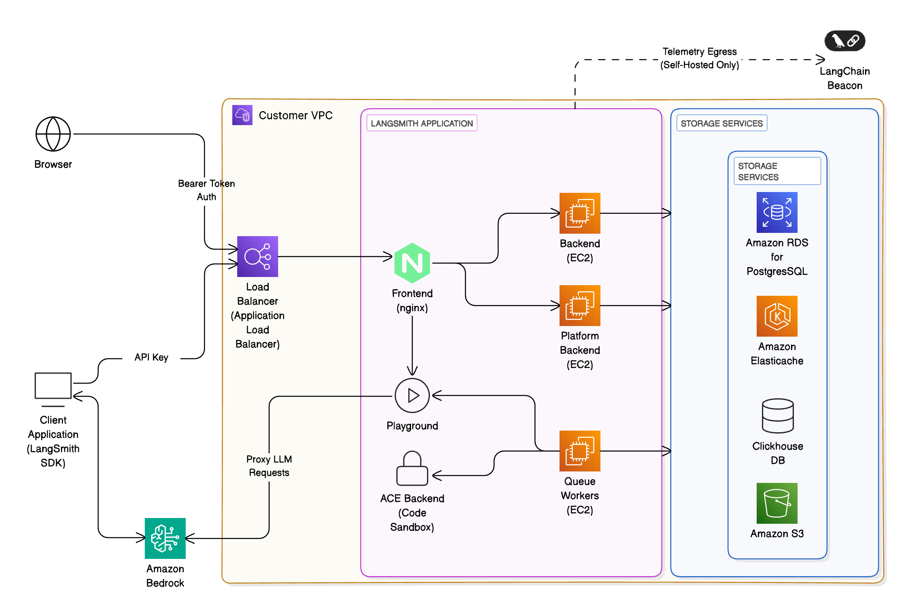

# Self-hosted LangSmith on AWS

When running LangSmith on [Amazon Web Services (AWS)](https://aws.amazon.com/), [self-hosted](../Self-hosted%20LangSmith.md) mode deploys a complete LangSmith platform with observability functionality.

This page provides:

* [Initial setup steps](#initial-setup) for deploying to EKS, configuring managed services, and setting up authentication.
* [AWS-specific architecture patterns](#reference-architecture) and reference diagrams.
* [Service recommendations](#compute-options) and best practices.
* [AWS Well-Architected best practices](#aws-well-architected-best-practices) for operational excellence, security, and reliability.

> [!NOTE]
>
> LangChain publishes production-ready [Terraform modules for AWS](https://github.com/langchain-ai/terraform/tree/main/modules/aws) that provision EKS, RDS, ElastiCache, S3, and networking in a single workflow. Start with the [Deploy with Terraform overview](../Deploy%20with%20Terraform/Deploy%20LangSmith%20with%20Terraform.md) to choose between the Terraform and Helm-only paths.

## Initial setup

**1. Deploy to Kubernetes**

Follow the [Kubernetes installation guide](../Install%20an%20instance/Self-host%20LangSmith%20on%20Kubernetes.md). LangSmith is tested on Amazon Elastic Kubernetes Service (EKS).

**EKS-specific notes:**

* Ensure the EBS CSI Driver is installed for persistent storage
* Use the `ebs.csi.aws.com` storage class provisioner

**2. Configure external services**

For production deployments, connect to AWS managed services:

> [card] [Amazon S3](../Connect%20external%20services/Enable%20blob%20storage.md#amazon-s3)
>
> Store trace data in S3

> [card] [Amazon RDS](../Connect%20external%20services/Connect%20to%20an%20external%20PostgreSQL%20database.md#amazon-rds)
>
> PostgreSQL database

> [card] [Amazon ElastiCache](../Connect%20external%20services/Connect%20to%20an%20external%20Redis%20or%20Valkey%20database.md#amazon-elasticache)
>
> Redis or Valkey for caching

> [card] [ClickHouse Cloud](../Connect%20external%20services/Connect%20to%20an%20external%20ClickHouse%20database.md)
>
> Analytics database

**3. Set up authentication**

Use [IAM Roles for Service Accounts (IRSA)](https://docs.aws.amazon.com/eks/latest/userguide/iam-roles-for-service-accounts.html) to authenticate LangSmith pods to AWS services without static credentials.

**Key pages:**

* [S3 IRSA configuration](../Connect%20external%20services/Enable%20blob%20storage.md#amazon-s3)
* [RDS IAM authentication](../Connect%20external%20services/Connect%20to%20an%20external%20PostgreSQL%20database.md#iam-authentication)
* [ElastiCache IAM authentication](../Connect%20external%20services/Connect%20to%20an%20external%20Redis%20or%20Valkey%20database.md#iam-authentication)

After completing these initial setup steps, you can review the complete AWS architecture and best practices below.

## Reference architecture

We recommend leveraging AWS's managed services to provide a scalable, secure, and resilient platform. The following architecture applies to both self-hosted and hybrid and aligns with the [AWS Well-Architected Framework](https://aws.amazon.com/architecture/well-architected/):

* &#x20;**Ingress & networking**: Requests enter via [Amazon Application Load Balancer (ALB)](https://aws.amazon.com/elasticloadbalancing/application-load-balancer/) within your [VPC](https://aws.amazon.com/vpc/), secured using [AWS WAF](https://aws.amazon.com/waf/) and [IAM](https://aws.amazon.com/iam/)-based authentication.

* &#x20;**Frontend & backend services:** Containers run on [Amazon EKS](https://aws.amazon.com/eks/), orchestrated behind the ALB, and route requests to other services within the cluster as necessary.

* &#x20;**Storage & databases:**
  * [Amazon RDS for PostgreSQL](https://aws.amazon.com/rds/postgresql/) or [Aurora](https://aws.amazon.com/rds/aurora/): metadata, projects, users, and short-term and long-term memory for deployed agents. LangSmith supports PostgreSQL version 14 or higher.
  * [Amazon ElastiCache](https://aws.amazon.com/elasticache/) (Redis or Valkey): caching and job queues. ElastiCache can be in single-instance or cluster mode. LangSmith requires Redis OSS version 6.2 or higher, or Valkey 8.
  * ClickHouse + [Amazon EBS](https://aws.amazon.com/ebs/): analytics and trace storage.
    * We recommend using an [externally managed ClickHouse solution](../Connect%20external%20services/Connect%20to%20an%20external%20ClickHouse%20database.md) unless security or compliance reasons
      prevent you from doing so.
    * ClickHouse is not required for hybrid deployments.
  * [Amazon S3](https://aws.amazon.com/s3/): object storage for trace artifacts and telemetry.

* &#x20;**LLM integration:** Optionally proxy requests to [Amazon Bedrock](https://aws.amazon.com/bedrock/) or [Amazon SageMaker](https://aws.amazon.com/sagemaker/) for LLM inference.

* &#x20;**Monitoring & observability:** Integrate with [Amazon CloudWatch](https://aws.amazon.com/cloudwatch/)

## Compute options

LangSmith supports multiple compute options depending on your requirements:

| Compute option | Description | Suitable for |
| - | - | - |
| **Elastic Kubernetes Service (preferred)** | Advanced scaling and multi-tenant support | Large enterprises |
| **EC2-based** | Full control, BYO-infra | Regulated or air-gapped environments |

## AWS Well-Architected best practices

This reference is designed to align with the six pillars of the AWS Well-Architected Framework:

### Operational excellence

* Automate deployments with IaC ([CloudFormation](https://aws.amazon.com/cloudformation/) / [Terraform](https://www.terraform.io/)).
* Use [AWS Systems Manager Parameter Store](https://docs.aws.amazon.com/systems-manager/latest/userguide/systems-manager-parameter-store.html) for configuration.
* Configure your LangSmith instance to [export telemetry data](../Self-hosted%20observability/Export%20LangSmith%20telemetry%20to%20your%20observability%20backend.md) and continuously monitor via [CloudWatch Logs](https://docs.aws.amazon.com/AmazonCloudWatch/latest/logs/WhatIsCloudWatchLogs.html).
* The preferred method to manage [Agent Servers](../../../Deploy/Get%20started/LangSmith%20Agent%20Server.md) is to create a CI process that builds [Agent Server](../../../Deploy/Agent%20Server/Capabilities/Agent%20Server.md) images and pushes them to [ECR](https://aws.amazon.com/ecr/). Create a test deployment for pull requests before deploying a new revision to staging or production upon PR merge.

### Security

* Use [IAM](https://aws.amazon.com/iam/) roles with least-privilege policies.
* Enable encryption at rest ([RDS](https://docs.aws.amazon.com/AmazonRDS/latest/UserGuide/Overview.Encryption.html), [S3](https://docs.aws.amazon.com/AmazonS3/latest/userguide/UsingEncryption.html), ClickHouse volumes) and in transit (TLS 1.2+).
* Integrate with [AWS Secrets Manager](https://aws.amazon.com/secrets-manager/) for credentials.
* Use [Amazon Cognito](https://aws.amazon.com/cognito/) as an IDP in conjunction with LangSmith's built-in authentication and authorization features to secure access to agents and their tools.

### Reliability

* Replicate the LangSmith [data plane](../../../Deploy/Get%20started/Deployment%20components/LangSmith%20data%20plane.md) across regions: Deploy identical data planes to Kubernetes clusters in different regions for LangSmith Agent Server. Deploy [RDS](https://docs.aws.amazon.com/AmazonRDS/latest/UserGuide/Concepts.MultiAZSingleStandby.html) and [ECS](https://aws.amazon.com/ecs/) services across [Multi-AZ](https://aws.amazon.com/about-aws/global-infrastructure/regions_az/).
* Implement [auto-scaling](https://aws.amazon.com/autoscaling/) for backend workers.
* Use [Amazon Route 53](https://aws.amazon.com/route53/) health checks and failover policies.

### Performance efficiency

* Leverage [EC2](https://aws.amazon.com/ec2/) instances for optimized compute.
* Use [S3 Intelligent-Tiering](https://aws.amazon.com/s3/storage-classes/intelligent-tiering/) for infrequently accessed trace data.

### Cost optimization

* Right-size [EKS](https://aws.amazon.com/eks/) clusters using [Compute Savings Plans](https://aws.amazon.com/savingsplans/compute-pricing/).
* Monitor cost KPIs using [AWS Cost Explorer](https://aws.amazon.com/aws-cost-management/aws-cost-explorer/) dashboards.

### Sustainability

* Minimize idle workloads with on-demand compute.
* Store telemetry in low-latency, low-cost tiers.
* Enable auto-shutdown for non-prod environments.

## Security and compliance

LangSmith can be configured for:

* [PrivateLink](https://aws.amazon.com/privatelink/)-only access (no public internet exposure, besides egress necessary for billing).
* [KMS](https://aws.amazon.com/kms/)-based encryption keys for S3, RDS, and EBS.
* Audit logging to [CloudWatch](https://aws.amazon.com/cloudwatch/) and [AWS CloudTrail](https://aws.amazon.com/cloudtrail/).

Customers can deploy in [GovCloud](https://aws.amazon.com/govcloud-us/), ISO, or HIPAA regions as needed.

## Monitoring and evals

Use LangSmith to:

* Capture traces from LLM apps running on [Bedrock](https://aws.amazon.com/bedrock/) or [SageMaker](https://aws.amazon.com/sagemaker/).
* Evaluate model outputs via [LangSmith datasets](../../../Test/Datasets%20%26%20Experiments/Datasets/Manage%20datasets.md).
* Track latency, token usage, and success rates.

Integrate with:

* [AWS CloudWatch](https://aws.amazon.com/cloudwatch/) dashboards.
* [OpenTelemetry](https://opentelemetry.io/) and [Prometheus](https://prometheus.io/) exporters.
