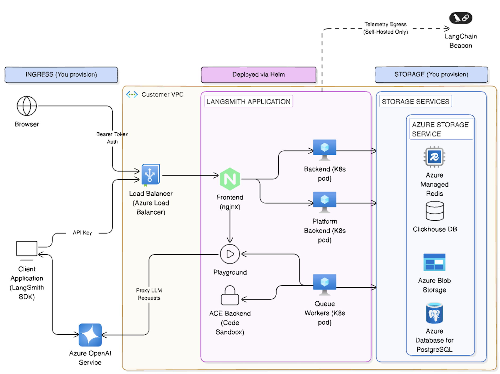

# Self-hosted LangSmith on Azure

When running LangSmith on [Microsoft Azure](https://azure.microsoft.com/), [self-hosted](../Self-hosted%20LangSmith.md) mode deploys a complete LangSmith platform with observability functionality.

This page provides:

* [Initial setup steps](#initial-setup) for deploying to AKS, configuring managed services, and setting up authentication.
* [Azure-specific architecture patterns](#reference-architecture) and reference diagrams.
* [Compute and networking guidance](#compute-and-networking-on-azure) and best practices.
* [Security and access control](#security-and-access-control) recommendations for Azure deployments.

> [!NOTE]
>
> LangChain publishes production-ready [Terraform modules for Azure](https://github.com/langchain-ai/terraform/tree/main/modules/azure) that provision AKS, Azure Database for PostgreSQL, Azure Managed Redis, Blob Storage, and Key Vault in a single workflow. Start with the [Deploy with Terraform overview](../Deploy%20with%20Terraform/Deploy%20LangSmith%20with%20Terraform.md) to choose between the Terraform and Helm-only paths.

## Initial setup

**1. Deploy to Kubernetes**

Follow the [Kubernetes installation guide](../Install%20an%20instance/Self-host%20LangSmith%20on%20Kubernetes.md). LangSmith is tested on Azure Kubernetes Service (AKS).

**AKS-specific notes:**

* LangSmith works with standard AKS clusters
* Use Azure Disk storage class for persistent volumes

**2. Configure external services**

For production deployments, connect to Azure managed services:

> [card] [Azure Blob Storage](../Connect%20external%20services/Enable%20blob%20storage.md#azure-blob-storage)
>
> Store trace data in Azure Blob

> [card] [Azure Database](../Connect%20external%20services/Connect%20to%20an%20external%20PostgreSQL%20database.md#azure-database-for-postgresql)
>
> PostgreSQL database

> [card] [Azure Cache](../Connect%20external%20services/Connect%20to%20an%20external%20Redis%20or%20Valkey%20database.md#azure-cache-for-redis)
>
> Redis for caching

> [card] [ClickHouse Cloud](../Connect%20external%20services/Connect%20to%20an%20external%20ClickHouse%20database.md)
>
> Analytics database

**3. Set up authentication**

Use [Azure Workload Identity](https://azure.github.io/azure-workload-identity/docs/introduction.html) to authenticate LangSmith pods to Azure services.

**Key pages:**

* [Azure Blob managed identity](../Connect%20external%20services/Enable%20blob%20storage.md#azure-blob-storage)
* [Azure Database Entra authentication](../Connect%20external%20services/Connect%20to%20an%20external%20PostgreSQL%20database.md#iam-authentication)
* [Azure Cache Entra authentication](../Connect%20external%20services/Connect%20to%20an%20external%20Redis%20or%20Valkey%20database.md#iam-authentication)

After completing these initial setup steps, you can review the complete Azure architecture and best practices below.

## Reference architecture

We recommend using Azure's managed services to provide a scalable, secure, and resilient platform. The following architecture applies to both self-hosted and hybrid deployments.

| | Components | How it's installed |
| - | - | - |
| **LangSmith Helm release** | Frontend, backend, queue, platform backend, Playground, ACE, and optionally the LangSmith Agent Server control/data plane | One `helm upgrade --install` from the [`langchain/langsmith`](https://github.com/langchain-ai/helm/tree/main/charts/langsmith) chart |
| **You provision** | AKS, PostgreSQL, Managed Redis, Blob Storage, Key Vault, ingress, and ClickHouse | Your IaC tooling (Terraform, ARM templates, or Azure portal) before installing LangSmith |

**Installation order:** provision Azure infrastructure → provision or subscribe to ClickHouse → configure Entra ID and Workload Identity → run `helm upgrade --install`. Agent Server hosting, Fleet, Insights, and Chat are enabled through the same Helm release, not as separate installs.

**Compliance surface:** one application review for the LangSmith chart and its container images, plus standard Azure service reviews for each managed resource. ClickHouse Cloud adds one third-party SaaS review.

* **Client interfaces**: Users interact with LangSmith via a web browser or the LangChain SDK. All traffic terminates at an [Azure Load Balancer](https://azure.microsoft.com/en-us/products/load-balancer/) and is routed to the frontend (NGINX) within the [AKS](https://azure.microsoft.com/en-us/products/kubernetes-service/) cluster before being routed to another service within the cluster if necessary.
* **Storage services**: The platform requires persistent storage for traces, metadata and caching. On Azure the recommended services are:
  * &#x20;**[Azure Database for PostgreSQL (Flexible Server)](https://azure.microsoft.com/en-us/products/postgresql/)** for transactional data (e.g., runs, projects). Azure's high-availability options provision a standby replica in another zone; data is synchronously committed to both primary and standby servers. LangSmith requires PostgreSQL version 14 or higher.
  * &#x20;**[Azure Managed Redis](https://azure.microsoft.com/en-us/products/managed-redis/)** for queues and caching. Best practices include storing small values and breaking large objects into multiple keys, using pipelining to maximize throughput and ensuring the client and server reside in the same region. You can also use [Azure Cache for Redis](https://azure.microsoft.com/en-us/products/cache), running either in single-instance or cluster mode. LangSmith requires Redis OSS version 6.2 or higher.
  * &#x20;**ClickHouse** for high-volume analytics of traces. We recommend using an [externally managed ClickHouse solution](../Connect%20external%20services/Connect%20to%20an%20external%20ClickHouse%20database.md). If, for security or compliance reasons, that is not an option, deploy a ClickHouse cluster on AKS using the open-source operator. Ensure replication across [availability zones](https://learn.microsoft.com/en-us/azure/reliability/availability-zones-overview) for durability. Clickhouse is not required for a hybrid deployment.
  * &#x20;**[Azure Blob Storage](https://azure.microsoft.com/en-us/products/storage/blobs/)** for large artifacts. Use redundant storage configurations such as read-access geo-redundant (RA-GRS) or geo-zone-redundant (RA-GZRS) storage and design applications to read from the secondary region during an outage.

## Compute and networking on Azure

### Azure Kubernetes Service (AKS)

[AKS](https://azure.microsoft.com/en-us/products/kubernetes-service/) is the recommended compute platform for production deployments. This section outlines the key considerations for planning your setup.

#### Network model

Use [Azure CNI](https://learn.microsoft.com/en-us/azure/aks/configure-azure-cni) networking for production clusters. This model integrates the cluster into an existing virtual network, assigns IP addresses to each pod and node, and allows direct connectivity to on-premises or other Azure services. Ensure the subnet has enough IPs for nodes and pods, avoid overlapping address ranges and allocate additional IP space for scale-out events.

#### Ingress and load balancing

Use a layer-7 ingress, which routes HTTP/HTTPS traffic by URL path, terminates TLS, and needs fewer public IP addresses than layer-4 load balancers. LangSmith supports standard Ingress, Gateway API, and Istio Gateway routing. For the Helm values each option needs, see [Create an Ingress for installations](../Configure%20an%20instance/Create%20an%20Ingress%20for%20installations%20%28Kubernetes%29.md).

On AKS, Microsoft supports the managed NGINX ingress in the [application routing add-on](https://learn.microsoft.com/en-us/azure/aks/app-routing) with critical security patches only through November 2026. Microsoft recommends moving to its [Gateway API implementation](https://learn.microsoft.com/en-us/azure/aks/app-routing-gateway-api) or another supported implementation.

Use Envoy Gateway, which the [LangSmith Azure Terraform module](../Deploy%20with%20Terraform/Azure/Azure%20Terraform%20architecture.md#ingress-options) deploys by default. The module also handles DNS and certificates. For DNS, it assigns an Azure DNS label, or creates an Azure DNS zone and A record for a custom domain. For certificates, it installs cert-manager, which issues Let's Encrypt certificates over HTTP-01 or DNS-01. You can supply your own certificate as a Kubernetes secret instead, and renew it yourself. For which controllers support which certificate options, see the [ingress and TLS guide](https://github.com/langchain-ai/terraform/blob/main/modules/azure/INGRESS_CONTROLLERS.md) in the module repository.

The Envoy Gateway path does not load certificates from Key Vault. If your organization requires Key Vault certificates, Microsoft's managed Gateway API is an option. It manages Azure DNS records and Key Vault TLS certificates, but works only with the `approuting-istio` or `istio` GatewayClass, which the Terraform module does not use. For more information, see [Configure Azure DNS and TLS](https://learn.microsoft.com/en-us/azure/aks/app-routing-gateway-api-dns-tls).

#### Web Application Firewall (WAF)

For additional protection against attacks, deploy a [WAF](https://learn.microsoft.com/en-us/azure/web-application-firewall/overview) such as [Azure Application Gateway](https://azure.microsoft.com/en-us/products/application-gateway/). A WAF filters traffic using OWASP rules and can terminate TLS before the traffic reaches your AKS cluster.

#### Network policies

Apply [Kubernetes network policies](https://learn.microsoft.com/en-us/azure/aks/use-network-policies) to restrict pod-to-pod traffic and reduce the impact of compromised workloads. Enable network policy support when creating the cluster and design rules based on application connectivity.

#### High availability

Configure node pools across [availability zones](https://learn.microsoft.com/en-us/azure/reliability/availability-zones-overview) and use Pod Disruption Budgets (PDB) and multiple replicas for all deployments. Set pod resource requests and limits; the [AKS resource management best practices](https://learn.microsoft.com/en-us/azure/aks/developer-best-practices-resource-management) recommend setting CPU and memory limits to prevent pods from consuming all resources. Use [Cluster Autoscaler](https://learn.microsoft.com/en-us/azure/aks/cluster-autoscaler) and [Vertical Pod Autoscaler](https://learn.microsoft.com/en-us/azure/aks/vertical-pod-autoscaler) to scale node pools and adjust pod resources automatically.

### Networking and identity

#### Virtual network integration

Deploy AKS into its own [virtual network](https://azure.microsoft.com/en-us/products/virtual-network/) and create separate subnets for the cluster, database, Redis, and storage endpoints. Use [Private Link](https://azure.microsoft.com/en-us/products/private-link/) and [service endpoints](https://learn.microsoft.com/en-us/azure/virtual-network/virtual-network-service-endpoints-overview) to keep traffic within your virtual network and avoid exposure to the public internet.

#### Authentication

Integrate LangSmith with [Microsoft Entra ID](https://www.microsoft.com/en-us/security/business/identity-access/microsoft-entra-id) (Azure AD) for single sign-on. Use Azure AD OAuth2 for bearer tokens and assign roles to control access to the UI and API.

## Storage and data services

### Azure Database for PostgreSQL

#### High availability

Use [Flexible Server](https://learn.microsoft.com/en-us/azure/postgresql/flexible-server/overview) with high-availability mode. Azure provisions a standby replica either within the same availability zone (zonal) or across zones (zone-redundant). Data is synchronously committed to both the primary and standby servers, ensuring that committed data is not lost. Zone-redundant configurations place the standby in a different zone to protect against zone outages but may add write latency.

#### Backups and disaster recovery

Enable [automatic backups](https://learn.microsoft.com/en-us/azure/postgresql/flexible-server/concepts-backup-restore) and configure geo-redundant backup storage to protect against region-wide outages. For critical applications, create read replicas in a secondary region.

#### Scaling

Choose an appropriate SKU that matches your workload; Flexible Server allows scaling compute and storage independently. Monitor metrics and configure alerts through [Azure Monitor](https://azure.microsoft.com/en-us/products/monitor/).

### Azure Managed Redis

#### Persistence and redundancy

Choose a tier that provides replication and persistence. Configure Redis persistence or data backup for durability. For high-availability, use [active geo-replication](https://learn.microsoft.com/en-us/azure/redis/how-to-active-geo-replication) or zone-redundant caches depending on the tier.

### ClickHouse on Azure

ClickHouse is used for analytical workloads (traces and feedback). If you cannot use an externally managed solution, deploy a ClickHouse cluster on AKS using Helm or the official operator. For resilience, replicate data across nodes and availability zones. Consider using [Azure Disks](https://azure.microsoft.com/en-us/products/storage/disks/) for local storage and mount them as StatefulSets.

### Azure Blob Storage

#### Redundancy

Choose a redundancy configuration based on your recovery objectives. Use [read-access geo-redundant (RA-GRS) or geo-zone-redundant (RA-GZRS) storage](https://learn.microsoft.com/en-us/azure/storage/common/storage-redundancy) and design applications to switch reads to the secondary region during a primary region outage.

#### Naming and partitioning

Use naming conventions that improve load balancing across partitions and plan for the maximum number of concurrent clients. Stay within Azure's scalability and capacity targets and partition data across multiple storage accounts if necessary.

#### Networking

Access blob storage through [private endpoints](https://learn.microsoft.com/en-us/azure/storage/common/storage-private-endpoints) or by using SAS tokens and CORS rules to enable direct client access.

## Security and access control

### Azure Key Vault

#### Separate vaults per application and environment

Store secrets such as database connection strings and API keys in [Azure Key Vault](https://azure.microsoft.com/en-us/products/key-vault/). Use a dedicated vault for each application and environment (dev, test, prod) to limit the impact of a security breach.

#### Access control

Use the [RBAC permission model](https://learn.microsoft.com/en-us/azure/key-vault/general/rbac-guide) to assign roles at the vault scope and restrict access to required principals. Restrict network access using Private Link and firewalls.

#### Data protection and logging

Enable [soft delete and purge protection](https://learn.microsoft.com/en-us/azure/key-vault/general/soft-delete-overview) to prevent accidental deletion. Turn on logging and configure alerts for Key Vault access events.

### Network security

#### Ingress isolation

Expose only the frontend service through the ingress controller or WAF. Other services should be internal and communicate through cluster networking.

#### RBAC and pod security

Use [Kubernetes RBAC](https://kubernetes.io/docs/reference/access-authn-authz/rbac/) to control who can deploy, modify, or read resources. Enable [pod security admission](https://kubernetes.io/docs/concepts/security/pod-security-admission/) to enforce baseline, restricted, or privileged profiles.

#### Secrets management

Mount secrets from Key Vault into pods using [CSI Secret Store](https://learn.microsoft.com/en-us/azure/aks/csi-secrets-store-driver). Avoid storing secrets in environment variables or configuration files.

## Observability and monitoring

Configure your LangSmith instance to [export telemetry data](../Self-hosted%20observability/Export%20LangSmith%20telemetry%20to%20your%20observability%20backend.md) so you can use Azure's services to monitor it.

### Azure Monitor

Use [Azure Monitor](https://azure.microsoft.com/en-us/products/monitor/) for metrics, logs, and alerting. Proactive monitoring involves configuring alerts on key signals like node CPU/memory utilization, pod status, and service latency. Azure Monitor alerts notify you when predefined thresholds are exceeded.

### Managed Prometheus and Grafana

Enable [Azure Monitor managed Prometheus](https://learn.microsoft.com/en-us/azure/azure-monitor/essentials/prometheus-metrics-overview) to collect Kubernetes metrics. Combine it with [Grafana dashboards](https://azure.microsoft.com/en-us/products/managed-grafana/) for visualization. Define service-level objectives (SLOs) and configure alerts accordingly.

### Container Insights

Install [Container Insights](https://learn.microsoft.com/en-us/azure/azure-monitor/containers/container-insights-overview) to capture logs and metrics from AKS nodes and pods. Use [Azure Log Analytics workspaces](https://learn.microsoft.com/en-us/azure/azure-monitor/logs/log-analytics-overview) to query and analyze logs.

### Application logging

Ensure LangSmith services emit logs to stdout/stderr and forward them via [Fluent Bit](https://fluentbit.io/) or the Azure Monitor agent.

## Continuous integration

* The preferred method to manage [Agent Servers](../../../Deploy/Get%20started/LangSmith%20Agent%20Server.md) is to create a CI process that builds [Agent Server](../../../Deploy/Agent%20Server/Capabilities/Agent%20Server.md) images and pushes them to [Azure Container Registry](https://azure.microsoft.com/en-us/products/container-registry). Create a test deployment for pull requests before deploying a new revision to staging or production upon PR merge.
