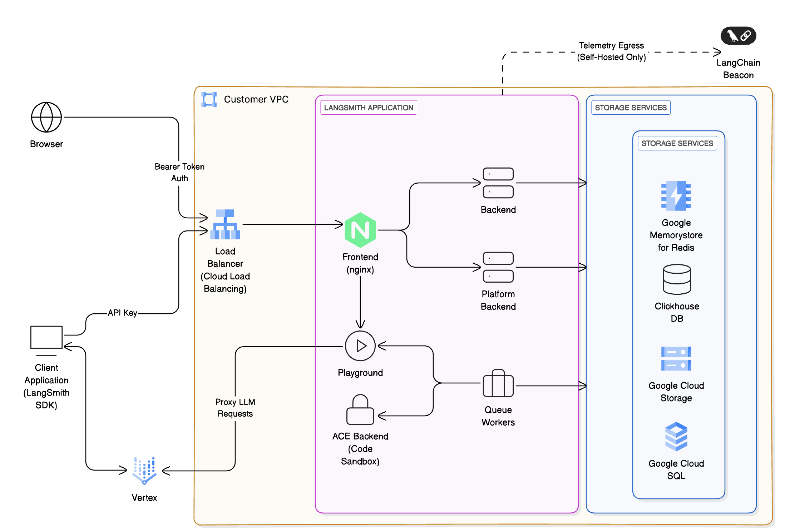

# Self-hosted LangSmith on GCP

When running LangSmith on [Google Cloud Platform (GCP)](https://cloud.google.com/), [self-hosted](../Self-hosted%20LangSmith.md) mode deploys a complete LangSmith platform with observability functionality.

This page provides:

* [Initial setup steps](#initial-setup) for deploying to GKE, configuring managed services, and setting up authentication.
* [GCP-specific architecture patterns](#reference-architecture) and reference diagrams.
* [Service recommendations](#compute-options) and best practices.
* [Google Cloud Well-Architected best practices](#google-cloud-well-architected-best-practices) for operational excellence, security, and reliability.

> [!NOTE]
>
> LangChain publishes production-ready [Terraform modules for GCP](https://github.com/langchain-ai/terraform/tree/main/modules/gcp) that provision GKE, Cloud SQL, Memorystore, Cloud Storage, and networking in a single workflow. Start with the [Deploy with Terraform overview](../Deploy%20with%20Terraform/Deploy%20LangSmith%20with%20Terraform.md) to choose between the Terraform and Helm-only paths.

## Initial setup

**1. Deploy to Kubernetes**

Follow the [Kubernetes installation guide](../Install%20an%20instance/Self-host%20LangSmith%20on%20Kubernetes.md). LangSmith is tested on Google Kubernetes Engine (GKE).

**GKE-specific notes:**

* LangSmith works with standard GKE clusters
* Use GCE persistent disk storage class

**2. Configure external services**

For production deployments, connect to GCP managed services:

> [card] [Google Cloud Storage](../Connect%20external%20services/Enable%20blob%20storage.md#google-cloud-storage)
>
> Store trace data in GCS

> [card] [Cloud SQL](../Connect%20external%20services/Connect%20to%20an%20external%20PostgreSQL%20database.md#google-cloud-sql)
>
> PostgreSQL database

> [card] [Memorystore](../Connect%20external%20services/Connect%20to%20an%20external%20Redis%20or%20Valkey%20database.md#google-cloud-memorystore)
>
> Redis or Valkey for caching

> [card] [ClickHouse Cloud](../Connect%20external%20services/Connect%20to%20an%20external%20ClickHouse%20database.md)
>
> Analytics database

**3. Set up authentication**

Use [Workload Identity](https://cloud.google.com/kubernetes-engine/docs/how-to/workload-identity) to authenticate LangSmith pods to GCP services.

**Key pages:**

* [GCS HMAC key authentication](../Connect%20external%20services/Enable%20blob%20storage.md#google-cloud-storage)
* [Cloud SQL IAM authentication](../Connect%20external%20services/Connect%20to%20an%20external%20PostgreSQL%20database.md#iam-authentication)
* [Memorystore IAM authentication](../Connect%20external%20services/Connect%20to%20an%20external%20Redis%20or%20Valkey%20database.md#iam-authentication)

After completing these initial setup steps, you can review the complete GCP architecture and best practices below.

## Reference architecture

We recommend leveraging GCP's managed services to provide a scalable, secure, and resilient platform. The following architecture applies to both self-hosted and hybrid and aligns with the [Google Cloud Well-Architected Framework](https://docs.cloud.google.com/architecture/framework):

* &#x20;**Ingress & networking**: Requests enter via [Cloud Load Balancing](https://cloud.google.com/load-balancing) within your [VPC](https://cloud.google.com/vpc), secured using [Cloud Armor](https://cloud.google.com/armor) and [IAM](https://cloud.google.com/iam)-based authentication.

* &#x20;**Frontend & backend services:** Containers run on [Google Kubernetes Engine (GKE)](https://cloud.google.com/kubernetes-engine), orchestrated behind the load balancer. Routes requests to other services within the cluster as necessary.

* &#x20;**Storage & databases:**
  * [Cloud SQL for PostgreSQL](https://cloud.google.com/sql/docs/postgres): metadata, projects, users, and short-term and long-term memory for deployed agents. LangSmith supports PostgreSQL version 14 or higher.
  * [Memorystore](https://cloud.google.com/memorystore) ([Redis](https://cloud.google.com/memorystore/docs/redis) or [Valkey](https://cloud.google.com/memorystore/docs/valkey)): caching and job queues. Memorystore can be in single-instance or cluster mode. LangSmith requires Redis OSS version 6.2 or higher, or Valkey 8.
  * ClickHouse + [Persistent Disks](https://cloud.google.com/compute/docs/disks): analytics and trace storage.
    * We recommend using an [externally managed ClickHouse solution](../Connect%20external%20services/Connect%20to%20an%20external%20ClickHouse%20database.md) unless security or compliance reasons
      prevent you from doing so.
    * ClickHouse is not required for hybrid deployments.
  * [Cloud Storage](https://cloud.google.com/storage): object storage for trace artifacts and telemetry.

* &#x20;**LLM integration:** Optionally proxy requests to [Gemini Enterprise Agent Platform](https://cloud.google.com/products/gemini-enterprise-agent-platform) for LLM inference.

* &#x20;**Monitoring & observability:** Integrate with [Cloud Monitoring](https://cloud.google.com/monitoring) and [Cloud Logging](https://cloud.google.com/logging)

## Compute options

LangSmith supports multiple compute options depending on your requirements:

| Compute option | Description | Suitable for |
| - | - | - |
| **Google Kubernetes Engine (preferred)** | Advanced scaling and multi-tenant support | Large enterprises |
| **Compute Engine-based** | Full control, BYO-infra | Regulated or air-gapped environments |

## Google cloud Well-Architected best practices

This reference is designed to align with the six pillars of the Google Cloud Well-Architected Framework:

### Operational excellence

* Automate deployments with IaC ([Terraform](https://www.terraform.io/) / [Deployment Manager](https://cloud.google.com/deployment-manager)).
* Use [Secret Manager](https://cloud.google.com/secret-manager) for configuration and sensitive data.
* Configure your LangSmith instance to [export telemetry data](../Self-hosted%20observability/Export%20LangSmith%20telemetry%20to%20your%20observability%20backend.md) and continuously monitor via [Cloud Logging](https://cloud.google.com/logging).
* The preferred method to manage [Agent Servers](../../../Deploy/Get%20started/LangSmith%20Agent%20Server.md) is to create a CI process that builds [Agent Server](../../../Deploy/Agent%20Server/Capabilities/Agent%20Server.md) images and pushes them to [Artifact Registry](https://cloud.google.com/artifact-registry). Create a test deployment for pull requests before deploying a new revision to staging or production upon PR merge.

### Security

* Use [IAM](https://cloud.google.com/iam) roles with least-privilege policies and [Workload Identity](https://cloud.google.com/kubernetes-engine/docs/how-to/workload-identity) for secure pod-to-GCP-service authentication.
* Enable encryption at rest ([Cloud SQL](https://docs.cloud.google.com/sql/docs/postgres/cmek), [Cloud Storage](https://cloud.google.com/storage/docs/encryption), Persistent Disks) and in transit (TLS 1.2+).
* Integrate with [Secret Manager](https://cloud.google.com/secret-manager) for credentials.
* Use [Identity Platform](https://cloud.google.com/identity-platform) or [Workload Identity Federation](https://cloud.google.com/iam/docs/workload-identity-federation) as an IDP in conjunction with LangSmith's built-in authentication and authorization features to secure access to agents and their tools.

### Reliability

* Replicate the LangSmith [data plane](../../../Deploy/Get%20started/Deployment%20components/LangSmith%20data%20plane.md) across regions: Deploy identical data planes to Kubernetes clusters in different regions for LangSmith Agent Server. Deploy [Cloud SQL](https://cloud.google.com/sql/docs/postgres/high-availability) and [GKE](https://docs.cloud.google.com/kubernetes-engine/docs/concepts/configuration-overview) services across multiple zones.
* Implement [autoscaling](https://cloud.google.com/kubernetes-engine/docs/concepts/cluster-autoscaler) for backend workers using [Horizontal Pod Autoscaler](https://cloud.google.com/kubernetes-engine/docs/concepts/horizontalpodautoscaler) and [Cluster Autoscaler](https://cloud.google.com/kubernetes-engine/docs/concepts/cluster-autoscaler).
* Use [Cloud DNS](https://cloud.google.com/dns) health checks and failover policies.

### Performance optimization

* Leverage [Compute Engine](https://cloud.google.com/compute) instances for optimized compute with [machine type selection](https://cloud.google.com/compute/docs/machine-types).
* Use [Cloud Storage lifecycle policies](https://cloud.google.com/storage/docs/lifecycle) for infrequently accessed trace data, moving to [Nearline](https://cloud.google.com/storage/docs/storage-classes#nearline) or [Coldline](https://cloud.google.com/storage/docs/storage-classes#coldline) storage classes.

### Cost optimization

* Right-size [GKE](https://cloud.google.com/kubernetes-engine) clusters using [Committed Use Discounts](https://cloud.google.com/compute/docs/instances/signing-up-committed-use-discounts) and [Sustained Use Discounts](https://cloud.google.com/compute/docs/sustained-use-discounts).
* Monitor cost KPIs using [Cloud Billing](https://cloud.google.com/billing/docs) dashboards and [Cost Management](https://cloud.google.com/cost-management) tools.

### Sustainability

* Minimize idle workloads with on-demand compute and [autoscaling](https://cloud.google.com/kubernetes-engine/docs/concepts/cluster-autoscaler).
* Store telemetry in low-latency, low-cost tiers using [Cloud Storage lifecycle policies](https://cloud.google.com/storage/docs/lifecycle).
* Enable auto-shutdown for non-prod environments using [scheduled actions](https://cloud.google.com/compute/docs/instances/schedule-instance-start-stop).

## Security and compliance

LangSmith can be configured for:

* [Private Service Connect](https://cloud.google.com/vpc/docs/private-service-connect)-only access (no public internet exposure, besides egress necessary for billing).
* [Cloud KMS](https://cloud.google.com/kms)-based encryption keys for Cloud Storage, Cloud SQL, and Persistent Disks.
* Audit logging to [Cloud Logging](https://cloud.google.com/logging) and [Cloud Audit Logs](https://cloud.google.com/logging/docs/audit).

Customers can deploy in [Assured Workloads](https://cloud.google.com/assured-workloads) regions for compliance with ISO, HIPAA, or other regulatory requirements as needed.

## Monitoring and evals

Use LangSmith to:

* Capture traces from LLM apps running on [Gemini Enterprise Agent Platform](https://cloud.google.com/products/gemini-enterprise-agent-platform).
* Evaluate model outputs via [LangSmith datasets](../../../Test/Datasets%20%26%20Experiments/Datasets/Manage%20datasets.md).
* Track latency, token usage, and success rates.

Integrate with:

* [Cloud Monitoring](https://cloud.google.com/monitoring) dashboards.
* [OpenTelemetry](https://opentelemetry.io/) and [Prometheus](https://prometheus.io/) exporters.
