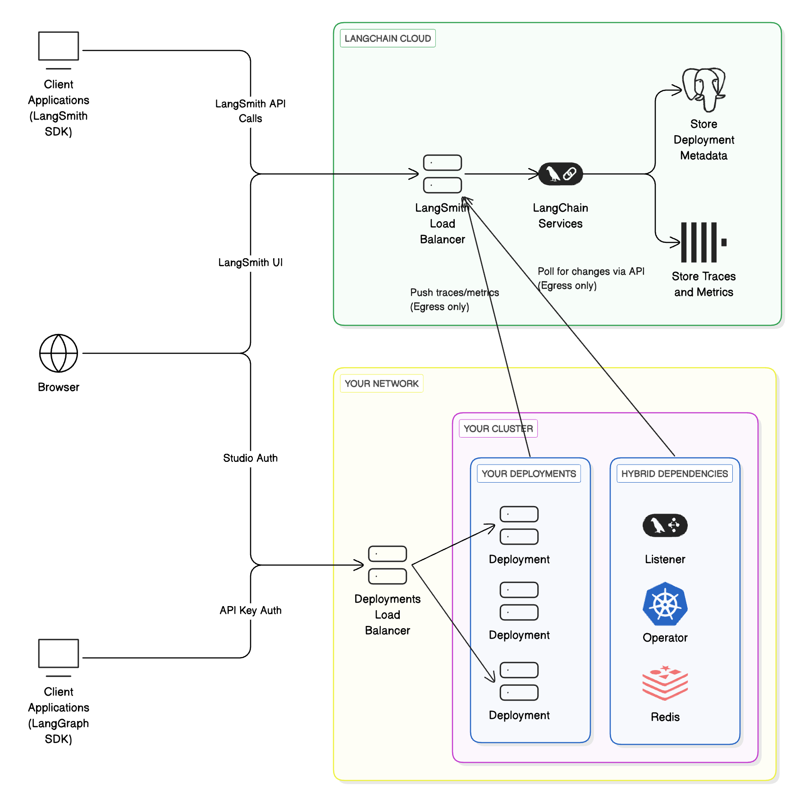

# Setup guide (legacy)

> Legacy hybrid deployment model with a LangChain-managed control plane and a self-managed data plane.

> [!WARNING]
>
> This page describes the legacy hybrid deployment model, which uses a LangChain-managed control plane to orchestrate Agent Servers in your cloud. For the current hybrid model, see [Hybrid](../../../Deploy/Deploy%20to%20Self-hosted/Hybrid.md).

> [!NOTE]
>
> The hybrid option requires an [Enterprise](https://www.langchain.com/pricing) plan. [Get a demo](https://www.langchain.com/contact-sales) to learn more.

The **hybrid** model splits LangSmith infrastructure between LangChain's cloud and yours:

* **Control plane** (LangSmith UI, APIs, and orchestration) runs in LangChain's cloud, managed by LangChain.
* **Data plane** (your Agent Servers (The server that runs your applications.) and agent workloads) runs in your cloud, managed by you.

This combines the convenience of a managed interface with the flexibility of running workloads in your own environment.

> [!NOTE]
>
> Learn more about the [control plane](../../../Deploy/Get%20started/Deployment%20components/LangSmith%20control%20plane.md), [data plane](../../../Deploy/Get%20started/Deployment%20components/LangSmith%20data%20plane.md), and [Agent Server](../../../Deploy/Agent%20Server/Capabilities/Agent%20Server.md) architecture concepts.

| Component | Responsibilities | Where it runs | Who manages it |
| - | - | - | - |
| Control plane (The LangSmith UI and APIs for managing deployments.) | <ul><li>UI for creating deployments and revisions</li><li>APIs for managing deployments</li><li>Observability data storage</li></ul> | LangChain's cloud | LangChain |
| Data plane (The runtime environment where your Agent Servers and agents execute.) | <ul><li>Operator/listener to reconcile deployments</li><li>Agent Servers (agents/graphs)</li><li>Backing services (Postgres, Redis, etc.)</li></ul> | Your cloud | You |

When running LangSmith in a hybrid model, you authenticate with a [LangSmith API key](../../Account/Create%20an%20account%20and%20API%20key.md).

### Workflow

1. Use the `langgraph-cli` or [Studio](../../../Test/Test%20from%20Studio/LangSmith%20Studio.md) to test your graph locally.
2. Build a Docker image using the `langgraph build` command.
3. Deploy your Agent Server from the [control plane UI](../../../Deploy/Get%20started/Deployment%20components/LangSmith%20control%20plane.md#control-plane-ui).

> [!NOTE]
>
> Supported Compute Platforms: [Kubernetes](https://kubernetes.io/). See [Kubernetes setup](#kubernetes-setup) below.

### Architecture



### Compute platforms

* **Kubernetes**: Hybrid supports running the data plane on any Kubernetes cluster.

> [!TIP]
>
> For setup in Kubernetes, see [Kubernetes setup](#kubernetes-setup) below.

### Egress to LangSmith and the control plane

In the hybrid deployment model, your self-hosted data plane will send network requests to the control plane to poll for changes that need to be implemented in the data plane. Traces from data plane deployments also get sent to the LangSmith instance integrated with the control plane. This traffic to the control plane is encrypted, over HTTPS. The data plane authenticates with the control plane with a LangSmith API key.

In order to enable this egress, you may need to update internal firewall rules or cloud resources (such as Security Groups) to [allow certain IP addresses](../../Cloud/Cloud%20%28SaaS%29.md#ingress-into-langchain-saas).

> [!WARNING]
>
> AWS/Azure PrivateLink or GCP Private Service Connect is currently not supported. This traffic will go over the internet.

## Kubernetes setup

The following steps describe how to connect your self-hosted data plane to the managed LangSmith control plane.

### Prerequisites

1. `KEDA` is installed on your cluster.

   ```bash
     helm repo add kedacore https://kedacore.github.io/charts
     helm install keda kedacore/keda --namespace keda --create-namespace
   ```

   > [!NOTE]
   >
   > `KEDA` is used to automatically scale the deployment system based on queue size.

2. A valid `Ingress` controller is installed on your cluster. For more information about configuring ingress for your deployment, refer to [Create an ingress for installations](../Configure%20an%20instance/Create%20an%20Ingress%20for%20installations%20%28Kubernetes%29.md). We highly recommend using the modern [Gateway API](../Configure%20an%20instance/Create%20an%20Ingress%20for%20installations%20%28Kubernetes%29.md#option-2%3A-gateway-api) in a production setup.

3. If you plan to have the listener watch multiple namespaces, you **MUST** use the [Gateway API](../Configure%20an%20instance/Create%20an%20Ingress%20for%20installations%20%28Kubernetes%29.md#option-2%3A-gateway-api) or an [Istio Gateway](../Configure%20an%20instance/Create%20an%20Ingress%20for%20installations%20%28Kubernetes%29.md#option-3%3A-istio-gateway) instead of the [standard ingress](../Configure%20an%20instance/Create%20an%20Ingress%20for%20installations%20%28Kubernetes%29.md#option-1%3A-standard-ingress) resource. A standard ingress resource can only route traffic to services in the same namespace, whereas a Gateway or Istio Gateway can route traffic to services across multiple namespaces.

4. You have slack space in your cluster for multiple deployments. `Cluster-Autoscaler` is recommended to automatically provision new nodes.

5. You will need to enable egress to two control plane URLs. The listener polls these endpoints for deployments. Use the pair that matches your LangSmith region.

LangSmith Agent Server control plane:

<table>
  <thead>
    <tr>
      <th>Region</th>

      <th>
        URL
      </th>
    </tr>
  </thead>

  <tbody>
    <tr>
      <td>GCP US</td>

      <td>
        `https://api.host.langchain.com`
      </td>
    </tr>

    <tr>
      <td>GCP EU</td>

      <td>
        `https://eu.api.host.langchain.com`
      </td>
    </tr>

    <tr>
      <td>GCP APAC</td>

      <td>
        `https://apac.api.host.langchain.com`
      </td>
    </tr>

    <tr>
      <td>AWS US</td>

      <td>
        `https://aws.api.host.langchain.com`
      </td>
    </tr>

    <tr><td>Azure US</td>
    <td>`https://azure.api.host.langchain.com`</td></tr>
  </tbody>
</table>

LangSmith API:

<table>
  <thead>
    <tr>
      <th>Region</th>

      <th>
        URL
      </th>
    </tr>
  </thead>

  <tbody>
    <tr>
      <td>GCP US</td>

      <td>
        `https://api.smith.langchain.com`
      </td>
    </tr>

    <tr>
      <td>GCP EU</td>

      <td>
        `https://eu.api.smith.langchain.com`
      </td>
    </tr>

    <tr>
      <td>GCP APAC</td>

      <td>
        `https://apac.api.smith.langchain.com`
      </td>
    </tr>

    <tr>
      <td>AWS US</td>

      <td>
        `https://aws.api.smith.langchain.com`
      </td>
    </tr>

    <tr><td>Azure US</td>
    <td>`https://azure.api.smith.langchain.com`</td></tr>
  </tbody>
</table>

### Setup

1. Provide your LangSmith organization ID to us. Your LangSmith organization will be configured to deploy the data plane in your cloud.
2. Create a listener from the LangSmith UI. The `Listener` data model is configured for the actual [listener application](../../../Deploy/Get%20started/Deployment%20components/LangSmith%20data%20plane.md#listener-application).
   1. In the left-hand navigation, select `Deployments` > `Listeners`.
   2. In the top-right of the page, select `+ Create Listener`.
   3. Enter a unique `Compute ID` for the listener. The `Compute ID` is a user-defined identifier that should be unique across all listeners in the current LangSmith workspace. The `Compute ID` is displayed to end users when they are creating a new deployment. Ensure that the `Compute ID` provides context to the end user about where their Agent Server deployments will be deployed to. For example, a `Compute ID` can be set to `k8s-cluster-name-dev-01`. In this example, the name of the Kubernetes cluster is `k8s-cluster-name`, `dev` denotes that the cluster is reserved for "development" workloads, and `01` is a numerical suffix to reduce naming collisions.
   4. Enter one or more Kubernetes namespaces. Later, the listener application will be configured to deploy to each of these namespaces.
   5. In the top-right on the page, select `Submit`.
   6. After the listener is created, copy the listener ID. You will use it later when installing the actual listener application in the Kubernetes cluster (step 5).
   > [!NOTE]
   >
   > **Important**
   > Creating a listener from the LangSmith UI does not install the listener application in the Kubernetes cluster.
3. A [Helm chart](https://github.com/langchain-ai/helm/tree/main/charts/langgraph-dataplane) is provided to install the necessary components in your Kubernetes cluster.
   * `langgraph-dataplane-listener`: This is a service that listens to LangChain's [control plane](../../../Deploy/Get%20started/Deployment%20components/LangSmith%20control%20plane.md) for changes to your deployments and creates/updates downstream CRDs. This is the [listener application](../../../Deploy/Get%20started/Deployment%20components/LangSmith%20data%20plane.md#listener-application).
   * `LangGraphPlatform CRD`: A CRD for LangSmith Agent Server. This contains the spec for managing an Agent Server.
   * `langgraph-dataplane-operator`: This operator handles changes to your LangSmith CRDs.
   * `langgraph-dataplane-redis`: A Redis instance is used by the `langgraph-dataplane-listener` to manage various tasks (mainly creating and deleting deployments).
4. Configure your `langgraph-dataplane-values.yaml` file.
   ```bash
     config:
       langsmithApiKey: "" # API Key of your Workspace
       langsmithWorkspaceId: "" # Workspace ID
       hostBackendUrl: "https://api.host.langchain.com" # Use the matching regional LangSmith Agent Server control plane URL from the table above
       smithBackendUrl: "https://api.smith.langchain.com" # Use the matching regional LangSmith API URL from the table above
       langgraphListenerId: "" # Listener ID from Step 2f
       watchNamespaces: "" # comma-separated list of Kubernetes namespaces that the listener and operator will deploy to
       enableLGPDeploymentHealthCheck: true # enable/disable health check step for deployments

     ingress:
       hostname: "" # specify a hostname that will be configured for all deployments

     operator:
       enabled: true
       createCRDs: true # set this to `false` if the CRD has been previously installed in the current Kubernetes cluster
   ```
   * `config.langsmithApiKey`: The `langgraph-listener` deployment authenticates with LangChain's LangGraph control plane API with the `langsmithApiKey`.
   * `config.langsmithWorkspaceId`: The `langgraph-listener` deployment is coupled to Agent Server deployments in the LangSmith workspace. In other words, the `langgraph-listener` deployment can only manage Agent Server deployments in the specified LangSmith workspace ID.
   * `config.langgraphListenerId`: In addition to being coupled with a LangSmith workspace, the `langgraph-listener` deployment is also coupled to a listener. When a new Agent Server deployment is created, it is automatically coupled to a `langgraphListenerId`. Specifying `langgraphListenerId` ensures that the `langgraph-listener` deployment can only manage Agent Server deployments that are coupled to `langgraphListenerId`.
   * `config.watchNamespaces`: A comma-separated list of Kubernetes namespaces that the `langgraph-listener` deployment will deploy to. This list should match the list of namespaces specified in step 2d.
   * `config.enableLGPDeploymentHealthCheck`: To disable the Agent Server health check, set this to `false`.
   * `ingress.hostname`: As part of the deployment workflow, the `langgraph-listener` deployment attempts to call the Agent Server health check endpoint (`GET /ok`) to verify that the application has started up correctly. A typical setup involves creating a shared DNS record or domain for Agent Server deployments. This is not managed by LangSmith. Once created, set `ingress.hostname` to the domain, which will be used to complete the health check.
   * `operator.createCRDs`: Set this value to `false` if the Kubernetes cluster already has the `LangGraphPlatform CRD` installed. During installation, an error will occur if the CRD is already installed. This situation may occur if multiple listeners are deployed on the same Kubernetes cluster.
5. Deploy `langgraph-dataplane` Helm chart.
   ```bash
     helm repo add langchain https://langchain-ai.github.io/helm/
     helm repo update
     helm upgrade -i langgraph-dataplane langchain/langgraph-dataplane --values langgraph-dataplane-values.yaml --wait --debug
   ```
6. If successful, you will see three services start up in your namespace.

   ```bash
     NAME                                            READY   STATUS              RESTARTS   AGE
     langgraph-dataplane-listener-6dd4749445-zjmr4   0/1     ContainerCreating   0          26s
     langgraph-dataplane-operator-6b88879f9b-t76gk   1/1     Running             0          26s
     langgraph-dataplane-redis-0                     1/1     Running             0          25s
   ```

   Your hybrid infrastructure is now ready to create deployments.

### Configuring additional data planes in the same cluster

To create a data plane in a different namespace in the same cluster, repeat the above steps and pass a `-n` option to `helm upgrade` to specify a different namespace.

**When installing multiple data planes in the same cluster, it is very important to follow the rules below:**

1. The `config.watchNamespaces` list should never intersect with other installations `config.watchNamespaces`. For example, if installation A is watching namespaces `foo,bar`, installation B cannot watch either `foo` or `bar`. Multiple operators or listeners watching the same namespace will lead to unexpected behavior. This means that multiple LangSmith workspaces cannot deploy to the same namespace! Please review the [cluster organization](#kubernetes-cluster-organization) section to understand this better.
2. It is required to use the [Gateway API](../Configure%20an%20instance/Create%20an%20Ingress%20for%20installations%20%28Kubernetes%29.md#option-2%3A-gateway-api) or an [Istio Gateway](../Configure%20an%20instance/Create%20an%20Ingress%20for%20installations%20%28Kubernetes%29.md#option-3%3A-istio-gateway). Relying on the [standard ingress](../Configure%20an%20instance/Create%20an%20Ingress%20for%20installations%20%28Kubernetes%29.md#option-1%3A-standard-ingress) resource can cause conflicts with Ingress objects created by other data planes in the same cluster. Because behavior in these cases depends on the specific ingress controller, this may result in unpredictable or undesired outcomes.

## Listeners

In the hybrid option, one or more [listener applications](../../../Deploy/Get%20started/Deployment%20components/LangSmith%20data%20plane.md#listener-application) can run depending on how your LangSmith workspaces and Kubernetes clusters are organized.

### Kubernetes cluster organization

* One or more listeners can run in a Kubernetes cluster.
* A listener can deploy into one or more namespaces in that cluster.
* Multiple listeners cannot deploy to the same namespace.
* Cluster owners are responsible for planning listener layout and Agent Server deployments.

### LangSmith workspace organization

* A workspace can be associated with one or more listeners.
* A listener can only be associated with one workspace. LangSmith workspace to listener is a one-to-many relationship.
* A workspace can only deploy to Kubernetes clusters where all of its listeners are deployed.

## Use cases

Here are some common listener configurations (not strict requirements):

### Each LangSmith workspace → separate Kubernetes cluster

* Cluster `alpha` runs workspace `A`
* Cluster `beta` runs workspace `B`

### One cluster, one namespace per workspace

* Cluster `alpha`, namespace `1` runs workspace `A`
* Cluster `alpha`, namespace `2` runs workspace `B`

### Separate clusters, with shared “dev” cluster

* Cluster `alpha` runs workspace `A`
* Cluster `beta` runs workspace `B`
* Cluster `dev` runs workspaces `A` and `B`
* Both workspaces have two listeners; cluster `dev` has two listener deployments
